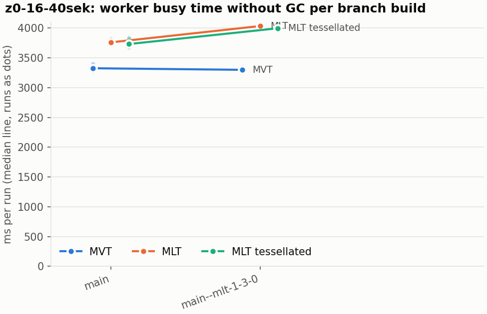
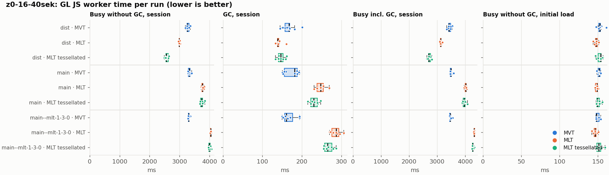
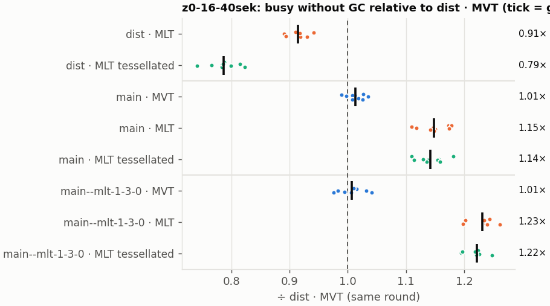
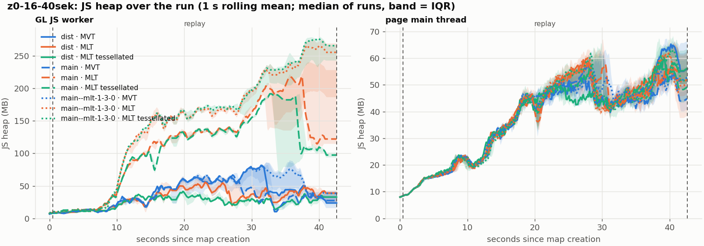
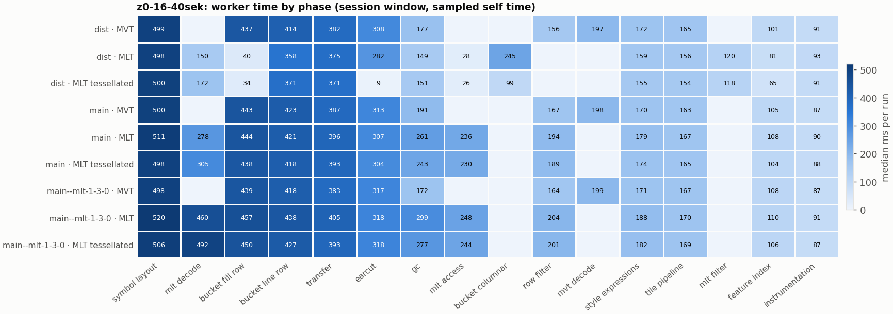

# Session trace benchmark — 20261106-165233

## Setup

- Created 2026-11-06T16:52:33+01:00; 10 repetitions + 1 warm-up round(s) (excluded); variants rotate per round (A B C, B C A, …); one cold browser context per run.
- Machine: , 16 logical cores, None GB RAM, Linux-7.2.9-200.nobara.fc44.x86_64-x86_64-with-glibc2.43; power: ?, AC None.
- GL JS gl7-local-files @ eb3231235c (dirty); worker count 1; viewport {'width': 1280, 'height': 1024}.
- Python 3.14.7, packages {'playwright': '1.64.1', 'numpy': '2.4.6', 'matplotlib': '3.10.8'}.

| variant | bundle | format | bundle sha256 | branch build |
|---|---|---|---|---|
| MVT | `dist/maplibre-gl-dev.mjs` | mvt | `4b8e23c84997` | – |
| MLT | `dist/maplibre-gl-dev.mjs` | mlt | `4b8e23c84997` | – |
| MLT tessellated | `dist/maplibre-gl-dev.mjs` | mlt-pre-tess | `4b8e23c84997` | – |
| main · MVT | `bench-builds/branches/main/maplibre-gl-dev.mjs` | mvt | `4243afebd841` | main @ bb38954083 (2026-10-26), MLT @ e286fed945 |
| main · MLT | `bench-builds/branches/main/maplibre-gl-dev.mjs` | mlt | `4243afebd841` | main @ bb38954083 (2026-10-26), MLT @ e286fed945 |
| main · MLT tessellated | `bench-builds/branches/main/maplibre-gl-dev.mjs` | mlt-pre-tess | `4243afebd841` | main @ bb38954083 (2026-10-26), MLT @ e286fed945 |
| main--mlt-1-3-0 · MVT | `bench-builds/branches/main--mlt-1-3-0/maplibre-gl-dev.mjs` | mvt | `8a63f3527a41` | main @ bb38954083 (2026-10-26), MLT @maplibre/mlt@1.3.0 (npm) |
| main--mlt-1-3-0 · MLT | `bench-builds/branches/main--mlt-1-3-0/maplibre-gl-dev.mjs` | mlt | `8a63f3527a41` | main @ bb38954083 (2026-10-26), MLT @maplibre/mlt@1.3.0 (npm) |
| main--mlt-1-3-0 · MLT tessellated | `bench-builds/branches/main--mlt-1-3-0/maplibre-gl-dev.mjs` | mlt-pre-tess | `8a63f3527a41` | main @ bb38954083 (2026-10-26), MLT @maplibre/mlt@1.3.0 (npm) |

| session | style | duration | frames | sha256 |
|---|---|---:|---:|---|
| z0-16-40sek | osm-bright | 42.1 s | 1739 | `55a2b8f22fe2` |

CPU sampling interval (median over runs): 159 µs.

## Definitions

- **busy** = wall time in which a GL JS worker thread runs a task (union of top-level task slices and GC slices on `DedicatedWorker thread`s), summed over workers. **GC** = union of `MinorGC`/`MajorGC`/`V8.GC*` slices on those threads. **busy without GC** = busy − GC (headline metric).
- **CPU** = thread time (`tdur`) of the same slices. Phase categories and functions come from the trace's CPU samples (self time), categorised by `config/categories.toml` (nearest matching frame, leaf to root).
- Windows: **load** = map creation → first idle; **session** = camera replay; **tail** = end of replay → idle; **total** = load + session + tail.
- Ratios are against **MVT**: ratio of medians with a bootstrap 95 % CI, the geometric mean of per-round ratios, and a two-sided Mann–Whitney U p-value (normal approximation, not corrected for multiple comparisons; rough below n = 8). Lower than 1× means less worker time.

## Session `z0-16-40sek`

### Worker busy without GC (session window)

| variant | n ok / failed | median ms | IQR | mean | ratio vs MVT | 95 % CI | geo-mean paired | MWU p |
|---|---:|---:|---:|---:|---:|---:|---:|---:|
| MVT | 9 / 0 | 3,259 | 3,251–3,312 | 3,280 | 1.00× | – | – | – |
| MLT | 7 / 0 | 2,988 | 2,986–2,998 | 2,991 | 0.92× | 0.89–0.92× | 0.91× | 0.001 |
| MLT tessellated | 9 / 0 | 2,558 | 2,548–2,623 | 2,581 | 0.78× | 0.77–0.81× | 0.79× | <0.001 |
| main · MVT | 9 / 0 | 3,327 | 3,289–3,344 | 3,323 | 1.02× | 0.99–1.03× | 1.01× | 0.093 |
| main · MLT | 9 / 0 | 3,761 | 3,748–3,781 | 3,767 | 1.15× | 1.12–1.16× | 1.15× | <0.001 |
| main · MLT tessellated | 9 / 0 | 3,733 | 3,704–3,771 | 3,745 | 1.15× | 1.12–1.17× | 1.14× | <0.001 |
| main--mlt-1-3-0 · MVT | 8 / 0 | 3,300 | 3,291–3,310 | 3,305 | 1.01× | 0.98–1.02× | 1.01× | 0.194 |
| main--mlt-1-3-0 · MLT | 7 / 0 | 4,035 | 4,031–4,044 | 4,036 | 1.24× | 1.20–1.24× | 1.23× | 0.001 |
| main--mlt-1-3-0 · MLT tessellated | 8 / 0 | 3,998 | 3,976–4,021 | 4,003 | 1.23× | 1.20–1.24× | 1.22× | <0.001 |

### All worker metrics (median, ratio vs baseline)

| metric | MVT | MLT | MLT tessellated | main · MVT | main · MLT | main · MLT tessellated | main--mlt-1-3-0 · MVT | main--mlt-1-3-0 · MLT | main--mlt-1-3-0 · MLT tessellated |
|---|---:|---:|---:|---:|---:|---:|---:|---:|---:|
| busy incl. GC | 3,426 | 3,127 (0.91×) | 2,712 (0.79×) | 3,494 (1.02×) | 4,018 (1.17×) | 3,962 (1.16×) | 3,466 (1.01×) | 4,315 (1.26×) | 4,266 (1.25×) |
| &nbsp;&nbsp;of which GC | 167.4 | 139.2 (0.83×) | 146.3 (0.87×) | 181.3 (1.08×) | 247.7 (1.48×) | 229.8 (1.37×) | 160.9 (0.96×) | 286.2 (1.71×) | 264.6 (1.58×) |
| &nbsp;&nbsp;of which busy without GC | 3,259 | 2,988 (0.92×) | 2,558 (0.78×) | 3,327 (1.02×) | 3,761 (1.15×) | 3,733 (1.15×) | 3,300 (1.01×) | 4,035 (1.24×) | 3,998 (1.23×) |
| &nbsp;&nbsp;&nbsp;&nbsp;of which filtering (sampled, incl. callees) | 155.8 | 120.2 (0.77×) | 117.7 (0.76×) | 167.5 (1.08×) | 193.7 (1.24×) | 189.0 (1.21×) | 163.7 (1.05×) | 203.7 (1.31×) | 201.4 (1.29×) |
| &nbsp;&nbsp;&nbsp;&nbsp;of which column decoding inside the MLT filter (sampled) | 0.0 | 37.6 | 37.5 | 0.0 | 0.0 | 0.0 | 0.0 | 0.0 | 0.0 |
| &nbsp;&nbsp;&nbsp;&nbsp;of which timing instrumentation (sampled) | 91.1 | 93.4 (1.03×) | 90.8 (1.00×) | 87.3 (0.96×) | 90.0 (0.99×) | 88.4 (0.97×) | 86.8 (0.95×) | 90.5 (0.99×) | 87.2 (0.96×) |
| busy without GC and instrumentation | 3,167 | 2,896 (0.91×) | 2,466 (0.78×) | 3,242 (1.02×) | 3,664 (1.16×) | 3,642 (1.15×) | 3,213 (1.01×) | 3,945 (1.25×) | 3,910 (1.23×) |
| CPU time without GC | 3,170 | 2,892 (0.91×) | 2,473 (0.78×) | 3,223 (1.02×) | 3,666 (1.16×) | 3,627 (1.14×) | 3,203 (1.01×) | 3,920 (1.24×) | 3,879 (1.22×) |
| tile: download end → sent to main thread, median per tile | 46.5 | 44.9 (0.97×) | 38.0 (0.82×) | 47.2 (1.02×) | 60.1 (1.29×) | 62.0 (1.33×) | 47.1 (1.01×) | 66.4 (1.43×) | 68.0 (1.46×) |
| tile: download end → sent to main thread, 90th percentile | 190.1 | 160.0 (0.84×) | 129.1 (0.68×) | 191.6 (1.01×) | 221.1 (1.16×) | 224.9 (1.18×) | 188.3 (0.99×) | 241.9 (1.27×) | 246.8 (1.30×) |
| tile: download end → sent to main thread, 95th percentile | 277.3 | 233.9 (0.84×) | 172.2 (0.62×) | 276.9 (1.00×) | 325.4 (1.17×) | 313.4 (1.13×) | 277.8 (1.00×) | 355.7 (1.28×) | 346.2 (1.25×) |
| tile: download end → sent to main thread, 99th percentile | 311.1 | 264.9 (0.85×) | 215.3 (0.69×) | 311.2 (1.00×) | 361.1 (1.16×) | 343.0 (1.10×) | 309.9 (1.00×) | 394.9 (1.27×) | 395.7 (1.27×) |
| minor GCs | 93.00 | 69.00 (0.74×) | 39.00 (0.42×) | 93.00 (1.00×) | 100.00 (1.08×) | 99.00 (1.06×) | 95.50 (1.03×) | 104.00 (1.12×) | 105.00 (1.13×) |
| major GCs | 7.00 | 9.00 (1.29×) | 12.00 (1.71×) | 10.00 (1.43×) | 4.00 (0.57×) | 4.00 (0.57×) | 5.50 (0.79×) | 4.00 (0.57×) | 4.00 (0.57×) |
| peak worker heap (MB) | 91.5 | 68.4 (0.75×) | 59.8 (0.65×) | 77.2 (0.84×) | 248.5 (2.72×) | 209.9 (2.30×) | 94.6 (1.03×) | 277.8 (3.04×) | 284.1 (3.11×) |
| load: busy without GC | 152.4 | 147.9 (0.97×) | 153.6 (1.01×) | 151.4 (0.99×) | 149.0 (0.98×) | 149.3 (0.98×) | 148.4 (0.97×) | 146.3 (0.96×) | 151.4 (0.99×) |
| load: GC | 7.2 | 6.7 (0.93×) | 7.4 (1.03×) | 7.6 (1.05×) | 7.5 (1.05×) | 7.8 (1.09×) | 7.3 (1.02×) | 7.2 (1.01×) | 7.4 (1.03×) |
| total: busy without GC | 3,412 | 3,138 (0.92×) | 2,706 (0.79×) | 3,477 (1.02×) | 3,912 (1.15×) | 3,886 (1.14×) | 3,451 (1.01×) | 4,182 (1.23×) | 4,151 (1.22×) |

Rows marked *of which* are parts of the row above, not additional time. Tile rows are per-tile latencies (medians over tiles, then over runs), not sums: tiles overlap in time, and the medians of the parse and queue parts do not add up exactly to the median latency.

### Filtering (session window)

Sampled worker time spent in feature filtering, including everything the filter calls (expression evaluation, property access): **row filter** = the style-spec feature filter that MVT runs per feature, **mlt filter** = the columnar MLT filter (incl. the geometry-type selection), without the columns it decodes (see the next table). Medians per run; rules in `config/categories.toml`.

| variant | mlt filter | row filter | filtering | ratio vs MVT | 95 % CI | MWU p | share of sampled busy |
|---|---:|---:|---:|---:|---:|---:|---:|
| MVT | 0.0 | 155.6 | 155.8 | 1.00× | – | – | 5.0% |
| MLT | 120.2 | 0.0 | 120.2 | 0.77× | 0.70–0.80× | 0.001 | 4.2% |
| MLT tessellated | 117.7 | 0.0 | 117.7 | 0.76× | 0.69–0.79× | <0.001 | 4.8% |
| main · MVT | 0.0 | 167.5 | 167.5 | 1.08× | 0.99–1.11× | 0.064 | 5.2% |
| main · MLT | 0.0 | 193.7 | 193.7 | 1.24× | 1.14–1.27× | <0.001 | 5.2% |
| main · MLT tessellated | 0.0 | 189.0 | 189.0 | 1.21× | 1.12–1.24× | <0.001 | 5.1% |
| main--mlt-1-3-0 · MVT | 0.0 | 163.7 | 163.7 | 1.05× | 0.97–1.07× | 0.470 | 5.1% |
| main--mlt-1-3-0 · MLT | 0.0 | 203.7 | 203.7 | 1.31× | 1.21–1.33× | 0.001 | 5.0% |
| main--mlt-1-3-0 · MLT tessellated | 0.0 | 201.4 | 201.4 | 1.29× | 1.19–1.33× | <0.001 | 5.1% |

**Filtering together with tile decoding.** The MLT decoder leaves columns encoded until something reads them, and the filter is usually the first reader: the columns it decodes (properties, and the geometry for `$type`) are **of which inside the filter** (phase *mlt filter decode*), the rest is *mlt decode* (geometry and columns read later, e.g. by paint properties and symbols). MVT decodes every feature's properties and geometry while it reads the tile (*mvt decode*), whether the filter keeps the feature or not. So **filtering** above compares the filters, and **decoding + filtering** compares all that the formats spend on decoding the tile and selecting features. **tile decoding** = *mvt decode* or *mlt decode* + *mlt filter decode*: work inside a call into a decoder. Reading data that is already decoded is not counted, as for MVT's feature objects: *mlt access* (row views, value getters, looking a column up by name) and the MLT facade (*mlt facade*). MVT decodes geometry only for the features its filter keeps, MLT decodes a layer's whole geometry column.

| variant | tile decoding | of which inside the filter | filtering | decoding + filtering | ratio vs MVT | 95 % CI | MWU p |
|---|---:|---:|---:|---:|---:|---:|---:|
| MVT | 196.7 | 0.0 | 155.8 | 355.1 | 1.00× | – | – |
| MLT | 186.8 | 37.6 | 120.2 | 306.9 | 0.86× | 0.83–0.90× | 0.001 |
| MLT tessellated | 209.7 | 37.5 | 117.7 | 324.0 | 0.91× | 0.87–0.95× | <0.001 |
| main · MVT | 197.9 | 0.0 | 167.5 | 369.5 | 1.04× | 0.98–1.07× | 0.077 |
| main · MLT | 277.9 | 0.0 | 193.7 | 473.5 | 1.33× | 1.28–1.37× | <0.001 |
| main · MLT tessellated | 305.0 | 0.0 | 189.0 | 492.3 | 1.39× | 1.33–1.43× | <0.001 |
| main--mlt-1-3-0 · MVT | 199.0 | 0.0 | 163.7 | 361.8 | 1.02× | 0.97–1.05× | 0.413 |
| main--mlt-1-3-0 · MLT | 460.0 | 0.0 | 203.7 | 663.7 | 1.87× | 1.78–1.93× | 0.001 |
| main--mlt-1-3-0 · MLT tessellated | 491.6 | 0.0 | 201.4 | 693.0 | 1.95× | 1.88–2.01× | <0.001 |

Top 12 functions inside filtering and its column decoding (self time, mean ms per run):

| phase | function | source | MVT | MLT | MLT tessellated | main · MVT | main · MLT | main · MLT tessellated | main--mlt-1-3-0 · MVT | main--mlt-1-3-0 · MLT | main--mlt-1-3-0 · MLT tessellated |
|---|---|---|---:|---:|---:|---:|---:|---:|---:|---:|---:|
| row filter | `evaluate` | node_modules/@maplibre/maplibre-gl-style-spec/dist/expression/compound_expression.mjs | 49.5 | 0.0 | 0.0 | 51.6 | 73.5 | 70.0 | 48.5 | 76.9 | 78.1 |
| row filter | `CompoundExpression.register.filter-in-small` | node_modules/@maplibre/maplibre-gl-style-spec/dist/expression/compound_expression.mjs | 22.1 | 0.0 | 0.0 | 21.5 | 24.3 | 24.0 | 22.7 | 28.0 | 26.3 |
| row filter | `CompoundExpression.register.filter-==` | node_modules/@maplibre/maplibre-gl-style-spec/dist/expression/compound_expression.mjs | 20.1 | 0.0 | 0.0 | 19.2 | 23.1 | 22.3 | 19.5 | 22.2 | 23.8 |
| row filter | `evaluate` | node_modules/@maplibre/maplibre-gl-style-spec/dist/expression/index.mjs | 18.0 | 0.0 | 0.0 | 21.8 | 21.9 | 21.1 | 21.0 | 23.0 | 21.1 |
| row filter | `filter` | node_modules/@maplibre/maplibre-gl-style-spec/dist/feature_filter/index.mjs | 12.6 | 0.0 | 0.0 | 13.6 | 12.5 | 13.2 | 12.3 | 12.6 | 12.3 |
| mlt filter | `scanDictionaryCodes` | maplibre-tile-spec/ts/dist/processing/filter/execution/filterKernel.js | 0.0 | 13.0 | 12.2 | 0.0 | 0.0 | 0.0 | 0.0 | 0.0 | 0.0 |
| row filter | `CompoundExpression.register.all.overloads` | node_modules/@maplibre/maplibre-gl-style-spec/dist/expression/compound_expression.mjs | 11.0 | 0.0 | 0.0 | 11.9 | 11.1 | 12.3 | 11.4 | 11.9 | 12.5 |
| mlt filter | `dictionaryRowMatches` | maplibre-tile-spec/ts/dist/processing/filter/execution/filterKernel.js | 0.0 | 10.8 | 11.4 | 0.0 | 0.0 | 0.0 | 0.0 | 0.0 | 0.0 |
| mlt filter | `filterByGeometryType` | maplibre-tile-spec/ts/dist/vector/geometry/geometryVector.js | 0.0 | 9.4 | 10.6 | 0.0 | 0.0 | 0.0 | 0.0 | 0.0 | 0.0 |
| mlt filter | `bytesEqual` | maplibre-tile-spec/ts/dist/processing/filter/execution/filterKernel.js | 0.0 | 7.8 | 7.5 | 0.0 | 0.0 | 0.0 | 0.0 | 0.0 | 0.0 |
| mlt filter | `resolveDictionaryExecutor` | maplibre-tile-spec/ts/dist/processing/filter/execution/filterKernel.js | 0.0 | 7.3 | 7.2 | 0.0 | 0.0 | 0.0 | 0.0 | 0.0 | 0.0 |
| row filter | `CompoundExpression.register.filter-type-==` | node_modules/@maplibre/maplibre-gl-style-spec/dist/expression/compound_expression.mjs | 6.4 | 0.0 | 0.0 | 6.5 | 6.6 | 6.1 | 5.9 | 6.2 | 6.5 |

### Bucket time by layer type (session window)

Sampled self time of the bucket code per layer type, row and columnar path together (median ms per run). **shared bucket code** is code all layer types use (`src/data/bucket/*` outside the layer files, `columnar_populate.ts`, `columnar_mesh_arrays.ts`, `load_geometry.ts`). **earcut** triangulates for fill and fill-extrusion on the row path; **pre-tess mesh** takes over the stored triangles of a pre-tessellated fill. **symbol** is the whole symbol layout phase. For exact wall time per source layer and type see the timing log tables below (builds with `worker_timing.ts` only).

| variant | fill | fill-extrusion | line | symbol | shared bucket code | earcut | pre-tess mesh | total |
|---|---:|---:|---:|---:|---:|---:|---:|---:|
| MVT | 437.0 | 0.0 | 414.2 | 499.1 | 38.0 | 308.1 | 0.0 | 1,685 |
| MLT | 55.4 | 0.0 | 363.4 | 497.8 | 259.1 | 282.0 | 2.9 | 1,477 |
| MLT tessellated | 43.1 | 0.0 | 376.7 | 500.0 | 111.0 | 9.0 | 12.5 | 1,046 |
| main · MVT | 443.1 | 0.0 | 422.7 | 500.1 | 37.8 | 312.9 | 0.0 | 1,717 |
| main · MLT | 444.1 | 0.0 | 421.2 | 510.8 | 42.5 | 307.0 | 0.0 | 1,728 |
| main · MLT tessellated | 438.3 | 0.0 | 417.6 | 497.6 | 40.7 | 304.1 | 0.0 | 1,691 |
| main--mlt-1-3-0 · MVT | 438.9 | 0.0 | 418.5 | 498.0 | 38.8 | 316.5 | 0.0 | 1,712 |
| main--mlt-1-3-0 · MLT | 457.4 | 0.0 | 437.6 | 519.8 | 41.9 | 318.2 | 0.0 | 1,772 |
| main--mlt-1-3-0 · MLT tessellated | 449.7 | 0.0 | 427.0 | 506.0 | 40.4 | 317.9 | 0.0 | 1,738 |

### Where the variants differ from MVT (session window, mean ms per run)

Open **[flame.html](flame.html)** to explore the call tree interactively: pick a variant, compare it with MVT (red = more time at the same call path, blue = less), click a frame to zoom in, and read the phase and function breakdown under it. Without a comparison, frames are coloured by phase: filtering is green in both formats, and the columns the MLT filter decodes on first access (*mlt filter decode*) are MLT blue frames under the green filter. `flame/*.txt` open in https://www.speedscope.app.

#### MLT vs MVT

**By phase** (sampled self time; the Δ column sums to the difference in sampled busy time):

| phase | MVT | MLT | Δ |
|---|---:|---:|---:|
| bucket columnar | 0.0 | 246.2 | +246.2 |
| mlt decode | 0.0 | 150.1 | +150.1 |
| mlt filter | 0.1 | 120.3 | +120.2 |
| mlt filter decode | 0.0 | 38.0 | +38.0 |
| mlt facade | 0.1 | 29.3 | +29.1 |
| mlt access | 0.0 | 27.8 | +27.8 |
| bucket fill columnar | 0.0 | 16.8 | +16.8 |
| bucket line columnar | 0.0 | 5.0 | +5.0 |
| pre-tess mesh | 0.0 | 3.7 | +3.7 |
| instrumentation | 90.1 | 92.7 | +2.6 |
| symbol layout | 500.2 | 498.9 | -1.3 |
| runtime | 13.3 | 10.7 | -2.7 |
| transfer | 381.8 | 376.7 | -5.1 |
| tile pipeline | 164.7 | 155.2 | -9.5 |
| style expressions | 171.6 | 159.6 | -12.0 |
| earcut | 308.3 | 286.7 | -21.6 |
| feature index | 102.5 | 80.2 | -22.2 |
| bucket row | 38.0 | 12.5 | -25.5 |
| gc | 176.9 | 151.1 | -25.9 |
| bucket line row | 415.1 | 360.8 | -54.3 |
| row filter | 159.4 | 0.0 | -159.4 |
| mvt decode | 197.0 | 0.0 | -197.0 |
| bucket fill row | 434.6 | 37.8 | -396.8 |

**Functions with the largest self-time difference** (by function name, summed over source files):

| function | MVT | MLT | Δ |
|---|---:|---:|---:|
| `buildRingBoundingBoxes` | 0.0 | 26.0 | +26.0 |
| `buildEarcutMesh` | 0.0 | 24.7 | +24.7 |
| `writeEarcutFill` | 0.0 | 22.3 | +22.3 |
| `decodeComponentwiseDeltaVec2` | 0.0 | 20.3 | +20.3 |
| `signedArea$2` | 4.4 | 22.0 | +17.6 |
| `readScaledRings` | 0.0 | 14.1 | +14.1 |
| `scanDictionaryCodes` | 0.0 | 13.0 | +13.0 |
| `fillLargeMeshArrays` | 22.4 | 34.8 | +12.4 |
| `get` | 25.5 | 37.9 | +12.4 |
| `decodeString$2` | 0.0 | 11.1 | +11.1 |
| `dictionaryRowMatches` | 0.0 | 10.8 | +10.8 |
| `decodeFsst` | 0.0 | 10.0 | +10.0 |
| `_vertexToIndex` | 139.9 | 0.8 | -139.1 |
| `populate` | 92.0 | 8.2 | -83.8 |
| `evaluate` | 85.1 | 19.8 | -65.4 |
| `readVarint` | 53.0 | 2.3 | -50.8 |
| `loadGeometry` | 61.6 | 11.6 | -49.9 |

#### MLT tessellated vs MVT

**By phase** (sampled self time; the Δ column sums to the difference in sampled busy time):

| phase | MVT | MLT tessellated | Δ |
|---|---:|---:|---:|
| mlt decode | 0.0 | 172.1 | +172.1 |
| mlt filter | 0.1 | 118.4 | +118.4 |
| bucket columnar | 0.0 | 98.6 | +98.6 |
| mlt filter decode | 0.0 | 36.7 | +36.7 |
| mlt facade | 0.1 | 33.2 | +33.0 |
| mlt access | 0.0 | 26.8 | +26.8 |
| pre-tess mesh | 0.0 | 12.3 | +12.3 |
| bucket fill columnar | 0.0 | 9.6 | +9.6 |
| bucket line columnar | 0.0 | 5.0 | +5.0 |
| symbol layout | 500.2 | 503.5 | +3.2 |
| instrumentation | 90.1 | 91.7 | +1.6 |
| runtime | 13.3 | 10.3 | -3.0 |
| tile pipeline | 164.7 | 153.7 | -11.0 |
| transfer | 381.8 | 370.0 | -11.8 |
| style expressions | 171.6 | 154.5 | -17.1 |
| gc | 176.9 | 153.0 | -23.9 |
| bucket row | 38.0 | 11.4 | -26.6 |
| feature index | 102.5 | 65.4 | -37.1 |
| bucket line row | 415.1 | 371.8 | -43.3 |
| row filter | 159.4 | 0.0 | -159.4 |
| mvt decode | 197.0 | 0.0 | -197.0 |
| earcut | 308.3 | 9.4 | -298.9 |
| bucket fill row | 434.6 | 33.2 | -401.4 |

**Functions with the largest self-time difference** (by function name, summed over source files):

| function | MVT | MLT tessellated | Δ |
|---|---:|---:|---:|
| `writeTessellatedFill` | 0.0 | 24.8 | +24.8 |
| `decodeComponentwiseDeltaVec2` | 0.0 | 19.4 | +19.4 |
| `decodeUnsignedZigZagDeltaInt32` | 0.0 | 18.1 | +18.1 |
| `buildTessellatedBoundingBox` | 0.0 | 12.2 | +12.2 |
| `scanDictionaryCodes` | 0.0 | 12.2 | +12.2 |
| `decodeString$2` | 0.0 | 11.6 | +11.6 |
| `dictionaryRowMatches` | 0.0 | 11.4 | +11.4 |
| `get` | 25.5 | 36.8 | +11.2 |
| `filterByGeometryType` | 0.0 | 10.6 | +10.6 |
| `decodeFastPforInt32` | 0.0 | 10.4 | +10.4 |
| `decodeFsst` | 0.0 | 9.7 | +9.7 |
| `readVertices` | 0.0 | 9.2 | +9.2 |
| `_vertexToIndex` | 139.9 | 0.6 | -139.3 |
| `isEar` | 95.7 | 1.5 | -94.2 |
| `populate` | 92.0 | 8.3 | -83.7 |
| `evaluate` | 85.1 | 18.2 | -67.0 |
| `loadGeometry` | 61.6 | 10.2 | -51.3 |

#### main · MVT vs MVT

**By phase** (sampled self time; the Δ column sums to the difference in sampled busy time):

| phase | MVT | main · MVT | Δ |
|---|---:|---:|---:|
| bucket line row | 415.1 | 426.4 | +11.3 |
| transfer | 381.8 | 389.8 | +8.0 |
| row filter | 159.4 | 167.2 | +7.8 |
| bucket fill row | 434.6 | 441.3 | +6.7 |
| gc | 176.9 | 182.5 | +5.5 |
| feature index | 102.5 | 106.7 | +4.3 |
| earcut | 308.3 | 312.2 | +3.9 |
| mvt decode | 197.0 | 198.5 | +1.5 |
| symbol layout | 500.2 | 501.0 | +0.8 |
| style expressions | 171.6 | 169.2 | -2.4 |
| instrumentation | 90.1 | 87.5 | -2.6 |

**Functions with the largest self-time difference** (by function name, summed over source files):

| function | MVT | main · MVT | Δ |
|---|---:|---:|---:|
| `hasLineDasharray` | 0.2 | 41.9 | +41.7 |
| `evaluate` | 85.1 | 92.4 | +7.2 |
| `(garbage collector)` | 176.9 | 182.5 | +5.5 |
| `reserve` | 199.6 | 205.0 | +5.4 |
| `signedArea$1` | 0.0 | 4.6 | +4.6 |
| `serialize` | 94.9 | 99.5 | +4.6 |
| `ProgramConfiguration` | 46.0 | 50.3 | +4.3 |
| `readUtf8$1` | 0.0 | 3.4 | +3.4 |
| `addCurrentVertex` | 29.3 | 32.5 | +3.2 |
| `_vertexToIndex` | 139.9 | 142.9 | +2.9 |
| `isEar` | 95.7 | 98.0 | +2.3 |
| `copyImage` | 20.8 | 22.9 | +2.1 |
| `addSymbolFeature` | 13.1 | 0.0 | -13.1 |
| `populate` | 92.0 | 78.9 | -13.1 |
| `addBucketFeatures` | 12.3 | 0.0 | -12.3 |
| `signedArea$2` | 4.4 | 0.0 | -4.4 |
| `_trim` | 87.6 | 83.8 | -3.8 |

#### main · MLT vs MVT

**By phase** (sampled self time; the Δ column sums to the difference in sampled busy time):

| phase | MVT | main · MLT | Δ |
|---|---:|---:|---:|
| mlt decode | 0.0 | 279.6 | +279.6 |
| mlt access | 0.0 | 236.9 | +236.9 |
| gc | 176.9 | 259.0 | +82.1 |
| mlt facade | 0.1 | 75.0 | +74.9 |
| row filter | 159.4 | 193.7 | +34.4 |
| transfer | 381.8 | 396.5 | +14.8 |
| bucket fill row | 434.6 | 447.8 | +13.2 |
| bucket line row | 415.1 | 425.9 | +10.8 |
| symbol layout | 500.2 | 510.2 | +9.9 |
| style expressions | 171.6 | 179.7 | +8.1 |
| feature index | 102.5 | 108.3 | +5.8 |
| bucket row | 38.0 | 42.3 | +4.3 |
| runtime | 13.3 | 15.4 | +2.1 |
| tile pipeline | 164.7 | 166.1 | +1.4 |
| earcut | 308.3 | 309.4 | +1.0 |
| other | 7.2 | 8.2 | +0.9 |
| mvt decode | 197.0 | 0.0 | -197.0 |

**Functions with the largest self-time difference** (by function name, summed over source files):

| function | MVT | main · MLT | Δ |
|---|---:|---:|---:|
| `getFeatures` | 0.0 | 111.0 | +111.0 |
| `(garbage collector)` | 176.9 | 259.0 | +82.1 |
| `decodeString$2` | 0.0 | 71.7 | +71.7 |
| `hasLineDasharray` | 0.2 | 44.3 | +44.2 |
| `convertGeometryVector` | 0.0 | 36.1 | +36.1 |
| `evaluate` | 85.1 | 113.9 | +28.7 |
| `decodeComponentwiseDeltaVec2` | 0.0 | 22.2 | +22.2 |
| `unpackNullable` | 0.0 | 18.4 | +18.4 |
| `getLineStringOrRing` | 0.0 | 17.8 | +17.8 |
| `getValue` | 0.0 | 15.9 | +15.9 |
| `loadGeometry` | 61.6 | 76.2 | +14.7 |
| `reserve` | 199.6 | 212.5 | +12.9 |
| `readVarint` | 53.0 | 1.9 | -51.2 |
| `readString` | 29.9 | 0.0 | -29.9 |
| `VectorTileFeature` | 29.9 | 0.0 | -29.9 |
| `readSVarint` | 26.8 | 0.0 | -26.8 |
| `populate` | 92.0 | 76.4 | -15.6 |

#### main · MLT tessellated vs MVT

**By phase** (sampled self time; the Δ column sums to the difference in sampled busy time):

| phase | MVT | main · MLT tessellated | Δ |
|---|---:|---:|---:|
| mlt decode | 0.0 | 305.1 | +305.1 |
| mlt access | 0.0 | 230.3 | +230.3 |
| mlt facade | 0.1 | 70.6 | +70.4 |
| gc | 176.9 | 241.3 | +64.4 |
| row filter | 159.4 | 189.5 | +30.1 |
| transfer | 381.8 | 394.3 | +12.5 |
| bucket fill row | 434.6 | 439.6 | +5.0 |
| bucket line row | 415.1 | 418.7 | +3.6 |
| style expressions | 171.6 | 175.0 | +3.4 |
| tile pipeline | 164.7 | 167.4 | +2.7 |
| feature index | 102.5 | 105.1 | +2.6 |
| bucket row | 38.0 | 40.1 | +2.1 |
| other | 7.2 | 8.7 | +1.5 |
| runtime | 13.3 | 14.5 | +1.2 |
| symbol layout | 500.2 | 498.0 | -2.2 |
| instrumentation | 90.1 | 87.8 | -2.4 |
| earcut | 308.3 | 304.7 | -3.6 |
| mvt decode | 197.0 | 0.0 | -197.0 |

**Functions with the largest self-time difference** (by function name, summed over source files):

| function | MVT | main · MLT tessellated | Δ |
|---|---:|---:|---:|
| `getFeatures` | 0.0 | 108.1 | +108.1 |
| `decodeString$2` | 0.0 | 70.8 | +70.8 |
| `(garbage collector)` | 176.9 | 241.3 | +64.4 |
| `hasLineDasharray` | 0.2 | 44.5 | +44.3 |
| `convertGeometryVector` | 0.0 | 34.1 | +34.1 |
| `evaluate` | 85.1 | 109.0 | +23.9 |
| `decodeComponentwiseDeltaVec2` | 0.0 | 21.1 | +21.1 |
| `decodeUnsignedZigZagDeltaInt32` | 0.0 | 18.2 | +18.2 |
| `unpackNullable` | 0.0 | 17.6 | +17.6 |
| `getLineStringOrRing` | 0.0 | 16.5 | +16.5 |
| `getValue` | 0.0 | 14.9 | +14.9 |
| `decodeFastPforInt32` | 0.0 | 13.8 | +13.8 |
| `readVarint` | 53.0 | 1.8 | -51.2 |
| `readString` | 29.9 | 0.0 | -29.9 |
| `VectorTileFeature` | 29.9 | 0.0 | -29.9 |
| `readSVarint` | 26.8 | 0.0 | -26.8 |
| `populate` | 92.0 | 72.4 | -19.6 |

#### main--mlt-1-3-0 · MVT vs MVT

**By phase** (sampled self time; the Δ column sums to the difference in sampled busy time):

| phase | MVT | main--mlt-1-3-0 · MVT | Δ |
|---|---:|---:|---:|
| earcut | 308.3 | 315.1 | +6.8 |
| bucket line row | 415.1 | 420.6 | +5.5 |
| feature index | 102.5 | 107.7 | +5.2 |
| row filter | 159.4 | 162.2 | +2.8 |
| bucket fill row | 434.6 | 437.2 | +2.6 |
| transfer | 381.8 | 383.3 | +1.6 |
| tile pipeline | 164.7 | 166.2 | +1.5 |
| mvt decode | 197.0 | 198.4 | +1.4 |
| bucket row | 38.0 | 39.0 | +1.0 |
| other | 7.2 | 8.0 | +0.8 |
| gc | 176.9 | 177.6 | +0.6 |
| symbol layout | 500.2 | 499.6 | -0.6 |
| runtime | 13.3 | 12.6 | -0.7 |
| style expressions | 171.6 | 168.8 | -2.8 |
| instrumentation | 90.1 | 86.7 | -3.4 |

**Functions with the largest self-time difference** (by function name, summed over source files):

| function | MVT | main--mlt-1-3-0 · MVT | Δ |
|---|---:|---:|---:|
| `hasLineDasharray` | 0.2 | 42.7 | +42.5 |
| `Point` | 0.0 | 13.4 | +13.4 |
| `signedArea$1` | 0.0 | 5.1 | +5.1 |
| `loadGeometry` | 61.6 | 65.4 | +3.8 |
| `insert` | 49.0 | 52.5 | +3.5 |
| `readUtf8$1` | 0.0 | 3.4 | +3.4 |
| `serialize` | 94.9 | 97.8 | +2.9 |
| `ProgramConfiguration` | 46.0 | 48.8 | +2.7 |
| `resize` | 11.2 | 13.2 | +2.0 |
| `addFeature` | 36.1 | 37.9 | +1.8 |
| `fetch` | 43.8 | 45.6 | +1.8 |
| `earcut` | 18.2 | 19.9 | +1.7 |
| `populate` | 92.0 | 75.9 | -16.1 |
| `Point$1` | 13.8 | 0.0 | -13.8 |
| `addSymbolFeature` | 13.1 | 0.0 | -13.1 |
| `addBucketFeatures` | 12.3 | 0.0 | -12.3 |
| `signedArea$2` | 4.4 | 0.0 | -4.4 |

#### main--mlt-1-3-0 · MLT vs MVT

**By phase** (sampled self time; the Δ column sums to the difference in sampled busy time):

| phase | MVT | main--mlt-1-3-0 · MLT | Δ |
|---|---:|---:|---:|
| mlt decode | 0.0 | 459.2 | +459.2 |
| mlt access | 0.0 | 251.1 | +251.1 |
| gc | 176.9 | 298.9 | +121.9 |
| mlt facade | 0.1 | 81.4 | +81.3 |
| row filter | 159.4 | 201.5 | +42.1 |
| bucket fill row | 434.6 | 458.7 | +24.1 |
| transfer | 381.8 | 405.3 | +23.6 |
| symbol layout | 500.2 | 521.5 | +21.3 |
| style expressions | 171.6 | 189.6 | +18.0 |
| bucket line row | 415.1 | 432.6 | +17.5 |
| earcut | 308.3 | 317.0 | +8.7 |
| feature index | 102.5 | 109.3 | +6.8 |
| tile pipeline | 164.7 | 169.0 | +4.3 |
| bucket row | 38.0 | 42.1 | +4.2 |
| runtime | 13.3 | 15.5 | +2.2 |
| other | 7.2 | 8.8 | +1.6 |
| mvt decode | 197.0 | 0.0 | -197.0 |

**Functions with the largest self-time difference** (by function name, summed over source files):

| function | MVT | main--mlt-1-3-0 · MLT | Δ |
|---|---:|---:|---:|
| `(garbage collector)` | 176.9 | 298.9 | +121.9 |
| `getFeatures` | 0.0 | 106.1 | +106.1 |
| `createDecoderWorkspace` | 0.0 | 100.2 | +100.2 |
| `decodeString$2` | 0.0 | 97.7 | +97.7 |
| `hasLineDasharray` | 0.2 | 43.5 | +43.4 |
| `convertGeometryVector` | 0.0 | 36.8 | +36.8 |
| `evaluate` | 85.1 | 119.9 | +34.8 |
| `getValue` | 0.0 | 31.6 | +31.6 |
| `unpackNullable` | 0.0 | 23.6 | +23.6 |
| `Point` | 0.0 | 23.1 | +23.1 |
| `reserve` | 199.6 | 222.4 | +22.7 |
| `decodeComponentwiseDeltaVec2` | 0.0 | 20.5 | +20.5 |
| `readVarint` | 53.0 | 0.0 | -53.0 |
| `readString` | 29.9 | 0.0 | -29.9 |
| `VectorTileFeature` | 29.9 | 0.0 | -29.9 |
| `readSVarint` | 26.8 | 0.0 | -26.8 |
| `populate` | 92.0 | 74.9 | -17.1 |

#### main--mlt-1-3-0 · MLT tessellated vs MVT

**By phase** (sampled self time; the Δ column sums to the difference in sampled busy time):

| phase | MVT | main--mlt-1-3-0 · MLT tessellated | Δ |
|---|---:|---:|---:|
| mlt decode | 0.0 | 492.0 | +492.0 |
| mlt access | 0.0 | 242.9 | +242.9 |
| gc | 176.9 | 279.8 | +102.8 |
| mlt facade | 0.1 | 80.4 | +80.3 |
| row filter | 159.4 | 201.4 | +42.1 |
| bucket fill row | 434.6 | 451.8 | +17.2 |
| transfer | 381.8 | 392.1 | +10.3 |
| style expressions | 171.6 | 181.1 | +9.5 |
| symbol layout | 500.2 | 507.6 | +7.4 |
| bucket line row | 415.1 | 422.4 | +7.3 |
| earcut | 308.3 | 314.7 | +6.3 |
| tile pipeline | 164.7 | 168.7 | +4.0 |
| feature index | 102.5 | 106.4 | +3.9 |
| runtime | 13.3 | 16.4 | +3.1 |
| bucket row | 38.0 | 40.3 | +2.4 |
| other | 7.2 | 8.9 | +1.6 |
| instrumentation | 90.1 | 87.2 | -2.9 |
| mvt decode | 197.0 | 0.0 | -197.0 |

**Functions with the largest self-time difference** (by function name, summed over source files):

| function | MVT | main--mlt-1-3-0 · MLT tessellated | Δ |
|---|---:|---:|---:|
| `createDecoderWorkspace` | 0.0 | 106.4 | +106.4 |
| `getFeatures` | 0.0 | 105.0 | +105.0 |
| `(garbage collector)` | 176.9 | 279.8 | +102.8 |
| `decodeString$2` | 0.0 | 95.2 | +95.2 |
| `hasLineDasharray` | 0.2 | 42.8 | +42.6 |
| `convertGeometryVector` | 0.0 | 36.9 | +36.9 |
| `evaluate` | 85.1 | 117.5 | +32.3 |
| `getValue` | 0.0 | 31.7 | +31.7 |
| `unpackNullable` | 0.0 | 22.1 | +22.1 |
| `Point` | 0.0 | 21.5 | +21.5 |
| `reserve` | 199.6 | 220.3 | +20.6 |
| `decodeUnsignedZigZagDeltaInt32` | 0.0 | 20.6 | +20.6 |
| `readVarint` | 53.0 | 0.0 | -53.0 |
| `readString` | 29.9 | 0.0 | -29.9 |
| `VectorTileFeature` | 29.9 | 0.0 | -29.9 |
| `readSVarint` | 26.8 | 0.0 | -26.8 |
| `populate` | 92.0 | 67.8 | -24.2 |

### Memory (session window)

**JS heap** = V8's used heap of the thread (`jsHeapSizeUsed` from the trace's `UpdateCounters`, about every 20 ms; the mean is time-weighted). It does not include ArrayBuffer contents, so the tile data itself (vertex, index and feature-index arrays) is not in it: **tile data sent to the main thread** is the size of the ArrayBuffers each tile result transfers (`web/worker_hook.js`), which then live on the main thread and are uploaded to the GPU. **garbage collected** = heap freed by the worker's GCs, a measure of how much it allocates. Medians per run; ratio of medians with a bootstrap 95 % CI.

| metric | MVT | MLT | MLT tessellated | main · MVT | main · MLT | main · MLT tessellated | main--mlt-1-3-0 · MVT | main--mlt-1-3-0 · MLT | main--mlt-1-3-0 · MLT tessellated |
|---|---:|---:|---:|---:|---:|---:|---:|---:|---:|
| worker JS heap, mean (MB) | 32.4 | 27.8 (0.86×, 0.66–1.18×) | 20.3 (0.62×, 0.50–0.86×) | 28.8 (0.89×, 0.67–1.28×) | 106.4 (3.28×, 2.47–4.38×) | 96.9 (2.99×, 2.17–3.95×) | 37.3 (1.15×, 0.82–1.56×) | 139.1 (4.29×, 3.21–5.72×) | 144.4 (4.45×, 3.39–5.74×) |
| worker JS heap, peak (MB) | 91.5 | 68.4 (0.75×, 0.61–0.99×) | 59.8 (0.65×, 0.56–0.83×) | 77.2 (0.84×, 0.75–1.14×) | 248.5 (2.72×, 2.25–3.47×) | 209.9 (2.30×, 1.91–2.75×) | 94.6 (1.03×, 0.86–1.26×) | 277.8 (3.04×, 2.63–3.74×) | 284.1 (3.11×, 2.45–3.84×) |
| worker JS heap after the last GC (MB) | 14.1 | 26.0 (1.84×, 0.52–3.36×) | 14.4 (1.02×, 0.38–1.78×) | 17.6 (1.24×, 0.65–2.08×) | 111.3 (7.88×, 4.29–22.43×) | 88.6 (6.28×, 3.85–9.65×) | 22.0 (1.56×, 0.68–2.47×) | 253.6 (17.96×, 5.50–26.50×) | 256.9 (18.19×, 9.85–26.30×) |
| garbage collected in the worker (MB) | 2,489 | 1,673 (0.67×, 0.66–0.68×) | 997.4 (0.40×, 0.39–0.41×) | 2,496 (1.00×, 0.99–1.02×) | 2,647 (1.06×, 1.02–1.08×) | 2,641 (1.06×, 1.05–1.08×) | 2,491 (1.00×, 0.99–1.01×) | 2,625 (1.05×, 1.04–1.09×) | 2,625 (1.05×, 1.04–1.07×) |
| main thread JS heap, mean (MB) | 34.1 | 34.9 (1.02×, 0.96–1.07×) | 34.4 (1.01×, 0.93–1.06×) | 33.5 (0.98×, 0.92–1.03×) | 34.8 (1.02×, 0.93–1.06×) | 34.1 (1.00×, 0.93–1.05×) | 35.6 (1.05×, 0.94–1.08×) | 34.2 (1.00×, 0.94–1.06×) | 35.0 (1.03×, 0.96–1.06×) |
| main thread JS heap, peak (MB) | 75.8 | 75.7 (1.00×, 0.91–1.06×) | 76.5 (1.01×, 0.87–1.05×) | 69.0 (0.91×, 0.84–1.03×) | 76.7 (1.01×, 0.85–1.05×) | 76.6 (1.01×, 0.89–1.10×) | 74.5 (0.98×, 0.87–1.03×) | 74.4 (0.98×, 0.90–1.04×) | 74.4 (0.98×, 0.91–1.03×) |
| main thread JS heap at the end of the replay (MB) | 55.6 | 55.8 (1.00×, 0.76–1.33×) | 55.8 (1.00×, 0.77–1.22×) | 44.5 (0.80×, 0.61–1.13×) | 51.7 (0.93×, 0.58–1.18×) | 48.8 (0.88×, 0.67–1.12×) | 52.4 (0.94×, 0.70–1.24×) | 50.2 (0.90×, 0.69–1.27×) | 52.0 (0.94×, 0.76–1.28×) |
| tile data sent to the main thread, total (MB) | 148.6 | 142.3 (0.96×, 0.95–0.98×) | 139.3 (0.94×, 0.92–0.96×) | 148.5 (1.00×, 0.99–1.02×) | 142.9 (0.96×, 0.96–0.98×) | 145.6 (0.98×, 0.98–1.00×) | 148.2 (1.00×, 0.99–1.01×) | 143.0 (0.96×, 0.95–0.98×) | 145.5 (0.98×, 0.97–1.00×) |
| tile data sent to the main thread, median per tile (KB) | 410.8 | 391.2 (0.95×, 0.94–0.96×) | 385.2 (0.94×, 0.93–0.94×) | 410.8 (1.00×, 0.99–1.01×) | 393.9 (0.96×, 0.95–0.96×) | 393.4 (0.96×, 0.95–0.97×) | 411.9 (1.00×, 0.99–1.01×) | 393.9 (0.96×, 0.93–0.96×) | 397.1 (0.97×, 0.96–0.97×) |

### Worker time by phase (session window, median ms of sampled self time)

| phase | MVT | MLT | MLT tessellated | main · MVT | main · MLT | main · MLT tessellated | main--mlt-1-3-0 · MVT | main--mlt-1-3-0 · MLT | main--mlt-1-3-0 · MLT tessellated |
|---|---:|---:|---:|---:|---:|---:|---:|---:|---:|
| symbol layout | 499.1 | 497.8 | 500.0 | 500.1 | 510.8 | 497.6 | 498.0 | 519.8 | 506.0 |
| mlt decode | 0.0 | 149.5 | 172.2 | 0.0 | 277.9 | 305.0 | 0.0 | 460.0 | 491.6 |
| bucket fill row | 437.0 | 39.6 | 33.9 | 443.1 | 444.1 | 438.3 | 438.9 | 457.4 | 449.7 |
| bucket line row | 414.2 | 358.4 | 371.3 | 422.7 | 421.2 | 417.6 | 418.5 | 437.6 | 427.0 |
| transfer | 381.9 | 375.3 | 370.9 | 387.0 | 396.0 | 392.8 | 382.9 | 404.5 | 392.6 |
| earcut | 308.1 | 282.0 | 9.0 | 312.9 | 307.0 | 304.1 | 316.5 | 318.2 | 317.9 |
| gc | 177.3 | 149.5 | 150.5 | 191.3 | 260.9 | 242.9 | 172.4 | 298.6 | 277.0 |
| mlt access | 0.0 | 27.5 | 26.0 | 0.0 | 236.2 | 229.7 | 0.0 | 247.9 | 244.3 |
| bucket columnar | 0.0 | 245.0 | 98.7 | 0.0 | 0.0 | 0.0 | 0.0 | 0.0 | 0.0 |
| row filter | 155.6 | 0.0 | 0.0 | 167.5 | 193.7 | 189.0 | 163.7 | 203.7 | 201.4 |
| mvt decode | 196.7 | 0.0 | 0.0 | 197.9 | 0.0 | 0.0 | 199.0 | 0.0 | 0.0 |
| style expressions | 172.0 | 158.9 | 154.7 | 170.1 | 179.3 | 174.1 | 170.8 | 188.2 | 181.7 |
| tile pipeline | 165.0 | 155.7 | 154.1 | 162.7 | 167.0 | 165.2 | 166.5 | 170.5 | 168.7 |
| mlt filter | 0.0 | 120.2 | 117.7 | 0.0 | 0.0 | 0.0 | 0.0 | 0.0 | 0.0 |
| feature index | 101.0 | 81.2 | 64.7 | 105.4 | 107.5 | 103.7 | 107.6 | 110.1 | 106.4 |
| instrumentation | 91.1 | 93.4 | 90.8 | 87.3 | 90.0 | 88.4 | 86.8 | 90.5 | 87.2 |
| mlt facade | 0.1 | 28.5 | 33.0 | 0.0 | 76.8 | 72.7 | 0.0 | 82.0 | 79.7 |
| bucket row | 38.0 | 12.3 | 11.4 | 37.8 | 42.5 | 40.7 | 38.8 | 41.9 | 40.4 |
| mlt filter decode | 0.0 | 37.6 | 37.5 | 0.0 | 0.0 | 0.0 | 0.0 | 0.0 | 0.0 |
| bucket fill columnar | 0.0 | 17.1 | 9.1 | 0.0 | 0.0 | 0.0 | 0.0 | 0.0 | 0.0 |
| runtime | 13.5 | 10.0 | 9.0 | 13.1 | 15.6 | 13.8 | 12.4 | 15.7 | 16.2 |
| pre-tess mesh | 0.0 | 2.9 | 12.5 | 0.0 | 0.0 | 0.0 | 0.0 | 0.0 | 0.0 |
| other | 6.8 | 6.9 | 6.7 | 7.6 | 8.4 | 8.2 | 8.2 | 9.1 | 9.3 |
| bucket line columnar | 0.0 | 5.0 | 5.4 | 0.0 | 0.0 | 0.0 | 0.0 | 0.0 | 0.0 |
| bucket fill-extrusion row | 0.0 | 0.0 | 0.0 | 0.0 | 0.0 | 0.0 | 0.0 | 0.0 | 0.0 |

### Top 20 worker functions by self time (session window, mean ms per run)

| function | source | phase | MVT | MLT | MLT tessellated | main · MVT | main · MLT | main · MLT tessellated | main--mlt-1-3-0 · MVT | main--mlt-1-3-0 · MLT | main--mlt-1-3-0 · MLT tessellated |
|---|---|---|---:|---:|---:|---:|---:|---:|---:|---:|---:|
| `(garbage collector)` | (native) | gc | 176.9 | 151.1 | 153.0 | 182.5 | 259.0 | 241.3 | 177.6 | 298.9 | 279.8 |
| `reserve` | src/util/struct_array.ts | tile pipeline | 199.6 | 187.7 | 184.3 | 205.0 | 212.5 | 201.1 | 201.1 | 222.4 | 220.3 |
| `_vertexToIndex` | src/render/subdivision.ts | bucket fill row | 139.9 | 0.8 | 0.6 | 142.9 | 143.6 | 142.3 | 140.3 | 144.5 | 143.0 |
| `getFeatures` | maplibre-tile-spec/ts/dist/vector/featureTable.js | mlt access | 0.0 | 0.0 | 0.0 | 0.0 | 111.0 | 108.1 | 0.0 | 0.0 | 0.0 |
| `createDecoderWorkspace` | node_modules/@maplibre/mlt/dist/decoding/fastPforDecoder.js | mlt decode | 0.0 | 0.0 | 0.0 | 0.0 | 0.0 | 0.0 | 0.0 | 100.2 | 106.4 |
| `getFeatures` | node_modules/@maplibre/mlt/dist/vector/featureTable.js | mlt access | 0.0 | 0.0 | 0.0 | 0.0 | 0.0 | 0.0 | 0.0 | 106.1 | 105.0 |
| `isEar` | node_modules/earcut/src/earcut.js | earcut | 95.7 | 82.1 | 1.5 | 98.0 | 95.4 | 96.0 | 96.0 | 99.3 | 99.2 |
| `decodeString$2` | node_modules/@maplibre/mlt/dist/decoding/decodingUtils.js | mlt decode | 0.0 | 0.0 | 0.0 | 0.0 | 0.0 | 0.0 | 0.0 | 97.7 | 95.2 |
| `emplace` | src/data/array_types.g.ts | bucket fill row | 87.3 | 90.0 | 84.5 | 83.8 | 88.4 | 88.3 | 88.5 | 93.5 | 90.7 |
| `_trim` | src/util/struct_array.ts | transfer | 87.6 | 72.3 | 64.7 | 83.8 | 84.4 | 87.5 | 83.8 | 90.3 | 88.4 |
| `serialize` | src/util/web_worker_transfer.ts | transfer | 79.3 | 81.8 | 83.3 | 83.7 | 83.6 | 80.6 | 81.1 | 82.8 | 81.1 |
| `evaluate` | node_modules/@maplibre/maplibre-gl-style-spec/dist/expression/compound_expression.mjs | row filter | 49.5 | 0.0 | 0.0 | 51.6 | 73.5 | 70.0 | 48.5 | 76.9 | 78.1 |
| `self.postMessage` | worker_hook.js | instrumentation | 69.5 | 71.5 | 70.7 | 69.8 | 71.5 | 70.7 | 69.3 | 72.1 | 70.5 |
| `decodeString$2` | maplibre-tile-spec/ts/dist/decoding/decodingUtils.js | mlt decode | 0.0 | 11.1 | 11.6 | 0.0 | 71.7 | 70.8 | 0.0 | 0.0 | 0.0 |
| `postMessage` | (native) | transfer | 66.6 | 69.4 | 67.3 | 68.6 | 70.4 | 70.6 | 67.2 | 71.1 | 68.3 |
| `populate` | src/data/bucket/line_bucket.ts | bucket line row | 67.1 | 0.0 | 0.0 | 34.6 | 32.7 | 30.6 | 33.0 | 31.2 | 28.6 |
| `setTimeout` | (native) | transfer | 60.8 | 62.5 | 62.4 | 62.1 | 63.6 | 63.1 | 61.7 | 63.9 | 63.4 |
| `readVarint` | node_modules/pbf/index.js | mvt decode | 53.0 | 0.0 | 0.0 | 52.8 | 0.0 | 0.0 | 53.2 | 0.0 | 0.0 |
| `ProgramConfiguration` | src/data/program_configuration.ts | bucket fill row | 46.0 | 50.7 | 53.1 | 50.3 | 49.0 | 48.2 | 48.8 | 50.1 | 48.2 |
| `fetch` | (native) | tile pipeline | 43.8 | 45.1 | 44.3 | 44.3 | 46.3 | 47.6 | 45.6 | 47.2 | 46.1 |

### Top 20 worker functions by total time (incl. callees) (session window, mean ms per run)

| function | source | phase | MVT | MLT | MLT tessellated | main · MVT | main · MLT | main · MLT tessellated | main--mlt-1-3-0 · MVT | main--mlt-1-3-0 · MLT | main--mlt-1-3-0 · MLT tessellated |
|---|---|---|---:|---:|---:|---:|---:|---:|---:|---:|---:|
| `loadTile` | src/source/vector_tile_worker_source.ts | tile pipeline | 1,942 | 1,679 | 1,274 | 1,970 | 2,419 | 2,398 | 1,960 | 2,661 | 2,650 |
| `parse` | src/source/worker_tile.ts | tile pipeline | 2,379 | 2,161 | 1,752 | 2,410 | 2,377 | 2,324 | 2,397 | 2,436 | 2,390 |
| `_parseWorkerTile` | src/source/vector_tile_worker_source.ts | tile pipeline | 1,854 | 1,627 | 1,225 | 1,880 | 1,836 | 1,797 | 1,871 | 1,881 | 1,850 |
| `populate` | src/data/bucket/fill_bucket.ts | bucket fill row | 863.8 | 0.0 | 0.0 | 876.8 | 844.7 | 823.4 | 876.7 | 863.0 | 851.5 |
| `loadVectorTile` | src/source/vector_tile_worker_source.ts | tile pipeline | 46.4 | 4.1 | 3.9 | 46.9 | 533.5 | 551.7 | 45.8 | 728.3 | 752.3 |
| `MLTVectorTile` | src/source/vector_tile_mlt.ts | mlt facade | 0.0 | 3.8 | 3.6 | 0.0 | 533.1 | 551.2 | 0.0 | 727.9 | 751.8 |
| `addFeature` | src/data/bucket/fill_bucket.ts | bucket fill row | 713.8 | 8.2 | 7.3 | 722.4 | 728.4 | 715.0 | 723.3 | 744.0 | 735.8 |
| `addBucketFeatures` | src/data/bucket/fill_bucket.ts | bucket fill row | 739.2 | 503.8 | 98.5 | 0.0 | 0.0 | 0.0 | 0.0 | 0.0 | 0.0 |
| `populate` | src/data/bucket/columnar/columnar_fill_bucket.ts | bucket fill columnar | 0.0 | 648.8 | 250.2 | 0.0 | 0.0 | 0.0 | 0.0 | 0.0 | 0.0 |
| `subdividePolygon` | src/render/subdivision.ts | bucket fill row | 587.0 | 7.1 | 6.6 | 594.8 | 596.6 | 586.2 | 594.2 | 607.2 | 600.7 |
| `subdividePolygonInternal` | src/render/subdivision.ts | bucket fill row | 579.2 | 7.1 | 6.6 | 586.8 | 588.3 | 578.6 | 586.8 | 599.5 | 592.0 |
| `(anonymous)` | src/source/vector_tile_mlt.ts | mlt facade | 0.0 | 0.1 | 0.0 | 0.0 | 517.1 | 536.5 | 0.0 | 397.3 | 383.6 |
| `MLTVectorTileLayer` | src/source/vector_tile_mlt.ts | mlt facade | 0.0 | 0.3 | 0.2 | 0.0 | 514.0 | 533.1 | 0.0 | 394.6 | 381.2 |
| `populate` | src/data/bucket/line_bucket.ts | bucket line row | 497.2 | 0.0 | 0.0 | 508.1 | 524.7 | 513.0 | 500.9 | 531.4 | 522.8 |
| `getFeatures` | maplibre-tile-spec/ts/dist/vector/featureTable.js | mlt access | 0.0 | 0.0 | 0.0 | 0.0 | 501.1 | 520.8 | 0.0 | 0.0 | 0.0 |
| `addFeature` | src/data/bucket/columnar/columnar_fill_bucket.ts | bucket fill columnar | 0.0 | 498.4 | 92.6 | 0.0 | 0.0 | 0.0 | 0.0 | 0.0 | 0.0 |
| `addFeatures` | src/data/bucket/symbol_bucket.ts | symbol layout | 444.5 | 452.3 | 457.7 | 446.7 | 453.7 | 441.9 | 444.8 | 466.2 | 456.5 |
| `performSymbolLayout` | src/symbol/symbol_layout.ts | symbol layout | 438.1 | 446.7 | 451.4 | 441.3 | 447.0 | 435.6 | 438.9 | 461.4 | 450.4 |
| `writeEarcutFill` | src/data/bucket/columnar/columnar_mesh_arrays.ts | bucket columnar | 0.0 | 460.0 | 8.7 | 0.0 | 0.0 | 0.0 | 0.0 | 0.0 | 0.0 |
| `processTask` | src/util/actor.ts | transfer | 434.2 | 430.5 | 419.0 | 441.0 | 447.3 | 445.6 | 439.0 | 458.8 | 442.6 |

## Runs

99 ok, 0 failed/aborted, 0 not run, 75 used in statistics.

## Validity checks

- Counted once: all 99 analysed runs pass (windows load + session + tail add up to total; phases add up to the sampled busy time; GC and sampled time lie within busy time; no timing-log line twice).
- z0-16-40sek/main--mlt-1-3-0.mlt/rep-09: replay frame gap of 7385 ms (main thread blocked)
- outlier runs left out of all statistics: busy without GC (session) more than 1.5 × IQR outside the quartiles of its session and variant (groups of at least 4 runs): 15 run(s): z0-16-40sek/mlt/rep-01 (2,931 ms), z0-16-40sek/mlt/rep-02 (3,094 ms), z0-16-40sek/main--mlt-1-3-0.mlt/rep-04 (3,979 ms), z0-16-40sek/main--mlt-1-3-0.mvt/rep-08 (3,226 ms), z0-16-40sek/main--mlt-1-3-0.mlt/rep-09 (3,606 ms), z0-16-40sek/main--mlt-1-3-0.mlt-pre-tess/rep-09 (4,793 ms), z0-16-40sek/mlt/rep-10 (3,191 ms), z0-16-40sek/mlt-pre-tess/rep-10 (2,829 ms), z0-16-40sek/main.mvt/rep-10 (3,527 ms), z0-16-40sek/main.mlt/rep-10 (4,370 ms), z0-16-40sek/main.mlt-pre-tess/rep-10 (4,287 ms), z0-16-40sek/main--mlt-1-3-0.mvt/rep-10 (3,932 ms), z0-16-40sek/main--mlt-1-3-0.mlt/rep-10 (4,465 ms), z0-16-40sek/main--mlt-1-3-0.mlt-pre-tess/rep-10 (4,654 ms), z0-16-40sek/mvt/rep-10 (3,697 ms)

## Files

- `runs.csv`: one row per run (incl. failed and warm-up runs), every scalar metric as `<window>.<metric>`.
- `summary.csv`: session × variant × metric statistics.
- `functions.csv`, `categories.csv`: CPU-sample self/total time per function and phase per run and window.
- `category_functions.csv`: self time per phase × function (e.g. what the filters spend their time on).
- `tiles.csv`, `tile_layers.csv`, `tile_phases.csv`: the per-tile worker timing log, long format.
- `flame.html`: interactive call tree per variant with a diff view; `flame/*.txt`: collapsed stacks for speedscope.
- `analysis/stacks.csv` (per run): sampled self time per full call stack.
- `tile_latency.csv`: per tile request, worker clock: received, download start/end, result sent, latency = sent − download end, parse_ms, wait_ms = latency − parse.
- `runs/<session>/<variant>/rep-NN/trace.json.gz`: the raw trace (opens in the DevTools Performance tab).
