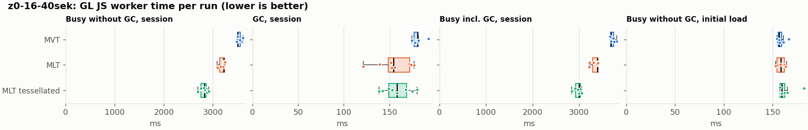
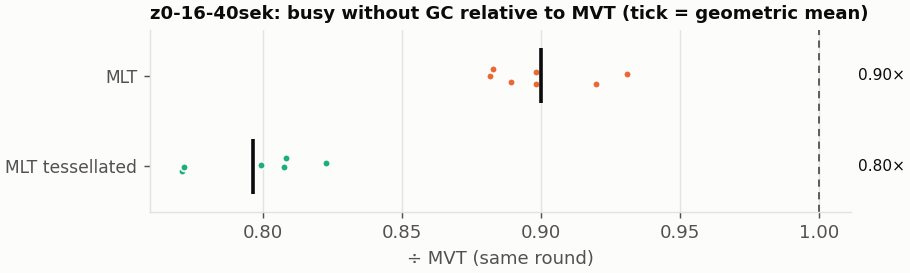
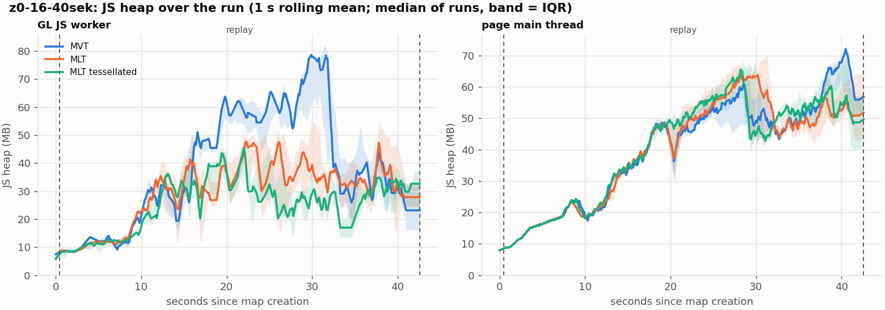
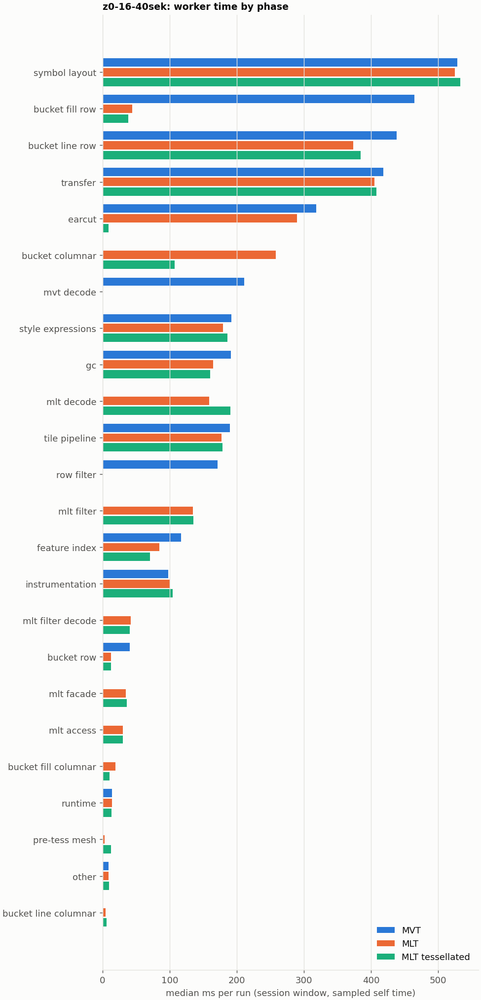

# Session trace benchmark — 20261106-195111

## Setup

- Created 2026-11-06T19:51:11+01:00; 10 repetitions + 1 warm-up round(s) (excluded); variants rotate per round (A B C, B C A, …); one cold browser context per run.
- Machine: , 16 logical cores, None GB RAM, Linux-7.2.9-200.nobara.fc44.x86_64-x86_64-with-glibc2.43; power: ?, AC None.
- GL JS gl7-local-files @ eb3231235c (dirty); worker count 1; viewport {'width': 1280, 'height': 1024}.
- Python 3.14.7, packages {'playwright': '1.64.1', 'numpy': '2.4.6', 'matplotlib': '3.10.8'}.

| variant | bundle | format | bundle sha256 | branch build |
|---|---|---|---|---|
| MVT | `dist/maplibre-gl-dev.mjs` | mvt | `4b8e23c84997` | – |
| MLT | `dist/maplibre-gl-dev.mjs` | mlt | `4b8e23c84997` | – |
| MLT tessellated | `dist/maplibre-gl-dev.mjs` | mlt-pre-tess | `4b8e23c84997` | – |

| session | style | duration | frames | sha256 |
|---|---|---:|---:|---|
| z0-16-40sek | osm-bright | 42.1 s | 1739 | `55a2b8f22fe2` |

CPU sampling interval (median over runs): 159 µs.

## Definitions

- **busy** = wall time in which a GL JS worker thread runs a task (union of top-level task slices and GC slices on `DedicatedWorker thread`s), summed over workers. **GC** = union of `MinorGC`/`MajorGC`/`V8.GC*` slices on those threads. **busy without GC** = busy − GC (headline metric).
- **CPU** = thread time (`tdur`) of the same slices. Phase categories and functions come from the trace's CPU samples (self time), categorised by `config/categories.toml` (nearest matching frame, leaf to root).
- Windows: **load** = map creation → first idle; **session** = camera replay; **tail** = end of replay → idle; **total** = load + session + tail.
- Ratios are against **MVT**: ratio of medians with a bootstrap 95 % CI, the geometric mean of per-round ratios, and a two-sided Mann–Whitney U p-value (normal approximation, not corrected for multiple comparisons; rough below n = 8). Lower than 1× means less worker time.

## Session `z0-16-40sek`

### Worker busy without GC (session window)

| variant | n ok / failed | median ms | IQR | mean | ratio vs MVT | 95 % CI | geo-mean paired | MWU p |
|---|---:|---:|---:|---:|---:|---:|---:|---:|
| MVT | 7 / 1 | 3,507 | 3,502–3,561 | 3,533 | 1.00× | – | – | – |
| MLT | 8 / 0 | 3,218 | 3,140–3,234 | 3,187 | 0.92× | 0.88–0.92× | 0.90× | 0.001 |
| MLT tessellated | 9 / 0 | 2,832 | 2,754–2,860 | 2,816 | 0.81× | 0.78–0.82× | 0.80× | 0.001 |

### All worker metrics (median, ratio vs baseline)

| metric | MVT | MLT | MLT tessellated |
|---|---:|---:|---:|
| busy incl. GC | 3,688 | 3,388 (0.92×) | 3,000 (0.81×) |
| &nbsp;&nbsp;of which GC | 181.0 | 154.4 (0.85×) | 158.4 (0.88×) |
| &nbsp;&nbsp;of which busy without GC | 3,507 | 3,218 (0.92×) | 2,832 (0.81×) |
| &nbsp;&nbsp;&nbsp;&nbsp;of which filtering (sampled, incl. callees) | 171.4 | 134.9 (0.79×) | 135.6 (0.79×) |
| &nbsp;&nbsp;&nbsp;&nbsp;of which column decoding inside the MLT filter (sampled) | 0.0 | 41.9 | 40.6 |
| &nbsp;&nbsp;&nbsp;&nbsp;of which timing instrumentation (sampled) | 97.6 | 101.1 (1.04×) | 104.4 (1.07×) |
| busy without GC and instrumentation | 3,412 | 3,115 (0.91×) | 2,728 (0.80×) |
| CPU time without GC | 3,409 | 3,109 (0.91×) | 2,718 (0.80×) |
| tile: download end → sent to main thread, median per tile | 54.3 | 49.0 (0.90×) | 40.0 (0.74×) |
| tile: download end → sent to main thread, 90th percentile | 200.5 | 169.1 (0.84×) | 136.1 (0.68×) |
| tile: download end → sent to main thread, 95th percentile | 289.9 | 226.4 (0.78×) | 183.3 (0.63×) |
| tile: download end → sent to main thread, 99th percentile | 323.2 | 270.1 (0.84×) | 221.9 (0.69×) |
| minor GCs | 95.00 | 68.00 (0.72×) | 39.00 (0.41×) |
| major GCs | 6.00 | 8.50 (1.42×) | 12.00 (2.00×) |
| peak worker heap (MB) | 91.9 | 72.3 (0.79×) | 55.3 (0.60×) |
| load: busy without GC | 156.6 | 158.6 (1.01×) | 159.3 (1.02×) |
| load: GC | 8.0 | 8.2 (1.01×) | 8.2 (1.02×) |
| total: busy without GC | 3,665 | 3,374 (0.92×) | 2,989 (0.82×) |

Rows marked *of which* are parts of the row above, not additional time. Tile rows are per-tile latencies (medians over tiles, then over runs), not sums: tiles overlap in time, and the medians of the parse and queue parts do not add up exactly to the median latency.

### Filtering (session window)

Sampled worker time spent in feature filtering, including everything the filter calls (expression evaluation, property access): **row filter** = the style-spec feature filter that MVT runs per feature, **mlt filter** = the columnar MLT filter (incl. the geometry-type selection), without the columns it decodes (see the next table). Medians per run; rules in `config/categories.toml`.

| variant | mlt filter | row filter | filtering | ratio vs MVT | 95 % CI | MWU p | share of sampled busy |
|---|---:|---:|---:|---:|---:|---:|---:|
| MVT | 0.0 | 171.1 | 171.4 | 1.00× | – | – | 5.0% |
| MLT | 134.9 | 0.0 | 134.9 | 0.79× | 0.75–0.81× | 0.001 | 4.4% |
| MLT tessellated | 135.6 | 0.0 | 135.6 | 0.79× | 0.76–0.81× | 0.001 | 5.0% |

**Filtering together with tile decoding.** The MLT decoder leaves columns encoded until something reads them, and the filter is usually the first reader: the columns it decodes (properties, and the geometry for `$type`) are **of which inside the filter** (phase *mlt filter decode*), the rest is *mlt decode* (geometry and columns read later, e.g. by paint properties and symbols). MVT decodes every feature's properties and geometry while it reads the tile (*mvt decode*), whether the filter keeps the feature or not. So **filtering** above compares the filters, and **decoding + filtering** compares all that the formats spend on decoding the tile and selecting features. **tile decoding** = *mvt decode* or *mlt decode* + *mlt filter decode*: work inside a call into a decoder. Reading data that is already decoded is not counted, as for MVT's feature objects: *mlt access* (row views, value getters, looking a column up by name) and the MLT facade (*mlt facade*). MVT decodes geometry only for the features its filter keeps, MLT decodes a layer's whole geometry column.

| variant | tile decoding | of which inside the filter | filtering | decoding + filtering | ratio vs MVT | 95 % CI | MWU p |
|---|---:|---:|---:|---:|---:|---:|---:|
| MVT | 211.1 | 0.0 | 171.4 | 381.8 | 1.00× | – | – |
| MLT | 199.4 | 41.9 | 134.9 | 335.1 | 0.88× | 0.86–0.91× | 0.001 |
| MLT tessellated | 229.0 | 40.6 | 135.6 | 363.9 | 0.95× | 0.93–1.00× | 0.011 |

Top 12 functions inside filtering and its column decoding (self time, mean ms per run):

| phase | function | source | MVT | MLT | MLT tessellated |
|---|---|---|---:|---:|---:|
| row filter | `evaluate` | node_modules/@maplibre/maplibre-gl-style-spec/dist/expression/compound_expression.mjs | 52.4 | 0.0 | 0.0 |
| row filter | `CompoundExpression.register.filter-in-small` | node_modules/@maplibre/maplibre-gl-style-spec/dist/expression/compound_expression.mjs | 22.3 | 0.0 | 0.0 |
| row filter | `CompoundExpression.register.filter-==` | node_modules/@maplibre/maplibre-gl-style-spec/dist/expression/compound_expression.mjs | 20.8 | 0.0 | 0.0 |
| row filter | `evaluate` | node_modules/@maplibre/maplibre-gl-style-spec/dist/expression/index.mjs | 19.3 | 0.0 | 0.0 |
| mlt filter | `scanDictionaryCodes` | maplibre-tile-spec/ts/dist/processing/filter/execution/filterKernel.js | 0.0 | 13.1 | 13.7 |
| row filter | `filter` | node_modules/@maplibre/maplibre-gl-style-spec/dist/feature_filter/index.mjs | 13.6 | 0.0 | 0.0 |
| row filter | `CompoundExpression.register.all.overloads` | node_modules/@maplibre/maplibre-gl-style-spec/dist/expression/compound_expression.mjs | 12.5 | 0.0 | 0.0 |
| mlt filter | `dictionaryRowMatches` | maplibre-tile-spec/ts/dist/processing/filter/execution/filterKernel.js | 0.0 | 12.1 | 12.4 |
| mlt filter | `filterByGeometryType` | maplibre-tile-spec/ts/dist/vector/geometry/geometryVector.js | 0.0 | 9.5 | 11.9 |
| mlt filter | `resolveDictionaryExecutor` | maplibre-tile-spec/ts/dist/processing/filter/execution/filterKernel.js | 0.0 | 8.6 | 7.4 |
| mlt filter | `bytesEqual` | maplibre-tile-spec/ts/dist/processing/filter/execution/filterKernel.js | 0.0 | 8.2 | 8.0 |
| row filter | `CompoundExpression.register.filter-type-==` | node_modules/@maplibre/maplibre-gl-style-spec/dist/expression/compound_expression.mjs | 7.2 | 0.0 | 0.0 |

### Bucket time by layer type (session window)

Sampled self time of the bucket code per layer type, row and columnar path together (median ms per run). **shared bucket code** is code all layer types use (`src/data/bucket/*` outside the layer files, `columnar_populate.ts`, `columnar_mesh_arrays.ts`, `load_geometry.ts`). **earcut** triangulates for fill and fill-extrusion on the row path; **pre-tess mesh** takes over the stored triangles of a pre-tessellated fill. **symbol** is the whole symbol layout phase. For exact wall time per source layer and type see the timing log tables below (builds with `worker_timing.ts` only).

| variant | fill | fill-extrusion | line | symbol | shared bucket code | earcut | pre-tess mesh | total |
|---|---:|---:|---:|---:|---:|---:|---:|---:|
| MVT | 464.6 | 0.0 | 437.8 | 528.2 | 40.2 | 318.4 | 0.0 | 1,782 |
| MLT | 62.5 | 0.0 | 377.4 | 524.4 | 272.1 | 289.6 | 3.2 | 1,537 |
| MLT tessellated | 49.0 | 0.0 | 393.0 | 533.1 | 120.5 | 8.8 | 12.9 | 1,106 |

### Where the variants differ from MVT (session window, mean ms per run)

Open **[flame.html](flame.html)** to explore the call tree interactively: pick a variant, compare it with MVT (red = more time at the same call path, blue = less), click a frame to zoom in, and read the phase and function breakdown under it. Without a comparison, frames are coloured by phase: filtering is green in both formats, and the columns the MLT filter decodes on first access (*mlt filter decode*) are MLT blue frames under the green filter. `flame/*.txt` open in https://www.speedscope.app.

#### MLT vs MVT

**By phase** (sampled self time; the Δ column sums to the difference in sampled busy time):

| phase | MVT | MLT | Δ |
|---|---:|---:|---:|
| bucket columnar | 0.0 | 255.8 | +255.8 |
| mlt decode | 0.0 | 158.8 | +158.8 |
| mlt filter | 0.2 | 133.9 | +133.7 |
| mlt filter decode | 0.0 | 41.9 | +41.9 |
| mlt facade | 0.2 | 33.9 | +33.8 |
| mlt access | 0.0 | 30.6 | +30.6 |
| bucket fill columnar | 0.0 | 18.5 | +18.5 |
| bucket line columnar | 0.0 | 4.9 | +4.9 |
| pre-tess mesh | 0.0 | 3.5 | +3.5 |
| instrumentation | 98.1 | 100.1 | +2.1 |
| runtime | 14.9 | 13.5 | -1.4 |
| symbol layout | 529.0 | 523.6 | -5.4 |
| tile pipeline | 189.6 | 177.0 | -12.6 |
| style expressions | 191.6 | 178.4 | -13.2 |
| transfer | 419.3 | 404.5 | -14.8 |
| gc | 190.4 | 165.0 | -25.4 |
| bucket row | 39.3 | 12.6 | -26.7 |
| earcut | 320.0 | 287.6 | -32.4 |
| feature index | 117.3 | 84.1 | -33.1 |
| bucket line row | 434.7 | 372.5 | -62.3 |
| row filter | 170.9 | 0.0 | -170.9 |
| mvt decode | 209.2 | 0.0 | -209.2 |
| bucket fill row | 463.5 | 44.1 | -419.4 |

**Functions with the largest self-time difference** (by function name, summed over source files):

| function | MVT | MLT | Δ |
|---|---:|---:|---:|
| `buildRingBoundingBoxes` | 0.0 | 27.7 | +27.7 |
| `buildEarcutMesh` | 0.0 | 25.4 | +25.4 |
| `writeEarcutFill` | 0.0 | 25.0 | +25.0 |
| `decodeComponentwiseDeltaVec2` | 0.0 | 20.6 | +20.6 |
| `signedArea$2` | 4.7 | 22.1 | +17.4 |
| `get` | 27.1 | 42.7 | +15.6 |
| `readScaledRings` | 0.0 | 14.4 | +14.4 |
| `scanDictionaryCodes` | 0.0 | 13.1 | +13.1 |
| `dictionaryRowMatches` | 0.0 | 12.1 | +12.1 |
| `decodeString$2` | 0.0 | 11.9 | +11.9 |
| `decodeFsst` | 0.0 | 10.6 | +10.6 |
| `decodeFastPforInt32` | 0.0 | 10.4 | +10.4 |
| `_vertexToIndex` | 149.1 | 0.5 | -148.5 |
| `populate` | 96.3 | 8.9 | -87.4 |
| `evaluate` | 92.7 | 21.4 | -71.3 |
| `loadGeometry` | 67.2 | 11.7 | -55.5 |
| `readVarint` | 56.5 | 2.5 | -54.0 |

#### MLT tessellated vs MVT

**By phase** (sampled self time; the Δ column sums to the difference in sampled busy time):

| phase | MVT | MLT tessellated | Δ |
|---|---:|---:|---:|
| mlt decode | 0.0 | 189.0 | +189.0 |
| mlt filter | 0.2 | 134.8 | +134.6 |
| bucket columnar | 0.0 | 107.3 | +107.3 |
| mlt filter decode | 0.0 | 40.3 | +40.3 |
| mlt facade | 0.2 | 35.4 | +35.2 |
| mlt access | 0.0 | 30.1 | +30.1 |
| pre-tess mesh | 0.0 | 12.7 | +12.7 |
| bucket fill columnar | 0.0 | 10.7 | +10.7 |
| bucket line columnar | 0.0 | 6.3 | +6.3 |
| instrumentation | 98.1 | 103.3 | +5.3 |
| other | 8.7 | 9.8 | +1.1 |
| symbol layout | 529.0 | 527.7 | -1.3 |
| runtime | 14.9 | 13.1 | -1.7 |
| style expressions | 191.6 | 183.8 | -7.9 |
| tile pipeline | 189.6 | 178.3 | -11.3 |
| transfer | 419.3 | 402.4 | -16.8 |
| gc | 190.4 | 165.9 | -24.5 |
| bucket row | 39.3 | 13.0 | -26.4 |
| feature index | 117.3 | 69.4 | -47.9 |
| bucket line row | 434.7 | 384.9 | -49.8 |
| row filter | 170.9 | 0.0 | -170.9 |
| mvt decode | 209.2 | 0.0 | -209.2 |
| earcut | 320.0 | 8.8 | -311.2 |
| bucket fill row | 463.5 | 38.3 | -425.3 |

**Functions with the largest self-time difference** (by function name, summed over source files):

| function | MVT | MLT tessellated | Δ |
|---|---:|---:|---:|
| `writeTessellatedFill` | 0.0 | 26.9 | +26.9 |
| `decodeComponentwiseDeltaVec2` | 0.0 | 20.4 | +20.4 |
| `decodeUnsignedZigZagDeltaInt32` | 0.0 | 19.3 | +19.3 |
| `get` | 27.1 | 42.9 | +15.8 |
| `scanDictionaryCodes` | 0.0 | 13.7 | +13.7 |
| `buildTessellatedBoundingBox` | 0.0 | 12.6 | +12.6 |
| `decodeFastPforInt32` | 0.0 | 12.6 | +12.6 |
| `decodeString$2` | 0.0 | 12.5 | +12.5 |
| `dictionaryRowMatches` | 0.0 | 12.4 | +12.4 |
| `filterByGeometryType` | 0.0 | 11.9 | +11.9 |
| `decodeFsst` | 0.0 | 10.4 | +10.4 |
| `appendScaledVertices` | 0.0 | 9.6 | +9.6 |
| `_vertexToIndex` | 149.1 | 0.6 | -148.4 |
| `isEar` | 98.9 | 1.3 | -97.6 |
| `populate` | 96.3 | 9.1 | -87.2 |
| `evaluate` | 92.7 | 22.3 | -70.4 |
| `loadGeometry` | 67.2 | 11.8 | -55.4 |

### Memory (session window)

**JS heap** = V8's used heap of the thread (`jsHeapSizeUsed` from the trace's `UpdateCounters`, about every 20 ms; the mean is time-weighted). It does not include ArrayBuffer contents, so the tile data itself (vertex, index and feature-index arrays) is not in it: **tile data sent to the main thread** is the size of the ArrayBuffers each tile result transfers (`web/worker_hook.js`), which then live on the main thread and are uploaded to the GPU. **garbage collected** = heap freed by the worker's GCs, a measure of how much it allocates. Medians per run; ratio of medians with a bootstrap 95 % CI.

| metric | MVT | MLT | MLT tessellated |
|---|---:|---:|---:|
| worker JS heap, mean (MB) | 34.1 | 25.0 (0.74×, 0.65–0.94×) | 20.6 (0.60×, 0.57–0.77×) |
| worker JS heap, peak (MB) | 91.9 | 72.3 (0.79×, 0.71–0.87×) | 55.3 (0.60×, 0.54–0.71×) |
| worker JS heap after the last GC (MB) | 17.0 | 16.7 (0.99×, 0.60–2.71×) | 16.3 (0.96×, 0.43–1.93×) |
| garbage collected in the worker (MB) | 2,507 | 1,676 (0.67×, 0.65–0.68×) | 987.5 (0.39×, 0.39–0.40×) |
| main thread JS heap, mean (MB) | 35.8 | 35.9 (1.00×, 0.97–1.06×) | 36.4 (1.02×, 0.98–1.06×) |
| main thread JS heap, peak (MB) | 81.1 | 78.4 (0.97×, 0.94–1.00×) | 79.5 (0.98×, 0.96–1.04×) |
| main thread JS heap at the end of the replay (MB) | 56.6 | 51.5 (0.91×, 0.73–1.25×) | 49.3 (0.87×, 0.67–1.11×) |
| tile data sent to the main thread, total (MB) | 148.6 | 142.5 (0.96×, 0.94–0.97×) | 138.7 (0.93×, 0.92–0.94×) |
| tile data sent to the main thread, median per tile (KB) | 412.9 | 392.1 (0.95×, 0.94–0.96×) | 384.3 (0.93×, 0.93–0.94×) |

### Worker time by phase (session window, median ms of sampled self time)

| phase | MVT | MLT | MLT tessellated |
|---|---:|---:|---:|
| symbol layout | 528.2 | 524.4 | 533.1 |
| bucket fill row | 464.6 | 44.2 | 38.2 |
| bucket line row | 437.8 | 373.3 | 384.4 |
| transfer | 418.5 | 404.6 | 407.7 |
| earcut | 318.4 | 289.6 | 8.8 |
| bucket columnar | 0.0 | 258.3 | 107.3 |
| mvt decode | 211.1 | 0.0 | 0.0 |
| style expressions | 192.1 | 179.4 | 186.1 |
| gc | 190.9 | 164.8 | 160.3 |
| mlt decode | 0.0 | 158.5 | 190.8 |
| tile pipeline | 189.5 | 177.4 | 178.3 |
| row filter | 171.1 | 0.0 | 0.0 |
| mlt filter | 0.0 | 134.9 | 135.6 |
| feature index | 116.6 | 84.5 | 70.5 |
| instrumentation | 97.6 | 101.1 | 104.4 |
| mlt filter decode | 0.0 | 41.9 | 40.6 |
| bucket row | 40.2 | 12.6 | 12.9 |
| mlt facade | 0.0 | 34.8 | 36.4 |
| mlt access | 0.0 | 30.0 | 30.1 |
| bucket fill columnar | 0.0 | 19.3 | 10.5 |
| runtime | 14.1 | 13.8 | 13.0 |
| pre-tess mesh | 0.0 | 3.2 | 12.9 |
| other | 9.1 | 9.1 | 9.4 |
| bucket line columnar | 0.0 | 4.6 | 6.0 |
| bucket fill-extrusion row | 0.0 | 0.0 | 0.0 |

### Top 20 worker functions by self time (session window, mean ms per run)

| function | source | phase | MVT | MLT | MLT tessellated |
|---|---|---|---:|---:|---:|
| `reserve` | src/util/struct_array.ts | bucket fill row | 213.5 | 195.7 | 195.3 |
| `(garbage collector)` | (native) | gc | 190.4 | 165.0 | 165.9 |
| `_vertexToIndex` | src/render/subdivision.ts | bucket fill row | 149.1 | 0.5 | 0.6 |
| `isEar` | node_modules/earcut/src/earcut.js | earcut | 98.9 | 85.1 | 1.3 |
| `_trim` | src/util/struct_array.ts | transfer | 91.9 | 75.8 | 68.5 |
| `emplace` | src/data/array_types.g.ts | bucket fill row | 88.9 | 90.5 | 89.3 |
| `serialize` | src/util/web_worker_transfer.ts | transfer | 88.0 | 88.3 | 90.1 |
| `self.postMessage` | worker_hook.js | instrumentation | 77.2 | 77.9 | 79.1 |
| `postMessage` | (native) | transfer | 73.1 | 74.9 | 75.0 |
| `populate` | src/data/bucket/line_bucket.ts | bucket line row | 69.9 | 0.0 | 0.0 |
| `setTimeout` | (native) | transfer | 64.6 | 64.4 | 64.6 |
| `readVarint` | node_modules/pbf/index.js | mvt decode | 56.5 | 0.0 | 0.0 |
| `ProgramConfiguration` | src/data/program_configuration.ts | bucket fill row | 50.8 | 55.7 | 52.9 |
| `fetch` | (native) | tile pipeline | 53.4 | 53.0 | 53.2 |
| `evaluate` | node_modules/@maplibre/maplibre-gl-style-spec/dist/expression/compound_expression.mjs | row filter | 52.4 | 0.0 | 0.0 |
| `insert` | src/data/feature_index.ts | feature index | 47.8 | 18.1 | 14.0 |
| `addLine` | src/data/bucket/line_bucket.ts | bucket line row | 44.9 | 46.3 | 45.7 |
| `isEarHashed` | node_modules/earcut/src/earcut.js | earcut | 44.6 | 35.2 | 1.4 |
| `parse` | src/source/worker_tile.ts | tile pipeline | 44.1 | 33.9 | 33.3 |
| `possiblyEvaluate` | src/style/properties.ts | style expressions | 36.2 | 38.5 | 40.7 |

### Top 20 worker functions by total time (incl. callees) (session window, mean ms per run)

| function | source | phase | MVT | MLT | MLT tessellated |
|---|---|---|---:|---:|---:|
| `parse` | src/source/worker_tile.ts | tile pipeline | 2,536 | 2,284 | 1,893 |
| `loadTile` | src/source/vector_tile_worker_source.ts | tile pipeline | 2,080 | 1,785 | 1,397 |
| `_parseWorkerTile` | src/source/vector_tile_worker_source.ts | tile pipeline | 1,976 | 1,721 | 1,335 |
| `populate` | src/data/bucket/fill_bucket.ts | bucket fill row | 916.6 | 0.0 | 0.0 |
| `addBucketFeatures` | src/data/bucket/fill_bucket.ts | bucket fill row | 781.6 | 513.4 | 104.7 |
| `addFeature` | src/data/bucket/fill_bucket.ts | bucket fill row | 752.3 | 8.2 | 7.5 |
| `populate` | src/data/bucket/columnar/columnar_fill_bucket.ts | bucket fill columnar | 0.0 | 669.3 | 270.2 |
| `subdividePolygon` | src/render/subdivision.ts | bucket fill row | 613.5 | 7.1 | 6.4 |
| `subdividePolygonInternal` | src/render/subdivision.ts | bucket fill row | 606.0 | 7.0 | 6.4 |
| `populate` | src/data/bucket/line_bucket.ts | bucket line row | 518.2 | 0.0 | 0.0 |
| `addFeature` | src/data/bucket/columnar/columnar_fill_bucket.ts | bucket fill columnar | 0.0 | 504.1 | 99.1 |
| `processTask` | src/util/actor.ts | transfer | 487.0 | 469.8 | 468.2 |
| `addFeatures` | src/data/bucket/symbol_bucket.ts | symbol layout | 469.8 | 475.9 | 483.1 |
| `populate` | src/data/bucket/columnar/columnar_line_bucket.ts | bucket line columnar | 0.0 | 463.2 | 476.6 |
| `performSymbolLayout` | src/symbol/symbol_layout.ts | symbol layout | 463.2 | 468.9 | 476.0 |
| `writeEarcutFill` | src/data/bucket/columnar/columnar_mesh_arrays.ts | bucket columnar | 0.0 | 466.6 | 9.5 |
| `completeTask` | src/util/actor.ts | transfer | 404.3 | 385.5 | 381.7 |
| `buildEarcutMesh` | src/data/bucket/columnar/columnar_mesh_arrays.ts | bucket columnar | 0.0 | 323.7 | 5.4 |
| `earcut` | node_modules/earcut/src/earcut.js | earcut | 319.7 | 287.5 | 8.7 |
| `addBucketFeatures` | src/data/bucket/line_bucket.ts | bucket line row | 284.1 | 296.7 | 310.1 |

## Runs

32 ok, 1 failed/aborted, 0 not run, 24 used in statistics.

| run | status | stage | message |
|---|---|---|---|
| z0-16-40sek/mvt/rep-07 | failed | replay | Page.evaluate: Execution context was destroyed, most likely because of a navigation |

## Validity checks

- Counted once: all 33 analysed runs pass (windows load + session + tail add up to total; phases add up to the sampled busy time; GC and sampled time lie within busy time; no timing-log line twice).
- z0-16-40sek/mlt-pre-tess/rep-08: replay frame gap of 1012 ms (main thread blocked)
- outlier runs left out of all statistics: busy without GC (session) more than 1.5 × IQR outside the quartiles of its session and variant (groups of at least 4 runs): 5 run(s): z0-16-40sek/mlt/rep-01 (3,388 ms), z0-16-40sek/mvt/rep-01 (3,801 ms), z0-16-40sek/mlt-pre-tess/rep-02 (3,090 ms), z0-16-40sek/mvt/rep-05 (3,946 ms), z0-16-40sek/mlt/rep-05 (3,399 ms)

## Files

- `runs.csv`: one row per run (incl. failed and warm-up runs), every scalar metric as `<window>.<metric>`.
- `summary.csv`: session × variant × metric statistics.
- `functions.csv`, `categories.csv`: CPU-sample self/total time per function and phase per run and window.
- `category_functions.csv`: self time per phase × function (e.g. what the filters spend their time on).
- `tiles.csv`, `tile_layers.csv`, `tile_phases.csv`: the per-tile worker timing log, long format.
- `flame.html`: interactive call tree per variant with a diff view; `flame/*.txt`: collapsed stacks for speedscope.
- `analysis/stacks.csv` (per run): sampled self time per full call stack.
- `tile_latency.csv`: per tile request, worker clock: received, download start/end, result sent, latency = sent − download end, parse_ms, wait_ms = latency − parse.
- `runs/<session>/<variant>/rep-NN/trace.json.gz`: the raw trace (opens in the DevTools Performance tab).
