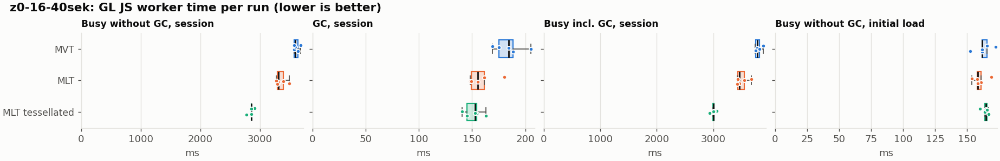
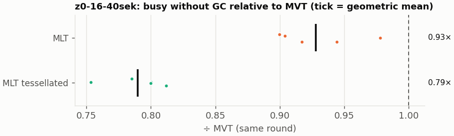
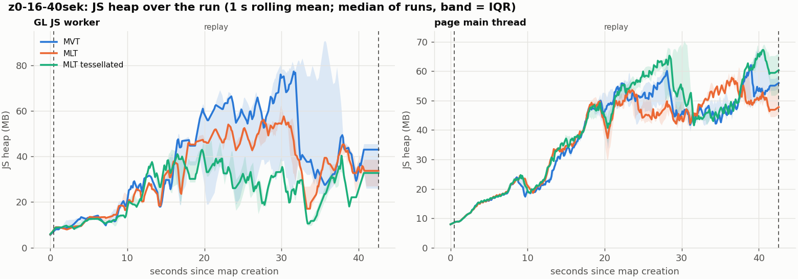
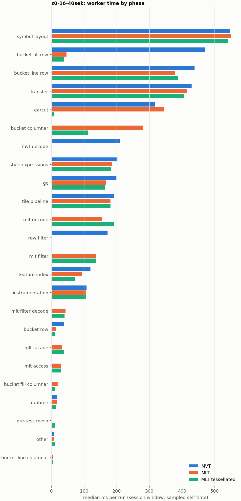

# Session trace benchmark — 20261107-121656

## Setup

- Created 2026-11-07T12:16:56+01:00; 5 repetitions + 1 warm-up round(s) (excluded); variants rotate per round (A B C, B C A, …); one cold browser context per run.
- Machine: , 16 logical cores, None GB RAM, Linux-7.2.9-200.nobara.fc44.x86_64-x86_64-with-glibc2.43; power: ?, AC None.
- GL JS gl7-local-files @ eb3231235c (dirty); worker count 1; viewport {'width': 1280, 'height': 1024}.
- Python 3.14.7, packages {'playwright': '1.64.1', 'numpy': '2.4.6', 'matplotlib': '3.10.8'}.

| variant | bundle | format | bundle sha256 | branch build |
|---|---|---|---|---|
| MVT | `dist/maplibre-gl-dev.mjs` | mvt | `4b8e23c84997` | – |
| MLT | `dist/maplibre-gl-dev.mjs` | mlt | `4b8e23c84997` | – |
| MLT tessellated | `dist/maplibre-gl-dev.mjs` | mlt-pre-tess | `4b8e23c84997` | – |

| session | style | duration | frames | sha256 |
|---|---|---:|---:|---|
| z0-16-40sek | osm-bright | 42.1 s | 1739 | `55a2b8f22fe2` |

CPU sampling interval (median over runs): 159 µs.

## Definitions

- **busy** = wall time in which a GL JS worker thread runs a task (union of top-level task slices and GC slices on `DedicatedWorker thread`s), summed over workers. **GC** = union of `MinorGC`/`MajorGC`/`V8.GC*` slices on those threads. **busy without GC** = busy − GC (headline metric).
- **CPU** = thread time (`tdur`) of the same slices. Phase categories and functions come from the trace's CPU samples (self time), categorised by `config/categories.toml` (nearest matching frame, leaf to root).
- Windows: **load** = map creation → first idle; **session** = camera replay; **tail** = end of replay → idle; **total** = load + session + tail.
- Ratios are against **MVT**: ratio of medians with a bootstrap 95 % CI, the geometric mean of per-round ratios, and a two-sided Mann–Whitney U p-value (normal approximation, not corrected for multiple comparisons; rough below n = 8). Lower than 1× means less worker time.

## Session `z0-16-40sek`

### Worker busy without GC (session window)

| variant | n ok / failed | median ms | IQR | mean | ratio vs MVT | 95 % CI | geo-mean paired | MWU p |
|---|---:|---:|---:|---:|---:|---:|---:|---:|
| MVT | 5 / 0 | 3,587 | 3,572–3,634 | 3,608 | 1.00× | – | – | – |
| MLT | 5 / 0 | 3,310 | 3,286–3,387 | 3,350 | 0.92× | 0.90–0.97× | 0.93× | 0.012 |
| MLT tessellated | 5 / 0 | 2,856 | 2,853–2,856 | 2,850 | 0.80× | 0.77–0.81× | 0.79× | 0.012 |

### All worker metrics (median, ratio vs baseline)

| metric | MVT | MLT | MLT tessellated |
|---|---:|---:|---:|
| busy incl. GC | 3,776 | 3,466 (0.92×) | 3,006 (0.80×) |
| &nbsp;&nbsp;of which GC | 184.5 | 155.4 (0.84×) | 152.9 (0.83×) |
| &nbsp;&nbsp;of which busy without GC | 3,587 | 3,310 (0.92×) | 2,856 (0.80×) |
| &nbsp;&nbsp;&nbsp;&nbsp;of which filtering (sampled, incl. callees) | 171.9 | 135.8 (0.79×) | 135.9 (0.79×) |
| &nbsp;&nbsp;&nbsp;&nbsp;of which column decoding inside the MLT filter (sampled) | 0.0 | 43.5 | 40.2 |
| &nbsp;&nbsp;&nbsp;&nbsp;of which timing instrumentation (sampled) | 107.6 | 106.7 (0.99×) | 105.1 (0.98×) |
| busy without GC and instrumentation | 3,480 | 3,202 (0.92×) | 2,751 (0.79×) |
| CPU time without GC | 3,495 | 3,211 (0.92×) | 2,758 (0.79×) |
| tile: download end → sent to main thread, median per tile | 52.5 | 55.4 (1.06×) | 41.8 (0.80×) |
| tile: download end → sent to main thread, 90th percentile | 203.0 | 174.2 (0.86×) | 138.4 (0.68×) |
| tile: download end → sent to main thread, 95th percentile | 288.6 | 252.2 (0.87×) | 190.8 (0.66×) |
| tile: download end → sent to main thread, 99th percentile | 324.8 | 285.1 (0.88×) | 218.5 (0.67×) |
| minor GCs | 96.00 | 75.00 (0.78×) | 40.00 (0.42×) |
| major GCs | 6.00 | 6.00 (1.00×) | 10.00 (1.67×) |
| peak worker heap (MB) | 90.4 | 72.8 (0.81×) | 54.9 (0.61×) |
| load: busy without GC | 161.9 | 158.5 (0.98×) | 165.0 (1.02×) |
| load: GC | 7.8 | 7.7 (0.99×) | 8.6 (1.10×) |
| total: busy without GC | 3,760 | 3,469 (0.92×) | 3,021 (0.80×) |

Rows marked *of which* are parts of the row above, not additional time. Tile rows are per-tile latencies (medians over tiles, then over runs), not sums: tiles overlap in time, and the medians of the parse and queue parts do not add up exactly to the median latency.

### Filtering (session window)

Sampled worker time spent in feature filtering, including everything the filter calls (expression evaluation, property access): **row filter** = the style-spec feature filter that MVT runs per feature, **mlt filter** = the columnar MLT filter (incl. the geometry-type selection), without the columns it decodes (see the next table). Medians per run; rules in `config/categories.toml`.

| variant | mlt filter | row filter | filtering | ratio vs MVT | 95 % CI | MWU p | share of sampled busy |
|---|---:|---:|---:|---:|---:|---:|---:|
| MVT | 0.0 | 171.9 | 171.9 | 1.00× | – | – | 4.9% |
| MLT | 135.8 | 0.0 | 135.8 | 0.79× | 0.78–0.86× | 0.012 | 4.3% |
| MLT tessellated | 135.9 | 0.0 | 135.9 | 0.79× | 0.76–0.84× | 0.012 | 5.0% |

**Filtering together with tile decoding.** The MLT decoder leaves columns encoded until something reads them, and the filter is usually the first reader: the columns it decodes (properties, and the geometry for `$type`) are **of which inside the filter** (phase *mlt filter decode*), the rest is *mlt decode* (geometry and columns read later, e.g. by paint properties and symbols). MVT decodes every feature's properties and geometry while it reads the tile (*mvt decode*), whether the filter keeps the feature or not. So **filtering** above compares the filters, and **decoding + filtering** compares all that the formats spend on decoding the tile and selecting features. **tile decoding** = *mvt decode* or *mlt decode* + *mlt filter decode*: work inside a call into a decoder. Reading data that is already decoded is not counted, as for MVT's feature objects: *mlt access* (row views, value getters, looking a column up by name) and the MLT facade (*mlt facade*). MVT decodes geometry only for the features its filter keeps, MLT decodes a layer's whole geometry column.

| variant | tile decoding | of which inside the filter | filtering | decoding + filtering | ratio vs MVT | 95 % CI | MWU p |
|---|---:|---:|---:|---:|---:|---:|---:|
| MVT | 211.3 | 0.0 | 171.9 | 384.8 | 1.00× | – | – |
| MLT | 195.9 | 43.5 | 135.8 | 330.9 | 0.86× | 0.83–0.91× | 0.012 |
| MLT tessellated | 232.2 | 40.2 | 135.9 | 370.3 | 0.96× | 0.94–0.98× | 0.012 |

Top 12 functions inside filtering and its column decoding (self time, mean ms per run):

| phase | function | source | MVT | MLT | MLT tessellated |
|---|---|---|---:|---:|---:|
| row filter | `evaluate` | node_modules/@maplibre/maplibre-gl-style-spec/dist/expression/compound_expression.mjs | 54.7 | 0.0 | 0.0 |
| row filter | `CompoundExpression.register.filter-in-small` | node_modules/@maplibre/maplibre-gl-style-spec/dist/expression/compound_expression.mjs | 23.9 | 0.0 | 0.0 |
| row filter | `CompoundExpression.register.filter-==` | node_modules/@maplibre/maplibre-gl-style-spec/dist/expression/compound_expression.mjs | 20.6 | 0.0 | 0.0 |
| row filter | `evaluate` | node_modules/@maplibre/maplibre-gl-style-spec/dist/expression/index.mjs | 17.7 | 0.0 | 0.0 |
| mlt filter | `scanDictionaryCodes` | maplibre-tile-spec/ts/dist/processing/filter/execution/filterKernel.js | 0.0 | 14.0 | 13.9 |
| row filter | `filter` | node_modules/@maplibre/maplibre-gl-style-spec/dist/feature_filter/index.mjs | 13.4 | 0.0 | 0.0 |
| mlt filter | `dictionaryRowMatches` | maplibre-tile-spec/ts/dist/processing/filter/execution/filterKernel.js | 0.0 | 11.7 | 12.9 |
| row filter | `CompoundExpression.register.all.overloads` | node_modules/@maplibre/maplibre-gl-style-spec/dist/expression/compound_expression.mjs | 12.5 | 0.0 | 0.0 |
| mlt filter | `filterByGeometryType` | maplibre-tile-spec/ts/dist/vector/geometry/geometryVector.js | 0.0 | 11.7 | 11.6 |
| mlt filter | `bytesEqual` | maplibre-tile-spec/ts/dist/processing/filter/execution/filterKernel.js | 0.0 | 8.8 | 8.2 |
| mlt filter | `resolveDictionaryExecutor` | maplibre-tile-spec/ts/dist/processing/filter/execution/filterKernel.js | 0.0 | 8.1 | 7.8 |
| mlt filter | `getNormalizedFilter` | maplibre-tile-spec/ts/dist/processing/filter/filterCache.js | 0.0 | 7.2 | 6.6 |

### Bucket time by layer type (session window)

Sampled self time of the bucket code per layer type, row and columnar path together (median ms per run). **shared bucket code** is code all layer types use (`src/data/bucket/*` outside the layer files, `columnar_populate.ts`, `columnar_mesh_arrays.ts`, `load_geometry.ts`). **earcut** triangulates for fill and fill-extrusion on the row path; **pre-tess mesh** takes over the stored triangles of a pre-tessellated fill. **symbol** is the whole symbol layout phase. For exact wall time per source layer and type see the timing log tables below (builds with `worker_timing.ts` only).

| variant | fill | fill-extrusion | line | symbol | shared bucket code | earcut | pre-tess mesh | total |
|---|---:|---:|---:|---:|---:|---:|---:|---:|
| MVT | 470.3 | 0.0 | 438.4 | 545.8 | 38.8 | 316.7 | 0.0 | 1,812 |
| MLT | 66.2 | 0.0 | 382.1 | 549.3 | 291.7 | 345.1 | 0.0 | 1,618 |
| MLT tessellated | 48.0 | 0.0 | 392.9 | 541.6 | 123.4 | 9.2 | 11.0 | 1,130 |

### Where the variants differ from MVT (session window, mean ms per run)

Open **[flame.html](flame.html)** to explore the call tree interactively: pick a variant, compare it with MVT (red = more time at the same call path, blue = less), click a frame to zoom in, and read the phase and function breakdown under it. Without a comparison, frames are coloured by phase: filtering is green in both formats, and the columns the MLT filter decodes on first access (*mlt filter decode*) are MLT blue frames under the green filter. `flame/*.txt` open in https://www.speedscope.app.

#### MLT vs MVT

**By phase** (sampled self time; the Δ column sums to the difference in sampled busy time):

| phase | MVT | MLT | Δ |
|---|---:|---:|---:|
| bucket columnar | 0.0 | 283.2 | +283.2 |
| mlt decode | 0.0 | 152.3 | +152.3 |
| mlt filter | 0.0 | 137.8 | +137.8 |
| mlt filter decode | 0.0 | 43.7 | +43.7 |
| mlt facade | 0.2 | 31.9 | +31.6 |
| mlt access | 0.0 | 30.4 | +30.4 |
| earcut | 319.8 | 345.3 | +25.6 |
| bucket fill columnar | 0.0 | 19.4 | +19.4 |
| bucket line columnar | 0.0 | 4.9 | +4.9 |
| symbol layout | 546.3 | 549.3 | +3.0 |
| other | 7.8 | 9.2 | +1.4 |
| instrumentation | 105.1 | 105.6 | +0.5 |
| runtime | 16.9 | 15.0 | -1.9 |
| transfer | 428.7 | 418.0 | -10.7 |
| tile pipeline | 195.0 | 180.1 | -14.9 |
| style expressions | 201.4 | 184.7 | -16.7 |
| feature index | 118.0 | 94.5 | -23.6 |
| bucket row | 39.5 | 12.5 | -27.0 |
| gc | 196.7 | 168.6 | -28.1 |
| bucket line row | 440.4 | 377.2 | -63.2 |
| row filter | 171.0 | 0.0 | -171.0 |
| mvt decode | 211.5 | 0.0 | -211.5 |
| bucket fill row | 468.7 | 45.5 | -423.2 |

**Functions with the largest self-time difference** (by function name, summed over source files):

| function | MVT | MLT | Δ |
|---|---:|---:|---:|
| `buildEarcutMesh` | 0.0 | 33.1 | +33.1 |
| `buildRingBoundingBoxes` | 0.0 | 32.5 | +32.5 |
| `writeEarcutFill` | 0.0 | 30.1 | +30.1 |
| `signedArea$2` | 4.5 | 28.9 | +24.3 |
| `decodeComponentwiseDeltaVec2` | 0.0 | 21.4 | +21.4 |
| `fillLargeMeshArrays` | 24.8 | 41.9 | +17.2 |
| `readScaledRings` | 0.0 | 17.0 | +17.0 |
| `scanDictionaryCodes` | 0.0 | 14.0 | +14.0 |
| `decodeString$2` | 0.0 | 12.5 | +12.5 |
| `get` | 29.8 | 42.1 | +12.3 |
| `filterByGeometryType` | 0.0 | 11.7 | +11.7 |
| `dictionaryRowMatches` | 0.0 | 11.7 | +11.7 |
| `_vertexToIndex` | 144.8 | 0.7 | -144.1 |
| `populate` | 97.3 | 8.9 | -88.4 |
| `evaluate` | 94.2 | 23.4 | -70.8 |
| `readVarint` | 58.2 | 2.5 | -55.8 |
| `loadGeometry` | 65.5 | 10.8 | -54.7 |

#### MLT tessellated vs MVT

**By phase** (sampled self time; the Δ column sums to the difference in sampled busy time):

| phase | MVT | MLT tessellated | Δ |
|---|---:|---:|---:|
| mlt decode | 0.0 | 191.1 | +191.1 |
| mlt filter | 0.0 | 137.1 | +137.0 |
| bucket columnar | 0.0 | 111.3 | +111.3 |
| mlt filter decode | 0.0 | 40.6 | +40.6 |
| mlt facade | 0.2 | 39.0 | +38.7 |
| mlt access | 0.0 | 29.8 | +29.8 |
| pre-tess mesh | 0.0 | 11.5 | +11.5 |
| bucket fill columnar | 0.0 | 9.9 | +9.9 |
| bucket line columnar | 0.0 | 5.7 | +5.7 |
| other | 7.8 | 8.8 | +1.0 |
| instrumentation | 105.1 | 102.6 | -2.5 |
| symbol layout | 546.3 | 542.2 | -4.1 |
| runtime | 16.9 | 12.3 | -4.6 |
| tile pipeline | 195.0 | 180.7 | -14.3 |
| style expressions | 201.4 | 181.2 | -20.1 |
| transfer | 428.7 | 405.2 | -23.5 |
| bucket row | 39.5 | 12.3 | -27.2 |
| gc | 196.7 | 158.7 | -38.0 |
| feature index | 118.0 | 71.9 | -46.2 |
| bucket line row | 440.4 | 389.4 | -51.0 |
| row filter | 171.0 | 0.0 | -171.0 |
| mvt decode | 211.5 | 0.0 | -211.5 |
| earcut | 319.8 | 9.2 | -310.5 |
| bucket fill row | 468.7 | 38.3 | -430.4 |

**Functions with the largest self-time difference** (by function name, summed over source files):

| function | MVT | MLT tessellated | Δ |
|---|---:|---:|---:|
| `writeTessellatedFill` | 0.0 | 28.9 | +28.9 |
| `decodeComponentwiseDeltaVec2` | 0.0 | 21.8 | +21.8 |
| `decodeUnsignedZigZagDeltaInt32` | 0.0 | 19.1 | +19.1 |
| `scanDictionaryCodes` | 0.0 | 13.9 | +13.9 |
| `decodeString$2` | 0.0 | 13.2 | +13.2 |
| `dictionaryRowMatches` | 0.0 | 12.9 | +12.9 |
| `get` | 29.8 | 42.5 | +12.7 |
| `decodeFastPforInt32` | 0.0 | 12.4 | +12.4 |
| `filterByGeometryType` | 0.0 | 11.6 | +11.6 |
| `buildTessellatedBoundingBox` | 0.0 | 11.5 | +11.5 |
| `decodeFsst` | 0.0 | 10.4 | +10.4 |
| `appendScaledVertices` | 0.0 | 9.7 | +9.7 |
| `_vertexToIndex` | 144.8 | 0.9 | -143.9 |
| `isEar` | 97.9 | 1.6 | -96.4 |
| `populate` | 97.3 | 9.3 | -88.0 |
| `evaluate` | 94.2 | 21.9 | -72.3 |
| `readVarint` | 58.2 | 2.3 | -55.9 |

### Memory (session window)

**JS heap** = V8's used heap of the thread (`jsHeapSizeUsed` from the trace's `UpdateCounters`, about every 20 ms; the mean is time-weighted). It does not include ArrayBuffer contents, so the tile data itself (vertex, index and feature-index arrays) is not in it: **tile data sent to the main thread** is the size of the ArrayBuffers each tile result transfers (`web/worker_hook.js`), which then live on the main thread and are uploaded to the GPU. **garbage collected** = heap freed by the worker's GCs, a measure of how much it allocates. Medians per run; ratio of medians with a bootstrap 95 % CI.

| metric | MVT | MLT | MLT tessellated |
|---|---:|---:|---:|
| worker JS heap, mean (MB) | 35.5 | 28.0 (0.79×, 0.64–1.47×) | 20.8 (0.59×, 0.49–1.09×) |
| worker JS heap, peak (MB) | 90.4 | 72.8 (0.81×, 0.71–1.28×) | 54.9 (0.61×, 0.52–1.00×) |
| worker JS heap after the last GC (MB) | 23.5 | 22.0 (0.94×, 0.64–2.23×) | 8.6 (0.37×, 0.27–0.88×) |
| garbage collected in the worker (MB) | 2,500 | 1,802 (0.72×, 0.71–0.73×) | 991.4 (0.40×, 0.39–0.40×) |
| main thread JS heap, mean (MB) | 35.1 | 34.7 (0.99×, 0.94–1.06×) | 37.3 (1.06×, 1.00–1.14×) |
| main thread JS heap, peak (MB) | 76.5 | 71.0 (0.93×, 0.87–1.11×) | 78.3 (1.02×, 0.95–1.16×) |
| main thread JS heap at the end of the replay (MB) | 55.7 | 47.4 (0.85×, 0.75–1.03×) | 60.0 (1.08×, 0.86–1.36×) |
| tile data sent to the main thread, total (MB) | 148.6 | 143.1 (0.96×, 0.95–0.97×) | 138.4 (0.93×, 0.92–0.94×) |
| tile data sent to the main thread, median per tile (KB) | 412.9 | 396.3 (0.96×, 0.95–0.96×) | 384.3 (0.93×, 0.92–0.94×) |

### Worker time by phase (session window, median ms of sampled self time)

| phase | MVT | MLT | MLT tessellated |
|---|---:|---:|---:|
| symbol layout | 545.8 | 549.3 | 541.6 |
| bucket fill row | 470.3 | 46.3 | 38.9 |
| bucket line row | 438.4 | 377.5 | 387.4 |
| transfer | 429.5 | 414.8 | 405.1 |
| earcut | 316.7 | 345.1 | 9.2 |
| bucket columnar | 0.0 | 279.7 | 111.0 |
| mvt decode | 211.3 | 0.0 | 0.0 |
| style expressions | 202.5 | 186.5 | 183.1 |
| gc | 198.9 | 167.7 | 163.7 |
| tile pipeline | 192.2 | 181.4 | 180.9 |
| mlt decode | 0.0 | 154.3 | 191.5 |
| row filter | 171.9 | 0.0 | 0.0 |
| mlt filter | 0.0 | 135.8 | 135.9 |
| feature index | 119.9 | 93.7 | 72.0 |
| instrumentation | 107.6 | 106.7 | 105.1 |
| mlt filter decode | 0.0 | 43.5 | 40.2 |
| bucket row | 38.8 | 13.0 | 12.4 |
| mlt facade | 0.2 | 32.6 | 38.2 |
| mlt access | 0.0 | 30.5 | 30.4 |
| bucket fill columnar | 0.0 | 19.2 | 9.7 |
| runtime | 17.2 | 16.5 | 13.6 |
| pre-tess mesh | 0.0 | 0.0 | 11.0 |
| other | 8.0 | 8.1 | 9.6 |
| bucket line columnar | 0.0 | 4.6 | 5.6 |
| bucket fill-extrusion row | 0.0 | 0.0 | 0.0 |

### Top 20 worker functions by self time (session window, mean ms per run)

| function | source | phase | MVT | MLT | MLT tessellated |
|---|---|---|---:|---:|---:|
| `reserve` | src/util/struct_array.ts | tile pipeline | 225.7 | 201.4 | 201.3 |
| `(garbage collector)` | (native) | gc | 196.7 | 168.6 | 158.7 |
| `_vertexToIndex` | src/render/subdivision.ts | bucket fill row | 144.8 | 0.7 | 0.9 |
| `isEar` | node_modules/earcut/src/earcut.js | earcut | 97.9 | 98.8 | 1.6 |
| `emplace` | src/data/array_types.g.ts | bucket fill row | 91.8 | 96.3 | 88.7 |
| `_trim` | src/util/struct_array.ts | transfer | 93.6 | 80.3 | 70.6 |
| `serialize` | src/util/web_worker_transfer.ts | transfer | 90.9 | 90.5 | 91.5 |
| `self.postMessage` | worker_hook.js | instrumentation | 80.6 | 80.8 | 77.7 |
| `postMessage` | (native) | transfer | 75.8 | 77.2 | 75.5 |
| `populate` | src/data/bucket/line_bucket.ts | bucket line row | 68.2 | 0.0 | 0.0 |
| `setTimeout` | (native) | transfer | 64.6 | 65.4 | 65.7 |
| `readVarint` | node_modules/pbf/index.js | mvt decode | 58.2 | 0.0 | 0.0 |
| `fetch` | (native) | tile pipeline | 56.4 | 55.0 | 55.6 |
| `ProgramConfiguration` | src/data/program_configuration.ts | bucket fill row | 49.7 | 54.9 | 54.6 |
| `evaluate` | node_modules/@maplibre/maplibre-gl-style-spec/dist/expression/compound_expression.mjs | row filter | 54.7 | 0.0 | 0.0 |
| `insert` | src/data/feature_index.ts | feature index | 48.1 | 19.9 | 13.3 |
| `addLine` | src/data/bucket/line_bucket.ts | bucket line row | 45.5 | 45.9 | 45.1 |
| `isEarHashed` | node_modules/earcut/src/earcut.js | earcut | 43.5 | 43.8 | 1.8 |
| `possiblyEvaluate` | src/style/properties.ts | style expressions | 36.9 | 42.1 | 41.0 |
| `addHalfVertex` | src/data/bucket/line_bucket.ts | bucket line row | 37.3 | 38.0 | 42.0 |

### Top 20 worker functions by total time (incl. callees) (session window, mean ms per run)

| function | source | phase | MVT | MLT | MLT tessellated |
|---|---|---|---:|---:|---:|
| `parse` | src/source/worker_tile.ts | tile pipeline | 2,578 | 2,413 | 1,923 |
| `loadTile` | src/source/vector_tile_worker_source.ts | tile pipeline | 2,109 | 1,886 | 1,416 |
| `_parseWorkerTile` | src/source/vector_tile_worker_source.ts | tile pipeline | 2,000 | 1,821 | 1,351 |
| `populate` | src/data/bucket/fill_bucket.ts | bucket fill row | 920.9 | 0.0 | 0.0 |
| `addBucketFeatures` | src/data/bucket/fill_bucket.ts | bucket fill row | 787.1 | 597.2 | 108.0 |
| `addFeature` | src/data/bucket/fill_bucket.ts | bucket fill row | 755.2 | 8.4 | 7.6 |
| `populate` | src/data/bucket/columnar/columnar_fill_bucket.ts | bucket fill columnar | 0.0 | 747.1 | 274.0 |
| `subdividePolygon` | src/render/subdivision.ts |  | 614.9 | 7.5 | 6.9 |
| `subdividePolygonInternal` | src/render/subdivision.ts |  | 606.4 | 7.4 | 6.9 |
| `addFeature` | src/data/bucket/columnar/columnar_fill_bucket.ts | bucket fill columnar | 0.0 | 586.4 | 101.8 |
| `writeEarcutFill` | src/data/bucket/columnar/columnar_mesh_arrays.ts | bucket columnar | 0.0 | 563.0 | 9.7 |
| `populate` | src/data/bucket/line_bucket.ts | bucket line row | 524.2 | 0.0 | 0.0 |
| `processTask` | src/util/actor.ts | transfer | 501.9 | 488.5 | 470.4 |
| `addFeatures` | src/data/bucket/symbol_bucket.ts | symbol layout | 487.2 | 498.0 | 494.6 |
| `performSymbolLayout` | src/symbol/symbol_layout.ts | symbol layout | 480.2 | 490.5 | 487.7 |
| `populate` | src/data/bucket/columnar/columnar_line_bucket.ts | bucket line columnar | 0.0 | 467.4 | 481.9 |
| `completeTask` | src/util/actor.ts | transfer | 413.8 | 399.8 | 381.0 |
| `buildEarcutMesh` | src/data/bucket/columnar/columnar_mesh_arrays.ts | bucket columnar | 0.0 | 393.2 | 5.6 |
| `earcut` | node_modules/earcut/src/earcut.js | earcut | 319.6 | 345.0 | 9.2 |
| `addBucketFeatures` | src/data/bucket/line_bucket.ts | bucket line row | 292.0 | 298.9 | 311.9 |

## Runs

18 ok, 0 failed/aborted, 0 not run, 15 used in statistics.

## Validity checks

- Counted once: all 18 analysed runs pass (windows load + session + tail add up to total; phases add up to the sampled busy time; GC and sampled time lie within busy time; no timing-log line twice).
- no other check triggered

## Files

- `runs.csv`: one row per run (incl. failed and warm-up runs), every scalar metric as `<window>.<metric>`.
- `summary.csv`: session × variant × metric statistics.
- `functions.csv`, `categories.csv`: CPU-sample self/total time per function and phase per run and window.
- `category_functions.csv`: self time per phase × function (e.g. what the filters spend their time on).
- `tiles.csv`, `tile_layers.csv`, `tile_phases.csv`: the per-tile worker timing log, long format.
- `flame.html`: interactive call tree per variant with a diff view; `flame/*.txt`: collapsed stacks for speedscope.
- `analysis/stacks.csv` (per run): sampled self time per full call stack.
- `tile_latency.csv`: per tile request, worker clock: received, download start/end, result sent, latency = sent − download end, parse_ms, wait_ms = latency − parse.
- `runs/<session>/<variant>/rep-NN/trace.json.gz`: the raw trace (opens in the DevTools Performance tab).
