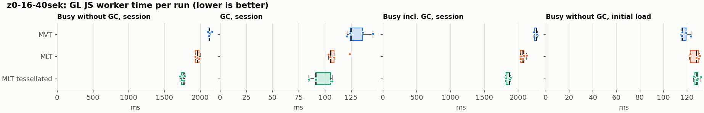
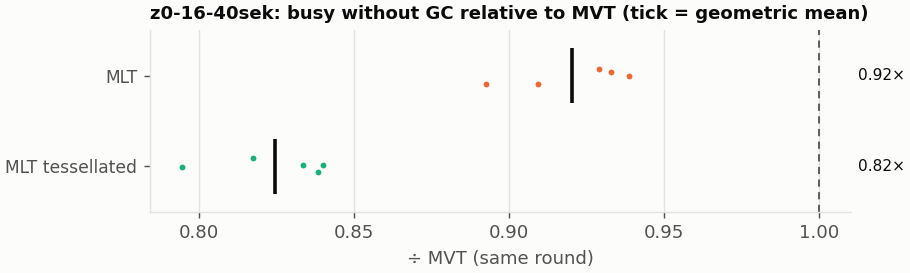
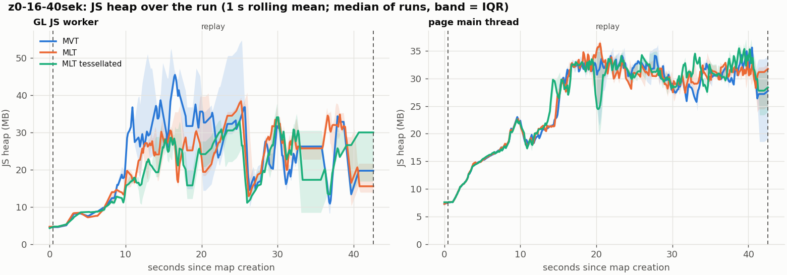
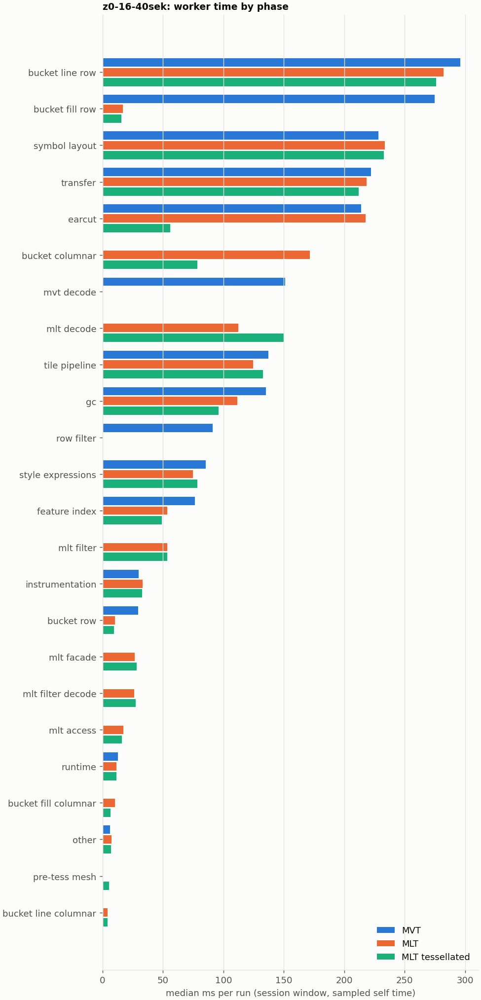

# Session trace benchmark — 20261107-123741

## Setup

- Created 2026-11-07T12:37:41+01:00; 5 repetitions + 1 warm-up round(s) (excluded); variants rotate per round (A B C, B C A, …); one cold browser context per run.
- Machine: , 16 logical cores, None GB RAM, Linux-7.2.9-200.nobara.fc44.x86_64-x86_64-with-glibc2.43; power: ?, AC None.
- GL JS gl7-local-files @ eb3231235c (dirty); worker count 1; viewport {'width': 1280, 'height': 1024}.
- Python 3.14.7, packages {'playwright': '1.64.1', 'numpy': '2.4.6', 'matplotlib': '3.10.8'}.

| variant | bundle | format | bundle sha256 | branch build |
|---|---|---|---|---|
| MVT | `dist/maplibre-gl-dev.mjs` | mvt | `4b8e23c84997` | – |
| MLT | `dist/maplibre-gl-dev.mjs` | mlt | `4b8e23c84997` | – |
| MLT tessellated | `dist/maplibre-gl-dev.mjs` | mlt-pre-tess | `4b8e23c84997` | – |

| session | style | duration | frames | sha256 |
|---|---|---:|---:|---|
| z0-16-40sek | positron (recorded: osm-bright) | 42.1 s | 1739 | `55a2b8f22fe2` |

CPU sampling interval (median over runs): 159 µs.

## Definitions

- **busy** = wall time in which a GL JS worker thread runs a task (union of top-level task slices and GC slices on `DedicatedWorker thread`s), summed over workers. **GC** = union of `MinorGC`/`MajorGC`/`V8.GC*` slices on those threads. **busy without GC** = busy − GC (headline metric).
- **CPU** = thread time (`tdur`) of the same slices. Phase categories and functions come from the trace's CPU samples (self time), categorised by `config/categories.toml` (nearest matching frame, leaf to root).
- Windows: **load** = map creation → first idle; **session** = camera replay; **tail** = end of replay → idle; **total** = load + session + tail.
- Ratios are against **MVT**: ratio of medians with a bootstrap 95 % CI, the geometric mean of per-round ratios, and a two-sided Mann–Whitney U p-value (normal approximation, not corrected for multiple comparisons; rough below n = 8). Lower than 1× means less worker time.

## Session `z0-16-40sek`

### Worker busy without GC (session window)

| variant | n ok / failed | median ms | IQR | mean | ratio vs MVT | 95 % CI | geo-mean paired | MWU p |
|---|---:|---:|---:|---:|---:|---:|---:|---:|
| MVT | 5 / 0 | 2,126 | 2,125–2,132 | 2,131 | 1.00× | – | – | – |
| MLT | 5 / 0 | 1,960 | 1,933–1,982 | 1,961 | 0.92× | 0.91–0.94× | 0.92× | 0.012 |
| MLT tessellated | 5 / 0 | 1,772 | 1,736–1,776 | 1,757 | 0.83× | 0.81–0.84× | 0.82× | 0.012 |

### All worker metrics (median, ratio vs baseline)

| metric | MVT | MLT | MLT tessellated |
|---|---:|---:|---:|
| busy incl. GC | 2,268 | 2,069 (0.91×) | 1,868 (0.82×) |
| &nbsp;&nbsp;of which GC | 124.7 | 105.5 (0.85×) | 91.3 (0.73×) |
| &nbsp;&nbsp;of which busy without GC | 2,126 | 1,960 (0.92×) | 1,772 (0.83×) |
| &nbsp;&nbsp;&nbsp;&nbsp;of which filtering (sampled, incl. callees) | 91.2 | 53.4 (0.59×) | 53.7 (0.59×) |
| &nbsp;&nbsp;&nbsp;&nbsp;of which column decoding inside the MLT filter (sampled) | 0.0 | 26.3 | 27.3 |
| &nbsp;&nbsp;&nbsp;&nbsp;of which timing instrumentation (sampled) | 29.7 | 33.2 (1.12×) | 32.8 (1.10×) |
| busy without GC and instrumentation | 2,095 | 1,929 (0.92×) | 1,739 (0.83×) |
| CPU time without GC | 2,066 | 1,889 (0.91×) | 1,695 (0.82×) |
| tile: download end → sent to main thread, median per tile | 24.6 | 23.3 (0.95×) | 19.9 (0.81×) |
| tile: download end → sent to main thread, 90th percentile | 141.3 | 116.1 (0.82×) | 101.0 (0.71×) |
| tile: download end → sent to main thread, 95th percentile | 204.0 | 150.0 (0.74×) | 122.4 (0.60×) |
| tile: download end → sent to main thread, 99th percentile | 242.7 | 201.0 (0.83×) | 179.6 (0.74×) |
| minor GCs | 60.00 | 55.00 (0.92×) | 40.00 (0.67×) |
| major GCs | 10.00 | 9.00 (0.90×) | 9.00 (0.90×) |
| peak worker heap (MB) | 63.7 | 53.7 (0.84×) | 48.5 (0.76×) |
| load: busy without GC | 116.3 | 128.2 (1.10×) | 128.5 (1.10×) |
| load: GC | 5.2 | 5.4 (1.04×) | 5.5 (1.05×) |
| total: busy without GC | 2,245 | 2,090 (0.93×) | 1,900 (0.85×) |

Rows marked *of which* are parts of the row above, not additional time. Tile rows are per-tile latencies (medians over tiles, then over runs), not sums: tiles overlap in time, and the medians of the parse and queue parts do not add up exactly to the median latency.

### Filtering (session window)

Sampled worker time spent in feature filtering, including everything the filter calls (expression evaluation, property access): **row filter** = the style-spec feature filter that MVT runs per feature, **mlt filter** = the columnar MLT filter (incl. the geometry-type selection), without the columns it decodes (see the next table). Medians per run; rules in `config/categories.toml`.

| variant | mlt filter | row filter | filtering | ratio vs MVT | 95 % CI | MWU p | share of sampled busy |
|---|---:|---:|---:|---:|---:|---:|---:|
| MVT | 0.0 | 91.2 | 91.2 | 1.00× | – | – | 4.6% |
| MLT | 53.4 | 0.0 | 53.4 | 0.59× | 0.55–0.66× | 0.012 | 3.0% |
| MLT tessellated | 53.7 | 0.0 | 53.7 | 0.59× | 0.56–0.65× | 0.012 | 3.4% |

**Filtering together with tile decoding.** The MLT decoder leaves columns encoded until something reads them, and the filter is usually the first reader: the columns it decodes (properties, and the geometry for `$type`) are **of which inside the filter** (phase *mlt filter decode*), the rest is *mlt decode* (geometry and columns read later, e.g. by paint properties and symbols). MVT decodes every feature's properties and geometry while it reads the tile (*mvt decode*), whether the filter keeps the feature or not. So **filtering** above compares the filters, and **decoding + filtering** compares all that the formats spend on decoding the tile and selecting features. **tile decoding** = *mvt decode* or *mlt decode* + *mlt filter decode*: work inside a call into a decoder. Reading data that is already decoded is not counted, as for MVT's feature objects: *mlt access* (row views, value getters, looking a column up by name) and the MLT facade (*mlt facade*). MVT decodes geometry only for the features its filter keeps, MLT decodes a layer's whole geometry column.

| variant | tile decoding | of which inside the filter | filtering | decoding + filtering | ratio vs MVT | 95 % CI | MWU p |
|---|---:|---:|---:|---:|---:|---:|---:|
| MVT | 151.3 | 0.0 | 91.2 | 237.8 | 1.00× | – | – |
| MLT | 139.3 | 26.3 | 53.4 | 193.4 | 0.81× | 0.76–0.83× | 0.012 |
| MLT tessellated | 177.9 | 27.3 | 53.7 | 231.0 | 0.97× | 0.91–0.98× | 0.012 |

Top 12 functions inside filtering and its column decoding (self time, mean ms per run):

| phase | function | source | MVT | MLT | MLT tessellated |
|---|---|---|---:|---:|---:|
| row filter | `(anonymous)` | node_modules/@maplibre/maplibre-gl-style-spec/dist/expression/compound_expression.mjs | 23.2 | 0.0 | 0.0 |
| row filter | `evaluate` | node_modules/@maplibre/maplibre-gl-style-spec/dist/expression/index.mjs | 16.7 | 0.0 | 0.0 |
| row filter | `evaluate` | node_modules/@maplibre/maplibre-gl-style-spec/dist/expression/compound_expression.mjs | 11.7 | 0.0 | 0.0 |
| row filter | `evaluate` | node_modules/@maplibre/maplibre-gl-style-spec/dist/expression/definitions/comparison.mjs | 9.1 | 0.0 | 0.0 |
| mlt filter | `filterByGeometryType` | maplibre-tile-spec/ts/dist/vector/geometry/geometryVector.js | 0.0 | 6.8 | 7.4 |
| row filter | `get` | node_modules/@maplibre/maplibre-gl-style-spec/dist/expression/compound_expression.mjs | 5.9 | 0.0 | 0.0 |
| row filter | `evaluate` | node_modules/@maplibre/maplibre-gl-style-spec/dist/expression/definitions/match.mjs | 5.0 | 0.0 | 0.0 |
| row filter | `filter` | node_modules/@maplibre/maplibre-gl-style-spec/dist/feature_filter/index.mjs | 5.0 | 0.0 | 0.0 |
| mlt filter decode | `decodeFsst` | maplibre-tile-spec/ts/dist/decoding/fsstDecoder.js | 0.0 | 3.3 | 4.1 |
| mlt filter | `dictionaryRowMatches` | maplibre-tile-spec/ts/dist/processing/filter/execution/filterKernel.js | 0.0 | 3.3 | 3.9 |
| row filter | `eq` | node_modules/@maplibre/maplibre-gl-style-spec/dist/expression/definitions/comparison.mjs | 3.4 | 0.0 | 0.0 |
| mlt filter | `resolveDictionaryExecutor` | maplibre-tile-spec/ts/dist/processing/filter/execution/filterKernel.js | 0.0 | 2.4 | 3.3 |

### Bucket time by layer type (session window)

Sampled self time of the bucket code per layer type, row and columnar path together (median ms per run). **shared bucket code** is code all layer types use (`src/data/bucket/*` outside the layer files, `columnar_populate.ts`, `columnar_mesh_arrays.ts`, `load_geometry.ts`). **earcut** triangulates for fill and fill-extrusion on the row path; **pre-tess mesh** takes over the stored triangles of a pre-tessellated fill. **symbol** is the whole symbol layout phase. For exact wall time per source layer and type see the timing log tables below (builds with `worker_timing.ts` only).

| variant | fill | fill-extrusion | line | symbol | shared bucket code | earcut | pre-tess mesh | total |
|---|---:|---:|---:|---:|---:|---:|---:|---:|
| MVT | 274.8 | 0.0 | 296.2 | 228.5 | 29.3 | 213.8 | 0.0 | 1,041 |
| MLT | 26.2 | 0.0 | 286.2 | 233.7 | 181.7 | 217.6 | 0.0 | 936.4 |
| MLT tessellated | 22.0 | 0.0 | 279.3 | 232.9 | 87.3 | 55.9 | 5.5 | 685.0 |

### Where the variants differ from MVT (session window, mean ms per run)

Open **[flame.html](flame.html)** to explore the call tree interactively: pick a variant, compare it with MVT (red = more time at the same call path, blue = less), click a frame to zoom in, and read the phase and function breakdown under it. Without a comparison, frames are coloured by phase: filtering is green in both formats, and the columns the MLT filter decodes on first access (*mlt filter decode*) are MLT blue frames under the green filter. `flame/*.txt` open in https://www.speedscope.app.

#### MLT vs MVT

**By phase** (sampled self time; the Δ column sums to the difference in sampled busy time):

| phase | MVT | MLT | Δ |
|---|---:|---:|---:|
| bucket columnar | 0.0 | 170.2 | +170.2 |
| mlt decode | 0.0 | 112.6 | +112.6 |
| mlt filter | 0.1 | 54.1 | +54.0 |
| mlt facade | 0.2 | 27.3 | +27.1 |
| mlt filter decode | 0.0 | 26.3 | +26.3 |
| mlt access | 0.0 | 16.2 | +16.2 |
| bucket fill columnar | 0.0 | 10.0 | +10.0 |
| symbol layout | 228.0 | 234.3 | +6.2 |
| earcut | 213.6 | 218.5 | +4.9 |
| bucket line columnar | 0.0 | 3.9 | +3.9 |
| instrumentation | 31.4 | 32.4 | +1.0 |
| other | 6.7 | 7.2 | +0.6 |
| runtime | 12.4 | 11.6 | -0.8 |
| transfer | 219.9 | 217.5 | -2.4 |
| tile pipeline | 135.1 | 126.0 | -9.1 |
| style expressions | 85.6 | 76.4 | -9.2 |
| bucket line row | 294.3 | 279.9 | -14.5 |
| bucket row | 29.5 | 10.3 | -19.2 |
| feature index | 75.9 | 55.0 | -20.9 |
| gc | 139.6 | 114.7 | -24.9 |
| row filter | 89.9 | 0.0 | -89.9 |
| mvt decode | 152.0 | 0.0 | -152.0 |
| bucket fill row | 273.7 | 18.0 | -255.7 |

**Functions with the largest self-time difference** (by function name, summed over source files):

| function | MVT | MLT | Δ |
|---|---:|---:|---:|
| `writeEarcutFill` | 0.0 | 21.4 | +21.4 |
| `buildEarcutMesh` | 0.0 | 19.0 | +19.0 |
| `buildRingBoundingBoxes` | 0.0 | 18.2 | +18.2 |
| `decodeComponentwiseDeltaVec2` | 0.0 | 17.9 | +17.9 |
| `fillLargeMeshArrays` | 13.1 | 25.1 | +12.0 |
| `readScaledRings` | 0.0 | 12.0 | +12.0 |
| `signedArea$2` | 2.6 | 10.9 | +8.3 |
| `decodeString$2` | 0.0 | 8.1 | +8.1 |
| `decodeFastPforInt32` | 0.0 | 7.6 | +7.6 |
| `readVertices` | 0.0 | 7.5 | +7.5 |
| `filterByGeometryType` | 0.0 | 6.8 | +6.8 |
| `addCurrentVertex` | 30.3 | 36.4 | +6.2 |
| `_vertexToIndex` | 92.5 | 0.3 | -92.1 |
| `evaluate` | 59.1 | 15.8 | -43.3 |
| `loadGeometry` | 48.6 | 9.7 | -38.8 |
| `readVarint` | 37.2 | 2.3 | -34.9 |
| `readString` | 31.8 | 0.0 | -31.8 |

#### MLT tessellated vs MVT

**By phase** (sampled self time; the Δ column sums to the difference in sampled busy time):

| phase | MVT | MLT tessellated | Δ |
|---|---:|---:|---:|
| mlt decode | 0.0 | 150.5 | +150.5 |
| bucket columnar | 0.0 | 78.0 | +78.0 |
| mlt filter | 0.1 | 53.8 | +53.7 |
| mlt facade | 0.2 | 28.6 | +28.4 |
| mlt filter decode | 0.0 | 27.1 | +27.1 |
| mlt access | 0.0 | 16.1 | +16.1 |
| bucket fill columnar | 0.0 | 6.6 | +6.6 |
| symbol layout | 228.0 | 233.7 | +5.7 |
| pre-tess mesh | 0.0 | 5.2 | +5.2 |
| bucket line columnar | 0.0 | 4.0 | +4.0 |
| instrumentation | 31.4 | 33.4 | +2.0 |
| runtime | 12.4 | 11.5 | -0.9 |
| tile pipeline | 135.1 | 131.8 | -3.3 |
| style expressions | 85.6 | 78.2 | -7.4 |
| transfer | 219.9 | 211.5 | -8.4 |
| bucket line row | 294.3 | 277.7 | -16.7 |
| bucket row | 29.5 | 9.8 | -19.7 |
| feature index | 75.9 | 49.0 | -27.0 |
| gc | 139.6 | 101.6 | -38.0 |
| row filter | 89.9 | 0.0 | -89.9 |
| mvt decode | 152.0 | 0.0 | -152.0 |
| earcut | 213.6 | 55.2 | -158.4 |
| bucket fill row | 273.7 | 15.4 | -258.3 |

**Functions with the largest self-time difference** (by function name, summed over source files):

| function | MVT | MLT tessellated | Δ |
|---|---:|---:|---:|
| `decodeComponentwiseDeltaVec2` | 0.0 | 17.7 | +17.7 |
| `decodeUnsignedZigZagDeltaInt32` | 0.0 | 15.9 | +15.9 |
| `writeTessellatedFill` | 0.0 | 12.6 | +12.6 |
| `decodeFastPforInt32` | 0.0 | 9.7 | +9.7 |
| `decodeString$2` | 0.0 | 8.1 | +8.1 |
| `filterByGeometryType` | 0.0 | 7.4 | +7.4 |
| `fastUnpack256_4` | 0.0 | 7.3 | +7.3 |
| `readVertices` | 0.0 | 7.1 | +7.1 |
| `decodeBigEndianInt32sInto` | 0.0 | 6.1 | +6.1 |
| `addCurrentVertex` | 30.3 | 35.8 | +5.6 |
| `appendScaledVertices` | 0.0 | 5.5 | +5.5 |
| `writeEarcutFill` | 0.0 | 5.4 | +5.4 |
| `_vertexToIndex` | 92.5 | 0.2 | -92.3 |
| `isEar` | 61.9 | 10.7 | -51.3 |
| `evaluate` | 59.1 | 16.2 | -42.9 |
| `loadGeometry` | 48.6 | 9.4 | -39.2 |
| `(garbage collector)` | 139.6 | 101.6 | -38.0 |

### Memory (session window)

**JS heap** = V8's used heap of the thread (`jsHeapSizeUsed` from the trace's `UpdateCounters`, about every 20 ms; the mean is time-weighted). It does not include ArrayBuffer contents, so the tile data itself (vertex, index and feature-index arrays) is not in it: **tile data sent to the main thread** is the size of the ArrayBuffers each tile result transfers (`web/worker_hook.js`), which then live on the main thread and are uploaded to the GPU. **garbage collected** = heap freed by the worker's GCs, a measure of how much it allocates. Medians per run; ratio of medians with a bootstrap 95 % CI.

| metric | MVT | MLT | MLT tessellated |
|---|---:|---:|---:|
| worker JS heap, mean (MB) | 20.5 | 18.5 (0.90×, 0.69–1.37×) | 17.8 (0.87×, 0.64–1.04×) |
| worker JS heap, peak (MB) | 63.7 | 53.7 (0.84×, 0.66–1.04×) | 48.5 (0.76×, 0.59–0.86×) |
| worker JS heap after the last GC (MB) | 8.5 | 9.2 (1.07×, 0.76–2.13×) | 7.9 (0.92×, 0.66–1.25×) |
| garbage collected in the worker (MB) | 1,338 | 1,045 (0.78×, 0.75–0.80×) | 632.1 (0.47×, 0.46–0.48×) |
| main thread JS heap, mean (MB) | 24.0 | 23.8 (0.99×, 0.97–1.04×) | 24.2 (1.01×, 0.99–1.05×) |
| main thread JS heap, peak (MB) | 44.2 | 44.0 (0.99×, 0.93–1.09×) | 44.5 (1.01×, 0.94–1.07×) |
| main thread JS heap at the end of the replay (MB) | 27.7 | 31.7 (1.14×, 0.57–1.75×) | 28.4 (1.02×, 0.65–1.71×) |
| tile data sent to the main thread, total (MB) | 92.9 | 88.3 (0.95×, 0.93–0.96×) | 88.6 (0.95×, 0.93–0.96×) |
| tile data sent to the main thread, median per tile (KB) | 191.9 | 184.1 (0.96×, 0.94–0.98×) | 177.7 (0.93×, 0.91–0.96×) |

### Worker time by phase (session window, median ms of sampled self time)

| phase | MVT | MLT | MLT tessellated |
|---|---:|---:|---:|
| bucket line row | 296.2 | 282.0 | 275.9 |
| bucket fill row | 274.8 | 16.8 | 15.6 |
| symbol layout | 228.5 | 233.7 | 232.9 |
| transfer | 222.3 | 218.3 | 212.1 |
| earcut | 213.8 | 217.6 | 55.9 |
| bucket columnar | 0.0 | 171.6 | 78.4 |
| mvt decode | 151.3 | 0.0 | 0.0 |
| mlt decode | 0.0 | 112.2 | 150.5 |
| tile pipeline | 137.1 | 124.6 | 132.7 |
| gc | 135.2 | 111.5 | 95.8 |
| row filter | 91.2 | 0.0 | 0.0 |
| style expressions | 85.5 | 74.8 | 78.6 |
| feature index | 76.3 | 53.4 | 49.0 |
| mlt filter | 0.0 | 53.4 | 53.7 |
| instrumentation | 29.7 | 33.2 | 32.8 |
| bucket row | 29.3 | 10.4 | 9.5 |
| mlt facade | 0.0 | 26.7 | 28.2 |
| mlt filter decode | 0.0 | 26.3 | 27.3 |
| mlt access | 0.0 | 17.0 | 15.9 |
| runtime | 12.5 | 11.3 | 11.6 |
| bucket fill columnar | 0.0 | 10.3 | 6.4 |
| other | 6.1 | 7.3 | 6.8 |
| pre-tess mesh | 0.0 | 0.0 | 5.5 |
| bucket line columnar | 0.0 | 4.0 | 4.1 |
| bucket fill-extrusion row | 0.0 | 0.0 | 0.0 |

### Top 20 worker functions by self time (session window, mean ms per run)

| function | source | phase | MVT | MLT | MLT tessellated |
|---|---|---|---:|---:|---:|
| `(garbage collector)` | (native) | gc | 139.6 | 114.7 | 101.6 |
| `reserve` | src/util/struct_array.ts | feature index | 93.4 | 84.9 | 87.4 |
| `_vertexToIndex` | src/render/subdivision.ts | bucket fill row | 92.5 | 0.3 | 0.2 |
| `isEar` | node_modules/earcut/src/earcut.js | earcut | 61.9 | 63.4 | 10.7 |
| `emplace` | src/data/array_types.g.ts | bucket line row | 55.2 | 56.9 | 55.3 |
| `fetch` | (native) | tile pipeline | 53.9 | 53.6 | 55.1 |
| `_trim` | src/util/struct_array.ts | transfer | 46.1 | 40.4 | 35.9 |
| `setTimeout` | (native) | transfer | 41.5 | 43.6 | 44.0 |
| `postMessage` | (native) | transfer | 41.2 | 42.4 | 41.3 |
| `addLine` | src/data/bucket/line_bucket.ts | bucket line row | 38.7 | 38.6 | 38.6 |
| `readVarint` | node_modules/pbf/index.js | mvt decode | 37.2 | 0.0 | 0.0 |
| `addCurrentVertex` | src/data/bucket/line_bucket.ts | bucket line row | 30.3 | 36.4 | 35.8 |
| `addHalfVertex` | src/data/bucket/line_bucket.ts | bucket line row | 35.8 | 36.2 | 33.9 |
| `serialize` | src/util/web_worker_transfer.ts | transfer | 33.3 | 34.9 | 36.0 |
| `isEarHashed` | node_modules/earcut/src/earcut.js | earcut | 34.3 | 35.2 | 12.5 |
| `readString` | node_modules/pbf/index.js | mvt decode | 31.8 | 0.0 | 0.0 |
| `insert` | src/data/feature_index.ts | feature index | 30.2 | 15.6 | 11.6 |
| `fillLargeMeshArrays` | src/render/fill_large_mesh_arrays.ts | bucket fill row | 13.1 | 25.1 | 4.2 |
| `evaluate` | node_modules/@maplibre/maplibre-gl-style-spec/dist/expression/index.mjs | style expressions | 24.9 | 8.2 | 8.3 |
| `loadGeometry` | src/data/load_geometry.ts | bucket row | 24.8 | 8.3 | 8.3 |

### Top 20 worker functions by total time (incl. callees) (session window, mean ms per run)

| function | source | phase | MVT | MLT | MLT tessellated |
|---|---|---|---:|---:|---:|
| `parse` | src/source/worker_tile.ts | tile pipeline | 1,445 | 1,360 | 1,135 |
| `loadTile` | src/source/vector_tile_worker_source.ts | tile pipeline | 1,346 | 1,209 | 986.0 |
| `_parseWorkerTile` | src/source/vector_tile_worker_source.ts | tile pipeline | 1,241 | 1,143 | 918.7 |
| `populate` | src/data/bucket/fill_bucket.ts | bucket fill row | 589.4 | 0.0 | 0.0 |
| `addBucketFeatures` | src/data/bucket/fill_bucket.ts | bucket fill row | 508.6 | 378.7 | 128.3 |
| `populate` | src/data/bucket/columnar/columnar_fill_bucket.ts | bucket fill columnar | 0.0 | 476.1 | 253.1 |
| `addFeature` | src/data/bucket/fill_bucket.ts | bucket fill row | 475.7 | 3.6 | 3.0 |
| `subdividePolygon` | src/render/subdivision.ts | bucket fill row | 401.7 | 3.1 | 2.5 |
| `subdividePolygonInternal` | src/render/subdivision.ts |  | 392.3 | 3.0 | 2.5 |
| `populate` | src/data/bucket/line_bucket.ts | bucket line row | 380.7 | 0.0 | 0.0 |
| `populate` | src/data/bucket/columnar/columnar_line_bucket.ts | bucket line columnar | 0.0 | 374.5 | 372.0 |
| `addFeature` | src/data/bucket/columnar/columnar_fill_bucket.ts | bucket fill columnar | 0.0 | 364.0 | 120.8 |
| `writeEarcutFill` | src/data/bucket/columnar/columnar_mesh_arrays.ts | bucket columnar | 0.0 | 354.2 | 76.3 |
| `addBucketFeatures` | src/data/bucket/line_bucket.ts | bucket line row | 258.0 | 267.9 | 266.4 |
| `processTask` | src/util/actor.ts | transfer | 260.1 | 251.6 | 250.7 |
| `buildEarcutMesh` | src/data/bucket/columnar/columnar_mesh_arrays.ts | bucket columnar | 0.0 | 246.8 | 57.5 |
| `addFeature` | src/data/bucket/line_bucket.ts | bucket line row | 230.1 | 237.5 | 236.4 |
| `earcut` | node_modules/earcut/src/earcut.js | earcut | 213.3 | 218.4 | 55.2 |
| `addLine` | src/data/bucket/line_bucket.ts | bucket line row | 203.8 | 212.8 | 212.8 |
| `addFeatures` | src/data/bucket/symbol_bucket.ts | symbol layout | 188.1 | 193.4 | 193.6 |

## Runs

18 ok, 0 failed/aborted, 0 not run, 15 used in statistics.

## Validity checks

- Counted once: all 18 analysed runs pass (windows load + session + tail add up to total; phases add up to the sampled busy time; GC and sampled time lie within busy time; no timing-log line twice).
- no other check triggered

## Files

- `runs.csv`: one row per run (incl. failed and warm-up runs), every scalar metric as `<window>.<metric>`.
- `summary.csv`: session × variant × metric statistics.
- `functions.csv`, `categories.csv`: CPU-sample self/total time per function and phase per run and window.
- `category_functions.csv`: self time per phase × function (e.g. what the filters spend their time on).
- `tiles.csv`, `tile_layers.csv`, `tile_phases.csv`: the per-tile worker timing log, long format.
- `flame.html`: interactive call tree per variant with a diff view; `flame/*.txt`: collapsed stacks for speedscope.
- `analysis/stacks.csv` (per run): sampled self time per full call stack.
- `tile_latency.csv`: per tile request, worker clock: received, download start/end, result sent, latency = sent − download end, parse_ms, wait_ms = latency − parse.
- `runs/<session>/<variant>/rep-NN/trace.json.gz`: the raw trace (opens in the DevTools Performance tab).
