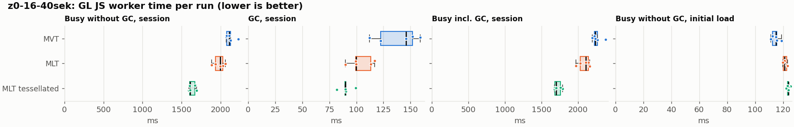
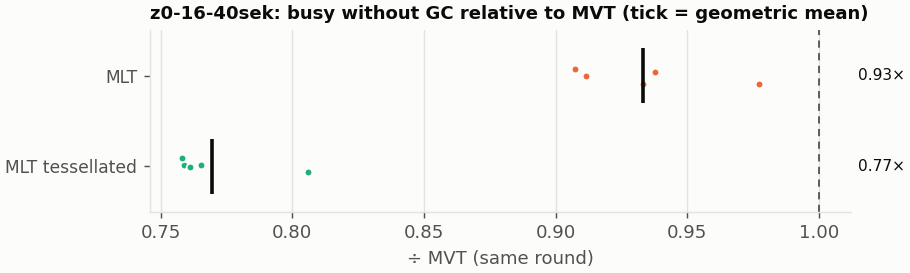
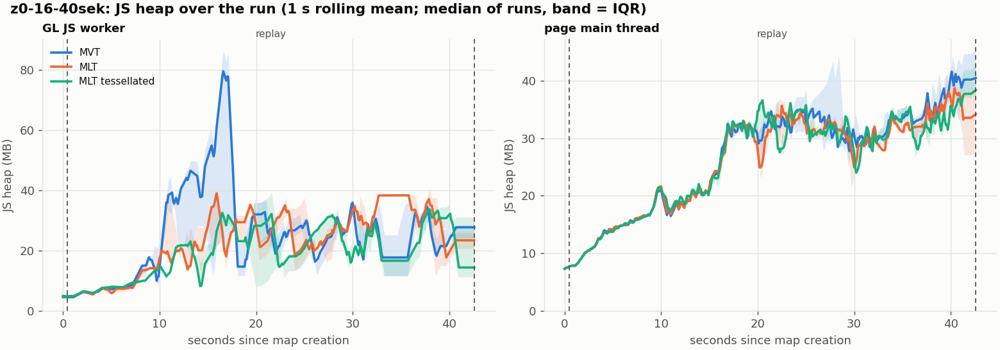
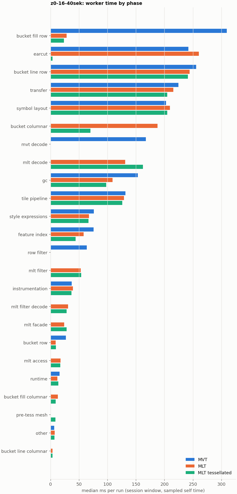

# Session trace benchmark — 20261107-125455

## Setup

- Created 2026-11-07T12:54:55+01:00; 5 repetitions + 1 warm-up round(s) (excluded); variants rotate per round (A B C, B C A, …); one cold browser context per run.
- Machine: , 16 logical cores, None GB RAM, Linux-7.2.9-200.nobara.fc44.x86_64-x86_64-with-glibc2.43; power: ?, AC None.
- GL JS gl7-local-files @ eb3231235c (dirty); worker count 1; viewport {'width': 1280, 'height': 1024}.
- Python 3.14.7, packages {'playwright': '1.64.1', 'numpy': '2.4.6', 'matplotlib': '3.10.8'}.

| variant | bundle | format | bundle sha256 | branch build |
|---|---|---|---|---|
| MVT | `dist/maplibre-gl-dev.mjs` | mvt | `4b8e23c84997` | – |
| MLT | `dist/maplibre-gl-dev.mjs` | mlt | `4b8e23c84997` | – |
| MLT tessellated | `dist/maplibre-gl-dev.mjs` | mlt-pre-tess | `4b8e23c84997` | – |

| session | style | duration | frames | sha256 |
|---|---|---:|---:|---|
| z0-16-40sek | maptiler-basic (recorded: osm-bright) | 42.1 s | 1739 | `55a2b8f22fe2` |

CPU sampling interval (median over runs): 159 µs.

## Definitions

- **busy** = wall time in which a GL JS worker thread runs a task (union of top-level task slices and GC slices on `DedicatedWorker thread`s), summed over workers. **GC** = union of `MinorGC`/`MajorGC`/`V8.GC*` slices on those threads. **busy without GC** = busy − GC (headline metric).
- **CPU** = thread time (`tdur`) of the same slices. Phase categories and functions come from the trace's CPU samples (self time), categorised by `config/categories.toml` (nearest matching frame, leaf to root).
- Windows: **load** = map creation → first idle; **session** = camera replay; **tail** = end of replay → idle; **total** = load + session + tail.
- Ratios are against **MVT**: ratio of medians with a bootstrap 95 % CI, the geometric mean of per-round ratios, and a two-sided Mann–Whitney U p-value (normal approximation, not corrected for multiple comparisons; rough below n = 8). Lower than 1× means less worker time.

## Session `z0-16-40sek`

### Worker busy without GC (session window)

| variant | n ok / failed | median ms | IQR | mean | ratio vs MVT | 95 % CI | geo-mean paired | MWU p |
|---|---:|---:|---:|---:|---:|---:|---:|---:|
| MVT | 5 / 0 | 2,109 | 2,078–2,125 | 2,122 | 1.00× | – | – | – |
| MLT | 5 / 0 | 1,993 | 1,935–2,029 | 1,981 | 0.95× | 0.89–0.98× | 0.93× | 0.012 |
| MLT tessellated | 5 / 0 | 1,611 | 1,605–1,671 | 1,633 | 0.76× | 0.72–0.81× | 0.77× | 0.012 |

### All worker metrics (median, ratio vs baseline)

| metric | MVT | MLT | MLT tessellated |
|---|---:|---:|---:|
| busy incl. GC | 2,237 | 2,106 (0.94×) | 1,700 (0.76×) |
| &nbsp;&nbsp;of which GC | 145.9 | 99.7 (0.68×) | 89.7 (0.61×) |
| &nbsp;&nbsp;of which busy without GC | 2,109 | 1,993 (0.95×) | 1,611 (0.76×) |
| &nbsp;&nbsp;&nbsp;&nbsp;of which filtering (sampled, incl. callees) | 64.0 | 53.1 (0.83×) | 53.9 (0.84×) |
| &nbsp;&nbsp;&nbsp;&nbsp;of which column decoding inside the MLT filter (sampled) | 0.0 | 30.8 | 28.3 |
| &nbsp;&nbsp;&nbsp;&nbsp;of which timing instrumentation (sampled) | 37.0 | 39.2 (1.06×) | 36.9 (1.00×) |
| busy without GC and instrumentation | 2,073 | 1,954 (0.94×) | 1,575 (0.76×) |
| CPU time without GC | 2,042 | 1,920 (0.94×) | 1,545 (0.76×) |
| tile: download end → sent to main thread, median per tile | 24.2 | 22.4 (0.92×) | 18.2 (0.75×) |
| tile: download end → sent to main thread, 90th percentile | 147.8 | 115.8 (0.78×) | 95.6 (0.65×) |
| tile: download end → sent to main thread, 95th percentile | 181.2 | 150.2 (0.83×) | 118.6 (0.65×) |
| tile: download end → sent to main thread, 99th percentile | 281.9 | 260.8 (0.93×) | 147.7 (0.52×) |
| minor GCs | 62.00 | 56.00 (0.90×) | 33.00 (0.53×) |
| major GCs | 9.00 | 7.00 (0.78×) | 9.00 (1.00×) |
| peak worker heap (MB) | 97.0 | 56.9 (0.59×) | 46.9 (0.48×) |
| load: busy without GC | 114.8 | 121.1 (1.05×) | 123.8 (1.08×) |
| load: GC | 4.8 | 5.2 (1.09×) | 4.8 (1.01×) |
| total: busy without GC | 2,221 | 2,112 (0.95×) | 1,734 (0.78×) |

Rows marked *of which* are parts of the row above, not additional time. Tile rows are per-tile latencies (medians over tiles, then over runs), not sums: tiles overlap in time, and the medians of the parse and queue parts do not add up exactly to the median latency.

### Filtering (session window)

Sampled worker time spent in feature filtering, including everything the filter calls (expression evaluation, property access): **row filter** = the style-spec feature filter that MVT runs per feature, **mlt filter** = the columnar MLT filter (incl. the geometry-type selection), without the columns it decodes (see the next table). Medians per run; rules in `config/categories.toml`.

| variant | mlt filter | row filter | filtering | ratio vs MVT | 95 % CI | MWU p | share of sampled busy |
|---|---:|---:|---:|---:|---:|---:|---:|
| MVT | 0.1 | 63.8 | 64.0 | 1.00× | – | – | 3.2% |
| MLT | 53.1 | 0.0 | 53.1 | 0.83× | 0.79–0.95× | 0.012 | 3.0% |
| MLT tessellated | 53.9 | 0.0 | 53.9 | 0.84× | 0.82–0.99× | 0.037 | 3.8% |

**Filtering together with tile decoding.** The MLT decoder leaves columns encoded until something reads them, and the filter is usually the first reader: the columns it decodes (properties, and the geometry for `$type`) are **of which inside the filter** (phase *mlt filter decode*), the rest is *mlt decode* (geometry and columns read later, e.g. by paint properties and symbols). MVT decodes every feature's properties and geometry while it reads the tile (*mvt decode*), whether the filter keeps the feature or not. So **filtering** above compares the filters, and **decoding + filtering** compares all that the formats spend on decoding the tile and selecting features. **tile decoding** = *mvt decode* or *mlt decode* + *mlt filter decode*: work inside a call into a decoder. Reading data that is already decoded is not counted, as for MVT's feature objects: *mlt access* (row views, value getters, looking a column up by name) and the MLT facade (*mlt facade*). MVT decodes geometry only for the features its filter keeps, MLT decodes a layer's whole geometry column.

| variant | tile decoding | of which inside the filter | filtering | decoding + filtering | ratio vs MVT | 95 % CI | MWU p |
|---|---:|---:|---:|---:|---:|---:|---:|
| MVT | 167.2 | 0.0 | 64.0 | 231.3 | 1.00× | – | – |
| MLT | 162.7 | 30.8 | 53.1 | 213.2 | 0.92× | 0.84–0.97× | 0.012 |
| MLT tessellated | 189.2 | 28.3 | 53.9 | 244.4 | 1.06× | 0.96–1.12× | 0.144 |

Top 12 functions inside filtering and its column decoding (self time, mean ms per run):

| phase | function | source | MVT | MLT | MLT tessellated |
|---|---|---|---:|---:|---:|
| row filter | `evaluate` | node_modules/@maplibre/maplibre-gl-style-spec/dist/expression/compound_expression.mjs | 17.8 | 0.0 | 0.0 |
| row filter | `evaluate` | node_modules/@maplibre/maplibre-gl-style-spec/dist/expression/index.mjs | 10.7 | 0.0 | 0.0 |
| mlt filter | `filterByGeometryType` | maplibre-tile-spec/ts/dist/vector/geometry/geometryVector.js | 0.0 | 6.5 | 8.0 |
| row filter | `CompoundExpression.register.filter-==` | node_modules/@maplibre/maplibre-gl-style-spec/dist/expression/compound_expression.mjs | 7.5 | 0.0 | 0.0 |
| row filter | `CompoundExpression.register.filter-in-small` | node_modules/@maplibre/maplibre-gl-style-spec/dist/expression/compound_expression.mjs | 7.0 | 0.0 | 0.0 |
| row filter | `filter` | node_modules/@maplibre/maplibre-gl-style-spec/dist/feature_filter/index.mjs | 5.9 | 0.0 | 0.0 |
| row filter | `CompoundExpression.register.filter-type-==` | node_modules/@maplibre/maplibre-gl-style-spec/dist/expression/compound_expression.mjs | 4.6 | 0.0 | 0.0 |
| mlt filter | `scanDictionaryCodes` | maplibre-tile-spec/ts/dist/processing/filter/execution/filterKernel.js | 0.0 | 3.8 | 4.5 |
| mlt filter | `dictionaryRowMatches` | maplibre-tile-spec/ts/dist/processing/filter/execution/filterKernel.js | 0.0 | 4.1 | 3.8 |
| mlt filter | `resolveDictionaryExecutor` | maplibre-tile-spec/ts/dist/processing/filter/execution/filterKernel.js | 0.0 | 3.7 | 3.0 |
| mlt filter decode | `decodeFsst` | maplibre-tile-spec/ts/dist/decoding/fsstDecoder.js | 0.0 | 2.7 | 3.1 |
| row filter | `CompoundExpression.register.all.overloads` | node_modules/@maplibre/maplibre-gl-style-spec/dist/expression/compound_expression.mjs | 2.8 | 0.0 | 0.0 |

### Bucket time by layer type (session window)

Sampled self time of the bucket code per layer type, row and columnar path together (median ms per run). **shared bucket code** is code all layer types use (`src/data/bucket/*` outside the layer files, `columnar_populate.ts`, `columnar_mesh_arrays.ts`, `load_geometry.ts`). **earcut** triangulates for fill and fill-extrusion on the row path; **pre-tess mesh** takes over the stored triangles of a pre-tessellated fill. **symbol** is the whole symbol layout phase. For exact wall time per source layer and type see the timing log tables below (builds with `worker_timing.ts` only).

| variant | fill | fill-extrusion | line | symbol | shared bucket code | earcut | pre-tess mesh | total |
|---|---:|---:|---:|---:|---:|---:|---:|---:|
| MVT | 309.6 | 0.0 | 255.7 | 202.9 | 26.7 | 241.9 | 0.0 | 1,035 |
| MLT | 41.8 | 0.0 | 247.6 | 209.6 | 196.5 | 260.4 | 0.0 | 956.6 |
| MLT tessellated | 32.2 | 0.0 | 246.0 | 204.8 | 80.1 | 3.4 | 8.5 | 570.4 |

### Where the variants differ from MVT (session window, mean ms per run)

Open **[flame.html](flame.html)** to explore the call tree interactively: pick a variant, compare it with MVT (red = more time at the same call path, blue = less), click a frame to zoom in, and read the phase and function breakdown under it. Without a comparison, frames are coloured by phase: filtering is green in both formats, and the columns the MLT filter decodes on first access (*mlt filter decode*) are MLT blue frames under the green filter. `flame/*.txt` open in https://www.speedscope.app.

#### MLT vs MVT

**By phase** (sampled self time; the Δ column sums to the difference in sampled busy time):

| phase | MVT | MLT | Δ |
|---|---:|---:|---:|
| bucket columnar | 0.0 | 185.4 | +185.4 |
| mlt decode | 0.0 | 128.4 | +128.4 |
| mlt filter | 0.1 | 54.5 | +54.4 |
| mlt filter decode | 0.0 | 30.2 | +30.2 |
| mlt facade | 0.1 | 24.7 | +24.6 |
| mlt access | 0.0 | 18.0 | +18.0 |
| bucket fill columnar | 0.0 | 12.8 | +12.8 |
| earcut | 242.9 | 255.7 | +12.8 |
| bucket line columnar | 0.0 | 3.5 | +3.5 |
| symbol layout | 205.9 | 208.3 | +2.4 |
| instrumentation | 36.8 | 37.6 | +0.8 |
| runtime | 15.7 | 12.5 | -3.2 |
| tile pipeline | 133.2 | 127.0 | -6.2 |
| style expressions | 75.2 | 68.3 | -6.9 |
| transfer | 225.2 | 217.9 | -7.3 |
| bucket line row | 257.5 | 246.2 | -11.3 |
| bucket row | 26.6 | 9.1 | -17.5 |
| feature index | 74.5 | 56.8 | -17.7 |
| gc | 147.4 | 113.2 | -34.2 |
| row filter | 62.9 | 0.0 | -62.9 |
| mvt decode | 173.3 | 0.0 | -173.3 |
| bucket fill row | 309.8 | 28.1 | -281.7 |

**Functions with the largest self-time difference** (by function name, summed over source files):

| function | MVT | MLT | Δ |
|---|---:|---:|---:|
| `writeEarcutFill` | 0.0 | 23.6 | +23.6 |
| `buildRingBoundingBoxes` | 0.0 | 20.5 | +20.5 |
| `buildEarcutMesh` | 0.0 | 20.3 | +20.3 |
| `decodeComponentwiseDeltaVec2` | 0.0 | 19.6 | +19.6 |
| `signedArea$2` | 2.7 | 15.5 | +12.8 |
| `readScaledRings` | 0.0 | 12.0 | +12.0 |
| `fillLargeMeshArrays` | 15.6 | 26.0 | +10.4 |
| `decodeFsst` | 0.0 | 7.9 | +7.9 |
| `decodeString$2` | 0.0 | 7.8 | +7.8 |
| `decodeFastPforInt32` | 0.0 | 7.6 | +7.6 |
| `get` | 10.3 | 17.5 | +7.2 |
| `filterByGeometryType` | 0.0 | 6.5 | +6.5 |
| `_vertexToIndex` | 100.8 | 0.3 | -100.4 |
| `readVarint` | 43.5 | 2.2 | -41.3 |
| `loadGeometry` | 44.2 | 8.5 | -35.8 |
| `(garbage collector)` | 147.4 | 113.2 | -34.2 |
| `populate` | 39.2 | 6.4 | -32.9 |

#### MLT tessellated vs MVT

**By phase** (sampled self time; the Δ column sums to the difference in sampled busy time):

| phase | MVT | MLT tessellated | Δ |
|---|---:|---:|---:|
| mlt decode | 0.0 | 162.5 | +162.5 |
| bucket columnar | 0.0 | 72.1 | +72.1 |
| mlt filter | 0.1 | 56.4 | +56.3 |
| mlt filter decode | 0.0 | 27.6 | +27.6 |
| mlt facade | 0.1 | 27.1 | +27.0 |
| mlt access | 0.0 | 17.6 | +17.6 |
| pre-tess mesh | 0.0 | 8.6 | +8.6 |
| bucket fill columnar | 0.0 | 8.4 | +8.4 |
| bucket line columnar | 0.0 | 3.5 | +3.5 |
| instrumentation | 36.8 | 35.9 | -0.9 |
| symbol layout | 205.9 | 204.9 | -1.0 |
| runtime | 15.7 | 14.2 | -1.5 |
| tile pipeline | 133.2 | 125.9 | -7.3 |
| style expressions | 75.2 | 65.5 | -9.7 |
| bucket line row | 257.5 | 245.8 | -11.7 |
| bucket row | 26.6 | 8.7 | -17.9 |
| transfer | 225.2 | 206.0 | -19.1 |
| feature index | 74.5 | 44.2 | -30.3 |
| gc | 147.4 | 97.9 | -49.5 |
| row filter | 62.9 | 0.0 | -62.9 |
| mvt decode | 173.3 | 0.0 | -173.3 |
| earcut | 242.9 | 3.4 | -239.5 |
| bucket fill row | 309.8 | 23.9 | -285.9 |

**Functions with the largest self-time difference** (by function name, summed over source files):

| function | MVT | MLT tessellated | Δ |
|---|---:|---:|---:|
| `writeTessellatedFill` | 0.0 | 19.6 | +19.6 |
| `decodeComponentwiseDeltaVec2` | 0.0 | 18.2 | +18.2 |
| `decodeUnsignedZigZagDeltaInt32` | 0.0 | 17.1 | +17.1 |
| `decodeFastPforInt32` | 0.0 | 8.6 | +8.6 |
| `buildTessellatedBoundingBox` | 0.0 | 8.4 | +8.4 |
| `filterByGeometryType` | 0.0 | 8.0 | +8.0 |
| `decodeFsst` | 0.0 | 7.8 | +7.8 |
| `readVertices` | 0.0 | 7.5 | +7.5 |
| `decodeString$2` | 0.0 | 7.5 | +7.5 |
| `fastUnpack256_4` | 0.0 | 7.4 | +7.4 |
| `appendScaledVertices` | 0.0 | 5.8 | +5.8 |
| `decodeBigEndianInt32sInto` | 0.0 | 5.7 | +5.7 |
| `_vertexToIndex` | 100.8 | 0.2 | -100.5 |
| `isEar` | 74.2 | 0.6 | -73.6 |
| `(garbage collector)` | 147.4 | 97.9 | -49.5 |
| `readVarint` | 43.5 | 2.1 | -41.5 |
| `loadGeometry` | 44.2 | 7.8 | -36.4 |

### Memory (session window)

**JS heap** = V8's used heap of the thread (`jsHeapSizeUsed` from the trace's `UpdateCounters`, about every 20 ms; the mean is time-weighted). It does not include ArrayBuffer contents, so the tile data itself (vertex, index and feature-index arrays) is not in it: **tile data sent to the main thread** is the size of the ArrayBuffers each tile result transfers (`web/worker_hook.js`), which then live on the main thread and are uploaded to the GPU. **garbage collected** = heap freed by the worker's GCs, a measure of how much it allocates. Medians per run; ratio of medians with a bootstrap 95 % CI.

| metric | MVT | MLT | MLT tessellated |
|---|---:|---:|---:|
| worker JS heap, mean (MB) | 22.1 | 19.9 (0.90×, 0.72–1.19×) | 17.0 (0.77×, 0.61–1.04×) |
| worker JS heap, peak (MB) | 97.0 | 56.9 (0.59×, 0.51–0.95×) | 46.9 (0.48×, 0.45–0.80×) |
| worker JS heap after the last GC (MB) | 10.4 | 13.2 (1.27×, 0.35–2.60×) | 7.5 (0.72×, 0.20–1.40×) |
| garbage collected in the worker (MB) | 1,449 | 1,042 (0.72×, 0.70–0.72×) | 543.6 (0.38×, 0.36–0.39×) |
| main thread JS heap, mean (MB) | 25.1 | 24.1 (0.96×, 0.92–1.01×) | 24.1 (0.96×, 0.92–1.01×) |
| main thread JS heap, peak (MB) | 52.3 | 47.5 (0.91×, 0.85–1.07×) | 45.4 (0.87×, 0.84–1.02×) |
| main thread JS heap at the end of the replay (MB) | 40.8 | 34.2 (0.84×, 0.52–1.47×) | 38.3 (0.94×, 0.52–1.65×) |
| tile data sent to the main thread, total (MB) | 91.4 | 84.1 (0.92×, 0.92–0.92×) | 84.3 (0.92×, 0.92–0.93×) |
| tile data sent to the main thread, median per tile (KB) | 195.1 | 177.9 (0.91×, 0.91–0.92×) | 179.9 (0.92×, 0.90–0.93×) |

### Worker time by phase (session window, median ms of sampled self time)

| phase | MVT | MLT | MLT tessellated |
|---|---:|---:|---:|
| bucket fill row | 309.6 | 28.2 | 23.7 |
| earcut | 241.9 | 260.4 | 3.4 |
| bucket line row | 255.7 | 244.2 | 241.3 |
| transfer | 224.5 | 215.5 | 204.7 |
| symbol layout | 202.9 | 209.6 | 204.8 |
| bucket columnar | 0.0 | 188.0 | 70.1 |
| mvt decode | 167.2 | 0.0 | 0.0 |
| mlt decode | 0.0 | 131.0 | 162.4 |
| gc | 153.4 | 108.7 | 97.9 |
| tile pipeline | 131.4 | 128.7 | 125.9 |
| style expressions | 75.8 | 67.6 | 66.7 |
| feature index | 75.6 | 57.9 | 44.0 |
| row filter | 63.8 | 0.0 | 0.0 |
| mlt filter | 0.1 | 53.1 | 53.9 |
| instrumentation | 37.0 | 39.2 | 36.9 |
| mlt filter decode | 0.0 | 30.8 | 28.3 |
| mlt facade | 0.0 | 24.1 | 28.3 |
| bucket row | 26.7 | 9.0 | 9.3 |
| mlt access | 0.0 | 17.7 | 17.1 |
| runtime | 15.9 | 12.0 | 13.7 |
| bucket fill columnar | 0.0 | 12.9 | 9.0 |
| pre-tess mesh | 0.0 | 0.0 | 8.5 |
| other | 6.5 | 7.3 | 6.9 |
| bucket line columnar | 0.0 | 3.6 | 3.3 |
| bucket fill-extrusion row | 0.0 | 0.0 | 0.0 |

### Top 20 worker functions by self time (session window, mean ms per run)

| function | source | phase | MVT | MLT | MLT tessellated |
|---|---|---|---:|---:|---:|
| `(garbage collector)` | (native) | gc | 147.4 | 113.2 | 97.9 |
| `_vertexToIndex` | src/render/subdivision.ts | bucket fill row | 100.8 | 0.3 | 0.2 |
| `reserve` | src/util/struct_array.ts | bucket fill row | 89.0 | 79.0 | 73.9 |
| `isEar` | node_modules/earcut/src/earcut.js | earcut | 74.2 | 74.9 | 0.6 |
| `emplace` | src/data/array_types.g.ts | bucket line row | 52.3 | 52.7 | 53.0 |
| `fetch` | (native) | tile pipeline | 51.7 | 52.4 | 51.9 |
| `_trim` | src/util/struct_array.ts | transfer | 46.0 | 34.4 | 31.5 |
| `readVarint` | node_modules/pbf/index.js | mvt decode | 43.5 | 0.0 | 0.0 |
| `setTimeout` | (native) | transfer | 42.9 | 42.8 | 42.1 |
| `postMessage` | (native) | transfer | 40.6 | 42.5 | 40.6 |
| `serialize` | src/util/web_worker_transfer.ts | transfer | 38.6 | 40.4 | 37.3 |
| `isEarHashed` | node_modules/earcut/src/earcut.js | earcut | 34.6 | 34.8 | 0.5 |
| `addLine` | src/data/bucket/line_bucket.ts | bucket line row | 32.5 | 33.8 | 33.9 |
| `insert` | src/data/feature_index.ts | feature index | 31.7 | 14.6 | 9.2 |
| `addHalfVertex` | src/data/bucket/line_bucket.ts | bucket line row | 27.4 | 30.7 | 28.1 |
| `readString` | node_modules/pbf/index.js | mvt decode | 29.6 | 0.0 | 0.0 |
| `VectorTileFeature` | node_modules/@mapbox/vector-tile/index.js | mvt decode | 29.0 | 0.0 | 0.0 |
| `addCurrentVertex` | src/data/bucket/line_bucket.ts | bucket line row | 26.0 | 27.8 | 28.5 |
| `earcutLinked` | node_modules/earcut/src/earcut.js | earcut | 28.3 | 25.6 | 0.4 |
| `fillLargeMeshArrays` | src/render/fill_large_mesh_arrays.ts | bucket columnar | 15.6 | 26.0 | 0.5 |

### Top 20 worker functions by total time (incl. callees) (session window, mean ms per run)

| function | source | phase | MVT | MLT | MLT tessellated |
|---|---|---|---:|---:|---:|
| `parse` | src/source/worker_tile.ts | tile pipeline | 1,435 | 1,376 | 1,024 |
| `loadTile` | src/source/vector_tile_worker_source.ts | tile pipeline | 1,353 | 1,249 | 898.3 |
| `_parseWorkerTile` | src/source/vector_tile_worker_source.ts | tile pipeline | 1,255 | 1,185 | 836.6 |
| `populate` | src/data/bucket/fill_bucket.ts | bucket fill row | 657.0 | 0.0 | 0.0 |
| `addBucketFeatures` | src/data/bucket/fill_bucket.ts | bucket fill row | 562.7 | 432.4 | 71.9 |
| `populate` | src/data/bucket/columnar/columnar_fill_bucket.ts | bucket fill columnar | 0.0 | 550.3 | 213.4 |
| `addFeature` | src/data/bucket/fill_bucket.ts |  | 527.2 | 4.2 | 3.0 |
| `subdividePolygon` | src/render/subdivision.ts | bucket fill row | 440.9 | 3.6 | 2.5 |
| `subdividePolygonInternal` | src/render/subdivision.ts | bucket fill row | 435.2 | 3.6 | 2.5 |
| `addFeature` | src/data/bucket/columnar/columnar_fill_bucket.ts | bucket fill columnar | 0.0 | 414.3 | 64.0 |
| `writeEarcutFill` | src/data/bucket/columnar/columnar_mesh_arrays.ts | bucket columnar | 0.0 | 401.6 | 4.3 |
| `populate` | src/data/bucket/columnar/columnar_line_bucket.ts | bucket line columnar | 0.0 | 322.7 | 325.5 |
| `populate` | src/data/bucket/line_bucket.ts | bucket line row | 307.1 | 0.0 | 0.0 |
| `buildEarcutMesh` | src/data/bucket/columnar/columnar_mesh_arrays.ts | bucket columnar | 0.0 | 286.8 | 2.3 |
| `processTask` | src/util/actor.ts | transfer | 263.1 | 259.3 | 245.9 |
| `earcut` | node_modules/earcut/src/earcut.js | earcut | 242.8 | 255.4 | 3.4 |
| `addBucketFeatures` | src/data/bucket/line_bucket.ts | bucket line row | 213.9 | 225.4 | 225.3 |
| `addFeature` | src/data/bucket/line_bucket.ts | bucket line row | 189.9 | 198.8 | 201.7 |
| `earcutLinked` | node_modules/earcut/src/earcut.js | earcut | 186.7 | 186.6 | 2.3 |
| `completeTask` | src/util/actor.ts | transfer | 185.7 | 177.0 | 164.0 |

## Runs

18 ok, 0 failed/aborted, 0 not run, 15 used in statistics.

## Validity checks

- Counted once: all 18 analysed runs pass (windows load + session + tail add up to total; phases add up to the sampled busy time; GC and sampled time lie within busy time; no timing-log line twice).
- no other check triggered

## Files

- `runs.csv`: one row per run (incl. failed and warm-up runs), every scalar metric as `<window>.<metric>`.
- `summary.csv`: session × variant × metric statistics.
- `functions.csv`, `categories.csv`: CPU-sample self/total time per function and phase per run and window.
- `category_functions.csv`: self time per phase × function (e.g. what the filters spend their time on).
- `tiles.csv`, `tile_layers.csv`, `tile_phases.csv`: the per-tile worker timing log, long format.
- `flame.html`: interactive call tree per variant with a diff view; `flame/*.txt`: collapsed stacks for speedscope.
- `analysis/stacks.csv` (per run): sampled self time per full call stack.
- `tile_latency.csv`: per tile request, worker clock: received, download start/end, result sent, latency = sent − download end, parse_ms, wait_ms = latency − parse.
- `runs/<session>/<variant>/rep-NN/trace.json.gz`: the raw trace (opens in the DevTools Performance tab).
