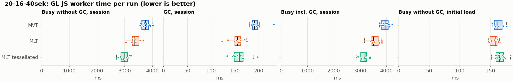
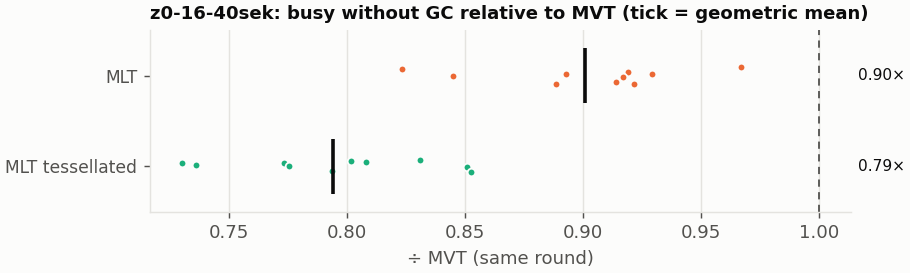
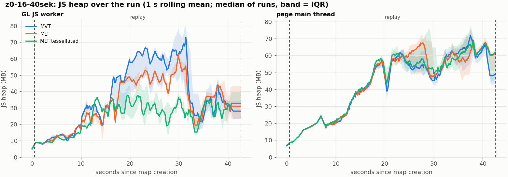
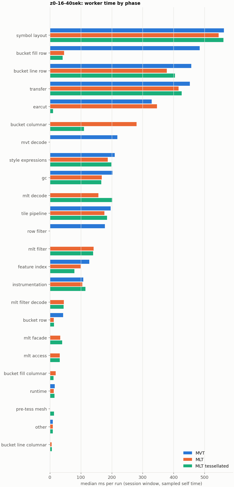

# Session trace benchmark — 20261107-131921

## Setup

- Created 2026-11-07T13:19:21+01:00; 10 repetitions + 1 warm-up round(s) (excluded); variants rotate per round (A B C, B C A, …); one cold browser context per run.
- Machine: , 16 logical cores, None GB RAM, Linux-7.2.9-200.nobara.fc44.x86_64-x86_64-with-glibc2.43; power: ?, AC None.
- GL JS gl7-local-files @ eb3231235c (dirty); worker count 1; viewport {'width': 1280, 'height': 1024}.
- Python 3.14.7, packages {'playwright': '1.64.1', 'numpy': '2.4.6', 'matplotlib': '3.10.8'}.

| variant | bundle | format | bundle sha256 | branch build |
|---|---|---|---|---|
| MVT | `dist/maplibre-gl-dev.mjs` | mvt | `4b8e23c84997` | – |
| MLT | `dist/maplibre-gl-dev.mjs` | mlt | `4b8e23c84997` | – |
| MLT tessellated | `dist/maplibre-gl-dev.mjs` | mlt-pre-tess | `4b8e23c84997` | – |

| session | style | duration | frames | sha256 |
|---|---|---:|---:|---|
| z0-16-40sek | osm-bright | 42.1 s | 1739 | `55a2b8f22fe2` |

CPU sampling interval (median over runs): 159 µs.

## Definitions

- **busy** = wall time in which a GL JS worker thread runs a task (union of top-level task slices and GC slices on `DedicatedWorker thread`s), summed over workers. **GC** = union of `MinorGC`/`MajorGC`/`V8.GC*` slices on those threads. **busy without GC** = busy − GC (headline metric).
- **CPU** = thread time (`tdur`) of the same slices. Phase categories and functions come from the trace's CPU samples (self time), categorised by `config/categories.toml` (nearest matching frame, leaf to root).
- Windows: **load** = map creation → first idle; **session** = camera replay; **tail** = end of replay → idle; **total** = load + session + tail.
- Ratios are against **MVT**: ratio of medians with a bootstrap 95 % CI, the geometric mean of per-round ratios, and a two-sided Mann–Whitney U p-value (normal approximation, not corrected for multiple comparisons; rough below n = 8). Lower than 1× means less worker time.

## Session `z0-16-40sek`

### Worker busy without GC (session window)

| variant | n ok / failed | median ms | IQR | mean | ratio vs MVT | 95 % CI | geo-mean paired | MWU p |
|---|---:|---:|---:|---:|---:|---:|---:|---:|
| MVT | 10 / 0 | 3,750 | 3,617–3,863 | 3,755 | 1.00× | – | – | – |
| MLT | 10 / 0 | 3,342 | 3,289–3,522 | 3,385 | 0.89× | 0.85–0.96× | 0.90× | 0.001 |
| MLT tessellated | 10 / 0 | 3,013 | 2,866–3,104 | 2,985 | 0.80× | 0.75–0.85× | 0.79× | <0.001 |

### All worker metrics (median, ratio vs baseline)

| metric | MVT | MLT | MLT tessellated |
|---|---:|---:|---:|
| busy incl. GC | 3,940 | 3,499 (0.89×) | 3,186 (0.81×) |
| &nbsp;&nbsp;of which GC | 190.5 | 155.1 (0.81×) | 158.8 (0.83×) |
| &nbsp;&nbsp;of which busy without GC | 3,750 | 3,342 (0.89×) | 3,013 (0.80×) |
| &nbsp;&nbsp;&nbsp;&nbsp;of which filtering (sampled, incl. callees) | 178.2 | 141.7 (0.80×) | 139.8 (0.78×) |
| &nbsp;&nbsp;&nbsp;&nbsp;of which column decoding inside the MLT filter (sampled) | 0.0 | 45.0 | 44.2 |
| &nbsp;&nbsp;&nbsp;&nbsp;of which timing instrumentation (sampled) | 108.1 | 105.2 (0.97×) | 114.8 (1.06×) |
| busy without GC and instrumentation | 3,638 | 3,236 (0.89×) | 2,897 (0.80×) |
| CPU time without GC | 3,640 | 3,234 (0.89×) | 2,900 (0.80×) |
| tile: download end → sent to main thread, median per tile | 55.3 | 53.2 (0.96×) | 44.0 (0.79×) |
| tile: download end → sent to main thread, 90th percentile | 208.3 | 178.8 (0.86×) | 141.8 (0.68×) |
| tile: download end → sent to main thread, 95th percentile | 303.0 | 255.5 (0.84×) | 186.8 (0.62×) |
| tile: download end → sent to main thread, 99th percentile | 341.0 | 288.0 (0.84×) | 217.3 (0.64×) |
| minor GCs | 96.00 | 74.00 (0.77×) | 41.00 (0.43×) |
| major GCs | 6.00 | 6.00 (1.00×) | 11.50 (1.92×) |
| peak worker heap (MB) | 90.4 | 74.5 (0.82×) | 53.4 (0.59×) |
| load: busy without GC | 161.0 | 157.5 (0.98×) | 165.2 (1.03×) |
| load: GC | 8.2 | 7.5 (0.91×) | 8.8 (1.07×) |
| total: busy without GC | 3,913 | 3,495 (0.89×) | 3,178 (0.81×) |

Rows marked *of which* are parts of the row above, not additional time. Tile rows are per-tile latencies (medians over tiles, then over runs), not sums: tiles overlap in time, and the medians of the parse and queue parts do not add up exactly to the median latency.

### Filtering (session window)

Sampled worker time spent in feature filtering, including everything the filter calls (expression evaluation, property access): **row filter** = the style-spec feature filter that MVT runs per feature, **mlt filter** = the columnar MLT filter (incl. the geometry-type selection), without the columns it decodes (see the next table). Medians per run; rules in `config/categories.toml`.

| variant | mlt filter | row filter | filtering | ratio vs MVT | 95 % CI | MWU p | share of sampled busy |
|---|---:|---:|---:|---:|---:|---:|---:|
| MVT | 0.2 | 178.1 | 178.2 | 1.00× | – | – | 4.9% |
| MLT | 141.7 | 0.0 | 141.7 | 0.80× | 0.75–0.84× | <0.001 | 4.4% |
| MLT tessellated | 139.8 | 0.0 | 139.8 | 0.78× | 0.74–0.86× | <0.001 | 5.0% |

**Filtering together with tile decoding.** The MLT decoder leaves columns encoded until something reads them, and the filter is usually the first reader: the columns it decodes (properties, and the geometry for `$type`) are **of which inside the filter** (phase *mlt filter decode*), the rest is *mlt decode* (geometry and columns read later, e.g. by paint properties and symbols). MVT decodes every feature's properties and geometry while it reads the tile (*mvt decode*), whether the filter keeps the feature or not. So **filtering** above compares the filters, and **decoding + filtering** compares all that the formats spend on decoding the tile and selecting features. **tile decoding** = *mvt decode* or *mlt decode* + *mlt filter decode*: work inside a call into a decoder. Reading data that is already decoded is not counted, as for MVT's feature objects: *mlt access* (row views, value getters, looking a column up by name) and the MLT facade (*mlt facade*). MVT decodes geometry only for the features its filter keeps, MLT decodes a layer's whole geometry column.

| variant | tile decoding | of which inside the filter | filtering | decoding + filtering | ratio vs MVT | 95 % CI | MWU p |
|---|---:|---:|---:|---:|---:|---:|---:|
| MVT | 217.9 | 0.0 | 178.2 | 395.2 | 1.00× | – | – |
| MLT | 203.4 | 45.0 | 141.7 | 344.3 | 0.87× | 0.81–0.94× | <0.001 |
| MLT tessellated | 248.1 | 44.2 | 139.8 | 389.8 | 0.99× | 0.90–1.05× | 0.345 |

Top 12 functions inside filtering and its column decoding (self time, mean ms per run):

| phase | function | source | MVT | MLT | MLT tessellated |
|---|---|---|---:|---:|---:|
| row filter | `evaluate` | node_modules/@maplibre/maplibre-gl-style-spec/dist/expression/compound_expression.mjs | 54.8 | 0.0 | 0.0 |
| row filter | `CompoundExpression.register.filter-in-small` | node_modules/@maplibre/maplibre-gl-style-spec/dist/expression/compound_expression.mjs | 25.1 | 0.0 | 0.0 |
| row filter | `CompoundExpression.register.filter-==` | node_modules/@maplibre/maplibre-gl-style-spec/dist/expression/compound_expression.mjs | 21.8 | 0.0 | 0.0 |
| row filter | `evaluate` | node_modules/@maplibre/maplibre-gl-style-spec/dist/expression/index.mjs | 18.8 | 0.0 | 0.0 |
| mlt filter | `scanDictionaryCodes` | maplibre-tile-spec/ts/dist/processing/filter/execution/filterKernel.js | 0.0 | 14.2 | 14.1 |
| row filter | `filter` | node_modules/@maplibre/maplibre-gl-style-spec/dist/feature_filter/index.mjs | 13.9 | 0.0 | 0.0 |
| row filter | `CompoundExpression.register.all.overloads` | node_modules/@maplibre/maplibre-gl-style-spec/dist/expression/compound_expression.mjs | 13.0 | 0.0 | 0.0 |
| mlt filter | `dictionaryRowMatches` | maplibre-tile-spec/ts/dist/processing/filter/execution/filterKernel.js | 0.0 | 12.8 | 12.1 |
| mlt filter | `filterByGeometryType` | maplibre-tile-spec/ts/dist/vector/geometry/geometryVector.js | 0.0 | 11.1 | 12.3 |
| mlt filter | `bytesEqual` | maplibre-tile-spec/ts/dist/processing/filter/execution/filterKernel.js | 0.0 | 8.9 | 8.5 |
| mlt filter | `getNormalizedFilter` | maplibre-tile-spec/ts/dist/processing/filter/filterCache.js | 0.0 | 8.2 | 7.9 |
| mlt filter | `resolveDictionaryExecutor` | maplibre-tile-spec/ts/dist/processing/filter/execution/filterKernel.js | 0.0 | 7.9 | 8.0 |

### Bucket time by layer type (session window)

Sampled self time of the bucket code per layer type, row and columnar path together (median ms per run). **shared bucket code** is code all layer types use (`src/data/bucket/*` outside the layer files, `columnar_populate.ts`, `columnar_mesh_arrays.ts`, `load_geometry.ts`). **earcut** triangulates for fill and fill-extrusion on the row path; **pre-tess mesh** takes over the stored triangles of a pre-tessellated fill. **symbol** is the whole symbol layout phase. For exact wall time per source layer and type see the timing log tables below (builds with `worker_timing.ts` only).

| variant | fill | fill-extrusion | line | symbol | shared bucket code | earcut | pre-tess mesh | total |
|---|---:|---:|---:|---:|---:|---:|---:|---:|
| MVT | 484.8 | 0.0 | 457.0 | 563.2 | 42.5 | 329.1 | 0.0 | 1,876 |
| MLT | 64.7 | 0.0 | 383.6 | 545.5 | 293.0 | 346.4 | 0.0 | 1,636 |
| MLT tessellated | 52.9 | 0.0 | 411.5 | 561.5 | 123.7 | 10.2 | 13.2 | 1,176 |

### Where the variants differ from MVT (session window, mean ms per run)

Open **[flame.html](flame.html)** to explore the call tree interactively: pick a variant, compare it with MVT (red = more time at the same call path, blue = less), click a frame to zoom in, and read the phase and function breakdown under it. Without a comparison, frames are coloured by phase: filtering is green in both formats, and the columns the MLT filter decodes on first access (*mlt filter decode*) are MLT blue frames under the green filter. `flame/*.txt` open in https://www.speedscope.app.

#### MLT vs MVT

**By phase** (sampled self time; the Δ column sums to the difference in sampled busy time):

| phase | MVT | MLT | Δ |
|---|---:|---:|---:|
| bucket columnar | 0.0 | 284.2 | +284.2 |
| mlt decode | 0.0 | 158.7 | +158.7 |
| mlt filter | 0.1 | 140.3 | +140.1 |
| mlt filter decode | 0.0 | 45.0 | +45.0 |
| mlt facade | 0.1 | 34.1 | +34.0 |
| mlt access | 0.0 | 31.7 | +31.7 |
| bucket fill columnar | 0.0 | 19.8 | +19.8 |
| earcut | 328.6 | 346.5 | +17.9 |
| bucket line columnar | 0.0 | 5.6 | +5.6 |
| runtime | 16.0 | 13.6 | -2.4 |
| instrumentation | 110.7 | 107.7 | -3.0 |
| symbol layout | 566.2 | 550.1 | -16.2 |
| tile pipeline | 197.4 | 179.4 | -18.1 |
| style expressions | 214.9 | 188.0 | -26.8 |
| bucket row | 42.2 | 12.6 | -29.6 |
| feature index | 127.7 | 98.0 | -29.7 |
| transfer | 452.0 | 420.5 | -31.4 |
| gc | 207.0 | 164.5 | -42.5 |
| bucket line row | 460.3 | 384.4 | -75.9 |
| row filter | 179.0 | 0.0 | -179.0 |
| mvt decode | 217.7 | 0.0 | -217.7 |
| bucket fill row | 484.1 | 46.4 | -437.7 |

**Functions with the largest self-time difference** (by function name, summed over source files):

| function | MVT | MLT | Δ |
|---|---:|---:|---:|
| `buildRingBoundingBoxes` | 0.0 | 33.1 | +33.1 |
| `buildEarcutMesh` | 0.0 | 31.9 | +31.9 |
| `writeEarcutFill` | 0.0 | 31.6 | +31.6 |
| `signedArea$2` | 5.1 | 27.5 | +22.5 |
| `decodeComponentwiseDeltaVec2` | 0.0 | 21.5 | +21.5 |
| `readScaledRings` | 0.0 | 17.2 | +17.2 |
| `fillLargeMeshArrays` | 24.9 | 41.7 | +16.8 |
| `scanDictionaryCodes` | 0.0 | 14.2 | +14.2 |
| `get` | 33.7 | 47.3 | +13.6 |
| `decodeString$2` | 0.0 | 12.9 | +12.9 |
| `dictionaryRowMatches` | 0.0 | 12.8 | +12.8 |
| `filterByGeometryType` | 0.0 | 11.1 | +11.1 |
| `_vertexToIndex` | 147.5 | 0.8 | -146.7 |
| `populate` | 101.0 | 10.0 | -91.0 |
| `evaluate` | 94.6 | 23.2 | -71.4 |
| `loadGeometry` | 68.3 | 11.4 | -56.9 |
| `readVarint` | 58.8 | 3.3 | -55.5 |

#### MLT tessellated vs MVT

**By phase** (sampled self time; the Δ column sums to the difference in sampled busy time):

| phase | MVT | MLT tessellated | Δ |
|---|---:|---:|---:|
| mlt decode | 0.0 | 200.1 | +200.1 |
| mlt filter | 0.1 | 142.4 | +142.3 |
| bucket columnar | 0.0 | 110.2 | +110.2 |
| mlt filter decode | 0.0 | 44.0 | +44.0 |
| mlt facade | 0.1 | 38.9 | +38.8 |
| mlt access | 0.0 | 31.4 | +31.4 |
| pre-tess mesh | 0.0 | 13.3 | +13.3 |
| bucket fill columnar | 0.0 | 11.8 | +11.8 |
| bucket line columnar | 0.0 | 6.0 | +6.0 |
| instrumentation | 110.7 | 112.0 | +1.2 |
| runtime | 16.0 | 14.8 | -1.3 |
| symbol layout | 566.2 | 559.7 | -6.5 |
| tile pipeline | 197.4 | 186.6 | -10.9 |
| style expressions | 214.9 | 194.9 | -19.9 |
| transfer | 452.0 | 426.0 | -25.9 |
| bucket row | 42.2 | 13.1 | -29.0 |
| gc | 207.0 | 168.0 | -39.0 |
| feature index | 127.7 | 78.5 | -49.2 |
| bucket line row | 460.3 | 406.6 | -53.7 |
| row filter | 179.0 | 0.0 | -179.0 |
| mvt decode | 217.7 | 0.0 | -217.7 |
| earcut | 328.6 | 10.2 | -318.4 |
| bucket fill row | 484.1 | 41.3 | -442.8 |

**Functions with the largest self-time difference** (by function name, summed over source files):

| function | MVT | MLT tessellated | Δ |
|---|---:|---:|---:|
| `writeTessellatedFill` | 0.0 | 27.1 | +27.1 |
| `decodeComponentwiseDeltaVec2` | 0.0 | 21.8 | +21.8 |
| `decodeUnsignedZigZagDeltaInt32` | 0.0 | 18.7 | +18.7 |
| `scanDictionaryCodes` | 0.0 | 14.1 | +14.1 |
| `decodeString$2` | 0.0 | 13.9 | +13.9 |
| `get` | 33.7 | 47.2 | +13.5 |
| `buildTessellatedBoundingBox` | 0.0 | 13.2 | +13.2 |
| `decodeFastPforInt32` | 0.0 | 12.7 | +12.7 |
| `filterByGeometryType` | 0.0 | 12.3 | +12.3 |
| `dictionaryRowMatches` | 0.0 | 12.1 | +12.1 |
| `readVertices` | 0.0 | 11.0 | +11.0 |
| `decodeFsst` | 0.0 | 10.5 | +10.5 |
| `_vertexToIndex` | 147.5 | 0.6 | -146.9 |
| `isEar` | 102.0 | 1.4 | -100.7 |
| `populate` | 101.0 | 10.4 | -90.6 |
| `evaluate` | 94.6 | 24.2 | -70.4 |
| `loadGeometry` | 68.3 | 11.6 | -56.7 |

### Memory (session window)

**JS heap** = V8's used heap of the thread (`jsHeapSizeUsed` from the trace's `UpdateCounters`, about every 20 ms; the mean is time-weighted). It does not include ArrayBuffer contents, so the tile data itself (vertex, index and feature-index arrays) is not in it: **tile data sent to the main thread** is the size of the ArrayBuffers each tile result transfers (`web/worker_hook.js`), which then live on the main thread and are uploaded to the GPU. **garbage collected** = heap freed by the worker's GCs, a measure of how much it allocates. Medians per run; ratio of medians with a bootstrap 95 % CI.

| metric | MVT | MLT | MLT tessellated |
|---|---:|---:|---:|
| worker JS heap, mean (MB) | 32.2 | 27.9 (0.87×, 0.78–1.19×) | 21.4 (0.66×, 0.59–0.91×) |
| worker JS heap, peak (MB) | 90.4 | 74.5 (0.82×, 0.77–1.11×) | 53.4 (0.59×, 0.56–0.80×) |
| worker JS heap after the last GC (MB) | 17.1 | 14.3 (0.83×, 0.51–1.76×) | 13.2 (0.77×, 0.41–1.14×) |
| garbage collected in the worker (MB) | 2,507 | 1,805 (0.72×, 0.71–0.73×) | 992.7 (0.40×, 0.39–0.40×) |
| main thread JS heap, mean (MB) | 36.7 | 38.3 (1.04×, 0.97–1.10×) | 38.2 (1.04×, 1.00–1.09×) |
| main thread JS heap, peak (MB) | 83.5 | 87.4 (1.05×, 0.91–1.13×) | 88.3 (1.06×, 0.97–1.15×) |
| main thread JS heap at the end of the replay (MB) | 49.6 | 61.8 (1.24×, 1.02–1.43×) | 62.1 (1.25×, 0.89–1.44×) |
| tile data sent to the main thread, total (MB) | 148.6 | 143.1 (0.96×, 0.95–0.96×) | 139.9 (0.94×, 0.93–0.94×) |
| tile data sent to the main thread, median per tile (KB) | 410.8 | 392.5 (0.96×, 0.95–0.96×) | 384.3 (0.94×, 0.93–0.94×) |

### Worker time by phase (session window, median ms of sampled self time)

| phase | MVT | MLT | MLT tessellated |
|---|---:|---:|---:|
| symbol layout | 563.2 | 545.5 | 561.5 |
| bucket fill row | 484.8 | 46.0 | 41.0 |
| bucket line row | 457.0 | 377.9 | 404.5 |
| transfer | 452.6 | 416.2 | 426.2 |
| earcut | 329.1 | 346.4 | 10.2 |
| bucket columnar | 0.0 | 280.4 | 110.2 |
| mvt decode | 217.9 | 0.0 | 0.0 |
| style expressions | 209.9 | 187.4 | 198.7 |
| gc | 202.8 | 167.9 | 165.9 |
| mlt decode | 0.0 | 157.2 | 201.6 |
| tile pipeline | 196.4 | 175.9 | 184.5 |
| row filter | 178.1 | 0.0 | 0.0 |
| mlt filter | 0.2 | 141.7 | 139.8 |
| feature index | 127.1 | 99.1 | 79.1 |
| instrumentation | 108.1 | 105.2 | 114.8 |
| mlt filter decode | 0.0 | 45.0 | 44.2 |
| bucket row | 42.5 | 12.6 | 13.4 |
| mlt facade | 0.1 | 33.6 | 40.0 |
| mlt access | 0.0 | 32.0 | 31.7 |
| bucket fill columnar | 0.0 | 19.0 | 11.6 |
| runtime | 15.6 | 12.8 | 15.0 |
| pre-tess mesh | 0.0 | 0.0 | 13.2 |
| other | 9.1 | 9.6 | 9.4 |
| bucket line columnar | 0.0 | 5.4 | 6.4 |
| bucket fill-extrusion row | 0.0 | 0.0 | 0.0 |

### Top 20 worker functions by self time (session window, mean ms per run)

| function | source | phase | MVT | MLT | MLT tessellated |
|---|---|---|---:|---:|---:|
| `reserve` | src/util/struct_array.ts | bucket fill row | 232.4 | 204.8 | 212.8 |
| `(garbage collector)` | (native) | gc | 207.0 | 164.5 | 168.0 |
| `_vertexToIndex` | src/render/subdivision.ts | bucket fill row | 147.5 | 0.8 | 0.6 |
| `isEar` | node_modules/earcut/src/earcut.js | earcut | 102.0 | 98.8 | 1.4 |
| `_trim` | src/util/struct_array.ts | transfer | 101.4 | 80.5 | 75.2 |
| `emplace` | src/data/array_types.g.ts | bucket fill row | 93.4 | 96.1 | 93.9 |
| `serialize` | src/util/web_worker_transfer.ts | transfer | 94.6 | 91.9 | 92.8 |
| `self.postMessage` | worker_hook.js | instrumentation | 86.2 | 83.6 | 86.7 |
| `postMessage` | (native) | transfer | 81.2 | 79.2 | 81.4 |
| `populate` | src/data/bucket/line_bucket.ts | bucket line row | 70.5 | 0.0 | 0.0 |
| `setTimeout` | (native) | transfer | 65.7 | 65.3 | 65.8 |
| `readVarint` | node_modules/pbf/index.js | mvt decode | 58.8 | 0.0 | 0.0 |
| `ProgramConfiguration` | src/data/program_configuration.ts | bucket fill row | 56.0 | 54.4 | 57.5 |
| `evaluate` | node_modules/@maplibre/maplibre-gl-style-spec/dist/expression/compound_expression.mjs | row filter | 54.8 | 0.0 | 0.0 |
| `fetch` | (native) | tile pipeline | 50.7 | 49.2 | 52.1 |
| `insert` | src/data/feature_index.ts | feature index | 50.3 | 20.7 | 15.3 |
| `parse` | src/source/worker_tile.ts | tile pipeline | 46.7 | 35.2 | 38.2 |
| `addLine` | src/data/bucket/line_bucket.ts | bucket line row | 46.0 | 46.4 | 46.5 |
| `isEarHashed` | node_modules/earcut/src/earcut.js | earcut | 44.6 | 43.8 | 1.7 |
| `possiblyEvaluate` | src/style/properties.ts | style expressions | 40.7 | 41.1 | 42.6 |

### Top 20 worker functions by total time (incl. callees) (session window, mean ms per run)

| function | source | phase | MVT | MLT | MLT tessellated |
|---|---|---|---:|---:|---:|
| `parse` | src/source/worker_tile.ts | tile pipeline | 2,690 | 2,451 | 2,014 |
| `loadTile` | src/source/vector_tile_worker_source.ts | tile pipeline | 2,191 | 1,915 | 1,482 |
| `_parseWorkerTile` | src/source/vector_tile_worker_source.ts | tile pipeline | 2,090 | 1,857 | 1,422 |
| `populate` | src/data/bucket/fill_bucket.ts | bucket fill row | 953.5 | 0.0 | 0.0 |
| `addBucketFeatures` | src/data/bucket/fill_bucket.ts | bucket fill row | 814.6 | 601.5 | 110.1 |
| `addFeature` | src/data/bucket/fill_bucket.ts | bucket fill row | 777.7 | 9.3 | 8.2 |
| `populate` | src/data/bucket/columnar/columnar_fill_bucket.ts | bucket fill columnar | 0.0 | 753.8 | 284.2 |
| `subdividePolygon` | src/render/subdivision.ts | bucket fill row | 630.8 | 8.0 | 7.3 |
| `subdividePolygonInternal` | src/render/subdivision.ts | bucket fill row | 622.5 | 7.8 | 7.2 |
| `addFeature` | src/data/bucket/columnar/columnar_fill_bucket.ts | bucket fill columnar | 0.0 | 588.5 | 101.9 |
| `writeEarcutFill` | src/data/bucket/columnar/columnar_mesh_arrays.ts | bucket columnar | 0.0 | 564.6 | 9.5 |
| `populate` | src/data/bucket/line_bucket.ts | bucket line row | 544.5 | 0.0 | 0.0 |
| `processTask` | src/util/actor.ts | transfer | 522.7 | 487.5 | 494.5 |
| `addFeatures` | src/data/bucket/symbol_bucket.ts | symbol layout | 502.8 | 498.5 | 510.4 |
| `populate` | src/data/bucket/columnar/columnar_line_bucket.ts | bucket line columnar | 0.0 | 478.9 | 504.5 |
| `performSymbolLayout` | src/symbol/symbol_layout.ts | symbol layout | 495.1 | 490.9 | 502.1 |
| `completeTask` | src/util/actor.ts | transfer | 442.2 | 408.1 | 408.8 |
| `buildEarcutMesh` | src/data/bucket/columnar/columnar_mesh_arrays.ts | bucket columnar | 0.0 | 392.0 | 5.7 |
| `earcut` | node_modules/earcut/src/earcut.js | earcut | 328.3 | 346.2 | 10.2 |
| `addBucketFeatures` | src/data/bucket/line_bucket.ts | bucket line row | 303.9 | 305.5 | 326.5 |

## Runs

33 ok, 0 failed/aborted, 0 not run, 30 used in statistics.

## Validity checks

- Counted once: all 33 analysed runs pass (windows load + session + tail add up to total; phases add up to the sampled busy time; GC and sampled time lie within busy time; no timing-log line twice).
- other programs used 0.30–1.99 logical processors during the replays (median 0.71)
- 26 run(s) with more than 0.5 cores of background load: z0-16-40sek/mlt/rep-01 (0.50), z0-16-40sek/mlt-pre-tess/rep-01 (1.24), z0-16-40sek/mvt/rep-01 (1.13), z0-16-40sek/mlt-pre-tess/rep-02 (1.99), z0-16-40sek/mvt/rep-02 (1.16), z0-16-40sek/mlt/rep-02 (0.63)

## Files

- `runs.csv`: one row per run (incl. failed and warm-up runs), every scalar metric as `<window>.<metric>`.
- `summary.csv`: session × variant × metric statistics.
- `functions.csv`, `categories.csv`: CPU-sample self/total time per function and phase per run and window.
- `category_functions.csv`: self time per phase × function (e.g. what the filters spend their time on).
- `tiles.csv`, `tile_layers.csv`, `tile_phases.csv`: the per-tile worker timing log, long format.
- `flame.html`: interactive call tree per variant with a diff view; `flame/*.txt`: collapsed stacks for speedscope.
- `analysis/stacks.csv` (per run): sampled self time per full call stack.
- `tile_latency.csv`: per tile request, worker clock: received, download start/end, result sent, latency = sent − download end, parse_ms, wait_ms = latency − parse.
- `runs/<session>/<variant>/rep-NN/trace.json.gz`: the raw trace (opens in the DevTools Performance tab).
