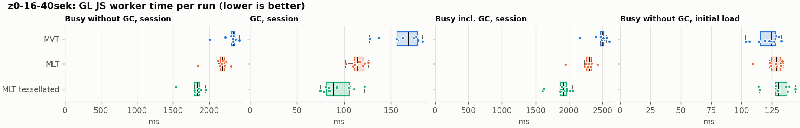
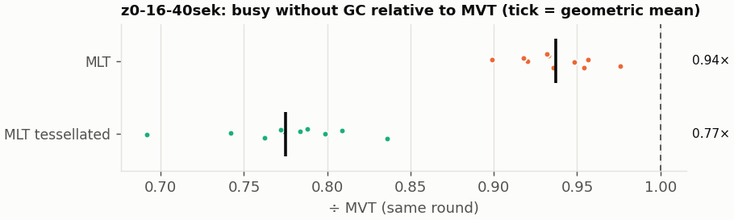
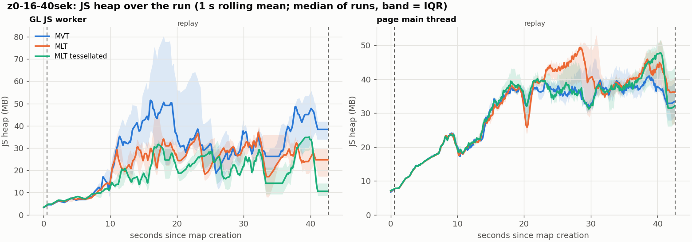
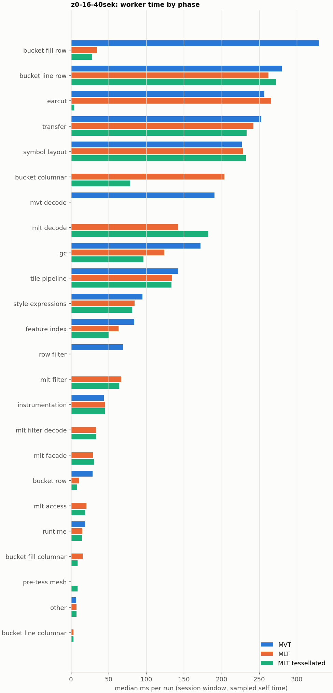

# Session trace benchmark — 20261107-135632

## Setup

- Created 2026-11-07T13:56:32+01:00; 10 repetitions + 1 warm-up round(s) (excluded); variants rotate per round (A B C, B C A, …); one cold browser context per run.
- Machine: , 16 logical cores, None GB RAM, Linux-7.2.9-200.nobara.fc44.x86_64-x86_64-with-glibc2.43; power: ?, AC None.
- GL JS gl7-local-files @ eb3231235c (dirty); worker count 1; viewport {'width': 1280, 'height': 1024}.
- Python 3.14.7, packages {'playwright': '1.64.1', 'numpy': '2.4.6', 'matplotlib': '3.10.8'}.

| variant | bundle | format | bundle sha256 | branch build |
|---|---|---|---|---|
| MVT | `dist/maplibre-gl-dev.mjs` | mvt | `4b8e23c84997` | – |
| MLT | `dist/maplibre-gl-dev.mjs` | mlt | `4b8e23c84997` | – |
| MLT tessellated | `dist/maplibre-gl-dev.mjs` | mlt-pre-tess | `4b8e23c84997` | – |

| session | style | duration | frames | sha256 |
|---|---|---:|---:|---|
| z0-16-40sek | maptiler-basic (recorded: osm-bright) | 42.1 s | 1739 | `55a2b8f22fe2` |

CPU sampling interval (median over runs): 159 µs.

## Definitions

- **busy** = wall time in which a GL JS worker thread runs a task (union of top-level task slices and GC slices on `DedicatedWorker thread`s), summed over workers. **GC** = union of `MinorGC`/`MajorGC`/`V8.GC*` slices on those threads. **busy without GC** = busy − GC (headline metric).
- **CPU** = thread time (`tdur`) of the same slices. Phase categories and functions come from the trace's CPU samples (self time), categorised by `config/categories.toml` (nearest matching frame, leaf to root).
- Windows: **load** = map creation → first idle; **session** = camera replay; **tail** = end of replay → idle; **total** = load + session + tail.
- Ratios are against **MVT**: ratio of medians with a bootstrap 95 % CI, the geometric mean of per-round ratios, and a two-sided Mann–Whitney U p-value (normal approximation, not corrected for multiple comparisons; rough below n = 8). Lower than 1× means less worker time.

## Session `z0-16-40sek`

### Worker busy without GC (session window)

| variant | n ok / failed | median ms | IQR | mean | ratio vs MVT | 95 % CI | geo-mean paired | MWU p |
|---|---:|---:|---:|---:|---:|---:|---:|---:|
| MVT | 10 / 0 | 2,333 | 2,310–2,356 | 2,306 | 1.00× | – | – | – |
| MLT | 10 / 0 | 2,182 | 2,155–2,210 | 2,161 | 0.94× | 0.91–0.96× | 0.94× | 0.005 |
| MLT tessellated | 10 / 0 | 1,833 | 1,796–1,864 | 1,790 | 0.79× | 0.72–0.81× | 0.77× | <0.001 |

### All worker metrics (median, ratio vs baseline)

| metric | MVT | MLT | MLT tessellated |
|---|---:|---:|---:|
| busy incl. GC | 2,491 | 2,304 (0.92×) | 1,916 (0.77×) |
| &nbsp;&nbsp;of which GC | 168.4 | 114.5 (0.68×) | 88.5 (0.53×) |
| &nbsp;&nbsp;of which busy without GC | 2,333 | 2,182 (0.94×) | 1,833 (0.79×) |
| &nbsp;&nbsp;&nbsp;&nbsp;of which filtering (sampled, incl. callees) | 69.0 | 66.9 (0.97×) | 64.1 (0.93×) |
| &nbsp;&nbsp;&nbsp;&nbsp;of which column decoding inside the MLT filter (sampled) | 0.0 | 33.8 | 33.0 |
| &nbsp;&nbsp;&nbsp;&nbsp;of which timing instrumentation (sampled) | 43.6 | 45.0 (1.03×) | 45.1 (1.04×) |
| busy without GC and instrumentation | 2,291 | 2,138 (0.93×) | 1,788 (0.78×) |
| CPU time without GC | 2,263 | 2,113 (0.93×) | 1,754 (0.78×) |
| tile: download end → sent to main thread, median per tile | 27.2 | 24.9 (0.92×) | 20.7 (0.76×) |
| tile: download end → sent to main thread, 90th percentile | 155.9 | 125.9 (0.81×) | 101.8 (0.65×) |
| tile: download end → sent to main thread, 95th percentile | 187.3 | 159.5 (0.85×) | 130.9 (0.70×) |
| tile: download end → sent to main thread, 99th percentile | 294.6 | 261.3 (0.89×) | 160.0 (0.54×) |
| minor GCs | 63.00 | 55.00 (0.87×) | 34.00 (0.54×) |
| major GCs | 7.50 | 7.00 (0.93×) | 9.00 (1.20×) |
| peak worker heap (MB) | 84.0 | 60.9 (0.73×) | 44.8 (0.53×) |
| load: busy without GC | 124.1 | 128.7 (1.04×) | 130.4 (1.05×) |
| load: GC | 5.5 | 5.2 (0.95×) | 4.8 (0.88×) |
| total: busy without GC | 2,453 | 2,313 (0.94×) | 1,965 (0.80×) |

Rows marked *of which* are parts of the row above, not additional time. Tile rows are per-tile latencies (medians over tiles, then over runs), not sums: tiles overlap in time, and the medians of the parse and queue parts do not add up exactly to the median latency.

### Filtering (session window)

Sampled worker time spent in feature filtering, including everything the filter calls (expression evaluation, property access): **row filter** = the style-spec feature filter that MVT runs per feature, **mlt filter** = the columnar MLT filter (incl. the geometry-type selection), without the columns it decodes (see the next table). Medians per run; rules in `config/categories.toml`.

| variant | mlt filter | row filter | filtering | ratio vs MVT | 95 % CI | MWU p | share of sampled busy |
|---|---:|---:|---:|---:|---:|---:|---:|
| MVT | 0.0 | 68.8 | 69.0 | 1.00× | – | – | 3.1% |
| MLT | 66.9 | 0.0 | 66.9 | 0.97× | 0.91–1.02× | 0.162 | 3.2% |
| MLT tessellated | 64.1 | 0.0 | 64.1 | 0.93× | 0.83–0.99× | 0.038 | 3.8% |

**Filtering together with tile decoding.** The MLT decoder leaves columns encoded until something reads them, and the filter is usually the first reader: the columns it decodes (properties, and the geometry for `$type`) are **of which inside the filter** (phase *mlt filter decode*), the rest is *mlt decode* (geometry and columns read later, e.g. by paint properties and symbols). MVT decodes every feature's properties and geometry while it reads the tile (*mvt decode*), whether the filter keeps the feature or not. So **filtering** above compares the filters, and **decoding + filtering** compares all that the formats spend on decoding the tile and selecting features. **tile decoding** = *mvt decode* or *mlt decode* + *mlt filter decode*: work inside a call into a decoder. Reading data that is already decoded is not counted, as for MVT's feature objects: *mlt access* (row views, value getters, looking a column up by name) and the MLT facade (*mlt facade*). MVT decodes geometry only for the features its filter keeps, MLT decodes a layer's whole geometry column.

| variant | tile decoding | of which inside the filter | filtering | decoding + filtering | ratio vs MVT | 95 % CI | MWU p |
|---|---:|---:|---:|---:|---:|---:|---:|
| MVT | 190.5 | 0.0 | 69.0 | 259.1 | 1.00× | – | – |
| MLT | 176.3 | 33.8 | 66.9 | 242.3 | 0.94× | 0.91–0.99× | 0.038 |
| MLT tessellated | 217.8 | 33.0 | 64.1 | 280.7 | 1.08× | 0.99–1.13× | 0.017 |

Top 12 functions inside filtering and its column decoding (self time, mean ms per run):

| phase | function | source | MVT | MLT | MLT tessellated |
|---|---|---|---:|---:|---:|
| row filter | `evaluate` | node_modules/@maplibre/maplibre-gl-style-spec/dist/expression/compound_expression.mjs | 18.8 | 0.0 | 0.0 |
| row filter | `evaluate` | node_modules/@maplibre/maplibre-gl-style-spec/dist/expression/index.mjs | 11.2 | 0.0 | 0.0 |
| mlt filter | `filterByGeometryType` | maplibre-tile-spec/ts/dist/vector/geometry/geometryVector.js | 0.0 | 8.0 | 8.6 |
| row filter | `CompoundExpression.register.filter-==` | node_modules/@maplibre/maplibre-gl-style-spec/dist/expression/compound_expression.mjs | 8.1 | 0.0 | 0.0 |
| row filter | `CompoundExpression.register.filter-in-small` | node_modules/@maplibre/maplibre-gl-style-spec/dist/expression/compound_expression.mjs | 7.3 | 0.0 | 0.0 |
| row filter | `filter` | node_modules/@maplibre/maplibre-gl-style-spec/dist/feature_filter/index.mjs | 6.5 | 0.0 | 0.0 |
| row filter | `CompoundExpression.register.filter-type-==` | node_modules/@maplibre/maplibre-gl-style-spec/dist/expression/compound_expression.mjs | 4.6 | 0.0 | 0.0 |
| mlt filter | `scanDictionaryCodes` | maplibre-tile-spec/ts/dist/processing/filter/execution/filterKernel.js | 0.0 | 4.6 | 4.5 |
| mlt filter | `dictionaryRowMatches` | maplibre-tile-spec/ts/dist/processing/filter/execution/filterKernel.js | 0.0 | 3.6 | 4.1 |
| mlt filter | `resolveDictionaryExecutor` | maplibre-tile-spec/ts/dist/processing/filter/execution/filterKernel.js | 0.0 | 3.4 | 2.9 |
| row filter | `CompoundExpression.register.all.overloads` | node_modules/@maplibre/maplibre-gl-style-spec/dist/expression/compound_expression.mjs | 3.0 | 0.0 | 0.0 |
| mlt filter | `getNormalizedFilter` | maplibre-tile-spec/ts/dist/processing/filter/filterCache.js | 0.0 | 2.9 | 2.9 |

### Bucket time by layer type (session window)

Sampled self time of the bucket code per layer type, row and columnar path together (median ms per run). **shared bucket code** is code all layer types use (`src/data/bucket/*` outside the layer files, `columnar_populate.ts`, `columnar_mesh_arrays.ts`, `load_geometry.ts`). **earcut** triangulates for fill and fill-extrusion on the row path; **pre-tess mesh** takes over the stored triangles of a pre-tessellated fill. **symbol** is the whole symbol layout phase. For exact wall time per source layer and type see the timing log tables below (builds with `worker_timing.ts` only).

| variant | fill | fill-extrusion | line | symbol | shared bucket code | earcut | pre-tess mesh | total |
|---|---:|---:|---:|---:|---:|---:|---:|---:|
| MVT | 329.2 | 0.0 | 280.2 | 226.9 | 28.6 | 256.9 | 0.0 | 1,125 |
| MLT | 50.9 | 0.0 | 265.7 | 228.1 | 213.5 | 266.0 | 0.0 | 1,027 |
| MLT tessellated | 38.2 | 0.0 | 275.5 | 232.3 | 87.4 | 4.0 | 8.8 | 647.8 |

### Where the variants differ from MVT (session window, mean ms per run)

Open **[flame.html](flame.html)** to explore the call tree interactively: pick a variant, compare it with MVT (red = more time at the same call path, blue = less), click a frame to zoom in, and read the phase and function breakdown under it. Without a comparison, frames are coloured by phase: filtering is green in both formats, and the columns the MLT filter decodes on first access (*mlt filter decode*) are MLT blue frames under the green filter. `flame/*.txt` open in https://www.speedscope.app.

#### MLT vs MVT

**By phase** (sampled self time; the Δ column sums to the difference in sampled busy time):

| phase | MVT | MLT | Δ |
|---|---:|---:|---:|
| bucket columnar | 0.0 | 204.1 | +204.1 |
| mlt decode | 0.0 | 143.4 | +143.4 |
| mlt filter | 0.1 | 65.0 | +64.9 |
| mlt filter decode | 0.0 | 33.6 | +33.6 |
| mlt facade | 0.1 | 28.8 | +28.7 |
| mlt access | 0.0 | 19.6 | +19.6 |
| bucket fill columnar | 0.0 | 15.5 | +15.5 |
| earcut | 252.7 | 265.4 | +12.7 |
| bucket line columnar | 0.0 | 3.3 | +3.3 |
| instrumentation | 42.4 | 43.9 | +1.4 |
| symbol layout | 225.4 | 223.8 | -1.5 |
| runtime | 18.3 | 14.7 | -3.6 |
| tile pipeline | 141.7 | 134.6 | -7.0 |
| style expressions | 94.1 | 82.3 | -11.8 |
| transfer | 249.5 | 236.8 | -12.7 |
| bucket line row | 277.2 | 263.4 | -13.8 |
| bucket row | 29.5 | 10.4 | -19.1 |
| feature index | 82.3 | 62.6 | -19.7 |
| gc | 170.0 | 125.1 | -44.9 |
| row filter | 67.9 | 0.0 | -67.9 |
| mvt decode | 187.0 | 0.0 | -187.0 |
| bucket fill row | 328.5 | 34.1 | -294.5 |

**Functions with the largest self-time difference** (by function name, summed over source files):

| function | MVT | MLT | Δ |
|---|---:|---:|---:|
| `writeEarcutFill` | 0.0 | 29.2 | +29.2 |
| `buildRingBoundingBoxes` | 0.0 | 21.1 | +21.1 |
| `buildEarcutMesh` | 0.0 | 20.4 | +20.4 |
| `decodeComponentwiseDeltaVec2` | 0.0 | 19.7 | +19.7 |
| `fillLargeMeshArrays` | 15.7 | 29.4 | +13.8 |
| `signedArea$2` | 3.2 | 16.2 | +13.0 |
| `readScaledRings` | 0.0 | 12.5 | +12.5 |
| `decodeString$2` | 0.0 | 10.4 | +10.4 |
| `decodeFastPforInt32` | 0.0 | 9.2 | +9.2 |
| `get` | 13.5 | 22.0 | +8.5 |
| `decodeFsst` | 0.0 | 8.1 | +8.1 |
| `filterByGeometryType` | 0.0 | 8.0 | +8.0 |
| `_vertexToIndex` | 99.7 | 0.4 | -99.3 |
| `(garbage collector)` | 170.0 | 125.1 | -44.9 |
| `readVarint` | 45.1 | 2.8 | -42.3 |
| `loadGeometry` | 49.2 | 9.4 | -39.8 |
| `populate` | 44.4 | 6.4 | -37.9 |

#### MLT tessellated vs MVT

**By phase** (sampled self time; the Δ column sums to the difference in sampled busy time):

| phase | MVT | MLT tessellated | Δ |
|---|---:|---:|---:|
| mlt decode | 0.0 | 178.7 | +178.7 |
| bucket columnar | 0.0 | 79.1 | +79.1 |
| mlt filter | 0.1 | 62.6 | +62.5 |
| mlt filter decode | 0.0 | 31.7 | +31.7 |
| mlt facade | 0.1 | 30.8 | +30.7 |
| mlt access | 0.0 | 19.0 | +19.0 |
| bucket fill columnar | 0.0 | 8.9 | +8.9 |
| pre-tess mesh | 0.0 | 8.8 | +8.8 |
| bucket line columnar | 0.0 | 3.6 | +3.6 |
| symbol layout | 225.4 | 226.4 | +1.1 |
| other | 7.2 | 7.7 | +0.6 |
| runtime | 18.3 | 14.1 | -4.1 |
| bucket line row | 277.2 | 266.9 | -10.3 |
| tile pipeline | 141.7 | 130.2 | -11.5 |
| style expressions | 94.1 | 77.9 | -16.2 |
| bucket row | 29.5 | 8.4 | -21.1 |
| transfer | 249.5 | 226.8 | -22.7 |
| feature index | 82.3 | 49.6 | -32.7 |
| row filter | 67.9 | 0.0 | -67.9 |
| gc | 170.0 | 99.6 | -70.4 |
| mvt decode | 187.0 | 0.0 | -187.0 |
| earcut | 252.7 | 3.9 | -248.8 |
| bucket fill row | 328.5 | 29.1 | -299.4 |

**Functions with the largest self-time difference** (by function name, summed over source files):

| function | MVT | MLT tessellated | Δ |
|---|---:|---:|---:|
| `writeTessellatedFill` | 0.0 | 24.0 | +24.0 |
| `decodeUnsignedZigZagDeltaInt32` | 0.0 | 19.3 | +19.3 |
| `decodeComponentwiseDeltaVec2` | 0.0 | 19.1 | +19.1 |
| `decodeFastPforInt32` | 0.0 | 10.9 | +10.9 |
| `decodeString$2` | 0.0 | 9.0 | +9.0 |
| `fastUnpack256_4` | 0.0 | 8.9 | +8.9 |
| `buildTessellatedBoundingBox` | 0.0 | 8.8 | +8.8 |
| `filterByGeometryType` | 0.0 | 8.6 | +8.6 |
| `readVertices` | 0.0 | 7.6 | +7.6 |
| `decodeFsst` | 0.0 | 7.4 | +7.4 |
| `get` | 13.5 | 20.5 | +7.0 |
| `appendScaledVertices` | 0.0 | 6.7 | +6.7 |
| `_vertexToIndex` | 99.7 | 0.3 | -99.4 |
| `isEar` | 74.5 | 0.6 | -73.9 |
| `(garbage collector)` | 170.0 | 99.6 | -70.4 |
| `readVarint` | 45.1 | 2.4 | -42.7 |
| `loadGeometry` | 49.2 | 8.0 | -41.2 |

### Memory (session window)

**JS heap** = V8's used heap of the thread (`jsHeapSizeUsed` from the trace's `UpdateCounters`, about every 20 ms; the mean is time-weighted). It does not include ArrayBuffer contents, so the tile data itself (vertex, index and feature-index arrays) is not in it: **tile data sent to the main thread** is the size of the ArrayBuffers each tile result transfers (`web/worker_hook.js`), which then live on the main thread and are uploaded to the GPU. **garbage collected** = heap freed by the worker's GCs, a measure of how much it allocates. Medians per run; ratio of medians with a bootstrap 95 % CI.

| metric | MVT | MLT | MLT tessellated |
|---|---:|---:|---:|
| worker JS heap, mean (MB) | 27.5 | 19.4 (0.71×, 0.58–0.96×) | 16.6 (0.60×, 0.50–0.81×) |
| worker JS heap, peak (MB) | 84.0 | 60.9 (0.73×, 0.60–1.02×) | 44.8 (0.53×, 0.44–0.74×) |
| worker JS heap after the last GC (MB) | 31.2 | 12.1 (0.39×, 0.30–0.82×) | 8.4 (0.27×, 0.21–0.68×) |
| garbage collected in the worker (MB) | 1,442 | 1,057 (0.73×, 0.73–0.74×) | 553.3 (0.38×, 0.38–0.39×) |
| main thread JS heap, mean (MB) | 26.4 | 28.2 (1.07×, 0.98–1.13×) | 27.4 (1.04×, 0.97–1.09×) |
| main thread JS heap, peak (MB) | 55.0 | 61.2 (1.11×, 0.96–1.23×) | 57.2 (1.04×, 0.87–1.17×) |
| main thread JS heap at the end of the replay (MB) | 34.5 | 37.6 (1.09×, 0.71–1.34×) | 33.1 (0.96×, 0.74–1.42×) |
| tile data sent to the main thread, total (MB) | 91.2 | 85.4 (0.94×, 0.93–0.95×) | 84.5 (0.93×, 0.92–0.93×) |
| tile data sent to the main thread, median per tile (KB) | 193.7 | 179.7 (0.93×, 0.92–0.93×) | 177.1 (0.91×, 0.91–0.92×) |

### Worker time by phase (session window, median ms of sampled self time)

| phase | MVT | MLT | MLT tessellated |
|---|---:|---:|---:|
| bucket fill row | 329.2 | 34.4 | 28.2 |
| bucket line row | 280.2 | 262.3 | 272.3 |
| earcut | 256.9 | 266.0 | 4.0 |
| transfer | 253.0 | 242.3 | 233.4 |
| symbol layout | 226.9 | 228.1 | 232.3 |
| bucket columnar | 0.0 | 204.0 | 78.6 |
| mvt decode | 190.5 | 0.0 | 0.0 |
| mlt decode | 0.0 | 142.2 | 182.4 |
| gc | 172.1 | 124.1 | 96.1 |
| tile pipeline | 142.7 | 134.3 | 133.4 |
| style expressions | 94.8 | 84.3 | 81.1 |
| feature index | 84.1 | 63.1 | 50.0 |
| row filter | 68.8 | 0.0 | 0.0 |
| mlt filter | 0.0 | 66.9 | 64.1 |
| instrumentation | 43.6 | 45.0 | 45.1 |
| mlt filter decode | 0.0 | 33.8 | 33.0 |
| mlt facade | 0.1 | 28.9 | 30.5 |
| bucket row | 28.6 | 10.5 | 8.4 |
| mlt access | 0.0 | 20.4 | 18.7 |
| runtime | 18.4 | 15.1 | 14.5 |
| bucket fill columnar | 0.0 | 15.3 | 8.5 |
| pre-tess mesh | 0.0 | 0.0 | 8.8 |
| other | 6.9 | 7.4 | 7.2 |
| bucket line columnar | 0.0 | 3.3 | 3.4 |
| bucket fill-extrusion row | 0.0 | 0.0 | 0.0 |

### Top 20 worker functions by self time (session window, mean ms per run)

| function | source | phase | MVT | MLT | MLT tessellated |
|---|---|---|---:|---:|---:|
| `(garbage collector)` | (native) | gc | 170.0 | 125.1 | 99.6 |
| `_vertexToIndex` | src/render/subdivision.ts | bucket fill row | 99.7 | 0.4 | 0.3 |
| `reserve` | src/util/struct_array.ts | bucket fill row | 99.2 | 87.2 | 89.0 |
| `isEar` | node_modules/earcut/src/earcut.js | earcut | 74.5 | 74.2 | 0.6 |
| `emplace` | src/data/array_types.g.ts | bucket fill row | 53.3 | 57.4 | 51.1 |
| `fetch` | (native) | tile pipeline | 50.6 | 50.7 | 49.2 |
| `_trim` | src/util/struct_array.ts | transfer | 50.3 | 39.6 | 34.5 |
| `postMessage` | (native) | transfer | 46.6 | 46.8 | 44.8 |
| `readVarint` | node_modules/pbf/index.js | mvt decode | 45.1 | 0.0 | 0.0 |
| `serialize` | src/util/web_worker_transfer.ts | transfer | 42.8 | 42.6 | 42.0 |
| `setTimeout` | (native) | transfer | 42.4 | 42.6 | 42.1 |
| `isEarHashed` | node_modules/earcut/src/earcut.js | earcut | 36.4 | 36.9 | 0.5 |
| `addLine` | src/data/bucket/line_bucket.ts | bucket line row | 33.6 | 36.2 | 35.6 |
| `insert` | src/data/feature_index.ts | feature index | 34.4 | 15.8 | 11.4 |
| `readString` | node_modules/pbf/index.js | mvt decode | 33.2 | 0.0 | 0.0 |
| `addHalfVertex` | src/data/bucket/line_bucket.ts | bucket line row | 29.4 | 32.4 | 30.8 |
| `VectorTileFeature` | node_modules/@mapbox/vector-tile/index.js | mvt decode | 32.4 | 0.0 | 0.0 |
| `earcutLinked` | node_modules/earcut/src/earcut.js | earcut | 30.8 | 26.1 | 0.6 |
| `addCurrentVertex` | src/data/bucket/line_bucket.ts | bucket line row | 26.4 | 29.3 | 29.8 |
| `fillLargeMeshArrays` | src/render/fill_large_mesh_arrays.ts | bucket fill row | 15.7 | 29.4 | 0.7 |

### Top 20 worker functions by total time (incl. callees) (session window, mean ms per run)

| function | source | phase | MVT | MLT | MLT tessellated |
|---|---|---|---:|---:|---:|
| `parse` | src/source/worker_tile.ts | tile pipeline | 1,553 | 1,511 | 1,138 |
| `loadTile` | src/source/vector_tile_worker_source.ts | tile pipeline | 1,459 | 1,366 | 988.5 |
| `_parseWorkerTile` | src/source/vector_tile_worker_source.ts | tile pipeline | 1,356 | 1,306 | 931.3 |
| `populate` | src/data/bucket/fill_bucket.ts | bucket fill row | 695.6 | 0.0 | 0.0 |
| `addBucketFeatures` | src/data/bucket/fill_bucket.ts | bucket fill row | 595.7 | 461.8 | 79.0 |
| `populate` | src/data/bucket/columnar/columnar_fill_bucket.ts | bucket fill columnar | 0.0 | 591.1 | 232.9 |
| `addFeature` | src/data/bucket/fill_bucket.ts | bucket fill row | 554.2 | 4.7 | 3.2 |
| `subdividePolygon` | src/render/subdivision.ts | bucket fill row | 459.0 | 4.2 | 2.7 |
| `subdividePolygonInternal` | src/render/subdivision.ts | bucket fill row | 453.9 | 4.0 | 2.7 |
| `addFeature` | src/data/bucket/columnar/columnar_fill_bucket.ts | bucket fill columnar | 0.0 | 440.4 | 69.9 |
| `writeEarcutFill` | src/data/bucket/columnar/columnar_mesh_arrays.ts | bucket columnar | 0.0 | 424.9 | 4.8 |
| `populate` | src/data/bucket/columnar/columnar_line_bucket.ts | bucket line columnar | 0.0 | 355.6 | 353.4 |
| `populate` | src/data/bucket/line_bucket.ts | bucket line row | 326.9 | 0.0 | 0.0 |
| `buildEarcutMesh` | src/data/bucket/columnar/columnar_mesh_arrays.ts | bucket columnar | 0.0 | 296.5 | 2.6 |
| `processTask` | src/util/actor.ts | transfer | 290.2 | 276.0 | 263.4 |
| `earcut` | node_modules/earcut/src/earcut.js | earcut | 252.6 | 265.2 | 3.9 |
| `addBucketFeatures` | src/data/bucket/line_bucket.ts | bucket line row | 226.5 | 241.3 | 243.3 |
| `addFeature` | src/data/bucket/line_bucket.ts | bucket line row | 201.2 | 213.6 | 214.8 |
| `completeTask` | src/util/actor.ts | transfer | 211.1 | 196.3 | 184.4 |
| `addLine` | src/data/bucket/line_bucket.ts | bucket line row | 180.0 | 192.4 | 193.5 |

## Runs

33 ok, 0 failed/aborted, 0 not run, 30 used in statistics.

## Validity checks

- Counted once: all 33 analysed runs pass (windows load + session + tail add up to total; phases add up to the sampled busy time; GC and sampled time lie within busy time; no timing-log line twice).
- other programs used 0.24–1.33 logical processors during the replays (median 1.07)
- 26 run(s) with more than 0.5 cores of background load: z0-16-40sek/mvt/rep-02 (0.82), z0-16-40sek/mlt/rep-02 (0.98), z0-16-40sek/mvt/rep-03 (1.00), z0-16-40sek/mlt/rep-03 (0.96), z0-16-40sek/mlt-pre-tess/rep-03 (1.07), z0-16-40sek/mlt/rep-04 (1.09)

## Files

- `runs.csv`: one row per run (incl. failed and warm-up runs), every scalar metric as `<window>.<metric>`.
- `summary.csv`: session × variant × metric statistics.
- `functions.csv`, `categories.csv`: CPU-sample self/total time per function and phase per run and window.
- `category_functions.csv`: self time per phase × function (e.g. what the filters spend their time on).
- `tiles.csv`, `tile_layers.csv`, `tile_phases.csv`: the per-tile worker timing log, long format.
- `flame.html`: interactive call tree per variant with a diff view; `flame/*.txt`: collapsed stacks for speedscope.
- `analysis/stacks.csv` (per run): sampled self time per full call stack.
- `tile_latency.csv`: per tile request, worker clock: received, download start/end, result sent, latency = sent − download end, parse_ms, wait_ms = latency − parse.
- `runs/<session>/<variant>/rep-NN/trace.json.gz`: the raw trace (opens in the DevTools Performance tab).
