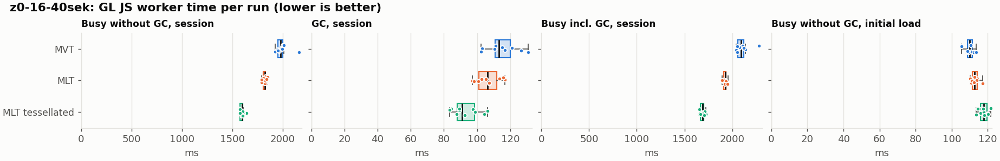
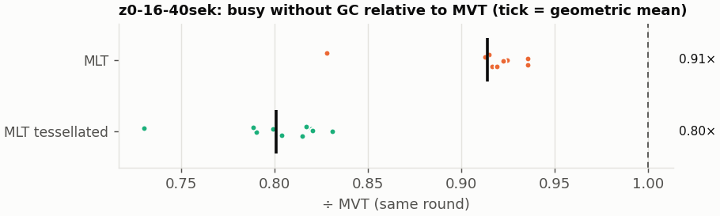
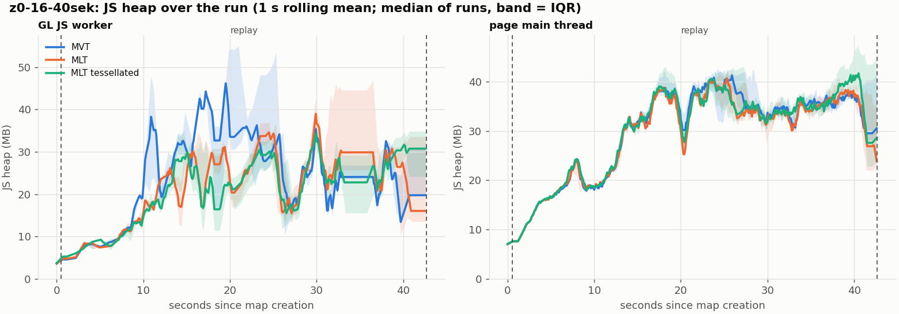
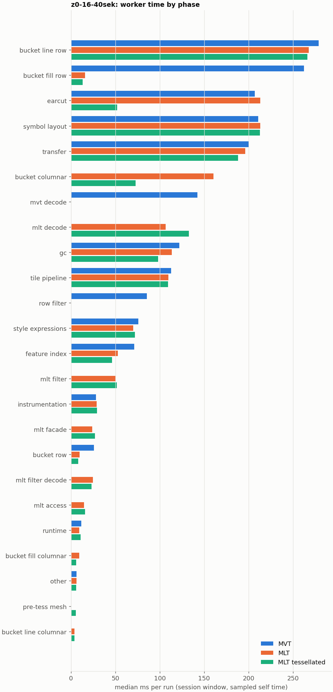

# Session trace benchmark — 20261107-142945

## Setup

- Created 2026-11-07T14:29:45+01:00; 10 repetitions + 1 warm-up round(s) (excluded); variants rotate per round (A B C, B C A, …); one cold browser context per run.
- Machine: , 16 logical cores, None GB RAM, Linux-7.2.9-200.nobara.fc44.x86_64-x86_64-with-glibc2.43; power: ?, AC None.
- GL JS gl7-local-files @ eb3231235c (dirty); worker count 1; viewport {'width': 1280, 'height': 1024}.
- Python 3.14.7, packages {'playwright': '1.64.1', 'numpy': '2.4.6', 'matplotlib': '3.10.8'}.

| variant | bundle | format | bundle sha256 | branch build |
|---|---|---|---|---|
| MVT | `dist/maplibre-gl-dev.mjs` | mvt | `4b8e23c84997` | – |
| MLT | `dist/maplibre-gl-dev.mjs` | mlt | `4b8e23c84997` | – |
| MLT tessellated | `dist/maplibre-gl-dev.mjs` | mlt-pre-tess | `4b8e23c84997` | – |

| session | style | duration | frames | sha256 |
|---|---|---:|---:|---|
| z0-16-40sek | positron (recorded: osm-bright) | 42.1 s | 1739 | `55a2b8f22fe2` |

CPU sampling interval (median over runs): 158 µs.

## Definitions

- **busy** = wall time in which a GL JS worker thread runs a task (union of top-level task slices and GC slices on `DedicatedWorker thread`s), summed over workers. **GC** = union of `MinorGC`/`MajorGC`/`V8.GC*` slices on those threads. **busy without GC** = busy − GC (headline metric).
- **CPU** = thread time (`tdur`) of the same slices. Phase categories and functions come from the trace's CPU samples (self time), categorised by `config/categories.toml` (nearest matching frame, leaf to root).
- Windows: **load** = map creation → first idle; **session** = camera replay; **tail** = end of replay → idle; **total** = load + session + tail.
- Ratios are against **MVT**: ratio of medians with a bootstrap 95 % CI, the geometric mean of per-round ratios, and a two-sided Mann–Whitney U p-value (normal approximation, not corrected for multiple comparisons; rough below n = 8). Lower than 1× means less worker time.

## Session `z0-16-40sek`

### Worker busy without GC (session window)

| variant | n ok / failed | median ms | IQR | mean | ratio vs MVT | 95 % CI | geo-mean paired | MWU p |
|---|---:|---:|---:|---:|---:|---:|---:|---:|
| MVT | 10 / 0 | 1,977 | 1,952–1,998 | 1,990 | 1.00× | – | – | – |
| MLT | 10 / 0 | 1,824 | 1,804–1,829 | 1,818 | 0.92× | 0.90–0.94× | 0.91× | <0.001 |
| MLT tessellated | 10 / 0 | 1,595 | 1,577–1,601 | 1,593 | 0.81× | 0.79–0.82× | 0.80× | <0.001 |

### All worker metrics (median, ratio vs baseline)

| metric | MVT | MLT | MLT tessellated |
|---|---:|---:|---:|
| busy incl. GC | 2,090 | 1,927 (0.92×) | 1,690 (0.81×) |
| &nbsp;&nbsp;of which GC | 113.2 | 106.2 (0.94×) | 91.0 (0.80×) |
| &nbsp;&nbsp;of which busy without GC | 1,977 | 1,824 (0.92×) | 1,595 (0.81×) |
| &nbsp;&nbsp;&nbsp;&nbsp;of which filtering (sampled, incl. callees) | 85.6 | 49.9 (0.58×) | 51.4 (0.60×) |
| &nbsp;&nbsp;&nbsp;&nbsp;of which column decoding inside the MLT filter (sampled) | 0.0 | 24.7 | 23.3 |
| &nbsp;&nbsp;&nbsp;&nbsp;of which timing instrumentation (sampled) | 28.3 | 28.8 (1.02×) | 29.2 (1.03×) |
| busy without GC and instrumentation | 1,948 | 1,795 (0.92×) | 1,566 (0.80×) |
| CPU time without GC | 1,913 | 1,748 (0.91×) | 1,532 (0.80×) |
| tile: download end → sent to main thread, median per tile | 23.8 | 21.9 (0.92×) | 18.4 (0.78×) |
| tile: download end → sent to main thread, 90th percentile | 126.4 | 106.7 (0.84×) | 97.2 (0.77×) |
| tile: download end → sent to main thread, 95th percentile | 176.9 | 139.8 (0.79×) | 119.8 (0.68×) |
| tile: download end → sent to main thread, 99th percentile | 223.8 | 186.8 (0.83×) | 167.8 (0.75×) |
| minor GCs | 61.00 | 54.00 (0.89×) | 36.00 (0.59×) |
| major GCs | 9.00 | 9.50 (1.06×) | 10.00 (1.11×) |
| peak worker heap (MB) | 60.6 | 60.7 (1.00×) | 49.5 (0.82×) |
| load: busy without GC | 110.0 | 112.6 (1.02×) | 117.8 (1.07×) |
| load: GC | 4.5 | 4.3 (0.94×) | 4.3 (0.94×) |
| total: busy without GC | 2,086 | 1,938 (0.93×) | 1,713 (0.82×) |

Rows marked *of which* are parts of the row above, not additional time. Tile rows are per-tile latencies (medians over tiles, then over runs), not sums: tiles overlap in time, and the medians of the parse and queue parts do not add up exactly to the median latency.

### Filtering (session window)

Sampled worker time spent in feature filtering, including everything the filter calls (expression evaluation, property access): **row filter** = the style-spec feature filter that MVT runs per feature, **mlt filter** = the columnar MLT filter (incl. the geometry-type selection), without the columns it decodes (see the next table). Medians per run; rules in `config/categories.toml`.

| variant | mlt filter | row filter | filtering | ratio vs MVT | 95 % CI | MWU p | share of sampled busy |
|---|---:|---:|---:|---:|---:|---:|---:|
| MVT | 0.0 | 85.5 | 85.6 | 1.00× | – | – | 4.6% |
| MLT | 49.9 | 0.0 | 49.9 | 0.58× | 0.53–0.60× | <0.001 | 3.0% |
| MLT tessellated | 51.4 | 0.0 | 51.4 | 0.60× | 0.57–0.62× | <0.001 | 3.5% |

**Filtering together with tile decoding.** The MLT decoder leaves columns encoded until something reads them, and the filter is usually the first reader: the columns it decodes (properties, and the geometry for `$type`) are **of which inside the filter** (phase *mlt filter decode*), the rest is *mlt decode* (geometry and columns read later, e.g. by paint properties and symbols). MVT decodes every feature's properties and geometry while it reads the tile (*mvt decode*), whether the filter keeps the feature or not. So **filtering** above compares the filters, and **decoding + filtering** compares all that the formats spend on decoding the tile and selecting features. **tile decoding** = *mvt decode* or *mlt decode* + *mlt filter decode*: work inside a call into a decoder. Reading data that is already decoded is not counted, as for MVT's feature objects: *mlt access* (row views, value getters, looking a column up by name) and the MLT facade (*mlt facade*). MVT decodes geometry only for the features its filter keeps, MLT decodes a layer's whole geometry column.

| variant | tile decoding | of which inside the filter | filtering | decoding + filtering | ratio vs MVT | 95 % CI | MWU p |
|---|---:|---:|---:|---:|---:|---:|---:|
| MVT | 142.5 | 0.0 | 85.6 | 227.8 | 1.00× | – | – |
| MLT | 130.7 | 24.7 | 49.9 | 179.6 | 0.79× | 0.76–0.80× | <0.001 |
| MLT tessellated | 154.6 | 23.3 | 51.4 | 206.4 | 0.91× | 0.89–0.92× | <0.001 |

Top 12 functions inside filtering and its column decoding (self time, mean ms per run):

| phase | function | source | MVT | MLT | MLT tessellated |
|---|---|---|---:|---:|---:|
| row filter | `(anonymous)` | node_modules/@maplibre/maplibre-gl-style-spec/dist/expression/compound_expression.mjs | 22.2 | 0.0 | 0.0 |
| row filter | `evaluate` | node_modules/@maplibre/maplibre-gl-style-spec/dist/expression/index.mjs | 15.0 | 0.0 | 0.0 |
| row filter | `evaluate` | node_modules/@maplibre/maplibre-gl-style-spec/dist/expression/compound_expression.mjs | 11.6 | 0.0 | 0.0 |
| row filter | `evaluate` | node_modules/@maplibre/maplibre-gl-style-spec/dist/expression/definitions/comparison.mjs | 9.5 | 0.0 | 0.0 |
| mlt filter | `filterByGeometryType` | maplibre-tile-spec/ts/dist/vector/geometry/geometryVector.js | 0.0 | 6.4 | 6.6 |
| row filter | `get` | node_modules/@maplibre/maplibre-gl-style-spec/dist/expression/compound_expression.mjs | 5.9 | 0.0 | 0.0 |
| row filter | `filter` | node_modules/@maplibre/maplibre-gl-style-spec/dist/feature_filter/index.mjs | 5.4 | 0.0 | 0.0 |
| row filter | `evaluate` | node_modules/@maplibre/maplibre-gl-style-spec/dist/expression/definitions/match.mjs | 4.7 | 0.0 | 0.0 |
| mlt filter | `dictionaryRowMatches` | maplibre-tile-spec/ts/dist/processing/filter/execution/filterKernel.js | 0.0 | 3.3 | 3.5 |
| mlt filter decode | `decodeFsst` | maplibre-tile-spec/ts/dist/decoding/fsstDecoder.js | 0.0 | 3.4 | 3.1 |
| mlt filter | `scanDictionaryCodes` | maplibre-tile-spec/ts/dist/processing/filter/execution/filterKernel.js | 0.0 | 3.4 | 3.3 |
| row filter | `eq` | node_modules/@maplibre/maplibre-gl-style-spec/dist/expression/definitions/comparison.mjs | 3.1 | 0.0 | 0.0 |

### Bucket time by layer type (session window)

Sampled self time of the bucket code per layer type, row and columnar path together (median ms per run). **shared bucket code** is code all layer types use (`src/data/bucket/*` outside the layer files, `columnar_populate.ts`, `columnar_mesh_arrays.ts`, `load_geometry.ts`). **earcut** triangulates for fill and fill-extrusion on the row path; **pre-tess mesh** takes over the stored triangles of a pre-tessellated fill. **symbol** is the whole symbol layout phase. For exact wall time per source layer and type see the timing log tables below (builds with `worker_timing.ts` only).

| variant | fill | fill-extrusion | line | symbol | shared bucket code | earcut | pre-tess mesh | total |
|---|---:|---:|---:|---:|---:|---:|---:|---:|
| MVT | 262.5 | 0.0 | 279.1 | 211.1 | 25.8 | 207.2 | 0.0 | 979.9 |
| MLT | 25.2 | 0.0 | 271.1 | 213.3 | 170.0 | 213.3 | 0.0 | 893.6 |
| MLT tessellated | 19.1 | 0.0 | 269.3 | 212.7 | 81.3 | 51.8 | 5.5 | 636.7 |

### Where the variants differ from MVT (session window, mean ms per run)

Open **[flame.html](flame.html)** to explore the call tree interactively: pick a variant, compare it with MVT (red = more time at the same call path, blue = less), click a frame to zoom in, and read the phase and function breakdown under it. Without a comparison, frames are coloured by phase: filtering is green in both formats, and the columns the MLT filter decodes on first access (*mlt filter decode*) are MLT blue frames under the green filter. `flame/*.txt` open in https://www.speedscope.app.

#### MLT vs MVT

**By phase** (sampled self time; the Δ column sums to the difference in sampled busy time):

| phase | MVT | MLT | Δ |
|---|---:|---:|---:|
| bucket columnar | 0.0 | 159.4 | +159.4 |
| mlt decode | 0.0 | 105.1 | +105.1 |
| mlt filter | 0.1 | 49.2 | +49.1 |
| mlt filter decode | 0.0 | 24.7 | +24.7 |
| mlt facade | 0.1 | 23.4 | +23.3 |
| mlt access | 0.0 | 15.3 | +15.3 |
| bucket fill columnar | 0.0 | 9.5 | +9.5 |
| earcut | 206.5 | 212.1 | +5.6 |
| bucket line columnar | 0.0 | 3.8 | +3.8 |
| symbol layout | 211.8 | 215.4 | +3.5 |
| runtime | 11.6 | 9.8 | -1.8 |
| tile pipeline | 114.5 | 110.3 | -4.2 |
| transfer | 204.3 | 196.3 | -8.0 |
| style expressions | 78.1 | 70.1 | -8.0 |
| gc | 122.9 | 113.9 | -9.0 |
| bucket line row | 279.8 | 267.3 | -12.5 |
| bucket row | 25.8 | 9.9 | -15.9 |
| feature index | 72.3 | 53.5 | -18.8 |
| row filter | 85.7 | 0.0 | -85.7 |
| mvt decode | 145.3 | 0.0 | -145.3 |
| bucket fill row | 260.3 | 15.9 | -244.4 |

**Functions with the largest self-time difference** (by function name, summed over source files):

| function | MVT | MLT | Δ |
|---|---:|---:|---:|
| `writeEarcutFill` | 0.0 | 19.7 | +19.7 |
| `buildEarcutMesh` | 0.0 | 17.6 | +17.6 |
| `buildRingBoundingBoxes` | 0.0 | 17.6 | +17.6 |
| `decodeComponentwiseDeltaVec2` | 0.0 | 16.5 | +16.5 |
| `readScaledRings` | 0.0 | 10.6 | +10.6 |
| `fillLargeMeshArrays` | 13.3 | 22.6 | +9.3 |
| `signedArea$2` | 2.6 | 11.4 | +8.8 |
| `decodeString$2` | 0.0 | 7.4 | +7.4 |
| `decodeFastPforInt32` | 0.0 | 7.0 | +7.0 |
| `filterByGeometryType` | 0.0 | 6.4 | +6.4 |
| `readVertices` | 0.0 | 6.3 | +6.3 |
| `scaleCheckedCoordinate` | 0.0 | 4.7 | +4.7 |
| `_vertexToIndex` | 87.8 | 0.4 | -87.4 |
| `evaluate` | 55.0 | 14.0 | -41.0 |
| `loadGeometry` | 44.5 | 9.1 | -35.4 |
| `readVarint` | 33.5 | 2.3 | -31.1 |
| `readString` | 28.4 | 0.0 | -28.4 |

#### MLT tessellated vs MVT

**By phase** (sampled self time; the Δ column sums to the difference in sampled busy time):

| phase | MVT | MLT tessellated | Δ |
|---|---:|---:|---:|
| mlt decode | 0.0 | 132.8 | +132.8 |
| bucket columnar | 0.0 | 72.7 | +72.7 |
| mlt filter | 0.1 | 50.5 | +50.4 |
| mlt facade | 0.1 | 26.9 | +26.8 |
| mlt filter decode | 0.0 | 23.0 | +23.0 |
| mlt access | 0.0 | 15.1 | +15.1 |
| bucket fill columnar | 0.0 | 5.8 | +5.8 |
| pre-tess mesh | 0.0 | 5.5 | +5.5 |
| bucket line columnar | 0.0 | 4.2 | +4.2 |
| symbol layout | 211.8 | 214.1 | +2.3 |
| other | 6.1 | 5.6 | -0.5 |
| runtime | 11.6 | 10.7 | -0.9 |
| tile pipeline | 114.5 | 109.7 | -4.8 |
| style expressions | 78.1 | 71.0 | -7.1 |
| transfer | 204.3 | 189.9 | -14.4 |
| bucket line row | 279.8 | 264.9 | -14.9 |
| bucket row | 25.8 | 8.3 | -17.5 |
| gc | 122.9 | 98.8 | -24.1 |
| feature index | 72.3 | 46.2 | -26.1 |
| row filter | 85.7 | 0.0 | -85.7 |
| mvt decode | 145.3 | 0.0 | -145.3 |
| earcut | 206.5 | 51.5 | -155.0 |
| bucket fill row | 260.3 | 12.9 | -247.4 |

**Functions with the largest self-time difference** (by function name, summed over source files):

| function | MVT | MLT tessellated | Δ |
|---|---:|---:|---:|
| `decodeComponentwiseDeltaVec2` | 0.0 | 17.3 | +17.3 |
| `decodeUnsignedZigZagDeltaInt32` | 0.0 | 14.3 | +14.3 |
| `writeTessellatedFill` | 0.0 | 12.2 | +12.2 |
| `readVertices` | 0.0 | 8.1 | +8.1 |
| `decodeFastPforInt32` | 0.0 | 7.8 | +7.8 |
| `fastUnpack256_4` | 0.0 | 6.7 | +6.7 |
| `filterByGeometryType` | 0.0 | 6.6 | +6.6 |
| `decodeString$2` | 0.0 | 6.4 | +6.4 |
| `buildTessellatedBoundingBox` | 0.0 | 5.4 | +5.4 |
| `writeEarcutFill` | 0.0 | 5.1 | +5.1 |
| `appendScaledVertices` | 0.0 | 5.0 | +5.0 |
| `decodeBigEndianInt32sInto` | 0.0 | 4.9 | +4.9 |
| `_vertexToIndex` | 87.8 | 0.2 | -87.6 |
| `isEar` | 63.6 | 9.3 | -54.3 |
| `evaluate` | 55.0 | 14.2 | -40.8 |
| `loadGeometry` | 44.5 | 7.7 | -36.8 |
| `readVarint` | 33.5 | 2.2 | -31.3 |

### Memory (session window)

**JS heap** = V8's used heap of the thread (`jsHeapSizeUsed` from the trace's `UpdateCounters`, about every 20 ms; the mean is time-weighted). It does not include ArrayBuffer contents, so the tile data itself (vertex, index and feature-index arrays) is not in it: **tile data sent to the main thread** is the size of the ArrayBuffers each tile result transfers (`web/worker_hook.js`), which then live on the main thread and are uploaded to the GPU. **garbage collected** = heap freed by the worker's GCs, a measure of how much it allocates. Medians per run; ratio of medians with a bootstrap 95 % CI.

| metric | MVT | MLT | MLT tessellated |
|---|---:|---:|---:|
| worker JS heap, mean (MB) | 20.6 | 19.0 (0.92×, 0.84–1.11×) | 18.7 (0.91×, 0.82–0.98×) |
| worker JS heap, peak (MB) | 60.6 | 60.7 (1.00×, 0.91–1.02×) | 49.5 (0.82×, 0.75–0.88×) |
| worker JS heap after the last GC (MB) | 8.5 | 9.7 (1.14×, 0.70–1.42×) | 10.3 (1.21×, 0.75–1.33×) |
| garbage collected in the worker (MB) | 1,356 | 1,039 (0.77×, 0.76–0.78×) | 627.2 (0.46×, 0.46–0.47×) |
| main thread JS heap, mean (MB) | 26.2 | 25.1 (0.96×, 0.92–1.02×) | 26.2 (1.00×, 0.94–1.09×) |
| main thread JS heap, peak (MB) | 52.5 | 49.6 (0.94×, 0.88–1.05×) | 53.7 (1.02×, 0.92–1.14×) |
| main thread JS heap at the end of the replay (MB) | 31.0 | 23.9 (0.77×, 0.55–1.23×) | 29.0 (0.94×, 0.61–1.51×) |
| tile data sent to the main thread, total (MB) | 94.5 | 88.4 (0.94×, 0.93–0.94×) | 88.2 (0.93×, 0.93–0.94×) |
| tile data sent to the main thread, median per tile (KB) | 195.9 | 184.6 (0.94×, 0.94–0.95×) | 177.4 (0.91×, 0.90–0.91×) |

### Worker time by phase (session window, median ms of sampled self time)

| phase | MVT | MLT | MLT tessellated |
|---|---:|---:|---:|
| bucket line row | 279.1 | 267.7 | 266.4 |
| bucket fill row | 262.5 | 15.9 | 13.0 |
| earcut | 207.2 | 213.3 | 51.8 |
| symbol layout | 211.1 | 213.3 | 212.7 |
| transfer | 200.4 | 196.3 | 188.3 |
| bucket columnar | 0.0 | 160.5 | 72.6 |
| mvt decode | 142.5 | 0.0 | 0.0 |
| mlt decode | 0.0 | 106.8 | 133.0 |
| gc | 121.9 | 113.6 | 98.1 |
| tile pipeline | 112.9 | 109.6 | 109.5 |
| row filter | 85.5 | 0.0 | 0.0 |
| style expressions | 75.8 | 70.1 | 72.2 |
| feature index | 71.4 | 52.7 | 46.1 |
| mlt filter | 0.0 | 49.9 | 51.4 |
| instrumentation | 28.3 | 28.8 | 29.2 |
| mlt facade | 0.0 | 23.9 | 26.8 |
| bucket row | 25.8 | 9.8 | 8.2 |
| mlt filter decode | 0.0 | 24.7 | 23.3 |
| mlt access | 0.0 | 14.5 | 15.7 |
| runtime | 11.5 | 9.4 | 10.7 |
| bucket fill columnar | 0.0 | 9.3 | 5.7 |
| other | 6.0 | 6.3 | 5.7 |
| pre-tess mesh | 0.0 | 0.0 | 5.5 |
| bucket line columnar | 0.0 | 3.8 | 3.9 |
| bucket fill-extrusion row | 0.0 | 0.0 | 0.0 |

### Top 20 worker functions by self time (session window, mean ms per run)

| function | source | phase | MVT | MLT | MLT tessellated |
|---|---|---|---:|---:|---:|
| `(garbage collector)` | (native) | gc | 122.9 | 113.9 | 98.8 |
| `_vertexToIndex` | src/render/subdivision.ts | bucket fill row | 87.8 | 0.4 | 0.2 |
| `reserve` | src/util/struct_array.ts | bucket fill row | 86.8 | 78.5 | 79.5 |
| `isEar` | node_modules/earcut/src/earcut.js | earcut | 63.6 | 61.5 | 9.3 |
| `emplace` | src/data/array_types.g.ts | bucket fill row | 52.5 | 54.0 | 53.2 |
| `fetch` | (native) | tile pipeline | 44.1 | 44.5 | 44.3 |
| `_trim` | src/util/struct_array.ts | transfer | 43.9 | 35.1 | 31.5 |
| `setTimeout` | (native) | transfer | 41.3 | 40.9 | 40.4 |
| `postMessage` | (native) | transfer | 38.4 | 39.4 | 39.3 |
| `addLine` | src/data/bucket/line_bucket.ts | bucket line row | 37.1 | 37.6 | 37.2 |
| `isEarHashed` | node_modules/earcut/src/earcut.js | earcut | 32.2 | 34.2 | 12.1 |
| `addHalfVertex` | src/data/bucket/line_bucket.ts | bucket line row | 32.4 | 33.6 | 31.2 |
| `readVarint` | node_modules/pbf/index.js | mvt decode | 33.5 | 0.0 | 0.0 |
| `addCurrentVertex` | src/data/bucket/line_bucket.ts | bucket line row | 29.5 | 32.3 | 33.1 |
| `serialize` | src/util/web_worker_transfer.ts | transfer | 32.0 | 33.1 | 31.4 |
| `insert` | src/data/feature_index.ts | feature index | 29.3 | 14.8 | 10.9 |
| `readString` | node_modules/pbf/index.js | mvt decode | 28.4 | 0.0 | 0.0 |
| `populate` | src/data/bucket/line_bucket.ts | bucket line row | 23.9 | 0.0 | 0.0 |
| `(anonymous)` | node_modules/@maplibre/maplibre-gl-style-spec/dist/expression/compound_expression.mjs | row filter | 23.2 | 0.4 | 0.7 |
| `loadGeometry` | node_modules/@mapbox/vector-tile/index.js | mvt decode | 23.1 | 0.0 | 0.0 |

### Top 20 worker functions by total time (incl. callees) (session window, mean ms per run)

| function | source | phase | MVT | MLT | MLT tessellated |
|---|---|---|---:|---:|---:|
| `parse` | src/source/worker_tile.ts | tile pipeline | 1,367 | 1,277 | 1,048 |
| `loadTile` | src/source/vector_tile_worker_source.ts | tile pipeline | 1,264 | 1,132 | 899.7 |
| `_parseWorkerTile` | src/source/vector_tile_worker_source.ts | tile pipeline | 1,178 | 1,081 | 849.9 |
| `populate` | src/data/bucket/fill_bucket.ts | bucket fill row | 562.3 | 0.0 | 0.0 |
| `addBucketFeatures` | src/data/bucket/fill_bucket.ts | bucket fill row | 487.2 | 363.4 | 119.2 |
| `addFeature` | src/data/bucket/fill_bucket.ts | bucket fill row | 456.5 | 3.7 | 2.9 |
| `populate` | src/data/bucket/columnar/columnar_fill_bucket.ts | bucket fill columnar | 0.0 | 454.2 | 231.4 |
| `subdividePolygon` | src/render/subdivision.ts | bucket fill row | 383.1 | 3.2 | 2.5 |
| `subdividePolygonInternal` | src/render/subdivision.ts | bucket fill row | 376.0 | 3.2 | 2.4 |
| `populate` | src/data/bucket/line_bucket.ts | bucket line row | 365.3 | 0.0 | 0.0 |
| `populate` | src/data/bucket/columnar/columnar_line_bucket.ts | bucket line columnar | 0.0 | 354.4 | 352.6 |
| `addFeature` | src/data/bucket/columnar/columnar_fill_bucket.ts | bucket fill columnar | 0.0 | 349.3 | 112.9 |
| `writeEarcutFill` | src/data/bucket/columnar/columnar_mesh_arrays.ts | bucket columnar | 0.0 | 339.0 | 71.7 |
| `addBucketFeatures` | src/data/bucket/line_bucket.ts | bucket line row | 244.8 | 256.3 | 255.0 |
| `buildEarcutMesh` | src/data/bucket/columnar/columnar_mesh_arrays.ts | bucket columnar | 0.0 | 239.1 | 54.4 |
| `processTask` | src/util/actor.ts | transfer | 233.1 | 221.9 | 215.3 |
| `addFeature` | src/data/bucket/line_bucket.ts | bucket line row | 218.9 | 227.4 | 226.2 |
| `earcut` | node_modules/earcut/src/earcut.js | earcut | 206.3 | 212.0 | 51.5 |
| `addLine` | src/data/bucket/line_bucket.ts | bucket line row | 192.8 | 202.9 | 203.7 |
| `addFeatures` | src/data/bucket/symbol_bucket.ts | symbol layout | 173.0 | 176.0 | 177.2 |

## Runs

33 ok, 0 failed/aborted, 0 not run, 30 used in statistics.

## Validity checks

- Counted once: all 33 analysed runs pass (windows load + session + tail add up to total; phases add up to the sampled busy time; GC and sampled time lie within busy time; no timing-log line twice).
- other programs used 0.23–1.41 logical processors during the replays (median 0.24)
- 1 run(s) with more than 0.5 cores of background load: z0-16-40sek/mvt/rep-10 (1.41)

## Files

- `runs.csv`: one row per run (incl. failed and warm-up runs), every scalar metric as `<window>.<metric>`.
- `summary.csv`: session × variant × metric statistics.
- `functions.csv`, `categories.csv`: CPU-sample self/total time per function and phase per run and window.
- `category_functions.csv`: self time per phase × function (e.g. what the filters spend their time on).
- `tiles.csv`, `tile_layers.csv`, `tile_phases.csv`: the per-tile worker timing log, long format.
- `flame.html`: interactive call tree per variant with a diff view; `flame/*.txt`: collapsed stacks for speedscope.
- `analysis/stacks.csv` (per run): sampled self time per full call stack.
- `tile_latency.csv`: per tile request, worker clock: received, download start/end, result sent, latency = sent − download end, parse_ms, wait_ms = latency − parse.
- `runs/<session>/<variant>/rep-NN/trace.json.gz`: the raw trace (opens in the DevTools Performance tab).
