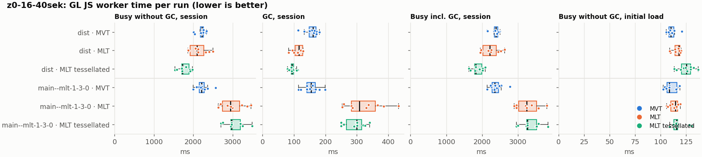
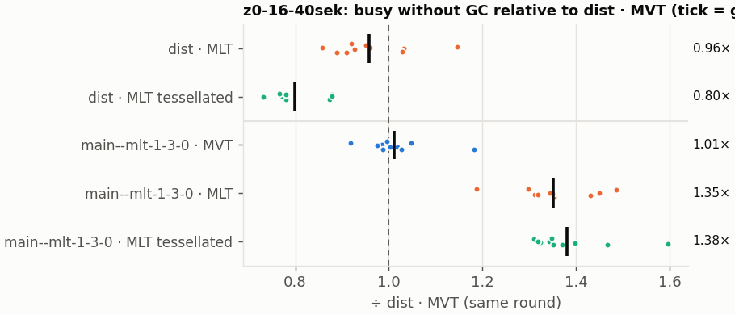
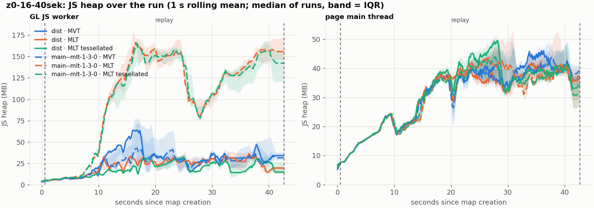
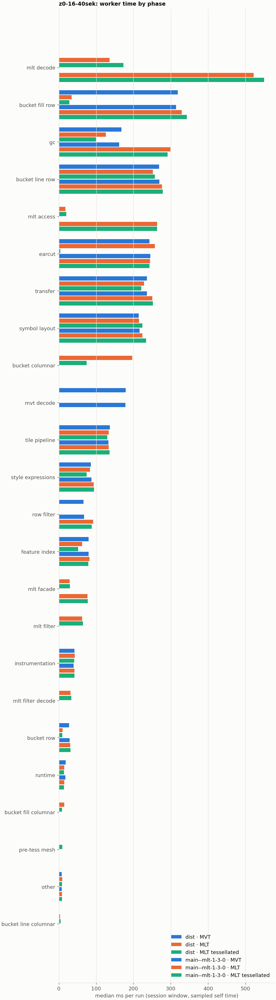

# Session trace benchmark — 20261107-154620

## Setup

- Created 2026-11-07T15:46:20+01:00; 10 repetitions + 1 warm-up round(s) (excluded); variants rotate per round (A B C, B C A, …); one cold browser context per run.
- Machine: , 16 logical cores, None GB RAM, Linux-7.2.9-200.nobara.fc44.x86_64-x86_64-with-glibc2.43; power: ?, AC None.
- GL JS gl7-local-files @ eb3231235c (dirty); worker count 1; viewport {'width': 1280, 'height': 1024}.
- Python 3.14.7, packages {'playwright': '1.64.1', 'numpy': '2.4.6', 'matplotlib': '3.10.8'}.

| variant | bundle | format | bundle sha256 | branch build |
|---|---|---|---|---|
| MVT | `dist/maplibre-gl-dev.mjs` | mvt | `4b8e23c84997` | – |
| MLT | `dist/maplibre-gl-dev.mjs` | mlt | `4b8e23c84997` | – |
| MLT tessellated | `dist/maplibre-gl-dev.mjs` | mlt-pre-tess | `4b8e23c84997` | – |
| main--mlt-1-3-0 · MVT | `bench-builds/branches/main--mlt-1-3-0/maplibre-gl-dev.mjs` | mvt | `8a63f3527a41` | main @ bb38954083 (2026-10-26), MLT @maplibre/mlt@1.3.0 (npm) |
| main--mlt-1-3-0 · MLT | `bench-builds/branches/main--mlt-1-3-0/maplibre-gl-dev.mjs` | mlt | `8a63f3527a41` | main @ bb38954083 (2026-10-26), MLT @maplibre/mlt@1.3.0 (npm) |
| main--mlt-1-3-0 · MLT tessellated | `bench-builds/branches/main--mlt-1-3-0/maplibre-gl-dev.mjs` | mlt-pre-tess | `8a63f3527a41` | main @ bb38954083 (2026-10-26), MLT @maplibre/mlt@1.3.0 (npm) |

| session | style | duration | frames | sha256 |
|---|---|---:|---:|---|
| z0-16-40sek | maptiler-basic (recorded: osm-bright) | 42.1 s | 1739 | `55a2b8f22fe2` |

CPU sampling interval (median over runs): 159 µs.

## Definitions

- **busy** = wall time in which a GL JS worker thread runs a task (union of top-level task slices and GC slices on `DedicatedWorker thread`s), summed over workers. **GC** = union of `MinorGC`/`MajorGC`/`V8.GC*` slices on those threads. **busy without GC** = busy − GC (headline metric).
- **CPU** = thread time (`tdur`) of the same slices. Phase categories and functions come from the trace's CPU samples (self time), categorised by `config/categories.toml` (nearest matching frame, leaf to root).
- Windows: **load** = map creation → first idle; **session** = camera replay; **tail** = end of replay → idle; **total** = load + session + tail.
- Ratios are against **MVT**: ratio of medians with a bootstrap 95 % CI, the geometric mean of per-round ratios, and a two-sided Mann–Whitney U p-value (normal approximation, not corrected for multiple comparisons; rough below n = 8). Lower than 1× means less worker time.

## Session `z0-16-40sek`

### Worker busy without GC (session window)

| variant | n ok / failed | median ms | IQR | mean | ratio vs MVT | 95 % CI | geo-mean paired | MWU p |
|---|---:|---:|---:|---:|---:|---:|---:|---:|
| MVT | 10 / 0 | 2,223 | 2,181–2,262 | 2,204 | 1.00× | – | – | – |
| MLT | 10 / 0 | 2,098 | 1,924–2,270 | 2,120 | 0.94× | 0.85–1.05× | 0.96× | 0.307 |
| MLT tessellated | 10 / 0 | 1,727 | 1,708–1,890 | 1,763 | 0.78× | 0.74–0.86× | 0.80× | <0.001 |
| main--mlt-1-3-0 · MVT | 10 / 0 | 2,210 | 2,158–2,279 | 2,232 | 0.99× | 0.95–1.05× | 1.01× | 0.970 |
| main--mlt-1-3-0 · MLT | 10 / 0 | 2,943 | 2,742–3,179 | 2,985 | 1.32× | 1.21–1.47× | 1.35× | <0.001 |
| main--mlt-1-3-0 · MLT tessellated | 10 / 0 | 2,973 | 2,958–3,198 | 3,047 | 1.34× | 1.29–1.46× | 1.38× | <0.001 |

### All worker metrics (median, ratio vs baseline)

| metric | MVT | MLT | MLT tessellated | main--mlt-1-3-0 · MVT | main--mlt-1-3-0 · MLT | main--mlt-1-3-0 · MLT tessellated |
|---|---:|---:|---:|---:|---:|---:|
| busy incl. GC | 2,384 | 2,216 (0.93×) | 1,826 (0.77×) | 2,351 (0.99×) | 3,242 (1.36×) | 3,265 (1.37×) |
| &nbsp;&nbsp;of which GC | 160.6 | 116.5 (0.73×) | 94.6 (0.59×) | 155.0 (0.97×) | 308.3 (1.92×) | 299.8 (1.87×) |
| &nbsp;&nbsp;of which busy without GC | 2,223 | 2,098 (0.94×) | 1,727 (0.78×) | 2,210 (0.99×) | 2,943 (1.32×) | 2,973 (1.34×) |
| &nbsp;&nbsp;&nbsp;&nbsp;of which filtering (sampled, incl. callees) | 66.3 | 62.4 (0.94×) | 64.4 (0.97×) | 67.8 (1.02×) | 91.7 (1.38×) | 88.0 (1.33×) |
| &nbsp;&nbsp;&nbsp;&nbsp;of which column decoding inside the MLT filter (sampled) | 0.0 | 31.1 | 33.3 | 0.0 | 0.0 | 0.0 |
| &nbsp;&nbsp;&nbsp;&nbsp;of which timing instrumentation (sampled) | 42.1 | 42.7 (1.01×) | 41.3 (0.98×) | 39.2 (0.93×) | 41.8 (0.99×) | 41.5 (0.99×) |
| busy without GC and instrumentation | 2,181 | 2,055 (0.94×) | 1,688 (0.77×) | 2,171 (1.00×) | 2,901 (1.33×) | 2,932 (1.34×) |
| CPU time without GC | 2,151 | 2,010 (0.93×) | 1,653 (0.77×) | 2,136 (0.99×) | 2,839 (1.32×) | 2,864 (1.33×) |
| tile: download end → sent to main thread, median per tile | 26.9 | 25.0 (0.93×) | 19.7 (0.73×) | 25.5 (0.95×) | 40.7 (1.51×) | 40.2 (1.50×) |
| tile: download end → sent to main thread, 90th percentile | 153.0 | 119.8 (0.78×) | 95.6 (0.62×) | 149.8 (0.98×) | 195.5 (1.28×) | 216.1 (1.41×) |
| tile: download end → sent to main thread, 95th percentile | 187.0 | 148.4 (0.79×) | 122.7 (0.66×) | 182.1 (0.97×) | 263.0 (1.41×) | 268.6 (1.44×) |
| tile: download end → sent to main thread, 99th percentile | 274.6 | 263.7 (0.96×) | 154.8 (0.56×) | 285.1 (1.04×) | 347.9 (1.27×) | 368.0 (1.34×) |
| minor GCs | 61.00 | 52.50 (0.86×) | 35.00 (0.57×) | 63.00 (1.03×) | 69.00 (1.13×) | 69.00 (1.13×) |
| major GCs | 7.50 | 8.00 (1.07×) | 8.50 (1.13×) | 9.00 (1.20×) | 7.00 (0.93×) | 7.00 (0.93×) |
| peak worker heap (MB) | 96.2 | 58.1 (0.60×) | 42.8 (0.45×) | 67.9 (0.71×) | 207.2 (2.15×) | 195.7 (2.04×) |
| load: busy without GC | 110.0 | 117.8 (1.07×) | 125.3 (1.14×) | 108.6 (0.99×) | 114.6 (1.04×) | 115.6 (1.05×) |
| load: GC | 4.9 | 4.9 (1.00×) | 4.6 (0.93×) | 5.1 (1.04×) | 5.0 (1.01×) | 5.0 (1.02×) |
| total: busy without GC | 2,334 | 2,218 (0.95×) | 1,859 (0.80×) | 2,320 (0.99×) | 3,061 (1.31×) | 3,095 (1.33×) |

Rows marked *of which* are parts of the row above, not additional time. Tile rows are per-tile latencies (medians over tiles, then over runs), not sums: tiles overlap in time, and the medians of the parse and queue parts do not add up exactly to the median latency.

### Filtering (session window)

Sampled worker time spent in feature filtering, including everything the filter calls (expression evaluation, property access): **row filter** = the style-spec feature filter that MVT runs per feature, **mlt filter** = the columnar MLT filter (incl. the geometry-type selection), without the columns it decodes (see the next table). Medians per run; rules in `config/categories.toml`.

| variant | mlt filter | row filter | filtering | ratio vs MVT | 95 % CI | MWU p | share of sampled busy |
|---|---:|---:|---:|---:|---:|---:|---:|
| MVT | 0.0 | 66.3 | 66.3 | 1.00× | – | – | 3.1% |
| MLT | 62.4 | 0.0 | 62.4 | 0.94× | 0.90–1.09× | 0.571 | 3.2% |
| MLT tessellated | 64.4 | 0.0 | 64.4 | 0.97× | 0.83–1.08× | 0.473 | 4.0% |
| main--mlt-1-3-0 · MVT | 0.0 | 67.8 | 67.8 | 1.02× | 0.96–1.14× | 0.241 | 3.3% |
| main--mlt-1-3-0 · MLT | 0.0 | 91.7 | 91.7 | 1.38× | 1.21–1.56× | <0.001 | 3.0% |
| main--mlt-1-3-0 · MLT tessellated | 0.0 | 88.0 | 88.0 | 1.33× | 1.27–1.50× | <0.001 | 3.0% |

**Filtering together with tile decoding.** The MLT decoder leaves columns encoded until something reads them, and the filter is usually the first reader: the columns it decodes (properties, and the geometry for `$type`) are **of which inside the filter** (phase *mlt filter decode*), the rest is *mlt decode* (geometry and columns read later, e.g. by paint properties and symbols). MVT decodes every feature's properties and geometry while it reads the tile (*mvt decode*), whether the filter keeps the feature or not. So **filtering** above compares the filters, and **decoding + filtering** compares all that the formats spend on decoding the tile and selecting features. **tile decoding** = *mvt decode* or *mlt decode* + *mlt filter decode*: work inside a call into a decoder. Reading data that is already decoded is not counted, as for MVT's feature objects: *mlt access* (row views, value getters, looking a column up by name) and the MLT facade (*mlt facade*). MVT decodes geometry only for the features its filter keeps, MLT decodes a layer's whole geometry column.

| variant | tile decoding | of which inside the filter | filtering | decoding + filtering | ratio vs MVT | 95 % CI | MWU p |
|---|---:|---:|---:|---:|---:|---:|---:|
| MVT | 179.5 | 0.0 | 66.3 | 245.6 | 1.00× | – | – |
| MLT | 166.7 | 31.1 | 62.4 | 229.3 | 0.93× | 0.84–1.05× | 0.273 |
| MLT tessellated | 204.0 | 33.3 | 64.4 | 264.9 | 1.08× | 1.02–1.19× | 0.017 |
| main--mlt-1-3-0 · MVT | 178.7 | 0.0 | 67.8 | 246.9 | 1.01× | 0.96–1.06× | 0.791 |
| main--mlt-1-3-0 · MLT | 522.6 | 0.0 | 91.7 | 613.4 | 2.50× | 2.24–2.75× | <0.001 |
| main--mlt-1-3-0 · MLT tessellated | 550.7 | 0.0 | 88.0 | 637.9 | 2.60× | 2.50–2.95× | <0.001 |

Top 12 functions inside filtering and its column decoding (self time, mean ms per run):

| phase | function | source | MVT | MLT | MLT tessellated | main--mlt-1-3-0 · MVT | main--mlt-1-3-0 · MLT | main--mlt-1-3-0 · MLT tessellated |
|---|---|---|---:|---:|---:|---:|---:|---:|
| row filter | `evaluate` | node_modules/@maplibre/maplibre-gl-style-spec/dist/expression/compound_expression.mjs | 18.1 | 0.0 | 0.0 | 17.3 | 31.7 | 31.6 |
| row filter | `evaluate` | node_modules/@maplibre/maplibre-gl-style-spec/dist/expression/index.mjs | 10.8 | 0.0 | 0.0 | 13.4 | 14.9 | 14.8 |
| row filter | `CompoundExpression.register.filter-in-small` | node_modules/@maplibre/maplibre-gl-style-spec/dist/expression/compound_expression.mjs | 6.5 | 0.0 | 0.0 | 7.1 | 12.9 | 12.2 |
| row filter | `CompoundExpression.register.filter-==` | node_modules/@maplibre/maplibre-gl-style-spec/dist/expression/compound_expression.mjs | 8.0 | 0.0 | 0.0 | 8.3 | 9.7 | 9.2 |
| mlt filter | `filterByGeometryType` | maplibre-tile-spec/ts/dist/vector/geometry/geometryVector.js | 0.0 | 7.4 | 8.3 | 0.0 | 0.0 | 0.0 |
| row filter | `filter` | node_modules/@maplibre/maplibre-gl-style-spec/dist/feature_filter/index.mjs | 6.2 | 0.0 | 0.0 | 6.3 | 6.9 | 6.5 |
| row filter | `CompoundExpression.register.filter-type-==` | node_modules/@maplibre/maplibre-gl-style-spec/dist/expression/compound_expression.mjs | 4.7 | 0.0 | 0.0 | 4.7 | 5.4 | 4.4 |
| mlt filter | `dictionaryRowMatches` | maplibre-tile-spec/ts/dist/processing/filter/execution/filterKernel.js | 0.0 | 5.0 | 4.3 | 0.0 | 0.0 | 0.0 |
| mlt filter | `scanDictionaryCodes` | maplibre-tile-spec/ts/dist/processing/filter/execution/filterKernel.js | 0.0 | 4.3 | 4.5 | 0.0 | 0.0 | 0.0 |
| row filter | `(anonymous)` | node_modules/@maplibre/maplibre-gl-style-spec/dist/expression/compound_expression.mjs | 2.5 | 0.0 | 0.0 | 3.5 | 2.6 | 3.2 |
| mlt filter | `bytesEqual` | maplibre-tile-spec/ts/dist/processing/filter/execution/filterKernel.js | 0.0 | 2.9 | 3.4 | 0.0 | 0.0 | 0.0 |
| mlt filter | `getNormalizedFilter` | maplibre-tile-spec/ts/dist/processing/filter/filterCache.js | 0.0 | 3.4 | 2.6 | 0.0 | 0.0 | 0.0 |

### Bucket time by layer type (session window)

Sampled self time of the bucket code per layer type, row and columnar path together (median ms per run). **shared bucket code** is code all layer types use (`src/data/bucket/*` outside the layer files, `columnar_populate.ts`, `columnar_mesh_arrays.ts`, `load_geometry.ts`). **earcut** triangulates for fill and fill-extrusion on the row path; **pre-tess mesh** takes over the stored triangles of a pre-tessellated fill. **symbol** is the whole symbol layout phase. For exact wall time per source layer and type see the timing log tables below (builds with `worker_timing.ts` only).

| variant | fill | fill-extrusion | line | symbol | shared bucket code | earcut | pre-tess mesh | total |
|---|---:|---:|---:|---:|---:|---:|---:|---:|
| MVT | 319.2 | 0.0 | 268.7 | 214.1 | 27.4 | 243.1 | 0.0 | 1,074 |
| MLT | 48.1 | 0.0 | 256.4 | 214.5 | 206.1 | 257.7 | 0.0 | 972.5 |
| MLT tessellated | 35.5 | 0.0 | 262.4 | 224.3 | 83.6 | 3.9 | 8.9 | 613.8 |
| main--mlt-1-3-0 · MVT | 314.1 | 0.0 | 269.8 | 216.7 | 28.6 | 245.6 | 0.0 | 1,081 |
| main--mlt-1-3-0 · MLT | 329.5 | 0.0 | 276.7 | 224.4 | 30.1 | 244.2 | 0.0 | 1,100 |
| main--mlt-1-3-0 · MLT tessellated | 343.6 | 0.0 | 278.7 | 233.7 | 30.9 | 243.0 | 0.0 | 1,125 |

### Where the variants differ from MVT (session window, mean ms per run)

Open **[flame.html](flame.html)** to explore the call tree interactively: pick a variant, compare it with MVT (red = more time at the same call path, blue = less), click a frame to zoom in, and read the phase and function breakdown under it. Without a comparison, frames are coloured by phase: filtering is green in both formats, and the columns the MLT filter decodes on first access (*mlt filter decode*) are MLT blue frames under the green filter. `flame/*.txt` open in https://www.speedscope.app.

#### MLT vs MVT

**By phase** (sampled self time; the Δ column sums to the difference in sampled busy time):

| phase | MVT | MLT | Δ |
|---|---:|---:|---:|
| bucket columnar | 0.0 | 197.5 | +197.5 |
| mlt decode | 0.0 | 137.8 | +137.8 |
| mlt filter | 0.0 | 64.1 | +64.1 |
| mlt filter decode | 0.0 | 32.2 | +32.2 |
| mlt facade | 0.1 | 28.4 | +28.4 |
| mlt access | 0.0 | 17.9 | +17.9 |
| earcut | 244.4 | 259.7 | +15.3 |
| bucket fill columnar | 0.0 | 14.3 | +14.3 |
| symbol layout | 212.8 | 219.7 | +6.9 |
| bucket line columnar | 0.0 | 3.5 | +3.5 |
| instrumentation | 41.3 | 42.7 | +1.4 |
| tile pipeline | 135.2 | 133.9 | -1.3 |
| transfer | 235.4 | 233.0 | -2.3 |
| runtime | 18.1 | 14.9 | -3.3 |
| style expressions | 87.2 | 80.3 | -6.9 |
| bucket line row | 267.2 | 258.8 | -8.4 |
| feature index | 79.2 | 62.7 | -16.5 |
| bucket row | 27.7 | 9.6 | -18.2 |
| gc | 162.5 | 121.8 | -40.7 |
| row filter | 64.5 | 0.0 | -64.5 |
| mvt decode | 179.0 | 0.0 | -179.0 |
| bucket fill row | 316.8 | 33.2 | -283.6 |

**Functions with the largest self-time difference** (by function name, summed over source files):

| function | MVT | MLT | Δ |
|---|---:|---:|---:|
| `writeEarcutFill` | 0.0 | 28.2 | +28.2 |
| `buildEarcutMesh` | 0.0 | 20.8 | +20.8 |
| `buildRingBoundingBoxes` | 0.0 | 20.7 | +20.7 |
| `decodeComponentwiseDeltaVec2` | 0.0 | 19.2 | +19.2 |
| `signedArea$2` | 2.8 | 15.9 | +13.1 |
| `readScaledRings` | 0.0 | 12.9 | +12.9 |
| `fillLargeMeshArrays` | 14.5 | 27.3 | +12.8 |
| `decodeString$2` | 0.0 | 9.2 | +9.2 |
| `decodeFastPforInt32` | 0.0 | 8.2 | +8.2 |
| `decodeFsst` | 0.0 | 8.0 | +8.0 |
| `filterByGeometryType` | 0.0 | 7.4 | +7.4 |
| `get` | 12.5 | 19.8 | +7.3 |
| `_vertexToIndex` | 99.8 | 0.3 | -99.4 |
| `readVarint` | 44.6 | 2.7 | -41.9 |
| `(garbage collector)` | 162.5 | 121.8 | -40.7 |
| `loadGeometry` | 47.8 | 8.7 | -39.1 |
| `populate` | 41.8 | 7.1 | -34.7 |

#### MLT tessellated vs MVT

**By phase** (sampled self time; the Δ column sums to the difference in sampled busy time):

| phase | MVT | MLT tessellated | Δ |
|---|---:|---:|---:|
| mlt decode | 0.0 | 173.8 | +173.8 |
| bucket columnar | 0.0 | 76.3 | +76.3 |
| mlt filter | 0.0 | 62.4 | +62.4 |
| mlt filter decode | 0.0 | 31.8 | +31.8 |
| mlt facade | 0.1 | 29.3 | +29.2 |
| mlt access | 0.0 | 18.8 | +18.8 |
| symbol layout | 212.8 | 225.3 | +12.5 |
| pre-tess mesh | 0.0 | 8.8 | +8.8 |
| bucket fill columnar | 0.0 | 8.5 | +8.5 |
| bucket line columnar | 0.0 | 4.3 | +4.3 |
| other | 7.5 | 8.4 | +0.9 |
| instrumentation | 41.3 | 42.1 | +0.8 |
| runtime | 18.1 | 15.1 | -3.0 |
| tile pipeline | 135.2 | 131.6 | -3.6 |
| bucket line row | 267.2 | 257.2 | -10.0 |
| style expressions | 87.2 | 77.2 | -10.0 |
| transfer | 235.4 | 223.4 | -11.9 |
| bucket row | 27.7 | 9.7 | -18.1 |
| feature index | 79.2 | 50.3 | -28.9 |
| gc | 162.5 | 99.2 | -63.3 |
| row filter | 64.5 | 0.0 | -64.5 |
| mvt decode | 179.0 | 0.0 | -179.0 |
| earcut | 244.4 | 3.9 | -240.5 |
| bucket fill row | 316.8 | 28.5 | -288.4 |

**Functions with the largest self-time difference** (by function name, summed over source files):

| function | MVT | MLT tessellated | Δ |
|---|---:|---:|---:|
| `writeTessellatedFill` | 0.0 | 21.4 | +21.4 |
| `decodeComponentwiseDeltaVec2` | 0.0 | 18.7 | +18.7 |
| `decodeUnsignedZigZagDeltaInt32` | 0.0 | 18.5 | +18.5 |
| `decodeFastPforInt32` | 0.0 | 10.7 | +10.7 |
| `buildTessellatedBoundingBox` | 0.0 | 8.8 | +8.8 |
| `decodeString$2` | 0.0 | 8.5 | +8.5 |
| `filterByGeometryType` | 0.0 | 8.3 | +8.3 |
| `fastUnpack256_4` | 0.0 | 8.1 | +8.1 |
| `decodeFsst` | 0.0 | 8.0 | +8.0 |
| `readVertices` | 0.0 | 7.8 | +7.8 |
| `get` | 12.5 | 20.1 | +7.6 |
| `decodeBigEndianInt32sInto` | 0.0 | 7.0 | +7.0 |
| `_vertexToIndex` | 99.8 | 0.3 | -99.4 |
| `isEar` | 72.8 | 0.7 | -72.1 |
| `(garbage collector)` | 162.5 | 99.2 | -63.3 |
| `readVarint` | 44.6 | 2.5 | -42.1 |
| `loadGeometry` | 47.8 | 8.6 | -39.2 |

#### main--mlt-1-3-0 · MVT vs MVT

**By phase** (sampled self time; the Δ column sums to the difference in sampled busy time):

| phase | MVT | main--mlt-1-3-0 · MVT | Δ |
|---|---:|---:|---:|
| transfer | 235.4 | 241.7 | +6.4 |
| symbol layout | 212.8 | 218.0 | +5.2 |
| row filter | 64.5 | 69.4 | +5.0 |
| bucket fill row | 316.8 | 321.5 | +4.7 |
| bucket line row | 267.2 | 270.7 | +3.6 |
| earcut | 244.4 | 246.1 | +1.8 |
| tile pipeline | 135.2 | 136.4 | +1.2 |
| feature index | 79.2 | 80.2 | +1.0 |
| style expressions | 87.2 | 88.1 | +0.8 |
| gc | 162.5 | 161.1 | -1.4 |
| instrumentation | 41.3 | 39.2 | -2.1 |

**Functions with the largest self-time difference** (by function name, summed over source files):

| function | MVT | main--mlt-1-3-0 · MVT | Δ |
|---|---:|---:|---:|
| `hasLineDasharray` | 0.1 | 14.9 | +14.8 |
| `Point` | 0.0 | 10.2 | +10.2 |
| `readUtf8$1` | 0.0 | 4.0 | +4.0 |
| `signedArea$1` | 0.0 | 3.0 | +3.0 |
| `_trim` | 46.8 | 49.2 | +2.4 |
| `evaluate` | 36.3 | 38.4 | +2.1 |
| `postMessage` | 42.8 | 44.8 | +2.0 |
| `_vertexToIndex` | 99.8 | 101.7 | +1.9 |
| `serialize` | 49.9 | 51.2 | +1.3 |
| `fillLargeMeshArrays` | 14.5 | 15.8 | +1.3 |
| `fetch` | 48.7 | 49.9 | +1.2 |
| `paintAttributeNames` | 7.1 | 8.3 | +1.2 |
| `addBucketFeatures` | 10.4 | 0.0 | -10.4 |
| `Point$1` | 9.1 | 0.0 | -9.1 |
| `addSymbolFeature` | 4.0 | 0.0 | -4.0 |
| `readUtf8` | 3.8 | 0.0 | -3.8 |
| `signedArea$2` | 2.8 | 0.0 | -2.8 |

#### main--mlt-1-3-0 · MLT vs MVT

**By phase** (sampled self time; the Δ column sums to the difference in sampled busy time):

| phase | MVT | main--mlt-1-3-0 · MLT | Δ |
|---|---:|---:|---:|
| mlt decode | 0.0 | 525.9 | +525.9 |
| mlt access | 0.0 | 269.8 | +269.8 |
| gc | 162.5 | 316.1 | +153.6 |
| mlt facade | 0.1 | 76.6 | +76.5 |
| row filter | 64.5 | 92.6 | +28.2 |
| bucket fill row | 316.8 | 334.6 | +17.8 |
| symbol layout | 212.8 | 229.0 | +16.3 |
| transfer | 235.4 | 249.8 | +14.4 |
| bucket line row | 267.2 | 278.3 | +11.2 |
| style expressions | 87.2 | 95.1 | +7.9 |
| earcut | 244.4 | 249.1 | +4.7 |
| tile pipeline | 135.2 | 139.2 | +4.0 |
| feature index | 79.2 | 82.5 | +3.4 |
| bucket row | 27.7 | 31.1 | +3.3 |
| other | 7.5 | 8.0 | +0.6 |
| runtime | 18.1 | 14.9 | -3.2 |
| mvt decode | 179.0 | 0.0 | -179.0 |

**Functions with the largest self-time difference** (by function name, summed over source files):

| function | MVT | main--mlt-1-3-0 · MLT | Δ |
|---|---:|---:|---:|
| `(garbage collector)` | 162.5 | 316.1 | +153.6 |
| `createDecoderWorkspace` | 0.0 | 136.3 | +136.3 |
| `getFeatures` | 0.0 | 111.6 | +111.6 |
| `decodeString$2` | 0.0 | 102.7 | +102.7 |
| `convertGeometryVector` | 0.0 | 43.1 | +43.1 |
| `getValue` | 0.0 | 32.1 | +32.1 |
| `unpackNullable` | 0.0 | 25.6 | +25.6 |
| `decodeComponentwiseDeltaVec2` | 0.0 | 21.7 | +21.7 |
| `getValueFromBuffer` | 0.0 | 20.0 | +20.0 |
| `Point` | 0.0 | 19.9 | +19.9 |
| `getLineStringOrRing` | 0.0 | 19.3 | +19.3 |
| `evaluate` | 36.3 | 55.1 | +18.8 |
| `readVarint` | 44.6 | 0.0 | -44.6 |
| `VectorTileFeature` | 31.5 | 0.0 | -31.5 |
| `readString` | 30.9 | 0.0 | -30.9 |
| `readSVarint` | 20.9 | 0.0 | -20.9 |
| `addBucketFeatures` | 10.4 | 0.0 | -10.4 |

#### main--mlt-1-3-0 · MLT tessellated vs MVT

**By phase** (sampled self time; the Δ column sums to the difference in sampled busy time):

| phase | MVT | main--mlt-1-3-0 · MLT tessellated | Δ |
|---|---:|---:|---:|
| mlt decode | 0.0 | 570.9 | +570.9 |
| mlt access | 0.0 | 268.2 | +268.2 |
| gc | 162.5 | 287.3 | +124.8 |
| mlt facade | 0.1 | 77.7 | +77.7 |
| row filter | 64.5 | 91.1 | +26.7 |
| bucket fill row | 316.8 | 336.7 | +19.9 |
| transfer | 235.4 | 255.0 | +19.6 |
| symbol layout | 212.8 | 230.1 | +17.3 |
| bucket line row | 267.2 | 279.7 | +12.5 |
| style expressions | 87.2 | 94.9 | +7.7 |
| tile pipeline | 135.2 | 141.5 | +6.4 |
| bucket row | 27.7 | 31.6 | +3.8 |
| earcut | 244.4 | 246.7 | +2.4 |
| other | 7.5 | 8.2 | +0.7 |
| runtime | 18.1 | 15.0 | -3.1 |
| mvt decode | 179.0 | 0.0 | -179.0 |

**Functions with the largest self-time difference** (by function name, summed over source files):

| function | MVT | main--mlt-1-3-0 · MLT tessellated | Δ |
|---|---:|---:|---:|
| `createDecoderWorkspace` | 0.0 | 133.5 | +133.5 |
| `(garbage collector)` | 162.5 | 287.3 | +124.8 |
| `getFeatures` | 0.0 | 110.1 | +110.1 |
| `decodeString$2` | 0.0 | 103.0 | +103.0 |
| `convertGeometryVector` | 0.0 | 40.8 | +40.8 |
| `getValue` | 0.0 | 31.7 | +31.7 |
| `unpackNullable` | 0.0 | 27.2 | +27.2 |
| `decodeUnsignedZigZagDeltaInt32` | 0.0 | 21.7 | +21.7 |
| `decodeComponentwiseDeltaVec2` | 0.0 | 21.3 | +21.3 |
| `getLineStringOrRing` | 0.0 | 20.4 | +20.4 |
| `Point` | 0.0 | 20.3 | +20.3 |
| `getValueFromBuffer` | 0.0 | 19.3 | +19.3 |
| `readVarint` | 44.6 | 0.0 | -44.6 |
| `VectorTileFeature` | 31.5 | 0.0 | -31.5 |
| `readString` | 30.9 | 0.0 | -30.9 |
| `readSVarint` | 20.9 | 0.0 | -20.9 |
| `addBucketFeatures` | 10.4 | 0.0 | -10.4 |

### Memory (session window)

**JS heap** = V8's used heap of the thread (`jsHeapSizeUsed` from the trace's `UpdateCounters`, about every 20 ms; the mean is time-weighted). It does not include ArrayBuffer contents, so the tile data itself (vertex, index and feature-index arrays) is not in it: **tile data sent to the main thread** is the size of the ArrayBuffers each tile result transfers (`web/worker_hook.js`), which then live on the main thread and are uploaded to the GPU. **garbage collected** = heap freed by the worker's GCs, a measure of how much it allocates. Medians per run; ratio of medians with a bootstrap 95 % CI.

| metric | MVT | MLT | MLT tessellated | main--mlt-1-3-0 · MVT | main--mlt-1-3-0 · MLT | main--mlt-1-3-0 · MLT tessellated |
|---|---:|---:|---:|---:|---:|---:|
| worker JS heap, mean (MB) | 25.8 | 18.8 (0.73×, 0.65–0.83×) | 16.8 (0.65×, 0.57–0.74×) | 23.3 (0.90×, 0.76–1.03×) | 100.9 (3.91×, 3.48–4.46×) | 98.2 (3.80×, 3.36–4.31×) |
| worker JS heap, peak (MB) | 96.2 | 58.1 (0.60×, 0.53–0.91×) | 42.8 (0.45×, 0.42–0.67×) | 67.9 (0.71×, 0.61–1.20×) | 207.2 (2.15×, 1.86–3.24×) | 195.7 (2.04×, 1.74–3.06×) |
| worker JS heap after the last GC (MB) | 13.9 | 9.0 (0.65×, 0.24–0.92×) | 8.4 (0.61×, 0.22–0.89×) | 12.9 (0.92×, 0.34–1.82×) | 143.5 (10.31×, 3.79–13.56×) | 136.4 (9.79×, 3.41–12.46×) |
| garbage collected in the worker (MB) | 1,434 | 1,055 (0.74×, 0.72–0.74×) | 548.2 (0.38×, 0.37–0.38×) | 1,442 (1.01×, 0.98–1.02×) | 1,636 (1.14×, 1.12–1.16×) | 1,669 (1.16×, 1.14–1.18×) |
| main thread JS heap, mean (MB) | 27.4 | 27.3 (1.00×, 0.95–1.02×) | 27.6 (1.01×, 0.95–1.05×) | 26.8 (0.98×, 0.95–1.01×) | 26.9 (0.98×, 0.93–1.01×) | 26.3 (0.96×, 0.93–1.01×) |
| main thread JS heap, peak (MB) | 59.9 | 58.5 (0.98×, 0.86–1.09×) | 59.8 (1.00×, 0.90–1.07×) | 57.0 (0.95×, 0.87–1.07×) | 61.2 (1.02×, 0.81–1.09×) | 58.1 (0.97×, 0.83–1.06×) |
| main thread JS heap at the end of the replay (MB) | 37.4 | 37.2 (1.00×, 0.77–1.13×) | 34.7 (0.93×, 0.71–1.09×) | 39.7 (1.06×, 0.80–1.20×) | 38.0 (1.02×, 0.67–1.20×) | 32.3 (0.86×, 0.75–1.02×) |
| tile data sent to the main thread, total (MB) | 90.7 | 84.9 (0.94×, 0.93–0.95×) | 84.1 (0.93×, 0.92–0.93×) | 90.8 (1.00×, 0.99–1.01×) | 85.1 (0.94×, 0.93–0.95×) | 88.8 (0.98×, 0.97–0.98×) |
| tile data sent to the main thread, median per tile (KB) | 193.2 | 179.7 (0.93×, 0.93–0.93×) | 176.9 (0.92×, 0.91–0.92×) | 193.2 (1.00×, 1.00–1.01×) | 178.5 (0.92×, 0.92–0.92×) | 182.3 (0.94×, 0.94–0.95×) |

### Worker time by phase (session window, median ms of sampled self time)

| phase | MVT | MLT | MLT tessellated | main--mlt-1-3-0 · MVT | main--mlt-1-3-0 · MLT | main--mlt-1-3-0 · MLT tessellated |
|---|---:|---:|---:|---:|---:|---:|
| mlt decode | 0.0 | 135.8 | 172.8 | 0.0 | 522.6 | 550.7 |
| bucket fill row | 319.2 | 34.2 | 27.9 | 314.1 | 329.5 | 343.6 |
| gc | 167.7 | 125.8 | 99.7 | 161.5 | 299.4 | 291.2 |
| bucket line row | 268.7 | 252.3 | 257.6 | 269.8 | 276.7 | 278.7 |
| mlt access | 0.0 | 17.9 | 19.5 | 0.0 | 263.5 | 263.5 |
| earcut | 243.1 | 257.7 | 3.9 | 245.6 | 244.2 | 243.0 |
| transfer | 236.5 | 228.5 | 221.0 | 236.5 | 250.8 | 251.7 |
| symbol layout | 214.1 | 214.5 | 224.3 | 216.7 | 224.4 | 233.7 |
| bucket columnar | 0.0 | 196.3 | 74.4 | 0.0 | 0.0 | 0.0 |
| mvt decode | 179.5 | 0.0 | 0.0 | 178.7 | 0.0 | 0.0 |
| tile pipeline | 136.7 | 133.3 | 130.2 | 133.1 | 133.6 | 135.6 |
| style expressions | 86.0 | 83.6 | 74.8 | 87.5 | 93.2 | 94.4 |
| row filter | 66.3 | 0.0 | 0.0 | 67.8 | 91.7 | 88.0 |
| feature index | 79.9 | 62.6 | 51.7 | 79.9 | 82.3 | 79.1 |
| mlt facade | 0.0 | 29.2 | 29.8 | 0.0 | 77.0 | 77.6 |
| mlt filter | 0.0 | 62.4 | 64.4 | 0.0 | 0.0 | 0.0 |
| instrumentation | 42.1 | 42.7 | 41.3 | 39.2 | 41.8 | 41.5 |
| mlt filter decode | 0.0 | 31.1 | 33.3 | 0.0 | 0.0 | 0.0 |
| bucket row | 27.4 | 9.6 | 9.4 | 28.6 | 30.1 | 30.9 |
| runtime | 18.4 | 14.3 | 13.8 | 17.6 | 14.6 | 14.1 |
| bucket fill columnar | 0.0 | 14.8 | 8.4 | 0.0 | 0.0 | 0.0 |
| pre-tess mesh | 0.0 | 0.0 | 8.9 | 0.0 | 0.0 | 0.0 |
| other | 7.6 | 8.9 | 8.8 | 7.9 | 8.7 | 8.3 |
| bucket line columnar | 0.0 | 3.4 | 4.4 | 0.0 | 0.0 | 0.0 |
| bucket fill-extrusion row | 0.0 | 0.0 | 0.0 | 0.0 | 0.0 | 0.0 |

### Top 20 worker functions by self time (session window, mean ms per run)

| function | source | phase | MVT | MLT | MLT tessellated | main--mlt-1-3-0 · MVT | main--mlt-1-3-0 · MLT | main--mlt-1-3-0 · MLT tessellated |
|---|---|---|---:|---:|---:|---:|---:|---:|
| `(garbage collector)` | (native) | gc | 162.5 | 121.8 | 99.2 | 161.1 | 316.1 | 287.3 |
| `createDecoderWorkspace` | node_modules/@maplibre/mlt/dist/decoding/fastPforDecoder.js | mlt decode | 0.0 | 0.0 | 0.0 | 0.0 | 136.3 | 133.5 |
| `getFeatures` | node_modules/@maplibre/mlt/dist/vector/featureTable.js | mlt access | 0.0 | 0.0 | 0.0 | 0.0 | 111.6 | 110.1 |
| `reserve` | src/util/struct_array.ts | feature index | 93.6 | 87.8 | 85.4 | 94.6 | 105.7 | 109.1 |
| `_vertexToIndex` | src/render/subdivision.ts | bucket fill row | 99.8 | 0.3 | 0.3 | 101.7 | 103.1 | 101.4 |
| `decodeString$2` | node_modules/@maplibre/mlt/dist/decoding/decodingUtils.js | mlt decode | 0.0 | 0.0 | 0.0 | 0.0 | 102.7 | 103.0 |
| `isEar` | node_modules/earcut/src/earcut.js | earcut | 72.8 | 74.0 | 0.7 | 73.6 | 75.5 | 73.3 |
| `emplace` | src/data/array_types.g.ts | bucket fill row | 52.1 | 54.2 | 52.1 | 52.8 | 55.8 | 57.5 |
| `fetch` | (native) | tile pipeline | 48.7 | 51.1 | 50.2 | 49.9 | 52.5 | 51.8 |
| `_trim` | src/util/struct_array.ts | transfer | 46.8 | 39.5 | 33.4 | 49.2 | 50.4 | 52.3 |
| `postMessage` | (native) | transfer | 42.8 | 45.3 | 45.2 | 44.8 | 45.9 | 47.9 |
| `readVarint` | node_modules/pbf/index.js | mvt decode | 44.6 | 0.0 | 0.0 | 43.9 | 0.0 | 0.0 |
| `setTimeout` | (native) | transfer | 42.2 | 43.1 | 42.0 | 43.1 | 43.8 | 43.7 |
| `serialize` | src/util/web_worker_transfer.ts | transfer | 40.5 | 43.0 | 40.5 | 41.8 | 43.7 | 43.6 |
| `convertGeometryVector` | node_modules/@maplibre/mlt/dist/vector/geometry/geometryVectorConverter.js | mlt access | 0.0 | 0.0 | 0.0 | 0.0 | 43.1 | 40.8 |
| `isEarHashed` | node_modules/earcut/src/earcut.js | earcut | 36.5 | 37.0 | 0.5 | 36.6 | 36.3 | 36.3 |
| `loadGeometry` | src/source/vector_tile_mlt.ts | mlt facade | 0.0 | 1.1 | 1.0 | 0.0 | 36.7 | 35.1 |
| `addLine` | src/data/bucket/line_bucket.ts | bucket line row | 33.9 | 35.6 | 35.8 | 33.6 | 34.0 | 34.3 |
| `insert` | src/data/feature_index.ts | feature index | 32.3 | 16.0 | 11.5 | 33.8 | 35.0 | 33.1 |
| `getValue` | node_modules/@maplibre/mlt/dist/vector/vector.js | mlt access | 0.0 | 0.0 | 0.0 | 0.0 | 32.1 | 31.7 |

### Top 20 worker functions by total time (incl. callees) (session window, mean ms per run)

| function | source | phase | MVT | MLT | MLT tessellated | main--mlt-1-3-0 · MVT | main--mlt-1-3-0 · MLT | main--mlt-1-3-0 · MLT tessellated |
|---|---|---|---:|---:|---:|---:|---:|---:|
| `loadTile` | src/source/vector_tile_worker_source.ts | tile pipeline | 1,401 | 1,335 | 969.9 | 1,412 | 2,175 | 2,218 |
| `parse` | src/source/worker_tile.ts | tile pipeline | 1,488 | 1,471 | 1,117 | 1,507 | 1,510 | 1,510 |
| `_parseWorkerTile` | src/source/vector_tile_worker_source.ts | tile pipeline | 1,302 | 1,274 | 911.2 | 1,314 | 1,302 | 1,301 |
| `loadVectorTile` | src/source/vector_tile_worker_source.ts | tile pipeline | 49.4 | 4.6 | 4.7 | 49.3 | 816.7 | 861.1 |
| `MLTVectorTile` | src/source/vector_tile_mlt.ts | mlt facade | 0.0 | 4.2 | 4.3 | 0.0 | 816.3 | 860.7 |
| `populate` | src/data/bucket/fill_bucket.ts | bucket fill row | 672.5 | 0.0 | 0.0 | 679.6 | 671.8 | 667.9 |
| `addBucketFeatures` | src/data/bucket/fill_bucket.ts | bucket fill row | 576.5 | 448.7 | 77.3 | 0.0 | 0.0 | 0.0 |
| `populate` | src/data/bucket/columnar/columnar_fill_bucket.ts | bucket fill columnar | 0.0 | 574.0 | 228.5 | 0.0 | 0.0 | 0.0 |
| `addFeature` | src/data/bucket/fill_bucket.ts | bucket fill row | 535.5 | 4.4 | 3.1 | 543.3 | 555.4 | 553.1 |
| `subdividePolygon` | src/render/subdivision.ts | bucket fill row | 444.8 | 3.8 | 2.6 | 450.9 | 459.5 | 453.2 |
| `subdividePolygonInternal` | src/render/subdivision.ts | bucket fill row | 439.8 | 3.8 | 2.6 | 445.2 | 453.2 | 448.2 |
| `decodeTile` | node_modules/@maplibre/mlt/dist/mltDecoder.js | mlt decode | 0.0 | 0.0 | 0.0 | 0.0 | 389.2 | 433.3 |
| `addFeature` | src/data/bucket/columnar/columnar_fill_bucket.ts | bucket fill columnar | 0.0 | 428.2 | 67.4 | 0.0 | 0.0 | 0.0 |
| `(anonymous)` | src/source/vector_tile_mlt.ts | mlt facade | 0.0 | 0.1 | 0.0 | 0.0 | 424.9 | 424.8 |
| `MLTVectorTileLayer` | src/source/vector_tile_mlt.ts | mlt facade | 0.0 | 0.4 | 0.4 | 0.0 | 420.7 | 421.0 |
| `writeEarcutFill` | src/data/bucket/columnar/columnar_mesh_arrays.ts | bucket columnar | 0.0 | 414.0 | 4.5 | 0.0 | 0.0 | 0.0 |
| `getFeatures` | node_modules/@maplibre/mlt/dist/vector/featureTable.js | mlt access | 0.0 | 0.0 | 0.0 | 0.0 | 405.5 | 404.8 |
| `populate` | src/data/bucket/columnar/columnar_line_bucket.ts | bucket line columnar | 0.0 | 348.6 | 345.9 | 0.0 | 0.0 | 0.0 |
| `populate` | src/data/bucket/line_bucket.ts | bucket line row | 316.3 | 0.0 | 0.0 | 321.2 | 336.6 | 333.2 |
| `(garbage collector)` | (native) | gc | 162.5 | 121.8 | 99.2 | 161.1 | 316.1 | 287.3 |

## Runs

66 ok, 0 failed/aborted, 0 not run, 60 used in statistics.

## Validity checks

- Counted once: all 66 analysed runs pass (windows load + session + tail add up to total; phases add up to the sampled busy time; GC and sampled time lie within busy time; no timing-log line twice).
- other programs used 0.24–2.58 logical processors during the replays (median 0.85)
- 46 run(s) with more than 0.5 cores of background load: z0-16-40sek/mlt/rep-01 (1.26), z0-16-40sek/mlt-pre-tess/rep-01 (1.02), z0-16-40sek/main--mlt-1-3-0.mvt/rep-01 (1.22), z0-16-40sek/main--mlt-1-3-0.mlt/rep-01 (1.76), z0-16-40sek/main--mlt-1-3-0.mlt-pre-tess/rep-01 (1.33), z0-16-40sek/mvt/rep-01 (1.20)

## Files

- `runs.csv`: one row per run (incl. failed and warm-up runs), every scalar metric as `<window>.<metric>`.
- `summary.csv`: session × variant × metric statistics.
- `functions.csv`, `categories.csv`: CPU-sample self/total time per function and phase per run and window.
- `category_functions.csv`: self time per phase × function (e.g. what the filters spend their time on).
- `tiles.csv`, `tile_layers.csv`, `tile_phases.csv`: the per-tile worker timing log, long format.
- `flame.html`: interactive call tree per variant with a diff view; `flame/*.txt`: collapsed stacks for speedscope.
- `analysis/stacks.csv` (per run): sampled self time per full call stack.
- `tile_latency.csv`: per tile request, worker clock: received, download start/end, result sent, latency = sent − download end, parse_ms, wait_ms = latency − parse.
- `runs/<session>/<variant>/rep-NN/trace.json.gz`: the raw trace (opens in the DevTools Performance tab).
