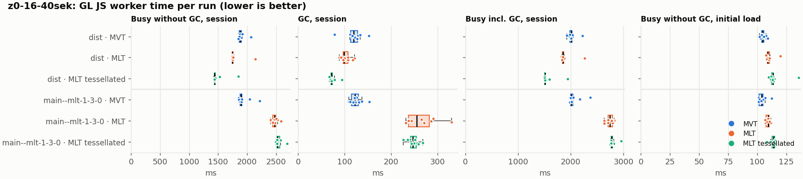
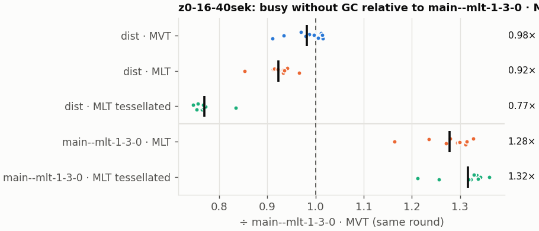
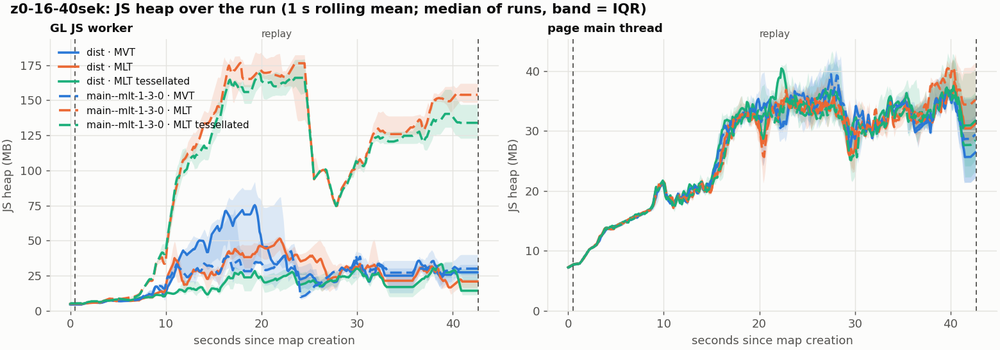
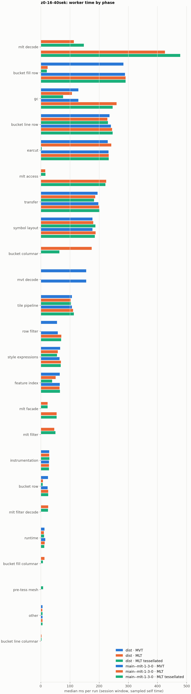

# Session trace benchmark — 20261107-171557

## Setup

- Created 2026-11-07T17:15:57+01:00; 10 repetitions + 1 warm-up round(s) (excluded); variants rotate per round (A B C, B C A, …); one cold browser context per run.
- Machine: , 16 logical cores, None GB RAM, Linux-7.2.9-200.nobara.fc44.x86_64-x86_64-with-glibc2.43; power: ?, AC None.
- GL JS gl7-local-files @ eb3231235c (dirty); worker count 1; viewport {'width': 1280, 'height': 1024}.
- Python 3.14.7, packages {'playwright': '1.64.1', 'numpy': '2.4.6', 'matplotlib': '3.10.8'}.

| variant | bundle | format | bundle sha256 | branch build |
|---|---|---|---|---|
| MVT | `dist/maplibre-gl-dev.mjs` | mvt | `4b8e23c84997` | – |
| MLT | `dist/maplibre-gl-dev.mjs` | mlt | `4b8e23c84997` | – |
| MLT tessellated | `dist/maplibre-gl-dev.mjs` | mlt-pre-tess | `4b8e23c84997` | – |
| main--mlt-1-3-0 · MVT | `bench-builds/branches/main--mlt-1-3-0/maplibre-gl-dev.mjs` | mvt | `8a63f3527a41` | main @ bb38954083 (2026-10-26), MLT @maplibre/mlt@1.3.0 (npm) |
| main--mlt-1-3-0 · MLT | `bench-builds/branches/main--mlt-1-3-0/maplibre-gl-dev.mjs` | mlt | `8a63f3527a41` | main @ bb38954083 (2026-10-26), MLT @maplibre/mlt@1.3.0 (npm) |
| main--mlt-1-3-0 · MLT tessellated | `bench-builds/branches/main--mlt-1-3-0/maplibre-gl-dev.mjs` | mlt-pre-tess | `8a63f3527a41` | main @ bb38954083 (2026-10-26), MLT @maplibre/mlt@1.3.0 (npm) |

| session | style | duration | frames | sha256 |
|---|---|---:|---:|---|
| z0-16-40sek | maptiler-basic (recorded: osm-bright) | 42.1 s | 1739 | `55a2b8f22fe2` |

CPU sampling interval (median over runs): 159 µs.

## Definitions

- **busy** = wall time in which a GL JS worker thread runs a task (union of top-level task slices and GC slices on `DedicatedWorker thread`s), summed over workers. **GC** = union of `MinorGC`/`MajorGC`/`V8.GC*` slices on those threads. **busy without GC** = busy − GC (headline metric).
- **CPU** = thread time (`tdur`) of the same slices. Phase categories and functions come from the trace's CPU samples (self time), categorised by `config/categories.toml` (nearest matching frame, leaf to root).
- Windows: **load** = map creation → first idle; **session** = camera replay; **tail** = end of replay → idle; **total** = load + session + tail.
- Ratios are against **main--mlt-1-3-0 · MVT**: ratio of medians with a bootstrap 95 % CI, the geometric mean of per-round ratios, and a two-sided Mann–Whitney U p-value (normal approximation, not corrected for multiple comparisons; rough below n = 8). Lower than 1× means less worker time.

## Session `z0-16-40sek`

### Worker busy without GC (session window)

| variant | n ok / failed | median ms | IQR | mean | ratio vs main--mlt-1-3-0 · MVT | 95 % CI | geo-mean paired | MWU p |
|---|---:|---:|---:|---:|---:|---:|---:|---:|
| MVT | 10 / 0 | 1,878 | 1,866–1,900 | 1,898 | 0.99× | 0.95–1.01× | 0.98× | 0.345 |
| MLT | 10 / 0 | 1,748 | 1,742–1,759 | 1,787 | 0.92× | 0.89–0.93× | 0.92× | 0.002 |
| MLT tessellated | 10 / 0 | 1,440 | 1,439–1,453 | 1,490 | 0.76× | 0.73–0.78× | 0.77× | <0.001 |
| main--mlt-1-3-0 · MVT | 10 / 0 | 1,897 | 1,881–1,909 | 1,936 | 1.00× | – | – | – |
| main--mlt-1-3-0 · MLT | 10 / 0 | 2,470 | 2,441–2,496 | 2,472 | 1.30× | 1.25–1.33× | 1.28× | <0.001 |
| main--mlt-1-3-0 · MLT tessellated | 10 / 0 | 2,526 | 2,517–2,560 | 2,546 | 1.33× | 1.28–1.36× | 1.32× | <0.001 |

### All worker metrics (median, ratio vs baseline)

| metric | MVT | MLT | MLT tessellated | main--mlt-1-3-0 · MVT | main--mlt-1-3-0 · MLT | main--mlt-1-3-0 · MLT tessellated |
|---|---:|---:|---:|---:|---:|---:|
| busy incl. GC | 2,005 (1.00×) | 1,851 (0.92×) | 1,514 (0.75×) | 2,010 | 2,738 (1.36×) | 2,774 (1.38×) |
| &nbsp;&nbsp;of which GC | 119.2 (0.97×) | 99.3 (0.81×) | 71.9 (0.59×) | 122.4 | 254.9 (2.08×) | 246.8 (2.02×) |
| &nbsp;&nbsp;of which busy without GC | 1,878 (0.99×) | 1,748 (0.92×) | 1,440 (0.76×) | 1,897 | 2,470 (1.30×) | 2,526 (1.33×) |
| &nbsp;&nbsp;&nbsp;&nbsp;of which filtering (sampled, incl. callees) | 56.1 (0.96×) | 46.5 (0.79×) | 50.4 (0.86×) | 58.5 | 70.8 (1.21×) | 69.8 (1.19×) |
| &nbsp;&nbsp;&nbsp;&nbsp;of which column decoding inside the MLT filter (sampled) | 0.0 | 25.4 | 25.1 | 0.0 | 0.0 | 0.0 |
| &nbsp;&nbsp;&nbsp;&nbsp;of which timing instrumentation (sampled) | 28.9 (1.02×) | 28.6 (1.01×) | 29.6 (1.04×) | 28.4 | 28.3 (1.00×) | 28.0 (0.99×) |
| busy without GC and instrumentation | 1,851 (0.99×) | 1,720 (0.92×) | 1,410 (0.75×) | 1,871 | 2,442 (1.31×) | 2,498 (1.34×) |
| CPU time without GC | 1,824 (0.99×) | 1,692 (0.92×) | 1,383 (0.75×) | 1,844 | 2,392 (1.30×) | 2,447 (1.33×) |
| tile: download end → sent to main thread, median per tile | 21.6 (0.96×) | 19.7 (0.88×) | 15.6 (0.69×) | 22.4 | 31.6 (1.41×) | 32.2 (1.44×) |
| tile: download end → sent to main thread, 90th percentile | 132.0 (1.03×) | 104.2 (0.82×) | 80.5 (0.63×) | 127.8 | 174.2 (1.36×) | 188.8 (1.48×) |
| tile: download end → sent to main thread, 95th percentile | 169.3 (1.01×) | 138.3 (0.82×) | 102.4 (0.61×) | 168.4 | 229.4 (1.36×) | 227.8 (1.35×) |
| tile: download end → sent to main thread, 99th percentile | 243.7 (0.97×) | 232.3 (0.92×) | 128.9 (0.51×) | 251.1 | 296.8 (1.18×) | 324.6 (1.29×) |
| minor GCs | 59.50 (0.98×) | 50.50 (0.83×) | 34.50 (0.57×) | 60.50 | 67.50 (1.12×) | 68.50 (1.13×) |
| major GCs | 8.50 (0.94×) | 9.00 (1.00×) | 9.00 (1.00×) | 9.00 | 8.00 (0.89×) | 8.00 (0.89×) |
| peak worker heap (MB) | 101.0 (1.50×) | 61.5 (0.91×) | 44.9 (0.67×) | 67.4 | 201.0 (2.98×) | 188.2 (2.79×) |
| load: busy without GC | 104.8 (1.01×) | 109.2 (1.05×) | 113.5 (1.09×) | 103.8 | 109.4 (1.05×) | 114.1 (1.10×) |
| load: GC | 4.3 (0.99×) | 4.3 (1.01×) | 4.3 (1.00×) | 4.3 | 4.6 (1.08×) | 4.6 (1.08×) |
| total: busy without GC | 1,983 (0.99×) | 1,856 (0.93×) | 1,554 (0.78×) | 2,001 | 2,581 (1.29×) | 2,640 (1.32×) |

Rows marked *of which* are parts of the row above, not additional time. Tile rows are per-tile latencies (medians over tiles, then over runs), not sums: tiles overlap in time, and the medians of the parse and queue parts do not add up exactly to the median latency.

### Filtering (session window)

Sampled worker time spent in feature filtering, including everything the filter calls (expression evaluation, property access): **row filter** = the style-spec feature filter that MVT runs per feature, **mlt filter** = the columnar MLT filter (incl. the geometry-type selection), without the columns it decodes (see the next table). Medians per run; rules in `config/categories.toml`.

| variant | mlt filter | row filter | filtering | ratio vs main--mlt-1-3-0 · MVT | 95 % CI | MWU p | share of sampled busy |
|---|---:|---:|---:|---:|---:|---:|---:|
| MVT | 0.0 | 56.0 | 56.1 | 0.96× | 0.90–1.03× | 0.140 | 3.1% |
| MLT | 46.5 | 0.0 | 46.5 | 0.79× | 0.75–0.85× | 0.002 | 2.8% |
| MLT tessellated | 50.4 | 0.0 | 50.4 | 0.86× | 0.76–0.93× | 0.002 | 3.9% |
| main--mlt-1-3-0 · MVT | 0.0 | 58.5 | 58.5 | 1.00× | – | – | 3.3% |
| main--mlt-1-3-0 · MLT | 0.0 | 70.8 | 70.8 | 1.21× | 1.13–1.30× | 0.001 | 2.8% |
| main--mlt-1-3-0 · MLT tessellated | 0.0 | 69.8 | 69.8 | 1.19× | 1.14–1.29× | 0.001 | 2.7% |

**Filtering together with tile decoding.** The MLT decoder leaves columns encoded until something reads them, and the filter is usually the first reader: the columns it decodes (properties, and the geometry for `$type`) are **of which inside the filter** (phase *mlt filter decode*), the rest is *mlt decode* (geometry and columns read later, e.g. by paint properties and symbols). MVT decodes every feature's properties and geometry while it reads the tile (*mvt decode*), whether the filter keeps the feature or not. So **filtering** above compares the filters, and **decoding + filtering** compares all that the formats spend on decoding the tile and selecting features. **tile decoding** = *mvt decode* or *mlt decode* + *mlt filter decode*: work inside a call into a decoder. Reading data that is already decoded is not counted, as for MVT's feature objects: *mlt access* (row views, value getters, looking a column up by name) and the MLT facade (*mlt facade*). MVT decodes geometry only for the features its filter keeps, MLT decodes a layer's whole geometry column.

| variant | tile decoding | of which inside the filter | filtering | decoding + filtering | ratio vs main--mlt-1-3-0 · MVT | 95 % CI | MWU p |
|---|---:|---:|---:|---:|---:|---:|---:|
| MVT | 155.9 | 0.0 | 56.1 | 212.0 | 0.99× | 0.95–1.01× | 0.345 |
| MLT | 139.2 | 25.4 | 46.5 | 185.2 | 0.87× | 0.83–0.89× | 0.003 |
| MLT tessellated | 173.0 | 25.1 | 50.4 | 223.0 | 1.04× | 1.00–1.06× | 0.121 |
| main--mlt-1-3-0 · MVT | 155.7 | 0.0 | 58.5 | 214.1 | 1.00× | – | – |
| main--mlt-1-3-0 · MLT | 426.2 | 0.0 | 70.8 | 497.3 | 2.32× | 2.23–2.41× | <0.001 |
| main--mlt-1-3-0 · MLT tessellated | 478.1 | 0.0 | 69.8 | 547.3 | 2.56× | 2.46–2.64× | <0.001 |

Top 12 functions inside filtering and its column decoding (self time, mean ms per run):

| phase | function | source | MVT | MLT | MLT tessellated | main--mlt-1-3-0 · MVT | main--mlt-1-3-0 · MLT | main--mlt-1-3-0 · MLT tessellated |
|---|---|---|---:|---:|---:|---:|---:|---:|
| row filter | `evaluate` | node_modules/@maplibre/maplibre-gl-style-spec/dist/expression/compound_expression.mjs | 15.3 | 0.0 | 0.0 | 16.2 | 23.7 | 23.8 |
| row filter | `evaluate` | node_modules/@maplibre/maplibre-gl-style-spec/dist/expression/index.mjs | 10.6 | 0.0 | 0.0 | 12.2 | 12.6 | 11.8 |
| row filter | `CompoundExpression.register.filter-in-small` | node_modules/@maplibre/maplibre-gl-style-spec/dist/expression/compound_expression.mjs | 7.2 | 0.0 | 0.0 | 5.3 | 7.8 | 8.2 |
| row filter | `CompoundExpression.register.filter-==` | node_modules/@maplibre/maplibre-gl-style-spec/dist/expression/compound_expression.mjs | 6.3 | 0.0 | 0.0 | 7.0 | 8.0 | 7.9 |
| mlt filter | `filterByGeometryType` | maplibre-tile-spec/ts/dist/vector/geometry/geometryVector.js | 0.0 | 5.5 | 7.1 | 0.0 | 0.0 | 0.0 |
| row filter | `filter` | node_modules/@maplibre/maplibre-gl-style-spec/dist/feature_filter/index.mjs | 5.0 | 0.0 | 0.0 | 5.7 | 6.2 | 6.1 |
| mlt filter | `dictionaryRowMatches` | maplibre-tile-spec/ts/dist/processing/filter/execution/filterKernel.js | 0.0 | 3.9 | 3.8 | 0.0 | 0.0 | 0.0 |
| row filter | `CompoundExpression.register.filter-type-==` | node_modules/@maplibre/maplibre-gl-style-spec/dist/expression/compound_expression.mjs | 3.5 | 0.0 | 0.0 | 3.7 | 3.7 | 3.4 |
| mlt filter | `scanDictionaryCodes` | maplibre-tile-spec/ts/dist/processing/filter/execution/filterKernel.js | 0.0 | 3.3 | 3.5 | 0.0 | 0.0 | 0.0 |
| mlt filter decode | `decodeFsst` | maplibre-tile-spec/ts/dist/decoding/fsstDecoder.js | 0.0 | 2.5 | 2.8 | 0.0 | 0.0 | 0.0 |
| mlt filter | `resolveDictionaryExecutor` | maplibre-tile-spec/ts/dist/processing/filter/execution/filterKernel.js | 0.0 | 2.4 | 2.6 | 0.0 | 0.0 | 0.0 |
| row filter | `CompoundExpression.register.all.overloads` | node_modules/@maplibre/maplibre-gl-style-spec/dist/expression/compound_expression.mjs | 2.0 | 0.0 | 0.0 | 2.6 | 2.3 | 2.1 |

### Bucket time by layer type (session window)

Sampled self time of the bucket code per layer type, row and columnar path together (median ms per run). **shared bucket code** is code all layer types use (`src/data/bucket/*` outside the layer files, `columnar_populate.ts`, `columnar_mesh_arrays.ts`, `load_geometry.ts`). **earcut** triangulates for fill and fill-extrusion on the row path; **pre-tess mesh** takes over the stored triangles of a pre-tessellated fill. **symbol** is the whole symbol layout phase. For exact wall time per source layer and type see the timing log tables below (builds with `worker_timing.ts` only).

| variant | fill | fill-extrusion | line | symbol | shared bucket code | earcut | pre-tess mesh | total |
|---|---:|---:|---:|---:|---:|---:|---:|---:|
| MVT | 283.4 | 0.0 | 236.1 | 177.4 | 24.9 | 230.1 | 0.0 | 948.7 |
| MLT | 36.2 | 0.0 | 230.7 | 180.4 | 181.8 | 241.6 | 0.0 | 868.3 |
| MLT tessellated | 28.8 | 0.0 | 233.1 | 187.3 | 71.1 | 3.5 | 8.4 | 527.9 |
| main--mlt-1-3-0 · MVT | 289.1 | 0.0 | 240.6 | 177.7 | 23.3 | 232.4 | 0.0 | 961.6 |
| main--mlt-1-3-0 · MLT | 291.1 | 0.0 | 244.5 | 188.2 | 25.4 | 233.0 | 0.0 | 975.9 |
| main--mlt-1-3-0 · MLT tessellated | 290.9 | 0.0 | 246.8 | 185.4 | 25.9 | 233.0 | 0.0 | 982.2 |

### Where the variants differ from main--mlt-1-3-0 · MVT (session window, mean ms per run)

Open **[flame.html](flame.html)** to explore the call tree interactively: pick a variant, compare it with main--mlt-1-3-0 · MVT (red = more time at the same call path, blue = less), click a frame to zoom in, and read the phase and function breakdown under it. Without a comparison, frames are coloured by phase: filtering is green in both formats, and the columns the MLT filter decodes on first access (*mlt filter decode*) are MLT blue frames under the green filter. `flame/*.txt` open in https://www.speedscope.app.

#### MVT vs main--mlt-1-3-0 · MVT

**By phase** (sampled self time; the Δ column sums to the difference in sampled busy time):

| phase | main--mlt-1-3-0 · MVT | MVT | Δ |
|---|---:|---:|---:|
| bucket row | 23.7 | 24.8 | +1.1 |
| mvt decode | 157.4 | 156.8 | -0.6 |
| style expressions | 67.9 | 67.2 | -0.7 |
| other | 6.4 | 5.7 | -0.7 |
| bucket line row | 242.7 | 240.6 | -2.1 |
| runtime | 15.6 | 13.1 | -2.5 |
| earcut | 232.4 | 229.8 | -2.6 |
| row filter | 59.7 | 56.3 | -3.4 |
| bucket fill row | 288.9 | 284.7 | -4.1 |
| tile pipeline | 111.9 | 107.5 | -4.4 |
| symbol layout | 183.5 | 178.9 | -4.6 |
| gc | 131.3 | 126.5 | -4.9 |
| transfer | 202.4 | 195.6 | -6.8 |

**Functions with the largest self-time difference** (by function name, summed over source files):

| function | main--mlt-1-3-0 · MVT | MVT | Δ |
|---|---:|---:|---:|
| `Point$1` | 0.0 | 8.8 | +8.8 |
| `addBucketFeatures` | 0.0 | 7.7 | +7.7 |
| `addSymbolFeature` | 0.0 | 4.0 | +4.0 |
| `readUtf8` | 0.0 | 3.1 | +3.1 |
| `signedArea$2` | 0.0 | 3.0 | +3.0 |
| `CompoundExpression.register.filter-in-small` | 5.3 | 7.2 | +1.9 |
| `populate` | 34.3 | 36.0 | +1.8 |
| `addHalfVertex` | 24.4 | 25.8 | +1.5 |
| `fixWindingOrder` | 13.5 | 14.8 | +1.4 |
| `addCurrentVertex` | 23.9 | 25.0 | +1.1 |
| `finishSymbolFeatures` | 0.0 | 1.0 | +1.0 |
| `TileTimings` | 0.0 | 0.9 | +0.9 |
| `hasLineDasharray` | 14.7 | 0.1 | -14.6 |
| `Point` | 8.4 | 0.0 | -8.4 |
| `(garbage collector)` | 131.3 | 126.5 | -4.9 |
| `readUtf8$1` | 3.2 | 0.0 | -3.2 |
| `signedArea$1` | 2.7 | 0.0 | -2.7 |

#### MLT vs main--mlt-1-3-0 · MVT

**By phase** (sampled self time; the Δ column sums to the difference in sampled busy time):

| phase | main--mlt-1-3-0 · MVT | MLT | Δ |
|---|---:|---:|---:|
| bucket columnar | 0.0 | 177.7 | +177.7 |
| mlt decode | 0.0 | 116.8 | +116.8 |
| mlt filter | 0.0 | 47.8 | +47.8 |
| mlt filter decode | 0.0 | 26.8 | +26.8 |
| mlt facade | 0.0 | 23.9 | +23.9 |
| mlt access | 0.0 | 16.2 | +16.2 |
| bucket fill columnar | 0.0 | 12.8 | +12.8 |
| earcut | 232.4 | 241.1 | +8.7 |
| bucket line columnar | 0.0 | 3.0 | +3.0 |
| instrumentation | 29.4 | 30.2 | +0.8 |
| other | 6.4 | 5.9 | -0.5 |
| runtime | 15.6 | 11.0 | -4.5 |
| tile pipeline | 111.9 | 105.5 | -6.4 |
| style expressions | 67.9 | 60.6 | -7.3 |
| transfer | 202.4 | 191.4 | -11.0 |
| bucket line row | 242.7 | 229.6 | -13.1 |
| feature index | 66.9 | 50.9 | -15.9 |
| bucket row | 23.7 | 7.7 | -16.1 |
| gc | 131.3 | 109.8 | -21.5 |
| row filter | 59.7 | 0.0 | -59.7 |
| mvt decode | 157.4 | 0.0 | -157.4 |
| bucket fill row | 288.9 | 24.4 | -264.5 |

**Functions with the largest self-time difference** (by function name, summed over source files):

| function | main--mlt-1-3-0 · MVT | MLT | Δ |
|---|---:|---:|---:|
| `writeEarcutFill` | 0.0 | 23.6 | +23.6 |
| `buildRingBoundingBoxes` | 0.0 | 19.9 | +19.9 |
| `buildEarcutMesh` | 0.0 | 18.6 | +18.6 |
| `decodeComponentwiseDeltaVec2` | 0.0 | 17.2 | +17.2 |
| `signedArea$2` | 0.0 | 13.3 | +13.3 |
| `fillLargeMeshArrays` | 13.6 | 25.9 | +12.3 |
| `readScaledRings` | 0.0 | 10.2 | +10.2 |
| `addBucketFeatures` | 0.0 | 7.8 | +7.8 |
| `Point$1` | 0.0 | 7.4 | +7.4 |
| `decodeString$2` | 0.0 | 7.2 | +7.2 |
| `decodeFsst` | 0.0 | 7.0 | +7.0 |
| `get` | 8.9 | 15.9 | +7.0 |
| `_vertexToIndex` | 95.4 | 0.3 | -95.2 |
| `readVarint` | 38.7 | 2.2 | -36.5 |
| `loadGeometry` | 40.3 | 7.1 | -33.2 |
| `populate` | 34.3 | 5.5 | -28.8 |
| `evaluate` | 33.7 | 5.5 | -28.2 |

#### MLT tessellated vs main--mlt-1-3-0 · MVT

**By phase** (sampled self time; the Δ column sums to the difference in sampled busy time):

| phase | main--mlt-1-3-0 · MVT | MLT tessellated | Δ |
|---|---:|---:|---:|
| mlt decode | 0.0 | 150.1 | +150.1 |
| bucket columnar | 0.0 | 65.6 | +65.6 |
| mlt filter | 0.0 | 51.0 | +51.0 |
| mlt filter decode | 0.0 | 26.4 | +26.4 |
| mlt facade | 0.0 | 23.3 | +23.3 |
| mlt access | 0.0 | 15.9 | +15.9 |
| pre-tess mesh | 0.0 | 8.3 | +8.3 |
| bucket fill columnar | 0.0 | 7.9 | +7.9 |
| symbol layout | 183.5 | 191.5 | +7.9 |
| bucket line columnar | 0.0 | 2.9 | +2.9 |
| instrumentation | 29.4 | 30.9 | +1.5 |
| other | 6.4 | 5.9 | -0.5 |
| runtime | 15.6 | 12.1 | -3.4 |
| tile pipeline | 111.9 | 106.7 | -5.2 |
| style expressions | 67.9 | 59.3 | -8.6 |
| bucket line row | 242.7 | 234.1 | -8.6 |
| transfer | 202.4 | 188.0 | -14.4 |
| bucket row | 23.7 | 7.4 | -16.4 |
| feature index | 66.9 | 40.4 | -26.5 |
| gc | 131.3 | 78.4 | -53.0 |
| row filter | 59.7 | 0.0 | -59.7 |
| mvt decode | 157.4 | 0.0 | -157.4 |
| earcut | 232.4 | 3.5 | -228.9 |
| bucket fill row | 288.9 | 22.0 | -266.9 |

**Functions with the largest self-time difference** (by function name, summed over source files):

| function | main--mlt-1-3-0 · MVT | MLT tessellated | Δ |
|---|---:|---:|---:|
| `writeTessellatedFill` | 0.0 | 19.2 | +19.2 |
| `decodeComponentwiseDeltaVec2` | 0.0 | 16.7 | +16.7 |
| `decodeUnsignedZigZagDeltaInt32` | 0.0 | 16.3 | +16.3 |
| `decodeFastPforInt32` | 0.0 | 8.6 | +8.6 |
| `buildTessellatedBoundingBox` | 0.0 | 8.2 | +8.2 |
| `fastUnpack256_4` | 0.0 | 7.3 | +7.3 |
| `decodeString$2` | 0.0 | 7.1 | +7.1 |
| `filterByGeometryType` | 0.0 | 7.1 | +7.1 |
| `decodeFsst` | 0.0 | 7.0 | +7.0 |
| `Point$1` | 0.0 | 6.7 | +6.7 |
| `addBucketFeatures` | 0.0 | 6.5 | +6.5 |
| `get` | 8.9 | 14.9 | +6.0 |
| `_vertexToIndex` | 95.4 | 0.2 | -95.3 |
| `isEar` | 70.5 | 0.4 | -70.0 |
| `(garbage collector)` | 131.3 | 78.4 | -53.0 |
| `readVarint` | 38.7 | 2.1 | -36.6 |
| `isEarHashed` | 35.9 | 0.5 | -35.5 |

#### main--mlt-1-3-0 · MLT vs main--mlt-1-3-0 · MVT

**By phase** (sampled self time; the Δ column sums to the difference in sampled busy time):

| phase | main--mlt-1-3-0 · MVT | main--mlt-1-3-0 · MLT | Δ |
|---|---:|---:|---:|
| mlt decode | 0.0 | 429.0 | +429.0 |
| mlt access | 0.0 | 225.2 | +225.2 |
| gc | 131.3 | 264.7 | +133.4 |
| mlt facade | 0.0 | 55.2 | +55.2 |
| row filter | 59.7 | 71.1 | +11.4 |
| symbol layout | 183.5 | 186.9 | +3.4 |
| bucket row | 23.7 | 25.7 | +2.0 |
| style expressions | 67.9 | 69.4 | +1.5 |
| bucket fill row | 288.9 | 290.1 | +1.2 |
| earcut | 232.4 | 231.8 | -0.5 |
| tile pipeline | 111.9 | 111.3 | -0.6 |
| transfer | 202.4 | 201.4 | -1.0 |
| instrumentation | 29.4 | 28.1 | -1.3 |
| feature index | 66.9 | 65.0 | -1.9 |
| runtime | 15.6 | 13.4 | -2.1 |
| mvt decode | 157.4 | 0.0 | -157.4 |

**Functions with the largest self-time difference** (by function name, summed over source files):

| function | main--mlt-1-3-0 · MVT | main--mlt-1-3-0 · MLT | Δ |
|---|---:|---:|---:|
| `(garbage collector)` | 131.3 | 264.7 | +133.4 |
| `createDecoderWorkspace` | 0.0 | 109.9 | +109.9 |
| `getFeatures` | 0.0 | 97.3 | +97.3 |
| `decodeString$2` | 0.0 | 86.9 | +86.9 |
| `convertGeometryVector` | 0.0 | 32.6 | +32.6 |
| `getValue` | 0.0 | 28.5 | +28.5 |
| `unpackNullable` | 0.0 | 22.1 | +22.1 |
| `decodeComponentwiseDeltaVec2` | 0.0 | 18.6 | +18.6 |
| `getLineStringOrRing` | 0.0 | 16.0 | +16.0 |
| `readUtf8` | 0.0 | 14.6 | +14.6 |
| `decodeFastPforWithWorkspace` | 0.0 | 14.2 | +14.2 |
| `get` | 8.9 | 22.2 | +13.3 |
| `readVarint` | 38.7 | 0.0 | -38.7 |
| `VectorTileFeature` | 27.1 | 0.0 | -27.1 |
| `readString` | 26.7 | 0.0 | -26.7 |
| `readSVarint` | 20.9 | 0.0 | -20.9 |
| `feature` | 5.6 | 1.3 | -4.3 |

#### main--mlt-1-3-0 · MLT tessellated vs main--mlt-1-3-0 · MVT

**By phase** (sampled self time; the Δ column sums to the difference in sampled busy time):

| phase | main--mlt-1-3-0 · MVT | main--mlt-1-3-0 · MLT tessellated | Δ |
|---|---:|---:|---:|
| mlt decode | 0.0 | 483.8 | +483.8 |
| mlt access | 0.0 | 223.5 | +223.5 |
| gc | 131.3 | 247.3 | +116.0 |
| mlt facade | 0.0 | 55.5 | +55.5 |
| row filter | 59.7 | 70.6 | +10.9 |
| bucket line row | 242.7 | 248.4 | +5.7 |
| symbol layout | 183.5 | 186.8 | +3.3 |
| bucket fill row | 288.9 | 291.7 | +2.8 |
| tile pipeline | 111.9 | 114.4 | +2.5 |
| bucket row | 23.7 | 25.8 | +2.1 |
| style expressions | 67.9 | 69.2 | +1.3 |
| other | 6.4 | 5.6 | -0.8 |
| instrumentation | 29.4 | 28.4 | -1.1 |
| earcut | 232.4 | 231.1 | -1.3 |
| runtime | 15.6 | 11.9 | -3.6 |
| mvt decode | 157.4 | 0.0 | -157.4 |

**Functions with the largest self-time difference** (by function name, summed over source files):

| function | main--mlt-1-3-0 · MVT | main--mlt-1-3-0 · MLT tessellated | Δ |
|---|---:|---:|---:|
| `createDecoderWorkspace` | 0.0 | 117.0 | +117.0 |
| `(garbage collector)` | 131.3 | 247.3 | +116.0 |
| `getFeatures` | 0.0 | 96.5 | +96.5 |
| `decodeString$2` | 0.0 | 89.8 | +89.8 |
| `convertGeometryVector` | 0.0 | 33.3 | +33.3 |
| `getValue` | 0.0 | 28.3 | +28.3 |
| `unpackNullable` | 0.0 | 26.0 | +26.0 |
| `decodeUnsignedZigZagDeltaInt32` | 0.0 | 19.3 | +19.3 |
| `decodeComponentwiseDeltaVec2` | 0.0 | 18.6 | +18.6 |
| `getLineStringOrRing` | 0.0 | 16.1 | +16.1 |
| `readUtf8` | 0.0 | 15.5 | +15.5 |
| `decodeFastPforWithWorkspace` | 0.0 | 14.1 | +14.1 |
| `readVarint` | 38.7 | 0.0 | -38.7 |
| `VectorTileFeature` | 27.1 | 0.0 | -27.1 |
| `readString` | 26.7 | 0.0 | -26.7 |
| `readSVarint` | 20.9 | 0.0 | -20.9 |
| `feature` | 5.6 | 1.1 | -4.4 |

### Memory (session window)

**JS heap** = V8's used heap of the thread (`jsHeapSizeUsed` from the trace's `UpdateCounters`, about every 20 ms; the mean is time-weighted). It does not include ArrayBuffer contents, so the tile data itself (vertex, index and feature-index arrays) is not in it: **tile data sent to the main thread** is the size of the ArrayBuffers each tile result transfers (`web/worker_hook.js`), which then live on the main thread and are uploaded to the GPU. **garbage collected** = heap freed by the worker's GCs, a measure of how much it allocates. Medians per run; ratio of medians with a bootstrap 95 % CI.

| metric | MVT | MLT | MLT tessellated | main--mlt-1-3-0 · MVT | main--mlt-1-3-0 · MLT | main--mlt-1-3-0 · MLT tessellated |
|---|---:|---:|---:|---:|---:|---:|
| worker JS heap, mean (MB) | 25.7 (1.15×, 0.92–1.37×) | 22.7 (1.02×, 0.80–1.16×) | 15.9 (0.71×, 0.59–0.77×) | 22.3 | 104.5 (4.69×, 3.84–5.03×) | 98.7 (4.43×, 3.63–4.71×) |
| worker JS heap, peak (MB) | 101.0 (1.50×, 0.91–1.79×) | 61.5 (0.91×, 0.61–1.07×) | 44.9 (0.67×, 0.45–0.79×) | 67.4 | 201.0 (2.98×, 2.00–3.81×) | 188.2 (2.79×, 1.84–3.36×) |
| worker JS heap after the last GC (MB) | 11.4 (0.92×, 0.44–1.51×) | 9.1 (0.74×, 0.36–1.18×) | 7.5 (0.60×, 0.32–1.19×) | 12.4 | 139.6 (11.29×, 5.59–17.96×) | 124.9 (10.10×, 5.03–16.45×) |
| garbage collected in the worker (MB) | 1,447 (1.01×, 0.99–1.01×) | 1,059 (0.74×, 0.73–0.74×) | 554.7 (0.39×, 0.37–0.39×) | 1,439 | 1,627 (1.13×, 1.11–1.14×) | 1,652 (1.15×, 1.13–1.16×) |
| main thread JS heap, mean (MB) | 24.0 (1.00×, 0.93–1.05×) | 24.2 (1.01×, 0.94–1.04×) | 25.1 (1.05×, 0.95–1.13×) | 24.0 | 24.1 (1.00×, 0.94–1.07×) | 23.8 (0.99×, 0.93–1.04×) |
| main thread JS heap, peak (MB) | 49.7 (1.00×, 0.91–1.10×) | 51.4 (1.03×, 0.92–1.11×) | 52.1 (1.05×, 0.90–1.17×) | 49.7 | 51.3 (1.03×, 0.96–1.12×) | 48.1 (0.97×, 0.90–1.08×) |
| main thread JS heap at the end of the replay (MB) | 26.4 (0.90×, 0.61–1.45×) | 31.2 (1.06×, 0.75–1.57×) | 31.7 (1.08×, 0.73–1.78×) | 29.4 | 35.2 (1.20×, 0.82–1.81×) | 28.4 (0.97×, 0.67–1.62×) |
| tile data sent to the main thread, total (MB) | 91.1 (1.00×, 1.00–1.01×) | 85.2 (0.94×, 0.93–0.94×) | 85.6 (0.94×, 0.94–0.94×) | 91.0 | 84.5 (0.93×, 0.91–0.93×) | 87.7 (0.96×, 0.95–0.97×) |
| tile data sent to the main thread, median per tile (KB) | 194.2 (1.00×, 1.00–1.01×) | 179.9 (0.92×, 0.92–0.93×) | 179.9 (0.92×, 0.92–0.93×) | 194.6 | 178.3 (0.92×, 0.90–0.92×) | 181.2 (0.93×, 0.93–0.94×) |

### Worker time by phase (session window, median ms of sampled self time)

| phase | MVT | MLT | MLT tessellated | main--mlt-1-3-0 · MVT | main--mlt-1-3-0 · MLT | main--mlt-1-3-0 · MLT tessellated |
|---|---:|---:|---:|---:|---:|---:|
| mlt decode | 0.0 | 113.4 | 147.9 | 0.0 | 426.2 | 478.1 |
| bucket fill row | 283.4 | 23.8 | 20.7 | 289.1 | 291.1 | 290.9 |
| gc | 128.9 | 106.7 | 76.6 | 128.7 | 260.3 | 246.6 |
| bucket line row | 236.1 | 228.5 | 230.5 | 240.6 | 244.5 | 246.8 |
| earcut | 230.1 | 241.6 | 3.5 | 232.4 | 233.0 | 233.0 |
| mlt access | 0.0 | 15.8 | 16.2 | 0.0 | 224.4 | 221.8 |
| transfer | 195.0 | 186.9 | 182.9 | 197.5 | 200.4 | 201.5 |
| symbol layout | 177.4 | 180.4 | 187.3 | 177.7 | 188.2 | 185.4 |
| bucket columnar | 0.0 | 174.8 | 64.1 | 0.0 | 0.0 | 0.0 |
| mvt decode | 155.9 | 0.0 | 0.0 | 155.7 | 0.0 | 0.0 |
| tile pipeline | 106.9 | 103.0 | 103.7 | 107.1 | 111.0 | 113.6 |
| row filter | 56.0 | 0.0 | 0.0 | 58.5 | 70.8 | 69.8 |
| style expressions | 66.7 | 58.5 | 56.1 | 64.6 | 69.0 | 68.7 |
| feature index | 65.0 | 50.8 | 39.1 | 65.1 | 64.4 | 66.0 |
| mlt facade | 0.0 | 23.2 | 23.5 | 0.0 | 54.2 | 54.2 |
| mlt filter | 0.0 | 46.5 | 50.4 | 0.0 | 0.0 | 0.0 |
| instrumentation | 28.9 | 28.6 | 29.6 | 28.4 | 28.3 | 28.0 |
| bucket row | 24.9 | 7.7 | 6.8 | 23.3 | 25.4 | 25.9 |
| mlt filter decode | 0.0 | 25.4 | 25.1 | 0.0 | 0.0 | 0.0 |
| runtime | 12.9 | 11.0 | 11.7 | 15.2 | 13.3 | 11.8 |
| bucket fill columnar | 0.0 | 12.6 | 7.2 | 0.0 | 0.0 | 0.0 |
| pre-tess mesh | 0.0 | 0.0 | 8.4 | 0.0 | 0.0 | 0.0 |
| other | 5.9 | 5.5 | 6.0 | 6.1 | 5.9 | 6.0 |
| bucket line columnar | 0.0 | 2.7 | 2.9 | 0.0 | 0.0 | 0.0 |
| bucket fill-extrusion row | 0.0 | 0.0 | 0.0 | 0.0 | 0.0 | 0.0 |

### Top 20 worker functions by self time (session window, mean ms per run)

| function | source | phase | MVT | MLT | MLT tessellated | main--mlt-1-3-0 · MVT | main--mlt-1-3-0 · MLT | main--mlt-1-3-0 · MLT tessellated |
|---|---|---|---:|---:|---:|---:|---:|---:|
| `(garbage collector)` | (native) | gc | 126.5 | 109.8 | 78.4 | 131.3 | 264.7 | 247.3 |
| `createDecoderWorkspace` | node_modules/@maplibre/mlt/dist/decoding/fastPforDecoder.js | mlt decode | 0.0 | 0.0 | 0.0 | 0.0 | 109.9 | 117.0 |
| `getFeatures` | node_modules/@maplibre/mlt/dist/vector/featureTable.js | mlt access | 0.0 | 0.0 | 0.0 | 0.0 | 97.3 | 96.5 |
| `_vertexToIndex` | src/render/subdivision.ts | bucket fill row | 94.7 | 0.3 | 0.2 | 95.4 | 93.9 | 96.2 |
| `decodeString$2` | node_modules/@maplibre/mlt/dist/decoding/decodingUtils.js | mlt decode | 0.0 | 0.0 | 0.0 | 0.0 | 86.9 | 89.8 |
| `reserve` | src/util/struct_array.ts | feature index | 79.1 | 72.8 | 72.2 | 81.1 | 84.0 | 84.0 |
| `isEar` | node_modules/earcut/src/earcut.js | earcut | 69.8 | 71.8 | 0.4 | 70.5 | 71.5 | 71.6 |
| `emplace` | src/data/array_types.g.ts | bucket fill row | 46.6 | 48.0 | 46.3 | 48.5 | 48.2 | 49.3 |
| `fetch` | (native) | tile pipeline | 41.3 | 42.7 | 42.5 | 42.8 | 42.1 | 42.7 |
| `_trim` | src/util/struct_array.ts | transfer | 38.5 | 32.4 | 28.8 | 40.9 | 42.4 | 42.5 |
| `setTimeout` | (native) | transfer | 39.0 | 39.8 | 39.5 | 39.6 | 39.9 | 40.3 |
| `readVarint` | node_modules/pbf/index.js | mvt decode | 38.5 | 0.0 | 0.0 | 38.7 | 0.0 | 0.0 |
| `postMessage` | (native) | transfer | 36.3 | 38.2 | 38.3 | 38.1 | 37.8 | 37.9 |
| `isEarHashed` | node_modules/earcut/src/earcut.js | earcut | 34.3 | 34.2 | 0.5 | 35.9 | 34.5 | 33.6 |
| `serialize` | src/util/web_worker_transfer.ts | transfer | 33.4 | 33.8 | 32.9 | 33.5 | 32.6 | 33.0 |
| `convertGeometryVector` | node_modules/@maplibre/mlt/dist/vector/geometry/geometryVectorConverter.js | mlt access | 0.0 | 0.0 | 0.0 | 0.0 | 32.6 | 33.3 |
| `addLine` | src/data/bucket/line_bucket.ts | bucket line row | 29.7 | 32.9 | 31.3 | 32.0 | 31.1 | 31.6 |
| `insert` | src/data/feature_index.ts | feature index | 29.9 | 13.3 | 9.8 | 29.6 | 29.8 | 30.9 |
| `getValue` | node_modules/@maplibre/mlt/dist/vector/vector.js | mlt access | 0.0 | 0.0 | 0.0 | 0.0 | 28.5 | 28.3 |
| `earcutLinked` | node_modules/earcut/src/earcut.js | earcut | 27.6 | 23.0 | 0.4 | 27.5 | 27.5 | 26.5 |

### Top 20 worker functions by total time (incl. callees) (session window, mean ms per run)

| function | source | phase | MVT | MLT | MLT tessellated | main--mlt-1-3-0 · MVT | main--mlt-1-3-0 · MLT | main--mlt-1-3-0 · MLT tessellated |
|---|---|---|---:|---:|---:|---:|---:|---:|
| `loadTile` | src/source/vector_tile_worker_source.ts | tile pipeline | 1,232 | 1,144 | 822.0 | 1,247 | 1,819 | 1,881 |
| `parse` | src/source/worker_tile.ts | tile pipeline | 1,308 | 1,260 | 950.0 | 1,326 | 1,271 | 1,282 |
| `_parseWorkerTile` | src/source/vector_tile_worker_source.ts | tile pipeline | 1,150 | 1,093 | 775.2 | 1,163 | 1,103 | 1,115 |
| `loadVectorTile` | src/source/vector_tile_worker_source.ts | tile pipeline | 41.8 | 4.1 | 3.8 | 42.1 | 670.6 | 723.0 |
| `MLTVectorTile` | src/source/vector_tile_mlt.ts | mlt facade | 0.0 | 3.9 | 3.5 | 0.0 | 670.2 | 722.6 |
| `populate` | src/data/bucket/fill_bucket.ts | bucket fill row | 611.1 | 0.0 | 0.0 | 618.1 | 591.2 | 592.6 |
| `addBucketFeatures` | src/data/bucket/fill_bucket.ts | bucket fill row | 525.6 | 409.0 | 65.3 | 0.0 | 0.0 | 0.0 |
| `populate` | src/data/bucket/columnar/columnar_fill_bucket.ts | bucket fill columnar | 0.0 | 514.3 | 196.6 | 0.0 | 0.0 | 0.0 |
| `addFeature` | src/data/bucket/fill_bucket.ts | bucket fill row | 492.8 | 3.9 | 3.0 | 499.4 | 498.6 | 498.1 |
| `subdividePolygon` | src/render/subdivision.ts | bucket fill row | 415.2 | 3.3 | 2.7 | 419.9 | 417.8 | 419.4 |
| `subdividePolygonInternal` | src/render/subdivision.ts | bucket fill row | 409.7 | 3.2 | 2.7 | 414.8 | 412.7 | 414.4 |
| `addFeature` | src/data/bucket/columnar/columnar_fill_bucket.ts | bucket fill columnar | 0.0 | 394.2 | 59.0 | 0.0 | 0.0 | 0.0 |
| `writeEarcutFill` | src/data/bucket/columnar/columnar_mesh_arrays.ts | bucket columnar | 0.0 | 380.9 | 3.6 | 0.0 | 0.0 | 0.0 |
| `decodeTile` | node_modules/@maplibre/mlt/dist/mltDecoder.js | mlt decode | 0.0 | 0.0 | 0.0 | 0.0 | 316.6 | 367.1 |
| `(anonymous)` | src/source/vector_tile_mlt.ts | mlt facade | 0.0 | 0.1 | 0.0 | 0.0 | 351.7 | 354.0 |
| `MLTVectorTileLayer` | src/source/vector_tile_mlt.ts | mlt facade | 0.0 | 0.2 | 0.2 | 0.0 | 349.5 | 351.8 |
| `getFeatures` | node_modules/@maplibre/mlt/dist/vector/featureTable.js | mlt access | 0.0 | 0.0 | 0.0 | 0.0 | 336.6 | 339.7 |
| `populate` | src/data/bucket/columnar/columnar_line_bucket.ts | bucket line columnar | 0.0 | 302.7 | 306.0 | 0.0 | 0.0 | 0.0 |
| `populate` | src/data/bucket/line_bucket.ts | bucket line row | 285.9 | 0.0 | 0.0 | 289.0 | 284.6 | 289.0 |
| `buildEarcutMesh` | src/data/bucket/columnar/columnar_mesh_arrays.ts | bucket columnar | 0.0 | 270.6 | 1.9 | 0.0 | 0.0 | 0.0 |

## Runs

66 ok, 0 failed/aborted, 0 not run, 60 used in statistics.

## Validity checks

- Counted once: all 66 analysed runs pass (windows load + session + tail add up to total; phases add up to the sampled busy time; GC and sampled time lie within busy time; no timing-log line twice).
- other programs used 0.00–1.06 logical processors during the replays (median 0.00)
- 3 run(s) with more than 0.5 cores of background load: z0-16-40sek/mlt/rep-01 (1.05), z0-16-40sek/mlt-pre-tess/rep-01 (1.06), z0-16-40sek/main--mlt-1-3-0.mvt/rep-01 (0.89)

## Files

- `runs.csv`: one row per run (incl. failed and warm-up runs), every scalar metric as `<window>.<metric>`.
- `summary.csv`: session × variant × metric statistics.
- `functions.csv`, `categories.csv`: CPU-sample self/total time per function and phase per run and window.
- `category_functions.csv`: self time per phase × function (e.g. what the filters spend their time on).
- `tiles.csv`, `tile_layers.csv`, `tile_phases.csv`: the per-tile worker timing log, long format.
- `flame.html`: interactive call tree per variant with a diff view; `flame/*.txt`: collapsed stacks for speedscope.
- `analysis/stacks.csv` (per run): sampled self time per full call stack.
- `tile_latency.csv`: per tile request, worker clock: received, download start/end, result sent, latency = sent − download end, parse_ms, wait_ms = latency − parse.
- `runs/<session>/<variant>/rep-NN/trace.json.gz`: the raw trace (opens in the DevTools Performance tab).
