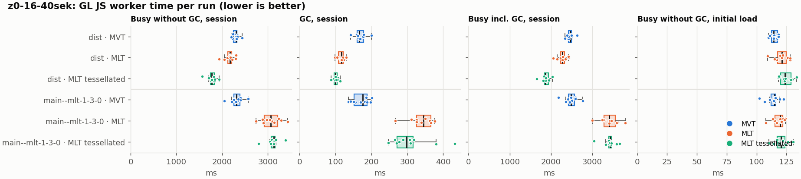
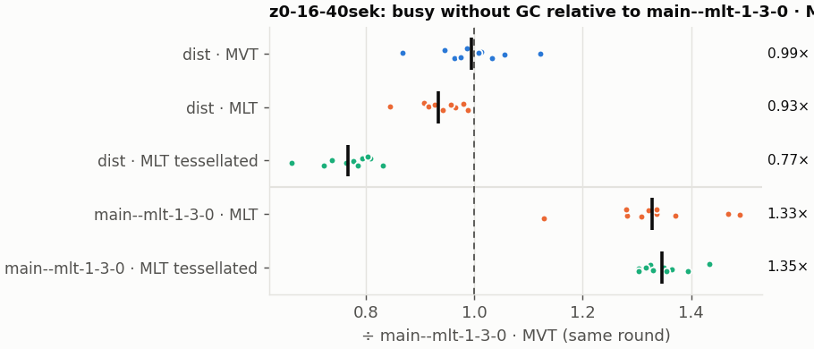
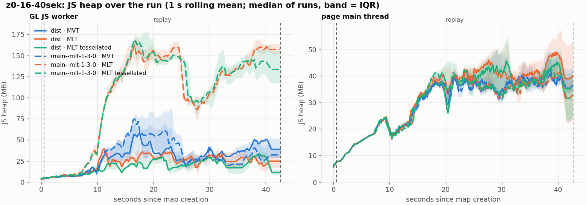
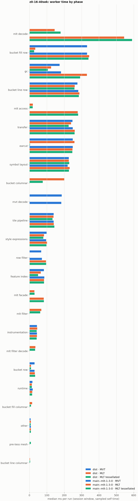

# Session trace benchmark — 20261108-163052

## Setup

- Created 2026-11-08T16:30:52+01:00; 10 repetitions + 1 warm-up round(s) (excluded); variants rotate per round (A B C, B C A, …); one cold browser context per run.
- Machine: , 16 logical cores, None GB RAM, Linux-7.2.9-200.nobara.fc44.x86_64-x86_64-with-glibc2.43; power: ?, AC None.
- GL JS gl7-local-files @ eb3231235c (dirty); worker count 1; viewport {'width': 1280, 'height': 1024}.
- Python 3.14.7, packages {'playwright': '1.64.1', 'numpy': '2.4.6', 'matplotlib': '3.10.8'}.

| variant | bundle | format | bundle sha256 | branch build |
|---|---|---|---|---|
| MVT | `dist/maplibre-gl-dev.mjs` | mvt | `4b8e23c84997` | – |
| MLT | `dist/maplibre-gl-dev.mjs` | mlt | `4b8e23c84997` | – |
| MLT tessellated | `dist/maplibre-gl-dev.mjs` | mlt-pre-tess | `4b8e23c84997` | – |
| main--mlt-1-3-0 · MVT | `bench-builds/branches/main--mlt-1-3-0/maplibre-gl-dev.mjs` | mvt | `8a63f3527a41` | main @ bb38954083 (2026-10-26), MLT @maplibre/mlt@1.3.0 (npm) |
| main--mlt-1-3-0 · MLT | `bench-builds/branches/main--mlt-1-3-0/maplibre-gl-dev.mjs` | mlt | `8a63f3527a41` | main @ bb38954083 (2026-10-26), MLT @maplibre/mlt@1.3.0 (npm) |
| main--mlt-1-3-0 · MLT tessellated | `bench-builds/branches/main--mlt-1-3-0/maplibre-gl-dev.mjs` | mlt-pre-tess | `8a63f3527a41` | main @ bb38954083 (2026-10-26), MLT @maplibre/mlt@1.3.0 (npm) |

| session | style | duration | frames | sha256 |
|---|---|---:|---:|---|
| z0-16-40sek | maptiler-basic (recorded: osm-bright) | 42.1 s | 1739 | `55a2b8f22fe2` |

CPU sampling interval (median over runs): 159 µs.

## Definitions

- **busy** = wall time in which a GL JS worker thread runs a task (union of top-level task slices and GC slices on `DedicatedWorker thread`s), summed over workers. **GC** = union of `MinorGC`/`MajorGC`/`V8.GC*` slices on those threads. **busy without GC** = busy − GC (headline metric).
- **CPU** = thread time (`tdur`) of the same slices. Phase categories and functions come from the trace's CPU samples (self time), categorised by `config/categories.toml` (nearest matching frame, leaf to root).
- Windows: **load** = map creation → first idle; **session** = camera replay; **tail** = end of replay → idle; **total** = load + session + tail.
- Ratios are against **main--mlt-1-3-0 · MVT**: ratio of medians with a bootstrap 95 % CI, the geometric mean of per-round ratios, and a two-sided Mann–Whitney U p-value (normal approximation, not corrected for multiple comparisons; rough below n = 8). Lower than 1× means less worker time.

## Session `z0-16-40sek`

### Worker busy without GC (session window)

| variant | n ok / failed | median ms | IQR | mean | ratio vs main--mlt-1-3-0 · MVT | 95 % CI | geo-mean paired | MWU p |
|---|---:|---:|---:|---:|---:|---:|---:|---:|
| MVT | 10 / 0 | 2,307 | 2,249–2,329 | 2,297 | 1.00× | 0.95–1.03× | 0.99× | 0.678 |
| MLT | 10 / 0 | 2,174 | 2,126–2,206 | 2,160 | 0.94× | 0.90–0.98× | 0.93× | 0.009 |
| MLT tessellated | 10 / 0 | 1,772 | 1,741–1,828 | 1,774 | 0.76× | 0.73–0.81× | 0.77× | <0.001 |
| main--mlt-1-3-0 · MVT | 10 / 0 | 2,318 | 2,255–2,388 | 2,313 | 1.00× | – | – | – |
| main--mlt-1-3-0 · MLT | 10 / 0 | 3,063 | 2,921–3,213 | 3,074 | 1.32× | 1.24–1.41× | 1.33× | <0.001 |
| main--mlt-1-3-0 · MLT tessellated | 10 / 0 | 3,131 | 3,070–3,156 | 3,112 | 1.35× | 1.30–1.40× | 1.35× | <0.001 |

### All worker metrics (median, ratio vs baseline)

| metric | MVT | MLT | MLT tessellated | main--mlt-1-3-0 · MVT | main--mlt-1-3-0 · MLT | main--mlt-1-3-0 · MLT tessellated |
|---|---:|---:|---:|---:|---:|---:|
| busy incl. GC | 2,467 (0.99×) | 2,281 (0.92×) | 1,869 (0.75×) | 2,484 | 3,417 (1.38×) | 3,431 (1.38×) |
| &nbsp;&nbsp;of which GC | 166.2 (0.94×) | 116.8 (0.66×) | 99.6 (0.57×) | 176.0 | 344.9 (1.96×) | 298.0 (1.69×) |
| &nbsp;&nbsp;of which busy without GC | 2,307 (1.00×) | 2,174 (0.94×) | 1,772 (0.76×) | 2,318 | 3,063 (1.32×) | 3,131 (1.35×) |
| &nbsp;&nbsp;&nbsp;&nbsp;of which filtering (sampled, incl. callees) | 67.3 (0.94×) | 68.2 (0.95×) | 62.0 (0.87×) | 71.5 | 95.7 (1.34×) | 96.2 (1.34×) |
| &nbsp;&nbsp;&nbsp;&nbsp;of which column decoding inside the MLT filter (sampled) | 0.0 | 34.4 | 32.6 | 0.0 | 0.0 | 0.0 |
| &nbsp;&nbsp;&nbsp;&nbsp;of which timing instrumentation (sampled) | 43.6 (1.01×) | 44.7 (1.03×) | 41.4 (0.96×) | 43.2 | 42.8 (0.99×) | 41.7 (0.96×) |
| busy without GC and instrumentation | 2,263 (1.00×) | 2,127 (0.94×) | 1,730 (0.76×) | 2,273 | 3,019 (1.33×) | 3,090 (1.36×) |
| CPU time without GC | 2,224 (1.00×) | 2,082 (0.93×) | 1,692 (0.76×) | 2,229 | 2,936 (1.32×) | 3,005 (1.35×) |
| tile: download end → sent to main thread, median per tile | 25.6 (0.99×) | 25.3 (0.98×) | 21.1 (0.82×) | 25.7 | 41.2 (1.60×) | 43.3 (1.68×) |
| tile: download end → sent to main thread, 90th percentile | 158.5 (0.98×) | 124.4 (0.77×) | 95.3 (0.59×) | 161.4 | 210.0 (1.30×) | 220.9 (1.37×) |
| tile: download end → sent to main thread, 95th percentile | 190.6 (0.99×) | 158.0 (0.82×) | 124.7 (0.65×) | 192.0 | 283.6 (1.48×) | 278.6 (1.45×) |
| tile: download end → sent to main thread, 99th percentile | 282.5 (0.95×) | 266.0 (0.89×) | 153.0 (0.51×) | 297.3 | 349.5 (1.18×) | 372.8 (1.25×) |
| minor GCs | 62.00 (1.02×) | 52.00 (0.85×) | 34.00 (0.56×) | 61.00 | 69.00 (1.13×) | 70.50 (1.16×) |
| major GCs | 7.00 (0.88×) | 8.00 (1.00×) | 10.00 (1.25×) | 8.00 | 7.00 (0.88×) | 6.00 (0.75×) |
| peak worker heap (MB) | 80.1 (0.81×) | 59.2 (0.60×) | 45.6 (0.46×) | 99.4 | 193.2 (1.94×) | 207.8 (2.09×) |
| load: busy without GC | 114.4 (0.99×) | 121.1 (1.05×) | 123.7 (1.08×) | 115.0 | 119.8 (1.04×) | 120.6 (1.05×) |
| load: GC | 5.3 (1.09×) | 4.8 (0.97×) | 4.8 (0.98×) | 4.9 | 6.0 (1.22×) | 5.1 (1.04×) |
| total: busy without GC | 2,425 (1.00×) | 2,297 (0.94×) | 1,898 (0.78×) | 2,431 | 3,186 (1.31×) | 3,251 (1.34×) |

Rows marked *of which* are parts of the row above, not additional time. Tile rows are per-tile latencies (medians over tiles, then over runs), not sums: tiles overlap in time, and the medians of the parse and queue parts do not add up exactly to the median latency.

### Filtering (session window)

Sampled worker time spent in feature filtering, including everything the filter calls (expression evaluation, property access): **row filter** = the style-spec feature filter that MVT runs per feature, **mlt filter** = the columnar MLT filter (incl. the geometry-type selection), without the columns it decodes (see the next table). Medians per run; rules in `config/categories.toml`.

| variant | mlt filter | row filter | filtering | ratio vs main--mlt-1-3-0 · MVT | 95 % CI | MWU p | share of sampled busy |
|---|---:|---:|---:|---:|---:|---:|---:|
| MVT | 0.0 | 67.3 | 67.3 | 0.94× | 0.87–1.00× | 0.089 | 3.1% |
| MLT | 68.2 | 0.0 | 68.2 | 0.95× | 0.83–0.99× | 0.021 | 3.3% |
| MLT tessellated | 62.0 | 0.0 | 62.0 | 0.87× | 0.82–0.93× | 0.007 | 3.9% |
| main--mlt-1-3-0 · MVT | 0.0 | 71.5 | 71.5 | 1.00× | – | – | 3.3% |
| main--mlt-1-3-0 · MLT | 0.0 | 95.7 | 95.7 | 1.34× | 1.21–1.44× | <0.001 | 3.0% |
| main--mlt-1-3-0 · MLT tessellated | 0.0 | 96.2 | 96.2 | 1.34× | 1.26–1.41× | <0.001 | 3.1% |

**Filtering together with tile decoding.** The MLT decoder leaves columns encoded until something reads them, and the filter is usually the first reader: the columns it decodes (properties, and the geometry for `$type`) are **of which inside the filter** (phase *mlt filter decode*), the rest is *mlt decode* (geometry and columns read later, e.g. by paint properties and symbols). MVT decodes every feature's properties and geometry while it reads the tile (*mvt decode*), whether the filter keeps the feature or not. So **filtering** above compares the filters, and **decoding + filtering** compares all that the formats spend on decoding the tile and selecting features. **tile decoding** = *mvt decode* or *mlt decode* + *mlt filter decode*: work inside a call into a decoder. Reading data that is already decoded is not counted, as for MVT's feature objects: *mlt access* (row views, value getters, looking a column up by name) and the MLT facade (*mlt facade*). MVT decodes geometry only for the features its filter keeps, MLT decodes a layer's whole geometry column.

| variant | tile decoding | of which inside the filter | filtering | decoding + filtering | ratio vs main--mlt-1-3-0 · MVT | 95 % CI | MWU p |
|---|---:|---:|---:|---:|---:|---:|---:|
| MVT | 185.2 | 0.0 | 67.3 | 255.0 | 1.00× | 0.95–1.03× | 0.734 |
| MLT | 178.4 | 34.4 | 68.2 | 247.0 | 0.96× | 0.90–1.00× | 0.089 |
| MLT tessellated | 211.6 | 32.6 | 62.0 | 276.5 | 1.08× | 1.03–1.12× | 0.011 |
| main--mlt-1-3-0 · MVT | 183.1 | 0.0 | 71.5 | 256.1 | 1.00× | – | – |
| main--mlt-1-3-0 · MLT | 544.4 | 0.0 | 95.7 | 638.1 | 2.49× | 2.30–2.65× | <0.001 |
| main--mlt-1-3-0 · MLT tessellated | 590.3 | 0.0 | 96.2 | 686.5 | 2.68× | 2.59–2.76× | <0.001 |

Top 12 functions inside filtering and its column decoding (self time, mean ms per run):

| phase | function | source | MVT | MLT | MLT tessellated | main--mlt-1-3-0 · MVT | main--mlt-1-3-0 · MLT | main--mlt-1-3-0 · MLT tessellated |
|---|---|---|---:|---:|---:|---:|---:|---:|
| row filter | `evaluate` | node_modules/@maplibre/maplibre-gl-style-spec/dist/expression/compound_expression.mjs | 17.0 | 0.0 | 0.0 | 18.5 | 33.6 | 33.8 |
| row filter | `evaluate` | node_modules/@maplibre/maplibre-gl-style-spec/dist/expression/index.mjs | 11.8 | 0.0 | 0.0 | 14.9 | 15.0 | 15.3 |
| row filter | `CompoundExpression.register.filter-in-small` | node_modules/@maplibre/maplibre-gl-style-spec/dist/expression/compound_expression.mjs | 7.1 | 0.0 | 0.0 | 6.9 | 12.7 | 13.0 |
| row filter | `CompoundExpression.register.filter-==` | node_modules/@maplibre/maplibre-gl-style-spec/dist/expression/compound_expression.mjs | 8.4 | 0.0 | 0.0 | 9.0 | 9.8 | 9.9 |
| mlt filter | `filterByGeometryType` | maplibre-tile-spec/ts/dist/vector/geometry/geometryVector.js | 0.0 | 7.5 | 7.8 | 0.0 | 0.0 | 0.0 |
| row filter | `filter` | node_modules/@maplibre/maplibre-gl-style-spec/dist/feature_filter/index.mjs | 6.8 | 0.0 | 0.0 | 6.7 | 6.4 | 7.1 |
| row filter | `CompoundExpression.register.filter-type-==` | node_modules/@maplibre/maplibre-gl-style-spec/dist/expression/compound_expression.mjs | 5.0 | 0.0 | 0.0 | 4.8 | 5.0 | 5.4 |
| mlt filter | `scanDictionaryCodes` | maplibre-tile-spec/ts/dist/processing/filter/execution/filterKernel.js | 0.0 | 5.1 | 5.0 | 0.0 | 0.0 | 0.0 |
| mlt filter | `dictionaryRowMatches` | maplibre-tile-spec/ts/dist/processing/filter/execution/filterKernel.js | 0.0 | 4.3 | 4.3 | 0.0 | 0.0 | 0.0 |
| row filter | `(anonymous)` | node_modules/@maplibre/maplibre-gl-style-spec/dist/expression/compound_expression.mjs | 2.6 | 0.0 | 0.0 | 2.7 | 3.6 | 3.5 |
| mlt filter | `resolveDictionaryExecutor` | maplibre-tile-spec/ts/dist/processing/filter/execution/filterKernel.js | 0.0 | 3.5 | 3.4 | 0.0 | 0.0 | 0.0 |
| mlt filter | `getNormalizedFilter` | maplibre-tile-spec/ts/dist/processing/filter/filterCache.js | 0.0 | 3.3 | 3.3 | 0.0 | 0.0 | 0.0 |

### Bucket time by layer type (session window)

Sampled self time of the bucket code per layer type, row and columnar path together (median ms per run). **shared bucket code** is code all layer types use (`src/data/bucket/*` outside the layer files, `columnar_populate.ts`, `columnar_mesh_arrays.ts`, `load_geometry.ts`). **earcut** triangulates for fill and fill-extrusion on the row path; **pre-tess mesh** takes over the stored triangles of a pre-tessellated fill. **symbol** is the whole symbol layout phase. For exact wall time per source layer and type see the timing log tables below (builds with `worker_timing.ts` only).

| variant | fill | fill-extrusion | line | symbol | shared bucket code | earcut | pre-tess mesh | total |
|---|---:|---:|---:|---:|---:|---:|---:|---:|
| MVT | 331.0 | 0.0 | 276.1 | 226.4 | 29.2 | 249.0 | 0.0 | 1,110 |
| MLT | 49.2 | 0.0 | 263.9 | 226.3 | 209.6 | 259.2 | 0.0 | 1,008 |
| MLT tessellated | 35.5 | 0.0 | 263.2 | 229.1 | 86.3 | 3.5 | 8.0 | 618.1 |
| main--mlt-1-3-0 · MVT | 331.6 | 0.0 | 281.0 | 219.6 | 29.5 | 249.1 | 0.0 | 1,119 |
| main--mlt-1-3-0 · MLT | 343.9 | 0.0 | 287.2 | 231.2 | 31.1 | 247.5 | 0.0 | 1,141 |
| main--mlt-1-3-0 · MLT tessellated | 339.4 | 0.0 | 283.7 | 227.5 | 32.8 | 246.8 | 0.0 | 1,133 |

### Where the variants differ from main--mlt-1-3-0 · MVT (session window, mean ms per run)

Open **[flame.html](flame.html)** to explore the call tree interactively: pick a variant, compare it with main--mlt-1-3-0 · MVT (red = more time at the same call path, blue = less), click a frame to zoom in, and read the phase and function breakdown under it. Without a comparison, frames are coloured by phase: filtering is green in both formats, and the columns the MLT filter decodes on first access (*mlt filter decode*) are MLT blue frames under the green filter. `flame/*.txt` open in https://www.speedscope.app.

#### MVT vs main--mlt-1-3-0 · MVT

**By phase** (sampled self time; the Δ column sums to the difference in sampled busy time):

| phase | main--mlt-1-3-0 · MVT | MVT | Δ |
|---|---:|---:|---:|
| symbol layout | 220.5 | 224.8 | +4.3 |
| mvt decode | 182.5 | 184.8 | +2.3 |
| instrumentation | 42.5 | 43.9 | +1.4 |
| tile pipeline | 139.8 | 140.6 | +0.8 |
| runtime | 18.5 | 17.5 | -1.0 |
| other | 8.3 | 7.3 | -1.0 |
| transfer | 249.6 | 248.0 | -1.6 |
| feature index | 84.7 | 82.6 | -2.1 |
| gc | 178.9 | 175.3 | -3.6 |
| bucket line row | 279.4 | 275.1 | -4.3 |
| row filter | 72.6 | 67.6 | -5.0 |
| bucket fill row | 334.5 | 328.2 | -6.3 |

**Functions with the largest self-time difference** (by function name, summed over source files):

| function | main--mlt-1-3-0 · MVT | MVT | Δ |
|---|---:|---:|---:|
| `Point$1` | 0.0 | 10.3 | +10.3 |
| `addBucketFeatures` | 0.0 | 9.8 | +9.8 |
| `addSymbolFeature` | 0.0 | 4.7 | +4.7 |
| `readUtf8` | 0.0 | 4.1 | +4.1 |
| `signedArea$2` | 0.0 | 3.4 | +3.4 |
| `isEar` | 72.1 | 74.0 | +1.9 |
| `finishSymbolFeatures` | 0.0 | 1.6 | +1.6 |
| `readString` | 32.1 | 33.6 | +1.5 |
| `layer` | 0.0 | 1.4 | +1.4 |
| `_subdivideTrianglesScanline` | 8.8 | 10.1 | +1.3 |
| `VectorTileFeature` | 30.1 | 31.3 | +1.2 |
| `TileTimings` | 0.0 | 1.0 | +1.0 |
| `hasLineDasharray` | 15.1 | 0.1 | -15.0 |
| `Point` | 10.3 | 0.0 | -10.3 |
| `evaluate` | 41.8 | 37.2 | -4.6 |
| `reserve` | 100.8 | 96.3 | -4.5 |
| `readUtf8$1` | 4.0 | 0.0 | -4.0 |

#### MLT vs main--mlt-1-3-0 · MVT

**By phase** (sampled self time; the Δ column sums to the difference in sampled busy time):

| phase | main--mlt-1-3-0 · MVT | MLT | Δ |
|---|---:|---:|---:|
| bucket columnar | 0.0 | 200.2 | +200.2 |
| mlt decode | 0.0 | 141.2 | +141.2 |
| mlt filter | 0.0 | 65.5 | +65.5 |
| mlt filter decode | 0.0 | 35.3 | +35.3 |
| mlt facade | 0.0 | 29.3 | +29.3 |
| mlt access | 0.0 | 19.3 | +19.3 |
| bucket fill columnar | 0.0 | 15.5 | +15.5 |
| earcut | 250.5 | 261.5 | +11.0 |
| symbol layout | 220.5 | 224.2 | +3.7 |
| bucket line columnar | 0.0 | 3.3 | +3.3 |
| instrumentation | 42.5 | 43.5 | +1.0 |
| tile pipeline | 139.8 | 136.0 | -3.8 |
| runtime | 18.5 | 13.9 | -4.6 |
| transfer | 249.6 | 236.5 | -13.1 |
| style expressions | 97.6 | 83.5 | -14.0 |
| bucket line row | 279.4 | 264.5 | -14.9 |
| bucket row | 29.8 | 9.1 | -20.7 |
| feature index | 84.7 | 64.0 | -20.7 |
| gc | 178.9 | 124.9 | -54.0 |
| row filter | 72.6 | 0.0 | -72.6 |
| mvt decode | 182.5 | 0.0 | -182.5 |
| bucket fill row | 334.5 | 33.2 | -301.3 |

**Functions with the largest self-time difference** (by function name, summed over source files):

| function | main--mlt-1-3-0 · MVT | MLT | Δ |
|---|---:|---:|---:|
| `writeEarcutFill` | 0.0 | 26.8 | +26.8 |
| `buildRingBoundingBoxes` | 0.0 | 21.9 | +21.9 |
| `buildEarcutMesh` | 0.0 | 20.5 | +20.5 |
| `decodeComponentwiseDeltaVec2` | 0.0 | 19.7 | +19.7 |
| `signedArea$2` | 0.0 | 15.9 | +15.9 |
| `readScaledRings` | 0.0 | 12.9 | +12.9 |
| `fillLargeMeshArrays` | 15.8 | 27.9 | +12.1 |
| `addBucketFeatures` | 0.0 | 10.7 | +10.7 |
| `decodeString$2` | 0.0 | 9.5 | +9.5 |
| `get` | 12.9 | 22.1 | +9.2 |
| `decodeFastPforInt32` | 0.0 | 8.9 | +8.9 |
| `Point$1` | 0.0 | 8.1 | +8.1 |
| `_vertexToIndex` | 103.4 | 0.4 | -103.1 |
| `(garbage collector)` | 178.9 | 124.9 | -54.0 |
| `readVarint` | 45.5 | 2.9 | -42.7 |
| `loadGeometry` | 49.5 | 8.3 | -41.2 |
| `populate` | 44.9 | 7.1 | -37.8 |

#### MLT tessellated vs main--mlt-1-3-0 · MVT

**By phase** (sampled self time; the Δ column sums to the difference in sampled busy time):

| phase | main--mlt-1-3-0 · MVT | MLT tessellated | Δ |
|---|---:|---:|---:|
| mlt decode | 0.0 | 178.4 | +178.4 |
| bucket columnar | 0.0 | 75.9 | +75.9 |
| mlt filter | 0.0 | 63.0 | +63.0 |
| mlt filter decode | 0.0 | 33.0 | +33.0 |
| mlt facade | 0.0 | 29.2 | +29.2 |
| mlt access | 0.0 | 18.8 | +18.8 |
| bucket fill columnar | 0.0 | 8.8 | +8.8 |
| pre-tess mesh | 0.0 | 8.2 | +8.2 |
| symbol layout | 220.5 | 226.2 | +5.6 |
| bucket line columnar | 0.0 | 3.8 | +3.8 |
| instrumentation | 42.5 | 41.9 | -0.7 |
| other | 8.3 | 7.5 | -0.7 |
| runtime | 18.5 | 13.5 | -5.0 |
| tile pipeline | 139.8 | 131.7 | -8.1 |
| style expressions | 97.6 | 78.9 | -18.7 |
| bucket line row | 279.4 | 259.9 | -19.5 |
| bucket row | 29.8 | 8.9 | -20.9 |
| transfer | 249.6 | 225.7 | -23.9 |
| feature index | 84.7 | 49.7 | -35.0 |
| row filter | 72.6 | 0.0 | -72.6 |
| gc | 178.9 | 106.1 | -72.7 |
| mvt decode | 182.5 | 0.0 | -182.5 |
| earcut | 250.5 | 3.6 | -246.9 |
| bucket fill row | 334.5 | 27.1 | -307.4 |

**Functions with the largest self-time difference** (by function name, summed over source files):

| function | main--mlt-1-3-0 · MVT | MLT tessellated | Δ |
|---|---:|---:|---:|
| `writeTessellatedFill` | 0.0 | 22.2 | +22.2 |
| `decodeComponentwiseDeltaVec2` | 0.0 | 19.9 | +19.9 |
| `decodeUnsignedZigZagDeltaInt32` | 0.0 | 18.2 | +18.2 |
| `decodeFastPforInt32` | 0.0 | 11.2 | +11.2 |
| `addBucketFeatures` | 0.0 | 9.5 | +9.5 |
| `decodeString$2` | 0.0 | 8.8 | +8.8 |
| `buildTessellatedBoundingBox` | 0.0 | 8.1 | +8.1 |
| `fastUnpack256_4` | 0.0 | 8.0 | +8.0 |
| `decodeFsst` | 0.0 | 7.9 | +7.9 |
| `Point$1` | 0.0 | 7.8 | +7.8 |
| `get` | 12.9 | 20.7 | +7.8 |
| `filterByGeometryType` | 0.0 | 7.8 | +7.8 |
| `_vertexToIndex` | 103.4 | 0.2 | -103.2 |
| `(garbage collector)` | 178.9 | 106.1 | -72.7 |
| `isEar` | 72.1 | 0.5 | -71.6 |
| `readVarint` | 45.5 | 2.2 | -43.3 |
| `loadGeometry` | 49.5 | 8.0 | -41.6 |

#### main--mlt-1-3-0 · MLT vs main--mlt-1-3-0 · MVT

**By phase** (sampled self time; the Δ column sums to the difference in sampled busy time):

| phase | main--mlt-1-3-0 · MVT | main--mlt-1-3-0 · MLT | Δ |
|---|---:|---:|---:|
| mlt decode | 0.0 | 542.4 | +542.4 |
| mlt access | 0.0 | 278.0 | +278.0 |
| gc | 178.9 | 330.4 | +151.5 |
| mlt facade | 0.0 | 82.3 | +82.3 |
| row filter | 72.6 | 94.9 | +22.4 |
| symbol layout | 220.5 | 232.9 | +12.4 |
| bucket fill row | 334.5 | 345.7 | +11.2 |
| transfer | 249.6 | 258.3 | +8.6 |
| bucket line row | 279.4 | 286.7 | +7.3 |
| tile pipeline | 139.8 | 143.3 | +3.5 |
| earcut | 250.5 | 252.0 | +1.5 |
| bucket row | 29.8 | 31.2 | +1.4 |
| style expressions | 97.6 | 98.9 | +1.3 |
| runtime | 18.5 | 16.1 | -2.4 |
| mvt decode | 182.5 | 0.0 | -182.5 |

**Functions with the largest self-time difference** (by function name, summed over source files):

| function | main--mlt-1-3-0 · MVT | main--mlt-1-3-0 · MLT | Δ |
|---|---:|---:|---:|
| `(garbage collector)` | 178.9 | 330.4 | +151.5 |
| `createDecoderWorkspace` | 0.0 | 137.5 | +137.5 |
| `getFeatures` | 0.0 | 112.8 | +112.8 |
| `decodeString$2` | 0.0 | 106.2 | +106.2 |
| `convertGeometryVector` | 0.0 | 43.7 | +43.7 |
| `getValue` | 0.0 | 32.5 | +32.5 |
| `unpackNullable` | 0.0 | 26.6 | +26.6 |
| `decodeComponentwiseDeltaVec2` | 0.0 | 23.2 | +23.2 |
| `getLineStringOrRing` | 0.0 | 21.7 | +21.7 |
| `readUtf8` | 0.0 | 20.9 | +20.9 |
| `getValueFromBuffer` | 0.0 | 20.5 | +20.5 |
| `decodeFastPforWithWorkspace` | 0.0 | 18.6 | +18.6 |
| `readVarint` | 45.5 | 0.0 | -45.5 |
| `readString` | 32.1 | 0.0 | -32.1 |
| `VectorTileFeature` | 30.1 | 0.0 | -30.1 |
| `readSVarint` | 21.6 | 0.0 | -21.6 |
| `feature` | 7.0 | 1.5 | -5.5 |

#### main--mlt-1-3-0 · MLT tessellated vs main--mlt-1-3-0 · MVT

**By phase** (sampled self time; the Δ column sums to the difference in sampled busy time):

| phase | main--mlt-1-3-0 · MVT | main--mlt-1-3-0 · MLT tessellated | Δ |
|---|---:|---:|---:|
| mlt decode | 0.0 | 585.8 | +585.8 |
| mlt access | 0.0 | 279.0 | +279.0 |
| gc | 178.9 | 306.8 | +127.9 |
| mlt facade | 0.0 | 81.3 | +81.3 |
| row filter | 72.6 | 96.4 | +23.8 |
| symbol layout | 220.5 | 231.4 | +10.8 |
| transfer | 249.6 | 256.4 | +6.8 |
| bucket fill row | 334.5 | 339.5 | +5.0 |
| bucket line row | 279.4 | 283.6 | +4.1 |
| tile pipeline | 139.8 | 143.3 | +3.5 |
| bucket row | 29.8 | 32.7 | +2.9 |
| style expressions | 97.6 | 96.9 | -0.7 |
| feature index | 84.7 | 84.0 | -0.8 |
| earcut | 250.5 | 247.5 | -3.0 |
| runtime | 18.5 | 15.1 | -3.3 |
| mvt decode | 182.5 | 0.0 | -182.5 |

**Functions with the largest self-time difference** (by function name, summed over source files):

| function | main--mlt-1-3-0 · MVT | main--mlt-1-3-0 · MLT tessellated | Δ |
|---|---:|---:|---:|
| `createDecoderWorkspace` | 0.0 | 137.9 | +137.9 |
| `(garbage collector)` | 178.9 | 306.8 | +127.9 |
| `getFeatures` | 0.0 | 113.4 | +113.4 |
| `decodeString$2` | 0.0 | 106.1 | +106.1 |
| `convertGeometryVector` | 0.0 | 44.7 | +44.7 |
| `getValue` | 0.0 | 34.1 | +34.1 |
| `unpackNullable` | 0.0 | 25.8 | +25.8 |
| `readUtf8` | 0.0 | 22.6 | +22.6 |
| `decodeUnsignedZigZagDeltaInt32` | 0.0 | 22.0 | +22.0 |
| `decodeComponentwiseDeltaVec2` | 0.0 | 21.8 | +21.8 |
| `getLineStringOrRing` | 0.0 | 20.1 | +20.1 |
| `getValueFromBuffer` | 0.0 | 19.7 | +19.7 |
| `readVarint` | 45.5 | 0.0 | -45.5 |
| `readString` | 32.1 | 0.0 | -32.1 |
| `VectorTileFeature` | 30.1 | 0.0 | -30.1 |
| `readSVarint` | 21.6 | 0.0 | -21.6 |
| `feature` | 7.0 | 1.4 | -5.5 |

### Memory (session window)

**JS heap** = V8's used heap of the thread (`jsHeapSizeUsed` from the trace's `UpdateCounters`, about every 20 ms; the mean is time-weighted). It does not include ArrayBuffer contents, so the tile data itself (vertex, index and feature-index arrays) is not in it: **tile data sent to the main thread** is the size of the ArrayBuffers each tile result transfers (`web/worker_hook.js`), which then live on the main thread and are uploaded to the GPU. **garbage collected** = heap freed by the worker's GCs, a measure of how much it allocates. Medians per run; ratio of medians with a bootstrap 95 % CI.

| metric | MVT | MLT | MLT tessellated | main--mlt-1-3-0 · MVT | main--mlt-1-3-0 · MLT | main--mlt-1-3-0 · MLT tessellated |
|---|---:|---:|---:|---:|---:|---:|
| worker JS heap, mean (MB) | 26.2 (0.96×, 0.80–1.17×) | 20.0 (0.74×, 0.62–0.85×) | 16.3 (0.60×, 0.50–0.66×) | 27.1 | 101.0 (3.72×, 3.11–4.13×) | 101.2 (3.73×, 3.11–4.17×) |
| worker JS heap, peak (MB) | 80.1 (0.81×, 0.62–1.28×) | 59.2 (0.60×, 0.57–0.87×) | 45.6 (0.46×, 0.42–0.67×) | 99.4 | 193.2 (1.94×, 1.83–2.86×) | 207.8 (2.09×, 1.98–3.09×) |
| worker JS heap after the last GC (MB) | 36.5 (2.82×, 0.51–3.26×) | 11.8 (0.91×, 0.31–1.13×) | 7.7 (0.59×, 0.24–0.77×) | 13.0 | 144.3 (11.14×, 4.51–13.39×) | 127.7 (9.85×, 3.65–12.66×) |
| garbage collected in the worker (MB) | 1,438 (1.00×, 0.99–1.01×) | 1,048 (0.73×, 0.72–0.74×) | 549.5 (0.38×, 0.38–0.39×) | 1,439 | 1,649 (1.15×, 1.13–1.16×) | 1,674 (1.16×, 1.14–1.18×) |
| main thread JS heap, mean (MB) | 26.7 (1.04×, 0.95–1.08×) | 28.4 (1.10×, 1.01–1.17×) | 27.1 (1.05×, 0.95–1.12×) | 25.8 | 26.4 (1.02×, 0.94–1.07×) | 26.6 (1.03×, 0.94–1.08×) |
| main thread JS heap, peak (MB) | 57.9 (1.11×, 0.90–1.20×) | 63.1 (1.21×, 1.03–1.26×) | 62.0 (1.19×, 0.87–1.23×) | 52.1 | 54.3 (1.04×, 0.86–1.15×) | 55.3 (1.06×, 0.88–1.17×) |
| main thread JS heap at the end of the replay (MB) | 36.8 (1.00×, 0.80–1.17×) | 40.4 (1.10×, 0.82–1.55×) | 33.1 (0.90×, 0.57–1.07×) | 36.9 | 33.1 (0.90×, 0.57–1.10×) | 36.7 (0.99×, 0.60–1.18×) |
| tile data sent to the main thread, total (MB) | 91.1 (1.00×, 0.99–1.01×) | 85.3 (0.94×, 0.92–0.95×) | 84.7 (0.93×, 0.92–0.94×) | 90.9 | 85.5 (0.94×, 0.93–0.95×) | 88.8 (0.98×, 0.96–0.99×) |
| tile data sent to the main thread, median per tile (KB) | 193.2 (1.00×, 0.99–1.00×) | 179.8 (0.93×, 0.92–0.93×) | 177.1 (0.91×, 0.91–0.92×) | 193.7 | 178.5 (0.92×, 0.92–0.92×) | 182.1 (0.94×, 0.93–0.94×) |

### Worker time by phase (session window, median ms of sampled self time)

| phase | MVT | MLT | MLT tessellated | main--mlt-1-3-0 · MVT | main--mlt-1-3-0 · MLT | main--mlt-1-3-0 · MLT tessellated |
|---|---:|---:|---:|---:|---:|---:|
| mlt decode | 0.0 | 144.6 | 179.5 | 0.0 | 544.4 | 590.3 |
| bucket fill row | 331.0 | 33.7 | 26.6 | 331.6 | 343.9 | 339.4 |
| gc | 173.0 | 124.4 | 105.7 | 181.7 | 330.1 | 291.3 |
| bucket line row | 276.1 | 260.3 | 258.8 | 281.0 | 287.2 | 283.7 |
| mlt access | 0.0 | 19.7 | 19.1 | 0.0 | 277.9 | 280.2 |
| transfer | 247.6 | 239.1 | 225.4 | 249.2 | 260.6 | 259.3 |
| earcut | 249.0 | 259.2 | 3.5 | 249.1 | 247.5 | 246.8 |
| symbol layout | 226.4 | 226.3 | 229.1 | 219.6 | 231.2 | 227.5 |
| bucket columnar | 0.0 | 200.5 | 76.5 | 0.0 | 0.0 | 0.0 |
| mvt decode | 185.2 | 0.0 | 0.0 | 183.1 | 0.0 | 0.0 |
| tile pipeline | 139.0 | 138.8 | 132.8 | 139.3 | 139.9 | 143.1 |
| style expressions | 98.2 | 83.6 | 79.4 | 95.8 | 101.7 | 97.7 |
| row filter | 67.3 | 0.0 | 0.0 | 71.5 | 95.7 | 96.2 |
| feature index | 82.7 | 64.8 | 49.9 | 85.3 | 83.9 | 84.0 |
| mlt facade | 0.1 | 28.4 | 29.1 | 0.0 | 82.3 | 82.9 |
| mlt filter | 0.0 | 68.2 | 62.0 | 0.0 | 0.0 | 0.0 |
| instrumentation | 43.6 | 44.7 | 41.4 | 43.2 | 42.8 | 41.7 |
| mlt filter decode | 0.0 | 34.4 | 32.6 | 0.0 | 0.0 | 0.0 |
| bucket row | 29.2 | 9.2 | 9.0 | 29.5 | 31.1 | 32.8 |
| runtime | 16.8 | 14.3 | 13.5 | 18.7 | 16.0 | 15.1 |
| bucket fill columnar | 0.0 | 15.1 | 8.6 | 0.0 | 0.0 | 0.0 |
| other | 6.9 | 8.2 | 7.4 | 8.2 | 8.3 | 8.5 |
| pre-tess mesh | 0.0 | 0.0 | 8.0 | 0.0 | 0.0 | 0.0 |
| bucket line columnar | 0.0 | 3.3 | 3.9 | 0.0 | 0.0 | 0.0 |
| bucket fill-extrusion row | 0.0 | 0.0 | 0.0 | 0.0 | 0.0 | 0.0 |

### Top 20 worker functions by self time (session window, mean ms per run)

| function | source | phase | MVT | MLT | MLT tessellated | main--mlt-1-3-0 · MVT | main--mlt-1-3-0 · MLT | main--mlt-1-3-0 · MLT tessellated |
|---|---|---|---:|---:|---:|---:|---:|---:|
| `(garbage collector)` | (native) | gc | 175.3 | 124.9 | 106.1 | 178.9 | 330.4 | 306.8 |
| `createDecoderWorkspace` | node_modules/@maplibre/mlt/dist/decoding/fastPforDecoder.js | mlt decode | 0.0 | 0.0 | 0.0 | 0.0 | 137.5 | 137.9 |
| `getFeatures` | node_modules/@maplibre/mlt/dist/vector/featureTable.js | mlt access | 0.0 | 0.0 | 0.0 | 0.0 | 112.8 | 113.4 |
| `reserve` | src/util/struct_array.ts | bucket fill row | 96.3 | 90.1 | 83.9 | 100.8 | 110.8 | 107.6 |
| `decodeString$2` | node_modules/@maplibre/mlt/dist/decoding/decodingUtils.js | mlt decode | 0.0 | 0.0 | 0.0 | 0.0 | 106.2 | 106.1 |
| `_vertexToIndex` | src/render/subdivision.ts | bucket fill row | 101.4 | 0.4 | 0.2 | 103.4 | 104.3 | 103.1 |
| `isEar` | node_modules/earcut/src/earcut.js | earcut | 74.0 | 75.1 | 0.5 | 72.1 | 74.9 | 73.6 |
| `emplace` | src/data/array_types.g.ts | bucket fill row | 52.6 | 56.1 | 50.9 | 54.8 | 56.8 | 58.3 |
| `_trim` | src/util/struct_array.ts | transfer | 48.9 | 40.2 | 33.6 | 50.1 | 51.9 | 53.1 |
| `fetch` | (native) | tile pipeline | 50.2 | 50.6 | 49.6 | 50.9 | 52.4 | 52.0 |
| `postMessage` | (native) | transfer | 46.3 | 46.0 | 45.3 | 45.6 | 49.4 | 47.5 |
| `readVarint` | node_modules/pbf/index.js | mvt decode | 44.7 | 0.0 | 0.0 | 45.5 | 0.0 | 0.0 |
| `convertGeometryVector` | node_modules/@maplibre/mlt/dist/vector/geometry/geometryVectorConverter.js | mlt access | 0.0 | 0.0 | 0.0 | 0.0 | 43.7 | 44.7 |
| `setTimeout` | (native) | transfer | 43.0 | 43.1 | 42.4 | 43.0 | 43.7 | 44.2 |
| `serialize` | src/util/web_worker_transfer.ts | transfer | 42.7 | 42.8 | 41.7 | 43.1 | 43.1 | 42.4 |
| `loadGeometry` | src/source/vector_tile_mlt.ts | mlt facade | 0.0 | 1.0 | 1.0 | 0.0 | 38.8 | 38.3 |
| `isEarHashed` | node_modules/earcut/src/earcut.js | earcut | 35.3 | 37.9 | 0.6 | 37.2 | 35.5 | 36.4 |
| `addLine` | src/data/bucket/line_bucket.ts | bucket line row | 33.4 | 37.2 | 35.9 | 33.8 | 34.1 | 33.7 |
| `insert` | src/data/feature_index.ts | feature index | 33.6 | 15.6 | 11.7 | 35.5 | 35.6 | 35.5 |
| `getValue` | node_modules/@maplibre/mlt/dist/vector/vector.js | mlt access | 0.0 | 0.0 | 0.0 | 0.0 | 32.5 | 34.1 |

### Top 20 worker functions by total time (incl. callees) (session window, mean ms per run)

| function | source | phase | MVT | MLT | MLT tessellated | main--mlt-1-3-0 · MVT | main--mlt-1-3-0 · MLT | main--mlt-1-3-0 · MLT tessellated |
|---|---|---|---:|---:|---:|---:|---:|---:|
| `loadTile` | src/source/vector_tile_worker_source.ts | tile pipeline | 1,455 | 1,362 | 977.1 | 1,464 | 2,240 | 2,271 |
| `parse` | src/source/worker_tile.ts | tile pipeline | 1,549 | 1,505 | 1,128 | 1,558 | 1,551 | 1,534 |
| `_parseWorkerTile` | src/source/vector_tile_worker_source.ts | tile pipeline | 1,351 | 1,303 | 921.2 | 1,362 | 1,339 | 1,328 |
| `loadVectorTile` | src/source/vector_tile_worker_source.ts | tile pipeline | 53.3 | 4.9 | 4.5 | 51.3 | 843.1 | 887.5 |
| `MLTVectorTile` | src/source/vector_tile_mlt.ts | mlt facade | 0.0 | 4.5 | 3.9 | 0.0 | 842.6 | 887.0 |
| `populate` | src/data/bucket/fill_bucket.ts | bucket fill row | 693.1 | 0.0 | 0.0 | 702.3 | 689.6 | 679.1 |
| `addBucketFeatures` | src/data/bucket/fill_bucket.ts | bucket fill row | 593.4 | 452.7 | 76.5 | 0.0 | 0.0 | 0.0 |
| `populate` | src/data/bucket/columnar/columnar_fill_bucket.ts | bucket fill columnar | 0.0 | 582.9 | 230.2 | 0.0 | 0.0 | 0.0 |
| `addFeature` | src/data/bucket/fill_bucket.ts | bucket fill row | 552.0 | 4.2 | 3.0 | 558.8 | 567.5 | 558.5 |
| `subdividePolygon` | src/render/subdivision.ts | bucket fill row | 457.6 | 3.6 | 2.7 | 461.1 | 467.9 | 458.8 |
| `subdividePolygonInternal` | src/render/subdivision.ts | bucket fill row | 451.8 | 3.5 | 2.7 | 455.6 | 461.2 | 453.3 |
| `decodeTile` | node_modules/@maplibre/mlt/dist/mltDecoder.js | mlt decode | 0.0 | 0.0 | 0.0 | 0.0 | 401.5 | 442.5 |
| `(anonymous)` | src/source/vector_tile_mlt.ts | mlt facade | 0.0 | 0.1 | 0.0 | 0.0 | 438.9 | 441.5 |
| `MLTVectorTileLayer` | src/source/vector_tile_mlt.ts | mlt facade | 0.0 | 0.4 | 0.3 | 0.0 | 435.0 | 437.5 |
| `addFeature` | src/data/bucket/columnar/columnar_fill_bucket.ts | bucket fill columnar | 0.0 | 432.2 | 67.7 | 0.0 | 0.0 | 0.0 |
| `getFeatures` | node_modules/@maplibre/mlt/dist/vector/featureTable.js | mlt access | 0.0 | 0.0 | 0.0 | 0.0 | 418.0 | 421.1 |
| `writeEarcutFill` | src/data/bucket/columnar/columnar_mesh_arrays.ts | bucket columnar | 0.0 | 416.9 | 4.4 | 0.0 | 0.0 | 0.0 |
| `populate` | src/data/bucket/columnar/columnar_line_bucket.ts | bucket line columnar | 0.0 | 354.7 | 345.8 | 0.0 | 0.0 | 0.0 |
| `populate` | src/data/bucket/line_bucket.ts | bucket line row | 325.6 | 0.0 | 0.0 | 331.6 | 344.3 | 342.7 |
| `(garbage collector)` | (native) | gc | 175.3 | 124.9 | 106.1 | 178.9 | 330.4 | 306.8 |

## Runs

66 ok, 0 failed/aborted, 0 not run, 60 used in statistics.

## Validity checks

- Counted once: all 66 analysed runs pass (windows load + session + tail add up to total; phases add up to the sampled busy time; GC and sampled time lie within busy time; no timing-log line twice).
- other programs used 0.25–1.75 logical processors during the replays (median 1.04)
- 55 run(s) with more than 0.5 cores of background load: z0-16-40sek/mvt/rep-01 (1.03), z0-16-40sek/mlt-pre-tess/rep-02 (0.97), z0-16-40sek/main--mlt-1-3-0.mvt/rep-02 (1.04), z0-16-40sek/main--mlt-1-3-0.mlt/rep-02 (1.01), z0-16-40sek/main--mlt-1-3-0.mlt-pre-tess/rep-02 (0.95), z0-16-40sek/mvt/rep-02 (0.94)

## Files

- `runs.csv`: one row per run (incl. failed and warm-up runs), every scalar metric as `<window>.<metric>`.
- `summary.csv`: session × variant × metric statistics.
- `functions.csv`, `categories.csv`: CPU-sample self/total time per function and phase per run and window.
- `category_functions.csv`: self time per phase × function (e.g. what the filters spend their time on).
- `tiles.csv`, `tile_layers.csv`, `tile_phases.csv`: the per-tile worker timing log, long format.
- `flame.html`: interactive call tree per variant with a diff view; `flame/*.txt`: collapsed stacks for speedscope.
- `analysis/stacks.csv` (per run): sampled self time per full call stack.
- `tile_latency.csv`: per tile request, worker clock: received, download start/end, result sent, latency = sent − download end, parse_ms, wait_ms = latency − parse.
- `runs/<session>/<variant>/rep-NN/trace.json.gz`: the raw trace (opens in the DevTools Performance tab).
