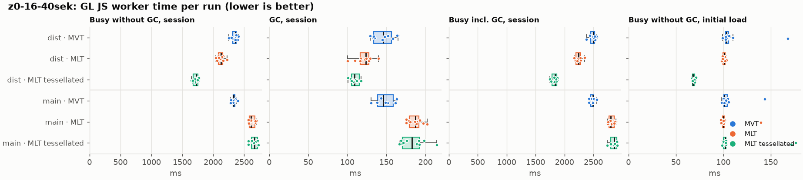
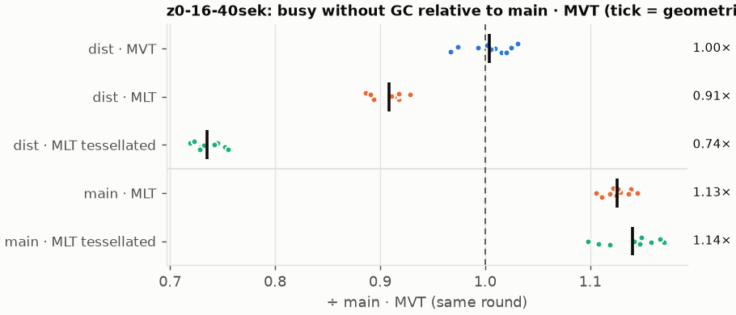
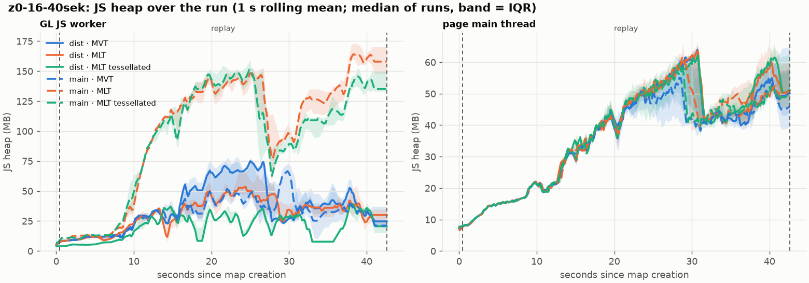
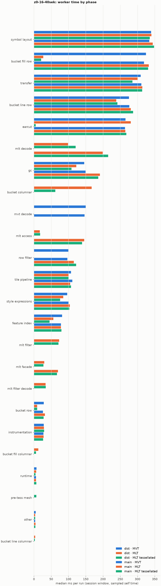

# Session trace benchmark — 20261110-105247

## Setup

- Created 2026-11-10T10:52:47+01:00; 10 repetitions + 1 warm-up round(s) (excluded); variants rotate per round (A B C, B C A, …); one cold browser context per run.
- Machine: Intel(R) Core(TM) Ultra 9 285K, 24 logical cores, 63.5 GB RAM, Windows-11-10.0.26200-SP0; power: GUID des Energieschemas: 8c5e7fda-e8bf-4a96-9a85-a6e23a8c635c  (H”chstleistung), AC True.
- GL JS gl7-performance-optimization @ 34e0236e4d; worker count 1; viewport {'width': 1280, 'height': 1024}.
- Python 3.13.17, packages {'playwright': '1.64.1', 'numpy': '2.5.4', 'matplotlib': '3.11.2'}.

| variant | bundle | format | bundle sha256 | branch build |
|---|---|---|---|---|
| MVT | `dist/maplibre-gl-dev.mjs` | mvt | `d578481ca3ef` | – |
| MLT | `dist/maplibre-gl-dev.mjs` | mlt | `d578481ca3ef` | – |
| MLT tessellated | `dist/maplibre-gl-dev.mjs` | mlt-pre-tess | `d578481ca3ef` | – |
| main · MVT | `bench-builds/branches/main/maplibre-gl-dev.mjs` | mvt | `662822cbe5c2` | main @ bb38954083 (2026-10-26), MLT @ 85738fbf81 |
| main · MLT | `bench-builds/branches/main/maplibre-gl-dev.mjs` | mlt | `662822cbe5c2` | main @ bb38954083 (2026-10-26), MLT @ 85738fbf81 |
| main · MLT tessellated | `bench-builds/branches/main/maplibre-gl-dev.mjs` | mlt-pre-tess | `662822cbe5c2` | main @ bb38954083 (2026-10-26), MLT @ 85738fbf81 |

| session | style | duration | frames | sha256 |
|---|---|---:|---:|---|
| z0-16-40sek | osm-bright | 42.1 s | 1739 | `55a2b8f22fe2` |

CPU sampling interval (median over runs): 537 µs.

## Definitions

- **busy** = wall time in which a GL JS worker thread runs a task (union of top-level task slices and GC slices on `DedicatedWorker thread`s), summed over workers. **GC** = union of `MinorGC`/`MajorGC`/`V8.GC*` slices on those threads. **busy without GC** = busy − GC (headline metric).
- **CPU** = thread time (`tdur`) of the same slices. Phase categories and functions come from the trace's CPU samples (self time), categorised by `config/categories.toml` (nearest matching frame, leaf to root).
- Windows: **load** = map creation → first idle; **session** = camera replay; **tail** = end of replay → idle; **total** = load + session + tail.
- Ratios are against **main · MVT**: ratio of medians with a bootstrap 95 % CI, the geometric mean of per-round ratios, and a two-sided Mann–Whitney U p-value (normal approximation, not corrected for multiple comparisons; rough below n = 8). Lower than 1× means less worker time.

## Session `z0-16-40sek`

### Worker busy without GC (session window)

| variant | n ok / failed | median ms | IQR | mean | ratio vs main · MVT | 95 % CI | geo-mean paired | MWU p |
|---|---:|---:|---:|---:|---:|---:|---:|---:|
| MVT | 10 / 0 | 2,355 | 2,313–2,371 | 2,343 | 1.01× | 0.99–1.02× | 1.00× | 0.427 |
| MLT | 10 / 0 | 2,125 | 2,083–2,154 | 2,121 | 0.91× | 0.89–0.93× | 0.91× | <0.001 |
| MLT tessellated | 10 / 0 | 1,725 | 1,678–1,753 | 1,716 | 0.74× | 0.72–0.75× | 0.74× | <0.001 |
| main · MVT | 10 / 0 | 2,330 | 2,322–2,352 | 2,334 | 1.00× | – | – | – |
| main · MLT | 10 / 0 | 2,615 | 2,581–2,676 | 2,627 | 1.12× | 1.10–1.15× | 1.13× | <0.001 |
| main · MLT tessellated | 10 / 0 | 2,669 | 2,619–2,718 | 2,661 | 1.15× | 1.11–1.17× | 1.14× | <0.001 |

### All worker metrics (median, ratio vs baseline)

| metric | MVT | MLT | MLT tessellated | main · MVT | main · MLT | main · MLT tessellated |
|---|---:|---:|---:|---:|---:|---:|
| busy incl. GC | 2,498 (1.00×) | 2,246 (0.90×) | 1,836 (0.74×) | 2,489 | 2,802 (1.13×) | 2,860 (1.15×) |
| &nbsp;&nbsp;of which GC | 146.2 (1.00×) | 123.6 (0.85×) | 109.4 (0.75×) | 146.2 | 187.4 (1.28×) | 182.7 (1.25×) |
| &nbsp;&nbsp;of which busy without GC | 2,355 (1.01×) | 2,125 (0.91×) | 1,725 (0.74×) | 2,330 | 2,615 (1.12×) | 2,669 (1.15×) |
| &nbsp;&nbsp;&nbsp;&nbsp;of which filtering (sampled, incl. callees) | 100.4 (1.04×) | 73.1 (0.76×) | 70.9 (0.73×) | 96.8 | 115.7 (1.20×) | 122.4 (1.26×) |
| &nbsp;&nbsp;&nbsp;&nbsp;of which column decoding inside the MLT filter (sampled) | 0.0 | 33.8 | 34.3 | 0.0 | 0.0 | 0.0 |
| &nbsp;&nbsp;&nbsp;&nbsp;of which timing instrumentation (sampled) | 28.6 (1.04×) | 28.8 (1.04×) | 29.6 (1.07×) | 27.6 | 27.9 (1.01×) | 26.5 (0.96×) |
| busy without GC and instrumentation | 2,326 (1.01×) | 2,099 (0.91×) | 1,695 (0.74×) | 2,303 | 2,587 (1.12×) | 2,641 (1.15×) |
| CPU time without GC | 2,262 (1.01×) | 2,029 (0.91×) | 1,639 (0.73×) | 2,235 | 2,508 (1.12×) | 2,562 (1.15×) |
| tile: download end → sent to main thread, median per tile | 47.0 (0.95×) | 47.2 (0.95×) | 36.8 (0.74×) | 49.6 | 55.1 (1.11×) | 54.9 (1.11×) |
| tile: download end → sent to main thread, 90th percentile | 154.0 (0.99×) | 133.5 (0.86×) | 98.4 (0.63×) | 155.6 | 174.4 (1.12×) | 183.7 (1.18×) |
| tile: download end → sent to main thread, 95th percentile | 213.3 (1.03×) | 164.2 (0.79×) | 126.1 (0.61×) | 206.7 | 238.1 (1.15×) | 237.1 (1.15×) |
| tile: download end → sent to main thread, 99th percentile | 237.3 (1.02×) | 207.5 (0.89×) | 148.5 (0.64×) | 232.5 | 262.6 (1.13×) | 269.6 (1.16×) |
| minor GCs | 91.50 (1.01×) | 71.00 (0.78×) | 49.00 (0.54×) | 90.50 | 99.00 (1.09×) | 97.50 (1.08×) |
| major GCs | 10.00 (0.95×) | 9.00 (0.86×) | 13.00 (1.24×) | 10.50 | 5.00 (0.48×) | 5.00 (0.48×) |
| peak worker heap (MB) | 84.5 (1.10×) | 66.9 (0.87×) | 54.0 (0.70×) | 76.8 | 177.2 (2.31×) | 166.1 (2.16×) |
| load: busy without GC | 103.5 (1.02×) | 101.2 (1.00×) | 67.9 (0.67×) | 101.2 | 100.2 (0.99×) | 101.8 (1.01×) |
| load: GC | 4.9 (0.97×) | 5.1 (1.01×) | 2.1 (0.41×) | 5.0 | 5.5 (1.10×) | 5.2 (1.03×) |
| total: busy without GC | 2,461 (1.01×) | 2,227 (0.91×) | 1,794 (0.74×) | 2,434 | 2,727 (1.12×) | 2,771 (1.14×) |

Rows marked *of which* are parts of the row above, not additional time. Tile rows are per-tile latencies (medians over tiles, then over runs), not sums: tiles overlap in time, and the medians of the parse and queue parts do not add up exactly to the median latency.

### Filtering (session window)

Sampled worker time spent in feature filtering, including everything the filter calls (expression evaluation, property access): **row filter** = the style-spec feature filter that MVT runs per feature, **mlt filter** = the columnar MLT filter (incl. the geometry-type selection), without the columns it decodes (see the next table). Medians per run; rules in `config/categories.toml`.

| variant | mlt filter | row filter | filtering | ratio vs main · MVT | 95 % CI | MWU p | share of sampled busy |
|---|---:|---:|---:|---:|---:|---:|---:|
| MVT | 0.0 | 100.1 | 100.4 | 1.04× | 0.96–1.11× | 0.307 | 4.4% |
| MLT | 73.1 | 0.0 | 73.1 | 0.76× | 0.68–0.79× | <0.001 | 3.5% |
| MLT tessellated | 70.9 | 0.0 | 70.9 | 0.73× | 0.68–0.78× | <0.001 | 4.4% |
| main · MVT | 0.0 | 96.8 | 96.8 | 1.00× | – | – | 4.3% |
| main · MLT | 0.0 | 115.7 | 115.7 | 1.20× | 1.11–1.31× | <0.001 | 4.5% |
| main · MLT tessellated | 0.0 | 122.4 | 122.4 | 1.26× | 1.17–1.32× | <0.001 | 4.6% |

**Filtering together with tile decoding.** The MLT decoder leaves columns encoded until something reads them, and the filter is usually the first reader: the columns it decodes (properties, and the geometry for `$type`) are **of which inside the filter** (phase *mlt filter decode*), the rest is *mlt decode* (geometry and columns read later, e.g. by paint properties and symbols). MVT decodes every feature's properties and geometry while it reads the tile (*mvt decode*), whether the filter keeps the feature or not. So **filtering** above compares the filters, and **decoding + filtering** compares all that the formats spend on decoding the tile and selecting features. **tile decoding** = *mvt decode* or *mlt decode* + *mlt filter decode*: work inside a call into a decoder. Reading data that is already decoded is not counted, as for MVT's feature objects: *mlt access* (row views, value getters, looking a column up by name) and the MLT facade (*mlt facade*). MVT decodes geometry only for the features its filter keeps, MLT decodes a layer's whole geometry column.

| variant | tile decoding | of which inside the filter | filtering | decoding + filtering | ratio vs main · MVT | 95 % CI | MWU p |
|---|---:|---:|---:|---:|---:|---:|---:|
| MVT | 150.5 | 0.0 | 100.4 | 250.0 | 1.03× | 0.97–1.07× | 0.241 |
| MLT | 134.4 | 33.8 | 73.1 | 205.2 | 0.84× | 0.78–0.90× | <0.001 |
| MLT tessellated | 156.6 | 34.3 | 70.9 | 226.1 | 0.93× | 0.88–0.98× | 0.007 |
| main · MVT | 146.6 | 0.0 | 96.8 | 243.2 | 1.00× | – | – |
| main · MLT | 199.1 | 0.0 | 115.7 | 316.5 | 1.30× | 1.21–1.36× | <0.001 |
| main · MLT tessellated | 214.8 | 0.0 | 122.4 | 335.6 | 1.38× | 1.31–1.45× | <0.001 |

Top 12 functions inside filtering and its column decoding (self time, mean ms per run):

| phase | function | source | MVT | MLT | MLT tessellated | main · MVT | main · MLT | main · MLT tessellated |
|---|---|---|---:|---:|---:|---:|---:|---:|
| row filter | `evaluate` | node_modules/@maplibre/maplibre-gl-style-spec/dist/expression/compound_expression.mjs | 33.7 | 0.0 | 0.0 | 30.6 | 46.3 | 45.7 |
| row filter | `CompoundExpression.register.filter-in-small` | node_modules/@maplibre/maplibre-gl-style-spec/dist/expression/compound_expression.mjs | 14.8 | 0.0 | 0.0 | 13.7 | 16.6 | 16.3 |
| row filter | `CompoundExpression.register.filter-==` | node_modules/@maplibre/maplibre-gl-style-spec/dist/expression/compound_expression.mjs | 14.5 | 0.0 | 0.0 | 15.0 | 14.9 | 14.1 |
| row filter | `evaluate` | node_modules/@maplibre/maplibre-gl-style-spec/dist/expression/index.mjs | 9.7 | 0.0 | 0.0 | 11.1 | 12.3 | 12.9 |
| row filter | `filter` | node_modules/@maplibre/maplibre-gl-style-spec/dist/feature_filter/index.mjs | 6.2 | 0.0 | 0.0 | 6.3 | 7.4 | 9.5 |
| mlt filter | `filterByGeometryType` | maplibre-tile-spec/ts/dist/vector/geometry/geometryVector.js | 0.0 | 7.9 | 8.9 | 0.0 | 0.0 | 0.0 |
| mlt filter | `scanDictionaryCodes` | maplibre-tile-spec/ts/dist/processing/filter/execution/filterKernel.js | 0.0 | 8.8 | 8.7 | 0.0 | 0.0 | 0.0 |
| mlt filter | `dictionaryRowMatches` | maplibre-tile-spec/ts/dist/processing/filter/execution/filterKernel.js | 0.0 | 7.4 | 7.5 | 0.0 | 0.0 | 0.0 |
| mlt filter decode | `unpackNullable` | maplibre-tile-spec/ts/dist/decoding/unpackNullableUtils.js | 0.0 | 7.1 | 6.9 | 0.0 | 0.0 | 0.0 |
| row filter | `CompoundExpression.register.all.overloads` | node_modules/@maplibre/maplibre-gl-style-spec/dist/expression/compound_expression.mjs | 5.3 | 0.0 | 0.0 | 4.2 | 5.6 | 5.9 |
| row filter | `CompoundExpression.register.filter-type-==` | node_modules/@maplibre/maplibre-gl-style-spec/dist/expression/compound_expression.mjs | 3.4 | 0.0 | 0.0 | 3.9 | 3.9 | 4.0 |
| mlt filter | `bytesEqual` | maplibre-tile-spec/ts/dist/processing/filter/execution/filterKernel.js | 0.0 | 4.0 | 3.6 | 0.0 | 0.0 | 0.0 |

### Bucket time by layer type (session window)

Sampled self time of the bucket code per layer type, row and columnar path together (median ms per run). **shared bucket code** is code all layer types use (`src/data/bucket/*` outside the layer files, `columnar_populate.ts`, `columnar_mesh_arrays.ts`, `load_geometry.ts`). **earcut** triangulates for fill and fill-extrusion on the row path; **pre-tess mesh** takes over the stored triangles of a pre-tessellated fill. **symbol** is the whole symbol layout phase. For exact wall time per source layer and type see the timing log tables below (builds with `worker_timing.ts` only).

| variant | fill | fill-extrusion | line | symbol | shared bucket code | earcut | pre-tess mesh | total |
|---|---:|---:|---:|---:|---:|---:|---:|---:|
| MVT | 324.7 | 0.0 | 275.5 | 339.5 | 28.5 | 265.4 | 0.0 | 1,237 |
| MLT | 42.7 | 0.0 | 243.5 | 340.4 | 176.9 | 280.6 | 0.0 | 1,093 |
| MLT tessellated | 27.0 | 0.0 | 244.5 | 335.4 | 71.3 | 4.9 | 7.1 | 694.5 |
| main · MVT | 319.0 | 0.0 | 276.3 | 334.1 | 26.2 | 263.7 | 0.0 | 1,226 |
| main · MLT | 332.5 | 0.0 | 280.7 | 344.0 | 31.7 | 265.0 | 0.0 | 1,250 |
| main · MLT tessellated | 330.6 | 0.0 | 287.5 | 348.1 | 27.9 | 267.5 | 0.0 | 1,264 |

### Where the variants differ from main · MVT (session window, mean ms per run)

Open **[flame.html](flame.html)** to explore the call tree interactively: pick a variant, compare it with main · MVT (red = more time at the same call path, blue = less), click a frame to zoom in, and read the phase and function breakdown under it. Without a comparison, frames are coloured by phase: filtering is green in both formats, and the columns the MLT filter decodes on first access (*mlt filter decode*) are MLT blue frames under the green filter. `flame/*.txt` open in https://www.speedscope.app.

#### MVT vs main · MVT

**By phase** (sampled self time; the Δ column sums to the difference in sampled busy time):

| phase | main · MVT | MVT | Δ |
|---|---:|---:|---:|
| symbol layout | 335.1 | 339.1 | +4.1 |
| feature index | 79.4 | 83.0 | +3.6 |
| row filter | 97.2 | 100.4 | +3.2 |
| mvt decode | 147.2 | 149.5 | +2.3 |
| bucket fill row | 326.6 | 327.8 | +1.2 |
| runtime | 6.4 | 7.5 | +1.0 |
| instrumentation | 27.7 | 28.6 | +1.0 |
| other | 3.8 | 4.7 | +0.8 |
| bucket line row | 275.9 | 276.4 | +0.6 |
| transfer | 311.1 | 310.0 | -1.1 |
| tile pipeline | 110.5 | 108.0 | -2.5 |
| style expressions | 101.8 | 98.9 | -3.0 |
| gc | 150.5 | 146.2 | -4.3 |

**Functions with the largest self-time difference** (by function name, summed over source files):

| function | main · MVT | MVT | Δ |
|---|---:|---:|---:|
| `populate` | 45.3 | 55.9 | +10.6 |
| `addBucketFeatures` | 0.0 | 8.3 | +8.3 |
| `addSymbolFeature` | 0.0 | 5.6 | +5.6 |
| `_vertexToIndex` | 105.6 | 111.0 | +5.4 |
| `isEar` | 81.8 | 86.6 | +4.8 |
| `insert` | 40.2 | 44.0 | +3.9 |
| `signedArea$2` | 0.0 | 3.7 | +3.7 |
| `loadGeometry` | 43.3 | 45.9 | +2.7 |
| `readUtf8` | 0.0 | 2.6 | +2.6 |
| `getGlyphQuads` | 10.9 | 13.4 | +2.5 |
| `addFeature` | 21.9 | 24.0 | +2.0 |
| `remapIndices` | 7.8 | 9.8 | +2.0 |
| `hasLineDasharray` | 23.7 | 0.2 | -23.5 |
| `signedArea$1` | 4.3 | 0.0 | -4.3 |
| `(garbage collector)` | 150.5 | 146.2 | -4.3 |
| `subdividePolygon` | 4.7 | 1.2 | -3.6 |
| `readUtf8$1` | 2.4 | 0.0 | -2.4 |

#### MLT vs main · MVT

**By phase** (sampled self time; the Δ column sums to the difference in sampled busy time):

| phase | main · MVT | MLT | Δ |
|---|---:|---:|---:|
| bucket columnar | 0.0 | 171.1 | +171.1 |
| mlt decode | 0.0 | 99.0 | +99.0 |
| mlt filter | 0.0 | 71.0 | +71.0 |
| mlt filter decode | 0.0 | 34.2 | +34.2 |
| mlt facade | 0.0 | 28.5 | +28.5 |
| mlt access | 0.0 | 17.1 | +17.1 |
| earcut | 265.5 | 281.9 | +16.5 |
| bucket fill columnar | 0.0 | 12.8 | +12.8 |
| symbol layout | 335.1 | 341.5 | +6.5 |
| bucket line columnar | 0.0 | 3.9 | +3.9 |
| transfer | 311.1 | 300.8 | -10.3 |
| tile pipeline | 110.5 | 98.9 | -11.6 |
| style expressions | 101.8 | 85.2 | -16.7 |
| bucket row | 26.3 | 8.8 | -17.6 |
| feature index | 79.4 | 56.4 | -23.0 |
| gc | 150.5 | 122.7 | -27.8 |
| bucket line row | 275.9 | 241.6 | -34.3 |
| row filter | 97.2 | 0.0 | -97.2 |
| mvt decode | 147.2 | 0.0 | -147.2 |
| bucket fill row | 326.6 | 27.5 | -299.1 |

**Functions with the largest self-time difference** (by function name, summed over source files):

| function | main · MVT | MLT | Δ |
|---|---:|---:|---:|
| `buildRingBoundingBoxes` | 0.0 | 24.8 | +24.8 |
| `writeEarcutFill` | 0.0 | 19.7 | +19.7 |
| `signedArea$2` | 0.0 | 17.2 | +17.2 |
| `buildEarcutMesh` | 0.0 | 17.2 | +17.2 |
| `decodeComponentwiseDeltaVec2` | 0.0 | 12.9 | +12.9 |
| `readScaledRings` | 0.0 | 12.7 | +12.7 |
| `unpackNullable` | 0.0 | 10.1 | +10.1 |
| `scanDictionaryCodes` | 0.0 | 8.8 | +8.8 |
| `addBucketFeatures` | 0.0 | 8.7 | +8.7 |
| `addSymbolFeature` | 0.0 | 8.7 | +8.7 |
| `fillLargeMeshArrays` | 11.8 | 20.5 | +8.6 |
| `decodeFastPforInt32` | 0.0 | 8.2 | +8.2 |
| `_vertexToIndex` | 105.6 | 0.5 | -105.1 |
| `evaluate` | 52.1 | 9.4 | -42.7 |
| `populate` | 45.3 | 6.4 | -38.9 |
| `loadGeometry` | 43.3 | 7.9 | -35.4 |
| `readVarint` | 37.3 | 2.3 | -35.0 |

#### MLT tessellated vs main · MVT

**By phase** (sampled self time; the Δ column sums to the difference in sampled busy time):

| phase | main · MVT | MLT tessellated | Δ |
|---|---:|---:|---:|
| mlt decode | 0.0 | 121.4 | +121.4 |
| mlt filter | 0.0 | 71.6 | +71.6 |
| bucket columnar | 0.0 | 62.3 | +62.3 |
| mlt filter decode | 0.0 | 34.7 | +34.7 |
| mlt facade | 0.0 | 28.6 | +28.6 |
| mlt access | 0.0 | 17.1 | +17.1 |
| pre-tess mesh | 0.0 | 7.0 | +7.0 |
| bucket fill columnar | 0.0 | 6.1 | +6.1 |
| bucket line columnar | 0.0 | 2.8 | +2.8 |
| symbol layout | 335.1 | 337.8 | +2.8 |
| instrumentation | 27.7 | 29.3 | +1.6 |
| other | 3.8 | 3.3 | -0.6 |
| runtime | 6.4 | 4.8 | -1.6 |
| tile pipeline | 110.5 | 100.3 | -10.1 |
| bucket row | 26.3 | 9.0 | -17.4 |
| transfer | 311.1 | 287.2 | -23.8 |
| style expressions | 101.8 | 73.8 | -28.1 |
| feature index | 79.4 | 46.1 | -33.2 |
| bucket line row | 275.9 | 241.1 | -34.7 |
| gc | 150.5 | 108.9 | -41.6 |
| row filter | 97.2 | 0.0 | -97.2 |
| mvt decode | 147.2 | 0.0 | -147.2 |
| earcut | 265.5 | 4.9 | -260.6 |
| bucket fill row | 326.6 | 20.7 | -305.9 |

**Functions with the largest self-time difference** (by function name, summed over source files):

| function | main · MVT | MLT tessellated | Δ |
|---|---:|---:|---:|
| `writeTessellatedFill` | 0.0 | 16.6 | +16.6 |
| `decodeComponentwiseDeltaVec2` | 0.0 | 12.5 | +12.5 |
| `decodeUnsignedZigZagDeltaInt32` | 0.0 | 11.6 | +11.6 |
| `decodeFastPforInt32` | 0.0 | 10.4 | +10.4 |
| `unpackNullable` | 0.0 | 10.4 | +10.4 |
| `filterByGeometryType` | 0.0 | 8.9 | +8.9 |
| `scanDictionaryCodes` | 0.0 | 8.7 | +8.7 |
| `get` | 11.5 | 19.6 | +8.1 |
| `decodeString$2` | 0.0 | 8.0 | +8.0 |
| `dictionaryRowMatches` | 0.0 | 7.5 | +7.5 |
| `readVertices` | 0.0 | 7.0 | +7.0 |
| `buildTessellatedBoundingBox` | 0.0 | 7.0 | +7.0 |
| `_vertexToIndex` | 105.6 | 0.0 | -105.6 |
| `isEar` | 81.8 | 0.8 | -81.0 |
| `evaluate` | 52.1 | 8.5 | -43.7 |
| `(garbage collector)` | 150.5 | 108.9 | -41.6 |
| `populate` | 45.3 | 5.0 | -40.3 |

#### main · MLT vs main · MVT

**By phase** (sampled self time; the Δ column sums to the difference in sampled busy time):

| phase | main · MVT | main · MLT | Δ |
|---|---:|---:|---:|
| mlt decode | 0.0 | 196.4 | +196.4 |
| mlt access | 0.0 | 146.5 | +146.5 |
| mlt facade | 0.0 | 70.0 | +70.0 |
| gc | 150.5 | 189.3 | +38.8 |
| row filter | 97.2 | 118.0 | +20.8 |
| bucket line row | 275.9 | 283.7 | +7.9 |
| symbol layout | 335.1 | 340.2 | +5.2 |
| transfer | 311.1 | 315.2 | +4.1 |
| bucket row | 26.3 | 30.2 | +3.8 |
| bucket fill row | 326.6 | 329.2 | +2.7 |
| earcut | 265.5 | 266.6 | +1.2 |
| runtime | 6.4 | 7.2 | +0.8 |
| other | 3.8 | 4.5 | +0.7 |
| feature index | 79.4 | 78.3 | -1.1 |
| tile pipeline | 110.5 | 108.1 | -2.3 |
| mvt decode | 147.2 | 0.0 | -147.2 |

**Functions with the largest self-time difference** (by function name, summed over source files):

| function | main · MVT | main · MLT | Δ |
|---|---:|---:|---:|
| `getFeatures` | 0.0 | 60.4 | +60.4 |
| `decodeString$2` | 0.0 | 56.6 | +56.6 |
| `(garbage collector)` | 150.5 | 189.3 | +38.8 |
| `convertGeometryVector` | 0.0 | 33.5 | +33.5 |
| `loadGeometry` | 43.3 | 65.8 | +22.6 |
| `evaluate` | 52.1 | 68.9 | +16.8 |
| `decodeComponentwiseDeltaVec2` | 0.0 | 13.9 | +13.9 |
| `getLineStringOrRing` | 0.0 | 12.6 | +12.6 |
| `unpackNullable` | 0.0 | 12.6 | +12.6 |
| `decodeFastPforInt32` | 0.0 | 8.7 | +8.7 |
| `decodeFsst` | 0.0 | 7.3 | +7.3 |
| `getValue` | 0.0 | 6.6 | +6.6 |
| `readVarint` | 37.3 | 1.5 | -35.8 |
| `readSVarint` | 24.8 | 0.0 | -24.8 |
| `readString` | 23.8 | 0.0 | -23.8 |
| `VectorTileFeature` | 17.7 | 0.0 | -17.7 |
| `populate` | 45.3 | 42.1 | -3.2 |

#### main · MLT tessellated vs main · MVT

**By phase** (sampled self time; the Δ column sums to the difference in sampled busy time):

| phase | main · MVT | main · MLT tessellated | Δ |
|---|---:|---:|---:|
| mlt decode | 0.0 | 217.9 | +217.9 |
| mlt access | 0.0 | 142.1 | +142.1 |
| mlt facade | 0.0 | 67.8 | +67.8 |
| gc | 150.5 | 187.9 | +37.5 |
| row filter | 97.2 | 120.5 | +23.3 |
| bucket line row | 275.9 | 286.5 | +10.6 |
| symbol layout | 335.1 | 344.1 | +9.1 |
| transfer | 311.1 | 316.8 | +5.7 |
| earcut | 265.5 | 267.2 | +1.8 |
| feature index | 79.4 | 80.7 | +1.4 |
| bucket row | 26.3 | 27.7 | +1.3 |
| runtime | 6.4 | 7.3 | +0.9 |
| bucket fill row | 326.6 | 327.4 | +0.9 |
| other | 3.8 | 4.6 | +0.8 |
| style expressions | 101.8 | 102.4 | +0.5 |
| instrumentation | 27.7 | 26.5 | -1.2 |
| tile pipeline | 110.5 | 108.3 | -2.2 |
| mvt decode | 147.2 | 0.0 | -147.2 |

**Functions with the largest self-time difference** (by function name, summed over source files):

| function | main · MVT | main · MLT tessellated | Δ |
|---|---:|---:|---:|
| `getFeatures` | 0.0 | 61.1 | +61.1 |
| `decodeString$2` | 0.0 | 59.2 | +59.2 |
| `(garbage collector)` | 150.5 | 187.9 | +37.5 |
| `convertGeometryVector` | 0.0 | 29.6 | +29.6 |
| `evaluate` | 52.1 | 68.0 | +15.9 |
| `getLineStringOrRing` | 0.0 | 13.7 | +13.7 |
| `decodeUnsignedZigZagDeltaInt32` | 0.0 | 13.2 | +13.2 |
| `loadGeometry` | 43.3 | 56.0 | +12.7 |
| `unpackNullable` | 0.0 | 12.3 | +12.3 |
| `decodeComponentwiseDeltaVec2` | 0.0 | 11.3 | +11.3 |
| `Point$1` | 16.8 | 27.5 | +10.7 |
| `decodeFastPforInt32` | 0.0 | 10.4 | +10.4 |
| `readVarint` | 37.3 | 1.2 | -36.1 |
| `readSVarint` | 24.8 | 0.0 | -24.8 |
| `readString` | 23.8 | 0.0 | -23.8 |
| `VectorTileFeature` | 17.7 | 0.0 | -17.7 |
| `populate` | 45.3 | 41.6 | -3.7 |

### Memory (session window)

**JS heap** = V8's used heap of the thread (`jsHeapSizeUsed` from the trace's `UpdateCounters`, about every 20 ms; the mean is time-weighted). It does not include ArrayBuffer contents, so the tile data itself (vertex, index and feature-index arrays) is not in it: **tile data sent to the main thread** is the size of the ArrayBuffers each tile result transfers (`web/worker_hook.js`), which then live on the main thread and are uploaded to the GPU. **garbage collected** = heap freed by the worker's GCs, a measure of how much it allocates. Medians per run; ratio of medians with a bootstrap 95 % CI.

| metric | MVT | MLT | MLT tessellated | main · MVT | main · MLT | main · MLT tessellated |
|---|---:|---:|---:|---:|---:|---:|
| worker JS heap, mean (MB) | 32.0 (1.22×, 0.90–1.37×) | 27.4 (1.04×, 0.83–1.19×) | 17.4 (0.66×, 0.52–0.75×) | 26.3 | 95.2 (3.62×, 2.95–4.03×) | 90.5 (3.45×, 2.80–3.80×) |
| worker JS heap, peak (MB) | 84.5 (1.10×, 0.82–1.38×) | 66.9 (0.87×, 0.71–1.09×) | 54.0 (0.70×, 0.58–0.83×) | 76.8 | 177.2 (2.31×, 1.92–2.73×) | 166.1 (2.16×, 1.81–2.61×) |
| worker JS heap after the last GC (MB) | 15.9 (0.95×, 0.81–1.25×) | 16.0 (0.96×, 0.61–1.47×) | 19.9 (1.19×, 0.73–1.38×) | 16.8 | 150.6 (8.97×, 7.90–10.17×) | 129.2 (7.70×, 6.69–8.66×) |
| garbage collected in the worker (MB) | 2,478 (1.00×, 0.98–1.01×) | 1,786 (0.72×, 0.71–0.73×) | 996.5 (0.40×, 0.40–0.41×) | 2,484 | 2,599 (1.05×, 1.03–1.06×) | 2,603 (1.05×, 1.03–1.06×) |
| main thread JS heap, mean (MB) | 33.9 (1.01×, 0.94–1.14×) | 34.1 (1.02×, 0.98–1.15×) | 35.1 (1.04×, 1.01–1.15×) | 33.6 | 34.8 (1.04×, 0.99–1.14×) | 34.3 (1.02×, 0.94–1.14×) |
| main thread JS heap, peak (MB) | 75.1 (1.04×, 0.92–1.15×) | 75.3 (1.04×, 0.99–1.16×) | 74.2 (1.03×, 0.97–1.15×) | 72.3 | 74.3 (1.03×, 0.96–1.14×) | 71.8 (0.99×, 0.88–1.11×) |
| main thread JS heap at the end of the replay (MB) | 49.7 (1.09×, 0.79–1.59×) | 50.7 (1.12×, 0.82–1.44×) | 50.7 (1.12×, 0.84–1.54×) | 45.4 | 50.5 (1.11×, 0.83–1.50×) | 49.2 (1.08×, 0.80–1.43×) |
| tile data sent to the main thread, total (MB) | 147.3 (1.00×, 0.98–1.02×) | 140.5 (0.96×, 0.94–0.99×) | 135.3 (0.92×, 0.91–0.94×) | 146.9 | 141.8 (0.97×, 0.95–0.98×) | 145.3 (0.99×, 0.97–1.01×) |
| tile data sent to the main thread, median per tile (KB) | 412.9 (1.00×, 0.99–1.01×) | 394.4 (0.95×, 0.94–0.96×) | 383.4 (0.93×, 0.92–0.94×) | 413.7 | 393.9 (0.95×, 0.95–0.96×) | 399.5 (0.97×, 0.96–0.98×) |

### Worker time by phase (session window, median ms of sampled self time)

| phase | MVT | MLT | MLT tessellated | main · MVT | main · MLT | main · MLT tessellated |
|---|---:|---:|---:|---:|---:|---:|
| symbol layout | 339.5 | 340.4 | 335.4 | 334.1 | 344.0 | 348.1 |
| bucket fill row | 324.7 | 27.1 | 20.6 | 319.0 | 332.5 | 330.6 |
| transfer | 309.3 | 300.0 | 285.2 | 311.0 | 314.1 | 313.8 |
| bucket line row | 275.5 | 238.6 | 242.0 | 276.3 | 280.7 | 287.5 |
| earcut | 265.4 | 280.6 | 4.9 | 263.7 | 265.0 | 267.5 |
| mlt decode | 0.0 | 98.8 | 120.6 | 0.0 | 199.1 | 214.8 |
| gc | 145.6 | 122.6 | 108.9 | 149.4 | 191.0 | 186.2 |
| bucket columnar | 0.0 | 167.3 | 61.8 | 0.0 | 0.0 | 0.0 |
| mvt decode | 150.5 | 0.0 | 0.0 | 146.6 | 0.0 | 0.0 |
| mlt access | 0.0 | 16.9 | 17.8 | 0.0 | 145.9 | 139.5 |
| row filter | 100.1 | 0.0 | 0.0 | 96.8 | 115.7 | 122.4 |
| tile pipeline | 107.6 | 100.8 | 100.5 | 111.3 | 105.1 | 107.5 |
| style expressions | 96.2 | 84.7 | 76.0 | 100.9 | 104.0 | 102.7 |
| feature index | 81.8 | 56.2 | 45.3 | 78.2 | 78.1 | 79.6 |
| mlt filter | 0.0 | 73.1 | 70.9 | 0.0 | 0.0 | 0.0 |
| mlt facade | 0.0 | 29.8 | 27.6 | 0.0 | 69.5 | 66.7 |
| mlt filter decode | 0.0 | 33.8 | 34.3 | 0.0 | 0.0 | 0.0 |
| bucket row | 28.5 | 9.4 | 9.3 | 26.2 | 31.7 | 27.9 |
| instrumentation | 28.6 | 28.8 | 29.6 | 27.6 | 27.9 | 26.5 |
| bucket fill columnar | 0.0 | 12.9 | 6.1 | 0.0 | 0.0 | 0.0 |
| runtime | 7.5 | 6.6 | 4.8 | 6.2 | 6.0 | 7.2 |
| pre-tess mesh | 0.0 | 0.0 | 7.1 | 0.0 | 0.0 | 0.0 |
| other | 5.0 | 3.7 | 3.5 | 3.7 | 4.8 | 4.2 |
| bucket line columnar | 0.0 | 3.4 | 2.6 | 0.0 | 0.0 | 0.0 |
| bucket fill-extrusion row | 0.0 | 0.0 | 0.0 | 0.0 | 0.0 | 0.0 |

### Top 20 worker functions by self time (session window, mean ms per run)

| function | source | phase | MVT | MLT | MLT tessellated | main · MVT | main · MLT | main · MLT tessellated |
|---|---|---|---:|---:|---:|---:|---:|---:|
| `(garbage collector)` | (native) | gc | 146.2 | 122.7 | 108.9 | 150.5 | 189.3 | 187.9 |
| `reserve` | src/util/struct_array.ts | bucket fill row | 153.8 | 141.7 | 138.1 | 154.4 | 158.9 | 162.4 |
| `_vertexToIndex` | src/render/subdivision.ts | bucket fill row | 111.0 | 0.5 | 0.0 | 105.6 | 106.3 | 104.7 |
| `setTimeout` | (native) | transfer | 87.2 | 88.6 | 87.7 | 86.5 | 88.5 | 86.7 |
| `isEar` | node_modules/earcut/src/earcut.js | earcut | 86.6 | 80.7 | 0.8 | 81.8 | 86.6 | 81.8 |
| `postMessage` | (native) | transfer | 73.7 | 74.5 | 72.6 | 74.8 | 73.8 | 77.0 |
| `_trim` | src/util/struct_array.ts | transfer | 65.7 | 56.0 | 46.0 | 66.5 | 66.8 | 67.4 |
| `getFeatures` | maplibre-tile-spec/ts/dist/vector/featureTable.js | mlt access | 0.0 | 0.0 | 0.0 | 0.0 | 60.4 | 61.1 |
| `decodeString$2` | maplibre-tile-spec/ts/dist/decoding/decodingUtils.js | mlt decode | 0.0 | 7.6 | 8.0 | 0.0 | 56.6 | 59.2 |
| `emplace` | src/data/array_types.g.ts | bucket line row | 55.3 | 51.6 | 49.9 | 55.9 | 57.8 | 55.1 |
| `evaluate` | node_modules/@maplibre/maplibre-gl-style-spec/dist/expression/compound_expression.mjs | row filter | 33.7 | 0.0 | 0.0 | 30.6 | 46.3 | 45.7 |
| `serialize` | src/util/web_worker_transfer.ts | transfer | 42.1 | 42.3 | 41.4 | 43.4 | 44.5 | 44.5 |
| `populate` | src/data/bucket/line_bucket.ts | bucket line row | 40.2 | 0.0 | 0.0 | 16.6 | 15.9 | 16.5 |
| `loadGeometry` | src/source/vector_tile_mlt.ts | mlt facade | 0.0 | 1.3 | 1.0 | 0.0 | 39.8 | 33.2 |
| `insert` | src/data/feature_index.ts | feature index | 39.8 | 13.1 | 7.6 | 36.8 | 36.4 | 39.4 |
| `earcutLinked` | node_modules/earcut/src/earcut.js | earcut | 35.6 | 34.6 | 0.7 | 35.3 | 39.1 | 37.1 |
| `readVarint` | node_modules/pbf/index.js | mvt decode | 39.1 | 0.0 | 0.0 | 37.3 | 0.0 | 0.0 |
| `isEarHashed` | node_modules/earcut/src/earcut.js | earcut | 37.0 | 36.7 | 0.2 | 38.4 | 36.4 | 37.2 |
| `ProgramConfiguration` | src/data/program_configuration.ts | bucket line row | 32.7 | 36.4 | 35.3 | 33.7 | 36.0 | 34.1 |
| `convertGeometryVector` | maplibre-tile-spec/ts/dist/vector/geometry/geometryVectorConverter.js | mlt access | 0.0 | 0.0 | 0.0 | 0.0 | 33.5 | 29.6 |

### Top 20 worker functions by total time (incl. callees) (session window, mean ms per run)

| function | source | phase | MVT | MLT | MLT tessellated | main · MVT | main · MLT | main · MLT tessellated |
|---|---|---|---:|---:|---:|---:|---:|---:|
| `loadTile` | src/source/vector_tile_worker_source.ts |  | 1,418 | 1,223 | 844.1 | 1,408 | 1,708 | 1,730 |
| `parse` | src/source/worker_tile.ts | tile pipeline | 1,718 | 1,563 | 1,169 | 1,710 | 1,700 | 1,705 |
| `_parseWorkerTile` | src/source/vector_tile_worker_source.ts | tile pipeline | 1,353 | 1,190 | 812.7 | 1,346 | 1,326 | 1,331 |
| `populate` | src/data/bucket/fill_bucket.ts | bucket fill row | 703.2 | 0.0 | 0.0 | 700.4 | 680.9 | 684.2 |
| `addBucketFeatures` | src/data/bucket/fill_bucket.ts | bucket fill row | 606.1 | 426.6 | 56.9 | 0.0 | 0.0 | 0.0 |
| `addFeature` | src/data/bucket/fill_bucket.ts | bucket fill row | 580.4 | 5.9 | 0.0 | 576.7 | 573.6 | 578.9 |
| `populate` | src/data/bucket/columnar/columnar_fill_bucket.ts | bucket fill columnar | 0.0 | 522.0 | 158.2 | 0.0 | 0.0 | 0.0 |
| `subdividePolygon` | src/render/subdivision.ts | bucket fill row | 484.0 | 5.4 | 0.0 | 480.5 | 478.8 | 482.2 |
| `subdividePolygonInternal` | src/render/subdivision.ts | bucket fill row | 478.3 | 5.3 | 0.0 | 471.8 | 472.3 | 476.2 |
| `addFeature` | src/data/bucket/columnar/columnar_fill_bucket.ts | bucket fill columnar | 0.0 | 422.6 | 52.1 | 0.0 | 0.0 | 0.0 |
| `writeEarcutFill` | src/data/bucket/columnar/columnar_mesh_arrays.ts | bucket columnar | 0.0 | 407.4 | 8.7 | 0.0 | 0.0 | 0.0 |
| `loadVectorTile` | src/source/vector_tile_worker_source.ts | tile pipeline | 39.0 | 3.4 | 2.8 | 36.9 | 352.4 | 370.5 |
| `MLTVectorTile` | src/source/vector_tile_mlt.ts |  | 0.0 | 2.9 | 2.5 | 0.0 | 352.1 | 369.9 |
| `(anonymous)` | src/source/vector_tile_mlt.ts | mlt facade | 0.0 | 0.1 | 0.0 | 0.0 | 340.7 | 357.9 |
| `MLTVectorTileLayer` | src/source/vector_tile_mlt.ts | mlt facade | 0.0 | 0.1 | 0.1 | 0.0 | 338.5 | 355.6 |
| `getFeatures` | maplibre-tile-spec/ts/dist/vector/featureTable.js | mlt access | 0.0 | 0.0 | 0.0 | 0.0 | 331.6 | 347.9 |
| `populate` | src/data/bucket/line_bucket.ts | bucket line row | 333.5 | 0.0 | 0.0 | 325.9 | 344.8 | 344.2 |
| `addFeatures` | src/data/bucket/symbol_bucket.ts | symbol layout | 312.5 | 316.2 | 314.7 | 307.7 | 313.5 | 318.7 |
| `performSymbolLayout` | src/symbol/symbol_layout.ts | symbol layout | 308.5 | 312.4 | 311.0 | 303.7 | 308.7 | 314.8 |
| `populate` | src/data/bucket/columnar/columnar_line_bucket.ts | bucket line columnar | 0.0 | 305.6 | 307.0 | 0.0 | 0.0 | 0.0 |

## Runs

66 ok, 0 failed/aborted, 0 not run, 60 used in statistics.

## Validity checks

- Counted once: all 66 analysed runs pass (windows load + session + tail add up to total; phases add up to the sampled busy time; GC and sampled time lie within busy time; no timing-log line twice).
- other programs used 0.40–2.45 logical processors during the replays (median 1.07)
- 52 run(s) with more than 0.5 cores of background load: z0-16-40sek/mlt/rep-01 (1.38), z0-16-40sek/mlt-pre-tess/rep-01 (2.45), z0-16-40sek/main.mvt/rep-01 (2.01), z0-16-40sek/main.mlt/rep-01 (1.41), z0-16-40sek/main.mlt-pre-tess/rep-01 (1.47), z0-16-40sek/mvt/rep-01 (1.45)

## Files

- `runs.csv`: one row per run (incl. failed and warm-up runs), every scalar metric as `<window>.<metric>`.
- `summary.csv`: session × variant × metric statistics.
- `functions.csv`, `categories.csv`: CPU-sample self/total time per function and phase per run and window.
- `category_functions.csv`: self time per phase × function (e.g. what the filters spend their time on).
- `tiles.csv`, `tile_layers.csv`, `tile_phases.csv`: the per-tile worker timing log, long format.
- `flame.html`: interactive call tree per variant with a diff view; `flame/*.txt`: collapsed stacks for speedscope.
- `analysis/stacks.csv` (per run): sampled self time per full call stack.
- `tile_latency.csv`: per tile request, worker clock: received, download start/end, result sent, latency = sent − download end, parse_ms, wait_ms = latency − parse.
- `runs/<session>/<variant>/rep-NN/trace.json.gz`: the raw trace (opens in the DevTools Performance tab).
