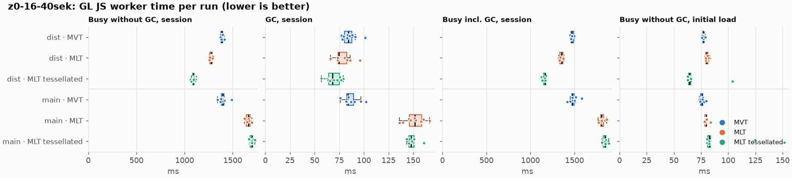
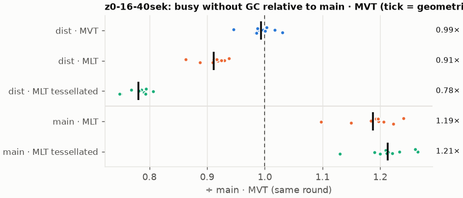
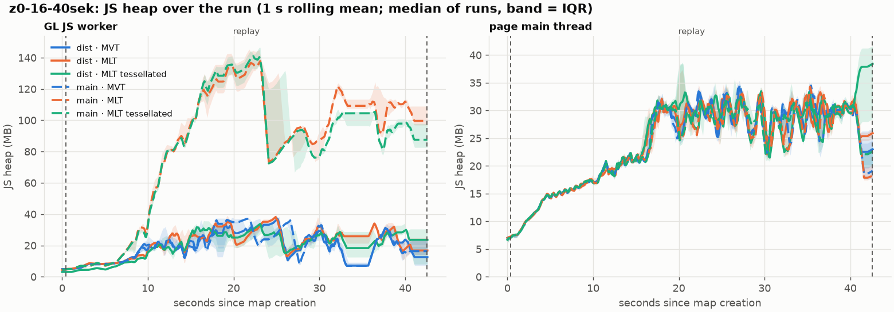
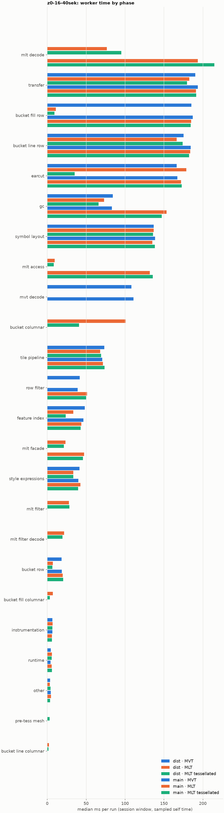

# Session trace benchmark — 20261110-121157

## Setup

- Created 2026-11-10T12:11:57+01:00; 10 repetitions + 1 warm-up round(s) (excluded); variants rotate per round (A B C, B C A, …); one cold browser context per run.
- Machine: Intel(R) Core(TM) Ultra 9 285K, 24 logical cores, 63.5 GB RAM, Windows-11-10.0.26200-SP0; power: GUID des Energieschemas: 8c5e7fda-e8bf-4a96-9a85-a6e23a8c635c  (H”chstleistung), AC True.
- GL JS gl7-performance-optimization @ 34e0236e4d; worker count 1; viewport {'width': 1280, 'height': 1024}.
- Python 3.13.17, packages {'playwright': '1.64.1', 'numpy': '2.5.4', 'matplotlib': '3.11.2'}.

| variant | bundle | format | bundle sha256 | branch build |
|---|---|---|---|---|
| MVT | `dist/maplibre-gl-dev.mjs` | mvt | `d578481ca3ef` | – |
| MLT | `dist/maplibre-gl-dev.mjs` | mlt | `d578481ca3ef` | – |
| MLT tessellated | `dist/maplibre-gl-dev.mjs` | mlt-pre-tess | `d578481ca3ef` | – |
| main · MVT | `bench-builds/branches/main/maplibre-gl-dev.mjs` | mvt | `662822cbe5c2` | main @ bb38954083 (2026-10-26), MLT @ 85738fbf81 |
| main · MLT | `bench-builds/branches/main/maplibre-gl-dev.mjs` | mlt | `662822cbe5c2` | main @ bb38954083 (2026-10-26), MLT @ 85738fbf81 |
| main · MLT tessellated | `bench-builds/branches/main/maplibre-gl-dev.mjs` | mlt-pre-tess | `662822cbe5c2` | main @ bb38954083 (2026-10-26), MLT @ 85738fbf81 |

| session | style | duration | frames | sha256 |
|---|---|---:|---:|---|
| z0-16-40sek | positron (recorded: osm-bright) | 42.1 s | 1739 | `55a2b8f22fe2` |

CPU sampling interval (median over runs): 539 µs.

## Definitions

- **busy** = wall time in which a GL JS worker thread runs a task (union of top-level task slices and GC slices on `DedicatedWorker thread`s), summed over workers. **GC** = union of `MinorGC`/`MajorGC`/`V8.GC*` slices on those threads. **busy without GC** = busy − GC (headline metric).
- **CPU** = thread time (`tdur`) of the same slices. Phase categories and functions come from the trace's CPU samples (self time), categorised by `config/categories.toml` (nearest matching frame, leaf to root).
- Windows: **load** = map creation → first idle; **session** = camera replay; **tail** = end of replay → idle; **total** = load + session + tail.
- Ratios are against **main · MVT**: ratio of medians with a bootstrap 95 % CI, the geometric mean of per-round ratios, and a two-sided Mann–Whitney U p-value (normal approximation, not corrected for multiple comparisons; rough below n = 8). Lower than 1× means less worker time.

## Session `z0-16-40sek`

### Worker busy without GC (session window)

| variant | n ok / failed | median ms | IQR | mean | ratio vs main · MVT | 95 % CI | geo-mean paired | MWU p |
|---|---:|---:|---:|---:|---:|---:|---:|---:|
| MVT | 10 / 0 | 1,386 | 1,380–1,394 | 1,389 | 0.99× | 0.98–1.01× | 0.99× | 0.473 |
| MLT | 10 / 0 | 1,278 | 1,260–1,287 | 1,274 | 0.92× | 0.90–0.93× | 0.91× | <0.001 |
| MLT tessellated | 10 / 0 | 1,093 | 1,084–1,098 | 1,092 | 0.78× | 0.77–0.80× | 0.78× | <0.001 |
| main · MVT | 10 / 0 | 1,394 | 1,381–1,407 | 1,398 | 1.00× | – | – | – |
| main · MLT | 10 / 0 | 1,664 | 1,640–1,681 | 1,660 | 1.19× | 1.17–1.21× | 1.19× | <0.001 |
| main · MLT tessellated | 10 / 0 | 1,697 | 1,681–1,709 | 1,695 | 1.22× | 1.20–1.23× | 1.21× | <0.001 |

### All worker metrics (median, ratio vs baseline)

| metric | MVT | MLT | MLT tessellated | main · MVT | main · MLT | main · MLT tessellated |
|---|---:|---:|---:|---:|---:|---:|
| busy incl. GC | 1,469 (0.99×) | 1,356 (0.92×) | 1,166 (0.79×) | 1,478 | 1,808 (1.22×) | 1,845 (1.25×) |
| &nbsp;&nbsp;of which GC | 84.2 (1.00×) | 74.7 (0.89×) | 68.1 (0.81×) | 83.9 | 151.9 (1.81×) | 147.9 (1.76×) |
| &nbsp;&nbsp;of which busy without GC | 1,386 (0.99×) | 1,278 (0.92×) | 1,093 (0.78×) | 1,394 | 1,664 (1.19×) | 1,697 (1.22×) |
| &nbsp;&nbsp;&nbsp;&nbsp;of which filtering (sampled, incl. callees) | 41.9 (1.07×) | 27.9 (0.71×) | 28.6 (0.73×) | 39.1 | 51.3 (1.31×) | 50.3 (1.29×) |
| &nbsp;&nbsp;&nbsp;&nbsp;of which column decoding inside the MLT filter (sampled) | 0.0 | 21.8 | 19.7 | 0.0 | 0.0 | 0.0 |
| &nbsp;&nbsp;&nbsp;&nbsp;of which timing instrumentation (sampled) | 6.8 (1.02×) | 7.1 (1.06×) | 6.6 (1.00×) | 6.7 | 6.0 (0.90×) | 6.0 (0.90×) |
| busy without GC and instrumentation | 1,380 (0.99×) | 1,271 (0.92×) | 1,087 (0.78×) | 1,388 | 1,658 (1.19×) | 1,691 (1.22×) |
| CPU time without GC | 1,323 (1.00×) | 1,212 (0.91×) | 1,028 (0.77×) | 1,329 | 1,592 (1.20×) | 1,617 (1.22×) |
| tile: download end → sent to main thread, median per tile | 25.3 (0.97×) | 23.7 (0.91×) | 20.3 (0.78×) | 26.2 | 32.3 (1.23×) | 30.8 (1.17×) |
| tile: download end → sent to main thread, 90th percentile | 102.4 (0.98×) | 84.2 (0.81×) | 77.8 (0.75×) | 104.4 | 142.2 (1.36×) | 152.6 (1.46×) |
| tile: download end → sent to main thread, 95th percentile | 140.6 (0.98×) | 122.9 (0.86×) | 88.9 (0.62×) | 142.9 | 162.2 (1.13×) | 167.6 (1.17×) |
| tile: download end → sent to main thread, 99th percentile | 163.4 (1.03×) | 146.2 (0.92×) | 123.3 (0.77×) | 159.4 | 188.4 (1.18×) | 196.5 (1.23×) |
| minor GCs | 60.00 (1.02×) | 51.50 (0.87×) | 43.50 (0.74×) | 59.00 | 63.50 (1.08×) | 62.50 (1.06×) |
| major GCs | 11.00 (1.00×) | 9.00 (0.82×) | 9.00 (0.82×) | 11.00 | 6.00 (0.55×) | 6.00 (0.55×) |
| peak worker heap (MB) | 49.1 (1.03×) | 49.7 (1.04×) | 45.9 (0.96×) | 47.8 | 148.5 (3.10×) | 150.3 (3.14×) |
| load: busy without GC | 77.2 (1.02×) | 80.3 (1.06×) | 64.4 (0.85×) | 75.9 | 79.6 (1.05×) | 82.6 (1.09×) |
| load: GC | 3.4 (1.03×) | 3.2 (0.97×) | 1.4 (0.41×) | 3.3 | 3.3 (0.99×) | 3.4 (1.01×) |
| total: busy without GC | 1,463 (1.00×) | 1,359 (0.92×) | 1,159 (0.79×) | 1,469 | 1,743 (1.19×) | 1,787 (1.22×) |

Rows marked *of which* are parts of the row above, not additional time. Tile rows are per-tile latencies (medians over tiles, then over runs), not sums: tiles overlap in time, and the medians of the parse and queue parts do not add up exactly to the median latency.

### Filtering (session window)

Sampled worker time spent in feature filtering, including everything the filter calls (expression evaluation, property access): **row filter** = the style-spec feature filter that MVT runs per feature, **mlt filter** = the columnar MLT filter (incl. the geometry-type selection), without the columns it decodes (see the next table). Medians per run; rules in `config/categories.toml`.

| variant | mlt filter | row filter | filtering | ratio vs main · MVT | 95 % CI | MWU p | share of sampled busy |
|---|---:|---:|---:|---:|---:|---:|---:|
| MVT | 0.0 | 41.9 | 41.9 | 1.07× | 0.97–1.18× | 0.212 | 3.2% |
| MLT | 27.9 | 0.0 | 27.9 | 0.71× | 0.62–0.80× | <0.001 | 2.3% |
| MLT tessellated | 28.6 | 0.0 | 28.6 | 0.73× | 0.66–0.85× | <0.001 | 2.9% |
| main · MVT | 0.0 | 39.1 | 39.1 | 1.00× | – | – | 3.0% |
| main · MLT | 0.0 | 51.3 | 51.3 | 1.31× | 1.16–1.44× | <0.001 | 3.1% |
| main · MLT tessellated | 0.0 | 50.3 | 50.3 | 1.29× | 1.23–1.44× | <0.001 | 3.0% |

**Filtering together with tile decoding.** The MLT decoder leaves columns encoded until something reads them, and the filter is usually the first reader: the columns it decodes (properties, and the geometry for `$type`) are **of which inside the filter** (phase *mlt filter decode*), the rest is *mlt decode* (geometry and columns read later, e.g. by paint properties and symbols). MVT decodes every feature's properties and geometry while it reads the tile (*mvt decode*), whether the filter keeps the feature or not. So **filtering** above compares the filters, and **decoding + filtering** compares all that the formats spend on decoding the tile and selecting features. **tile decoding** = *mvt decode* or *mlt decode* + *mlt filter decode*: work inside a call into a decoder. Reading data that is already decoded is not counted, as for MVT's feature objects: *mlt access* (row views, value getters, looking a column up by name) and the MLT facade (*mlt facade*). MVT decodes geometry only for the features its filter keeps, MLT decodes a layer's whole geometry column.

| variant | tile decoding | of which inside the filter | filtering | decoding + filtering | ratio vs main · MVT | 95 % CI | MWU p |
|---|---:|---:|---:|---:|---:|---:|---:|
| MVT | 108.2 | 0.0 | 41.9 | 149.8 | 1.00× | 0.95–1.04× | 0.910 |
| MLT | 98.2 | 21.8 | 27.9 | 127.4 | 0.85× | 0.80–0.89× | <0.001 |
| MLT tessellated | 116.2 | 19.7 | 28.6 | 145.7 | 0.97× | 0.90–1.02× | 0.076 |
| main · MVT | 110.9 | 0.0 | 39.1 | 150.1 | 1.00× | – | – |
| main · MLT | 193.7 | 0.0 | 51.3 | 242.6 | 1.62× | 1.53–1.70× | <0.001 |
| main · MLT tessellated | 214.9 | 0.0 | 50.3 | 265.1 | 1.77× | 1.67–1.84× | <0.001 |

Top 12 functions inside filtering and its column decoding (self time, mean ms per run):

| phase | function | source | MVT | MLT | MLT tessellated | main · MVT | main · MLT | main · MLT tessellated |
|---|---|---|---:|---:|---:|---:|---:|---:|
| row filter | `(anonymous)` | node_modules/@maplibre/maplibre-gl-style-spec/dist/expression/compound_expression.mjs | 10.1 | 0.0 | 0.0 | 8.4 | 13.0 | 12.2 |
| row filter | `evaluate` | node_modules/@maplibre/maplibre-gl-style-spec/dist/expression/compound_expression.mjs | 5.7 | 0.0 | 0.0 | 5.3 | 10.4 | 10.0 |
| row filter | `evaluate` | node_modules/@maplibre/maplibre-gl-style-spec/dist/expression/index.mjs | 6.4 | 0.0 | 0.0 | 7.3 | 7.8 | 8.8 |
| mlt filter | `filterByGeometryType` | maplibre-tile-spec/ts/dist/vector/geometry/geometryVector.js | 0.0 | 5.4 | 5.2 | 0.0 | 0.0 | 0.0 |
| row filter | `evaluate` | node_modules/@maplibre/maplibre-gl-style-spec/dist/expression/definitions/comparison.mjs | 4.0 | 0.0 | 0.0 | 4.6 | 4.3 | 4.9 |
| mlt filter decode | `unpackNullable` | maplibre-tile-spec/ts/dist/decoding/unpackNullableUtils.js | 0.0 | 4.5 | 3.4 | 0.0 | 0.0 | 0.0 |
| row filter | `get` | node_modules/@maplibre/maplibre-gl-style-spec/dist/expression/compound_expression.mjs | 3.2 | 0.0 | 0.0 | 3.0 | 3.3 | 3.9 |
| row filter | `evaluate` | node_modules/@maplibre/maplibre-gl-style-spec/dist/expression/definitions/match.mjs | 2.3 | 0.0 | 0.0 | 2.9 | 2.1 | 2.4 |
| row filter | `filter` | node_modules/@maplibre/maplibre-gl-style-spec/dist/feature_filter/index.mjs | 2.3 | 0.0 | 0.0 | 2.2 | 2.5 | 2.5 |
| mlt filter | `dictionaryRowMatches` | maplibre-tile-spec/ts/dist/processing/filter/execution/filterKernel.js | 0.0 | 1.9 | 2.3 | 0.0 | 0.0 | 0.0 |
| mlt filter decode | `decodeFsst` | maplibre-tile-spec/ts/dist/decoding/fsstDecoder.js | 0.0 | 2.1 | 1.8 | 0.0 | 0.0 | 0.0 |
| mlt filter decode | `decodeFastPforInt32` | maplibre-tile-spec/ts/dist/decoding/fastPforDecoder.js | 0.0 | 1.7 | 2.0 | 0.0 | 0.0 | 0.0 |

### Bucket time by layer type (session window)

Sampled self time of the bucket code per layer type, row and columnar path together (median ms per run). **shared bucket code** is code all layer types use (`src/data/bucket/*` outside the layer files, `columnar_populate.ts`, `columnar_mesh_arrays.ts`, `load_geometry.ts`). **earcut** triangulates for fill and fill-extrusion on the row path; **pre-tess mesh** takes over the stored triangles of a pre-tessellated fill. **symbol** is the whole symbol layout phase. For exact wall time per source layer and type see the timing log tables below (builds with `worker_timing.ts` only).

| variant | fill | fill-extrusion | line | symbol | shared bucket code | earcut | pre-tess mesh | total |
|---|---:|---:|---:|---:|---:|---:|---:|---:|
| MVT | 185.3 | 0.0 | 175.2 | 136.9 | 18.6 | 166.4 | 0.0 | 682.9 |
| MLT | 19.8 | 0.0 | 169.3 | 136.9 | 107.8 | 178.9 | 0.0 | 614.7 |
| MLT tessellated | 12.9 | 0.0 | 176.0 | 136.1 | 48.1 | 35.4 | 3.2 | 411.5 |
| main · MVT | 187.0 | 0.0 | 184.6 | 138.5 | 18.8 | 167.3 | 0.0 | 691.3 |
| main · MLT | 185.0 | 0.0 | 183.7 | 135.2 | 19.9 | 172.0 | 0.0 | 695.0 |
| main · MLT tessellated | 184.5 | 0.0 | 182.2 | 138.3 | 20.6 | 172.8 | 0.0 | 697.7 |

### Where the variants differ from main · MVT (session window, mean ms per run)

Open **[flame.html](flame.html)** to explore the call tree interactively: pick a variant, compare it with main · MVT (red = more time at the same call path, blue = less), click a frame to zoom in, and read the phase and function breakdown under it. Without a comparison, frames are coloured by phase: filtering is green in both formats, and the columns the MLT filter decodes on first access (*mlt filter decode*) are MLT blue frames under the green filter. `flame/*.txt` open in https://www.speedscope.app.

#### MVT vs main · MVT

**By phase** (sampled self time; the Δ column sums to the difference in sampled busy time):

| phase | main · MVT | MVT | Δ |
|---|---:|---:|---:|
| feature index | 46.4 | 48.8 | +2.4 |
| tile pipeline | 71.8 | 73.2 | +1.4 |
| row filter | 39.2 | 40.4 | +1.1 |
| style expressions | 41.2 | 42.0 | +0.8 |
| bucket fill row | 184.6 | 185.4 | +0.8 |
| earcut | 167.5 | 166.9 | -0.5 |
| other | 4.4 | 3.8 | -0.6 |
| symbol layout | 138.3 | 137.2 | -1.2 |
| transfer | 192.9 | 191.2 | -1.7 |
| gc | 86.8 | 84.9 | -1.9 |
| mvt decode | 111.3 | 108.9 | -2.5 |
| bucket line row | 182.8 | 175.6 | -7.2 |

**Functions with the largest self-time difference** (by function name, summed over source files):

| function | main · MVT | MVT | Δ |
|---|---:|---:|---:|
| `addBucketFeatures` | 0.0 | 5.8 | +5.8 |
| `insert` | 24.8 | 27.1 | +2.3 |
| `signedArea$2` | 0.0 | 2.2 | +2.2 |
| `readUtf8` | 0.0 | 2.0 | +2.0 |
| `addSymbolFeature` | 0.0 | 2.0 | +2.0 |
| `(anonymous)` | 15.5 | 17.2 | +1.7 |
| `_generateOutline` | 6.3 | 7.9 | +1.6 |
| `postMessage` | 59.9 | 61.3 | +1.4 |
| `toGraphemes` | 1.9 | 3.4 | +1.4 |
| `createNode` | 8.7 | 10.2 | +1.4 |
| `mag` | 5.0 | 6.3 | +1.3 |
| `calculateSignedArea` | 7.1 | 8.4 | +1.2 |
| `hasLineDasharray` | 6.4 | 0.1 | -6.3 |
| `emplace` | 36.5 | 32.8 | -3.7 |
| `addHalfVertex` | 21.4 | 18.7 | -2.8 |
| `signedArea$1` | 2.3 | 0.0 | -2.3 |
| `readUtf8$1` | 1.9 | 0.0 | -1.9 |

#### MLT vs main · MVT

**By phase** (sampled self time; the Δ column sums to the difference in sampled busy time):

| phase | main · MVT | MLT | Δ |
|---|---:|---:|---:|
| bucket columnar | 0.0 | 102.1 | +102.1 |
| mlt decode | 0.0 | 77.0 | +77.0 |
| mlt filter | 0.0 | 28.0 | +28.0 |
| mlt facade | 0.0 | 22.8 | +22.8 |
| mlt filter decode | 0.0 | 21.4 | +21.4 |
| earcut | 167.5 | 177.5 | +10.0 |
| mlt access | 0.0 | 9.5 | +9.5 |
| bucket fill columnar | 0.0 | 6.8 | +6.8 |
| bucket line columnar | 0.0 | 2.4 | +2.4 |
| runtime | 4.7 | 5.6 | +0.9 |
| instrumentation | 6.6 | 7.1 | +0.5 |
| other | 4.4 | 3.1 | -1.3 |
| symbol layout | 138.3 | 136.6 | -1.7 |
| tile pipeline | 71.8 | 69.6 | -2.1 |
| style expressions | 41.2 | 33.7 | -7.6 |
| transfer | 192.9 | 184.4 | -8.5 |
| gc | 86.8 | 76.4 | -10.4 |
| bucket row | 17.9 | 6.8 | -11.1 |
| feature index | 46.4 | 32.4 | -14.0 |
| bucket line row | 182.8 | 167.2 | -15.5 |
| row filter | 39.2 | 0.0 | -39.2 |
| mvt decode | 111.3 | 0.0 | -111.3 |
| bucket fill row | 184.6 | 11.9 | -172.8 |

**Functions with the largest self-time difference** (by function name, summed over source files):

| function | main · MVT | MLT | Δ |
|---|---:|---:|---:|
| `writeEarcutFill` | 0.0 | 16.0 | +16.0 |
| `buildRingBoundingBoxes` | 0.0 | 12.7 | +12.7 |
| `decodeComponentwiseDeltaVec2` | 0.0 | 10.1 | +10.1 |
| `buildEarcutMesh` | 0.0 | 9.6 | +9.6 |
| `addBucketFeatures` | 0.0 | 7.7 | +7.7 |
| `fillLargeMeshArrays` | 6.2 | 13.5 | +7.4 |
| `readScaledRings` | 0.0 | 7.2 | +7.2 |
| `readVertices` | 0.0 | 6.7 | +6.7 |
| `decodeFastPforInt32` | 0.0 | 6.5 | +6.5 |
| `unpackNullable` | 0.0 | 6.4 | +6.4 |
| `signedArea$2` | 0.0 | 6.3 | +6.3 |
| `filterByGeometryType` | 0.0 | 5.4 | +5.4 |
| `_vertexToIndex` | 64.9 | 0.2 | -64.7 |
| `loadGeometry` | 32.5 | 6.3 | -26.2 |
| `readVarint` | 25.7 | 2.1 | -23.6 |
| `readString` | 22.5 | 0.0 | -22.5 |
| `readSVarint` | 20.2 | 0.0 | -20.2 |

#### MLT tessellated vs main · MVT

**By phase** (sampled self time; the Δ column sums to the difference in sampled busy time):

| phase | main · MVT | MLT tessellated | Δ |
|---|---:|---:|---:|
| mlt decode | 0.0 | 95.8 | +95.8 |
| bucket columnar | 0.0 | 42.1 | +42.1 |
| mlt filter | 0.0 | 28.5 | +28.5 |
| mlt facade | 0.0 | 21.3 | +21.3 |
| mlt filter decode | 0.0 | 20.2 | +20.2 |
| mlt access | 0.0 | 8.7 | +8.7 |
| bucket fill columnar | 0.0 | 3.7 | +3.7 |
| pre-tess mesh | 0.0 | 3.1 | +3.1 |
| bucket line columnar | 0.0 | 2.2 | +2.2 |
| runtime | 4.7 | 5.9 | +1.2 |
| tile pipeline | 71.8 | 69.9 | -1.9 |
| symbol layout | 138.3 | 135.9 | -2.4 |
| style expressions | 41.2 | 32.2 | -9.1 |
| bucket line row | 182.8 | 173.5 | -9.2 |
| bucket row | 17.9 | 6.8 | -11.1 |
| transfer | 192.9 | 180.5 | -12.4 |
| gc | 86.8 | 67.6 | -19.2 |
| feature index | 46.4 | 24.8 | -21.5 |
| row filter | 39.2 | 0.0 | -39.2 |
| mvt decode | 111.3 | 0.0 | -111.3 |
| earcut | 167.5 | 34.6 | -132.9 |
| bucket fill row | 184.6 | 9.3 | -175.4 |

**Functions with the largest self-time difference** (by function name, summed over source files):

| function | main · MVT | MLT tessellated | Δ |
|---|---:|---:|---:|
| `decodeComponentwiseDeltaVec2` | 0.0 | 11.3 | +11.3 |
| `decodeUnsignedZigZagDeltaInt32` | 0.0 | 10.2 | +10.2 |
| `decodeFastPforInt32` | 0.0 | 8.0 | +8.0 |
| `writeTessellatedFill` | 0.0 | 7.7 | +7.7 |
| `addBucketFeatures` | 0.0 | 7.3 | +7.3 |
| `unpackNullable` | 0.0 | 5.8 | +5.8 |
| `readVertices` | 0.0 | 5.4 | +5.4 |
| `filterByGeometryType` | 0.0 | 5.2 | +5.2 |
| `readGeometry` | 0.0 | 4.3 | +4.3 |
| `fastUnpack256_4` | 0.0 | 4.3 | +4.3 |
| `decodeString$2` | 0.0 | 4.0 | +4.0 |
| `decodeBigEndianInt32sInto` | 0.0 | 3.7 | +3.7 |
| `_vertexToIndex` | 64.9 | 0.0 | -64.9 |
| `isEar` | 53.4 | 6.3 | -47.2 |
| `loadGeometry` | 32.5 | 6.3 | -26.2 |
| `readVarint` | 25.7 | 1.5 | -24.2 |
| `readString` | 22.5 | 0.0 | -22.5 |

#### main · MLT vs main · MVT

**By phase** (sampled self time; the Δ column sums to the difference in sampled busy time):

| phase | main · MVT | main · MLT | Δ |
|---|---:|---:|---:|
| mlt decode | 0.0 | 193.1 | +193.1 |
| mlt access | 0.0 | 133.3 | +133.3 |
| gc | 86.8 | 153.2 | +66.4 |
| mlt facade | 0.0 | 45.5 | +45.5 |
| row filter | 39.2 | 50.8 | +11.6 |
| earcut | 167.5 | 171.4 | +3.9 |
| style expressions | 41.2 | 44.0 | +2.8 |
| bucket row | 17.9 | 19.9 | +2.1 |
| runtime | 4.7 | 5.6 | +0.9 |
| bucket fill row | 184.6 | 183.9 | -0.8 |
| feature index | 46.4 | 44.2 | -2.1 |
| symbol layout | 138.3 | 136.1 | -2.3 |
| transfer | 192.9 | 189.8 | -3.1 |
| mvt decode | 111.3 | 0.0 | -111.3 |

**Functions with the largest self-time difference** (by function name, summed over source files):

| function | main · MVT | main · MLT | Δ |
|---|---:|---:|---:|
| `(garbage collector)` | 86.8 | 153.2 | +66.4 |
| `decodeString$2` | 0.0 | 55.9 | +55.9 |
| `getFeatures` | 0.0 | 49.8 | +49.8 |
| `convertGeometryVector` | 0.0 | 29.7 | +29.7 |
| `getLineStringOrRing` | 0.0 | 13.1 | +13.1 |
| `decodeComponentwiseDeltaVec2` | 0.0 | 12.8 | +12.8 |
| `unpackNullable` | 0.0 | 12.4 | +12.4 |
| `decodeFastPforInt32` | 0.0 | 8.8 | +8.8 |
| `(anonymous)` | 15.5 | 23.9 | +8.4 |
| `decodeFsst` | 0.0 | 7.3 | +7.3 |
| `MLTVectorTileLayer` | 0.0 | 7.0 | +7.0 |
| `loadGeometry` | 32.5 | 39.5 | +7.0 |
| `readVarint` | 25.7 | 2.1 | -23.6 |
| `readString` | 22.5 | 0.0 | -22.5 |
| `readSVarint` | 20.2 | 0.0 | -20.2 |
| `VectorTileFeature` | 10.2 | 0.0 | -10.2 |
| `_trim` | 30.9 | 28.1 | -2.8 |

#### main · MLT tessellated vs main · MVT

**By phase** (sampled self time; the Δ column sums to the difference in sampled busy time):

| phase | main · MVT | main · MLT tessellated | Δ |
|---|---:|---:|---:|
| mlt decode | 0.0 | 213.1 | +213.1 |
| mlt access | 0.0 | 135.2 | +135.2 |
| gc | 86.8 | 149.2 | +62.4 |
| mlt facade | 0.0 | 44.3 | +44.3 |
| row filter | 39.2 | 51.3 | +12.0 |
| earcut | 167.5 | 172.0 | +4.5 |
| tile pipeline | 71.8 | 74.4 | +2.7 |
| bucket row | 17.9 | 20.2 | +2.4 |
| bucket fill row | 184.6 | 185.9 | +1.3 |
| runtime | 4.7 | 5.8 | +1.1 |
| symbol layout | 138.3 | 137.5 | -0.8 |
| transfer | 192.9 | 191.8 | -1.1 |
| feature index | 46.4 | 44.5 | -1.9 |
| mvt decode | 111.3 | 0.0 | -111.3 |

**Functions with the largest self-time difference** (by function name, summed over source files):

| function | main · MVT | main · MLT tessellated | Δ |
|---|---:|---:|---:|
| `(garbage collector)` | 86.8 | 149.2 | +62.4 |
| `decodeString$2` | 0.0 | 56.0 | +56.0 |
| `getFeatures` | 0.0 | 54.9 | +54.9 |
| `convertGeometryVector` | 0.0 | 29.0 | +29.0 |
| `decodeComponentwiseDeltaVec2` | 0.0 | 13.6 | +13.6 |
| `decodeUnsignedZigZagDeltaInt32` | 0.0 | 12.9 | +12.9 |
| `unpackNullable` | 0.0 | 12.3 | +12.3 |
| `getLineStringOrRing` | 0.0 | 11.5 | +11.5 |
| `decodeFastPforInt32` | 0.0 | 8.9 | +8.9 |
| `getValue` | 0.0 | 7.6 | +7.6 |
| `evaluate` | 26.3 | 33.6 | +7.3 |
| `decodeFsst` | 0.0 | 7.2 | +7.2 |
| `readVarint` | 25.7 | 0.9 | -24.7 |
| `readString` | 22.5 | 0.0 | -22.5 |
| `readSVarint` | 20.2 | 0.0 | -20.2 |
| `VectorTileFeature` | 10.2 | 0.0 | -10.2 |
| `_vertexToIndex` | 64.9 | 62.2 | -2.7 |

### Memory (session window)

**JS heap** = V8's used heap of the thread (`jsHeapSizeUsed` from the trace's `UpdateCounters`, about every 20 ms; the mean is time-weighted). It does not include ArrayBuffer contents, so the tile data itself (vertex, index and feature-index arrays) is not in it: **tile data sent to the main thread** is the size of the ArrayBuffers each tile result transfers (`web/worker_hook.js`), which then live on the main thread and are uploaded to the GPU. **garbage collected** = heap freed by the worker's GCs, a measure of how much it allocates. Medians per run; ratio of medians with a bootstrap 95 % CI.

| metric | MVT | MLT | MLT tessellated | main · MVT | main · MLT | main · MLT tessellated |
|---|---:|---:|---:|---:|---:|---:|
| worker JS heap, mean (MB) | 16.5 (0.97×, 0.85–1.08×) | 18.3 (1.08×, 0.96–1.20×) | 18.1 (1.06×, 0.92–1.22×) | 17.0 | 79.7 (4.69×, 4.15–5.16×) | 74.6 (4.39×, 3.93–4.92×) |
| worker JS heap, peak (MB) | 49.1 (1.03×, 0.79–1.13×) | 49.7 (1.04×, 0.79–1.23×) | 45.9 (0.96×, 0.75–1.16×) | 47.8 | 148.5 (3.10×, 2.35–3.35×) | 150.3 (3.14×, 2.41–3.32×) |
| worker JS heap after the last GC (MB) | 8.6 (0.96×, 0.78–1.33×) | 9.6 (1.07×, 0.90–1.42×) | 8.0 (0.90×, 0.80–1.15×) | 8.9 | 97.1 (10.88×, 9.56–13.69×) | 81.7 (9.15×, 7.93–11.48×) |
| garbage collected in the worker (MB) | 1,345 (1.00×, 0.98–1.02×) | 1,039 (0.77×, 0.75–0.78×) | 629.6 (0.47×, 0.46–0.48×) | 1,347 | 1,476 (1.10×, 1.08–1.12×) | 1,485 (1.10×, 1.08–1.12×) |
| main thread JS heap, mean (MB) | 22.6 (1.01×, 1.00–1.03×) | 22.8 (1.02×, 1.00–1.04×) | 23.1 (1.03×, 1.01–1.05×) | 22.4 | 22.3 (1.00×, 0.98–1.01×) | 22.5 (1.00×, 0.99–1.02×) |
| main thread JS heap, peak (MB) | 42.5 (1.00×, 0.99–1.01×) | 42.4 (1.00×, 0.99–1.04×) | 42.3 (1.00×, 0.98–1.01×) | 42.4 | 42.2 (1.00×, 0.99–1.00×) | 42.3 (1.00×, 0.99–1.01×) |
| main thread JS heap at the end of the replay (MB) | 22.8 (1.21×, 0.84–1.50×) | 25.7 (1.36×, 1.02–1.47×) | 38.2 (2.02×, 1.22–2.31×) | 19.0 | 18.2 (0.96×, 0.73–1.13×) | 22.4 (1.18×, 0.85–1.30×) |
| tile data sent to the main thread, total (MB) | 93.5 (1.00×, 0.99–1.01×) | 87.3 (0.93×, 0.92–0.95×) | 87.2 (0.93×, 0.92–0.94×) | 93.6 | 86.7 (0.93×, 0.91–0.94×) | 90.9 (0.97×, 0.96–0.98×) |
| tile data sent to the main thread, median per tile (KB) | 197.1 (1.02×, 0.98–1.05×) | 185.4 (0.96×, 0.87–0.99×) | 173.9 (0.90×, 0.86–0.94×) | 193.9 | 183.6 (0.95×, 0.86–0.98×) | 189.1 (0.98×, 0.92–1.01×) |

### Worker time by phase (session window, median ms of sampled self time)

| phase | MVT | MLT | MLT tessellated | main · MVT | main · MLT | main · MLT tessellated |
|---|---:|---:|---:|---:|---:|---:|
| mlt decode | 0.0 | 76.5 | 95.1 | 0.0 | 193.7 | 214.9 |
| transfer | 190.3 | 182.8 | 179.7 | 193.5 | 191.2 | 191.4 |
| bucket fill row | 185.3 | 11.2 | 9.4 | 187.0 | 185.0 | 184.5 |
| bucket line row | 175.2 | 166.5 | 174.1 | 184.6 | 183.7 | 182.2 |
| earcut | 166.4 | 178.9 | 35.4 | 167.3 | 172.0 | 172.8 |
| gc | 84.4 | 73.2 | 66.2 | 83.3 | 153.5 | 147.3 |
| symbol layout | 136.9 | 136.9 | 136.1 | 138.5 | 135.2 | 138.3 |
| mlt access | 0.0 | 9.6 | 8.5 | 0.0 | 131.8 | 135.8 |
| mvt decode | 108.2 | 0.0 | 0.0 | 110.9 | 0.0 | 0.0 |
| bucket columnar | 0.0 | 101.0 | 41.0 | 0.0 | 0.0 | 0.0 |
| tile pipeline | 73.5 | 68.1 | 69.2 | 70.9 | 71.6 | 73.8 |
| row filter | 41.9 | 0.0 | 0.0 | 39.1 | 51.3 | 50.3 |
| feature index | 48.4 | 33.5 | 23.7 | 46.5 | 43.9 | 43.1 |
| mlt facade | 0.0 | 23.4 | 21.4 | 0.0 | 47.4 | 45.9 |
| style expressions | 41.7 | 33.4 | 33.6 | 40.1 | 42.8 | 39.8 |
| mlt filter | 0.0 | 27.9 | 28.6 | 0.0 | 0.0 | 0.0 |
| mlt filter decode | 0.0 | 21.8 | 19.7 | 0.0 | 0.0 | 0.0 |
| bucket row | 18.6 | 7.2 | 6.6 | 18.8 | 19.9 | 20.6 |
| bucket fill columnar | 0.0 | 7.4 | 3.5 | 0.0 | 0.0 | 0.0 |
| instrumentation | 6.8 | 7.1 | 6.6 | 6.7 | 6.0 | 6.0 |
| runtime | 4.7 | 6.1 | 5.8 | 4.4 | 5.9 | 6.2 |
| other | 3.6 | 3.4 | 4.3 | 4.5 | 4.8 | 3.7 |
| pre-tess mesh | 0.0 | 0.0 | 3.2 | 0.0 | 0.0 | 0.0 |
| bucket line columnar | 0.0 | 2.4 | 1.7 | 0.0 | 0.0 | 0.0 |
| bucket fill-extrusion row | 0.0 | 0.0 | 0.0 | 0.0 | 0.0 | 0.0 |

### Top 20 worker functions by self time (session window, mean ms per run)

| function | source | phase | MVT | MLT | MLT tessellated | main · MVT | main · MLT | main · MLT tessellated |
|---|---|---|---:|---:|---:|---:|---:|---:|
| `(garbage collector)` | (native) | gc | 84.9 | 76.4 | 67.6 | 86.8 | 153.2 | 149.2 |
| `setTimeout` | (native) | transfer | 69.2 | 71.0 | 71.1 | 69.9 | 70.7 | 71.4 |
| `reserve` | src/util/struct_array.ts | bucket fill row | 64.8 | 56.4 | 54.4 | 64.9 | 66.8 | 67.7 |
| `_vertexToIndex` | src/render/subdivision.ts | bucket fill row | 65.1 | 0.2 | 0.0 | 64.9 | 63.3 | 62.2 |
| `postMessage` | (native) | transfer | 61.3 | 59.1 | 60.0 | 59.9 | 57.7 | 60.8 |
| `decodeString$2` | maplibre-tile-spec/ts/dist/decoding/decodingUtils.js | mlt decode | 0.0 | 4.8 | 4.0 | 0.0 | 55.9 | 56.0 |
| `isEar` | node_modules/earcut/src/earcut.js | earcut | 53.3 | 51.6 | 6.3 | 53.4 | 54.3 | 55.6 |
| `getFeatures` | maplibre-tile-spec/ts/dist/vector/featureTable.js | mlt access | 0.0 | 0.0 | 0.0 | 0.0 | 49.8 | 54.9 |
| `emplace` | src/data/array_types.g.ts | bucket line row | 32.8 | 33.5 | 30.8 | 36.5 | 33.7 | 37.0 |
| `fetch` | (native) | tile pipeline | 31.8 | 32.5 | 33.0 | 32.0 | 32.7 | 33.1 |
| `_trim` | src/util/struct_array.ts | transfer | 29.7 | 23.5 | 18.0 | 30.9 | 28.1 | 28.2 |
| `convertGeometryVector` | maplibre-tile-spec/ts/dist/vector/geometry/geometryVectorConverter.js | mlt access | 0.0 | 0.0 | 0.0 | 0.0 | 29.7 | 29.0 |
| `isEarHashed` | node_modules/earcut/src/earcut.js | earcut | 27.2 | 27.9 | 7.0 | 28.6 | 27.6 | 26.1 |
| `readVarint` | node_modules/pbf/index.js | mvt decode | 26.1 | 0.0 | 0.0 | 25.7 | 0.0 | 0.0 |
| `addLine` | src/data/bucket/line_bucket.ts | bucket line row | 23.3 | 24.2 | 24.1 | 25.0 | 24.3 | 23.3 |
| `insert` | src/data/feature_index.ts | feature index | 24.9 | 9.8 | 6.9 | 22.2 | 22.6 | 23.2 |
| `readString` | node_modules/pbf/index.js | mvt decode | 23.0 | 0.0 | 0.0 | 22.5 | 0.0 | 0.0 |
| `addHalfVertex` | src/data/bucket/line_bucket.ts | bucket line row | 18.7 | 19.9 | 20.4 | 21.4 | 22.8 | 20.5 |
| `loadGeometry` | src/source/vector_tile_mlt.ts | mlt facade | 0.0 | 0.6 | 0.6 | 0.0 | 22.7 | 19.3 |
| `addCurrentVertex` | src/data/bucket/line_bucket.ts | bucket line row | 20.2 | 21.1 | 22.3 | 20.9 | 21.2 | 20.8 |

### Top 20 worker functions by total time (incl. callees) (session window, mean ms per run)

| function | source | phase | MVT | MLT | MLT tessellated | main · MVT | main · MLT | main · MLT tessellated |
|---|---|---|---:|---:|---:|---:|---:|---:|
| `loadTile` | src/source/vector_tile_worker_source.ts |  | 881.4 | 793.6 | 600.4 | 884.7 | 1,165 | 1,191 |
| `parse` | src/source/worker_tile.ts | tile pipeline | 949.5 | 891.5 | 701.4 | 953.8 | 927.2 | 931.3 |
| `_parseWorkerTile` | src/source/vector_tile_worker_source.ts | tile pipeline | 821.1 | 760.8 | 568.8 | 823.7 | 798.9 | 802.7 |
| `populate` | src/data/bucket/fill_bucket.ts | bucket fill row | 428.8 | 0.0 | 0.0 | 430.7 | 418.0 | 417.0 |
| `addBucketFeatures` | src/data/bucket/fill_bucket.ts | bucket fill row | 373.7 | 273.8 | 72.1 | 0.0 | 0.0 | 0.0 |
| `loadVectorTile` | src/source/vector_tile_worker_source.ts | tile pipeline | 34.7 | 2.8 | 2.1 | 34.6 | 336.1 | 358.7 |
| `MLTVectorTile` | src/source/vector_tile_mlt.ts |  | 0.0 | 2.8 | 1.9 | 0.0 | 336.0 | 358.5 |
| `addFeature` | src/data/bucket/fill_bucket.ts | bucket fill row | 348.2 | 2.7 | 0.0 | 348.2 | 350.6 | 351.0 |
| `(anonymous)` | src/source/vector_tile_mlt.ts | mlt facade | 0.0 | 0.1 | 0.0 | 0.0 | 323.7 | 346.6 |
| `MLTVectorTileLayer` | src/source/vector_tile_mlt.ts | mlt facade | 0.0 | 0.1 | 0.3 | 0.0 | 321.2 | 344.0 |
| `populate` | src/data/bucket/columnar/columnar_fill_bucket.ts | bucket fill columnar | 0.0 | 336.6 | 147.8 | 0.0 | 0.0 | 0.0 |
| `getFeatures` | maplibre-tile-spec/ts/dist/vector/featureTable.js | mlt access | 0.0 | 0.0 | 0.0 | 0.0 | 313.9 | 336.2 |
| `subdividePolygon` | src/render/subdivision.ts | bucket fill row | 292.5 | 2.4 | 0.0 | 294.0 | 294.7 | 297.2 |
| `subdividePolygonInternal` | src/render/subdivision.ts | bucket fill row | 290.1 | 2.4 | 0.0 | 291.4 | 292.2 | 294.2 |
| `addFeature` | src/data/bucket/columnar/columnar_fill_bucket.ts |  | 0.0 | 263.1 | 68.1 | 0.0 | 0.0 | 0.0 |
| `writeEarcutFill` | src/data/bucket/columnar/columnar_mesh_arrays.ts | bucket columnar | 0.0 | 256.1 | 46.5 | 0.0 | 0.0 | 0.0 |
| `populate` | src/data/bucket/columnar/columnar_line_bucket.ts | bucket line columnar | 0.0 | 239.3 | 242.5 | 0.0 | 0.0 | 0.0 |
| `populate` | src/data/bucket/line_bucket.ts | bucket line row | 232.5 | 0.0 | 0.0 | 233.5 | 231.6 | 234.0 |
| `buildEarcutMesh` | src/data/bucket/columnar/columnar_mesh_arrays.ts | bucket columnar | 0.0 | 192.0 | 36.8 | 0.0 | 0.0 | 0.0 |
| `earcut` | node_modules/earcut/src/earcut.js | earcut | 166.6 | 177.2 | 34.6 | 167.0 | 171.0 | 171.9 |

## Runs

66 ok, 0 failed/aborted, 0 not run, 60 used in statistics.

## Validity checks

- Counted once: all 66 analysed runs pass (windows load + session + tail add up to total; phases add up to the sampled busy time; GC and sampled time lie within busy time; no timing-log line twice).
- other programs used 0.53–3.86 logical processors during the replays (median 0.74)
- 60 run(s) with more than 0.5 cores of background load: z0-16-40sek/mlt/rep-01 (0.67), z0-16-40sek/mlt-pre-tess/rep-01 (0.56), z0-16-40sek/main.mvt/rep-01 (0.74), z0-16-40sek/main.mlt/rep-01 (0.99), z0-16-40sek/main.mlt-pre-tess/rep-01 (0.72), z0-16-40sek/mvt/rep-01 (0.62)

## Files

- `runs.csv`: one row per run (incl. failed and warm-up runs), every scalar metric as `<window>.<metric>`.
- `summary.csv`: session × variant × metric statistics.
- `functions.csv`, `categories.csv`: CPU-sample self/total time per function and phase per run and window.
- `category_functions.csv`: self time per phase × function (e.g. what the filters spend their time on).
- `tiles.csv`, `tile_layers.csv`, `tile_phases.csv`: the per-tile worker timing log, long format.
- `flame.html`: interactive call tree per variant with a diff view; `flame/*.txt`: collapsed stacks for speedscope.
- `analysis/stacks.csv` (per run): sampled self time per full call stack.
- `tile_latency.csv`: per tile request, worker clock: received, download start/end, result sent, latency = sent − download end, parse_ms, wait_ms = latency − parse.
- `runs/<session>/<variant>/rep-NN/trace.json.gz`: the raw trace (opens in the DevTools Performance tab).
