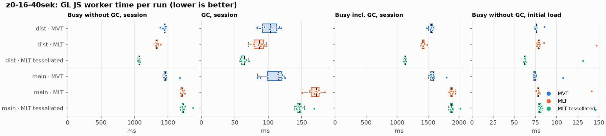
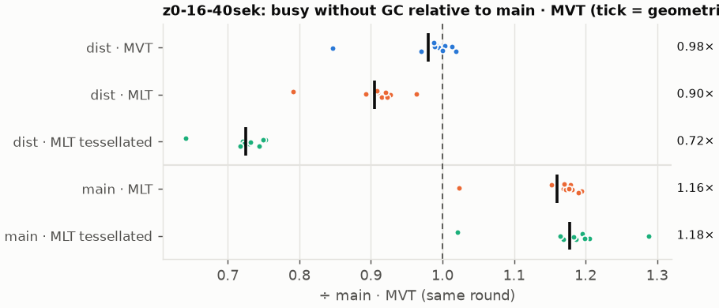
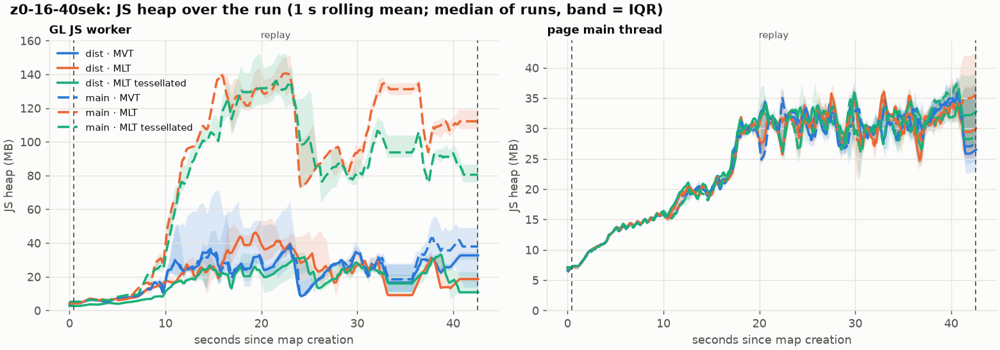
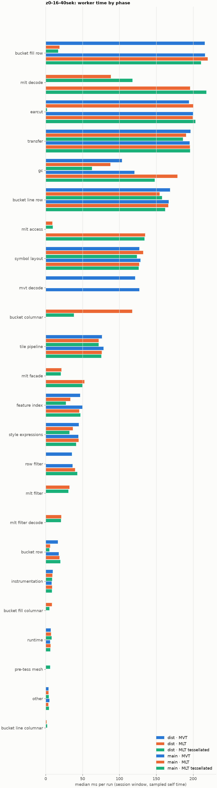

# Session trace benchmark — 20261110-141627

## Setup

- Created 2026-11-10T14:16:27+01:00; 10 repetitions + 1 warm-up round(s) (excluded); variants rotate per round (A B C, B C A, …); one cold browser context per run.
- Machine: Intel(R) Core(TM) Ultra 9 285K, 24 logical cores, 63.5 GB RAM, Windows-11-10.0.26200-SP0; power: GUID des Energieschemas: 8c5e7fda-e8bf-4a96-9a85-a6e23a8c635c  (H”chstleistung), AC True.
- GL JS gl7-performance-optimization @ 34e0236e4d; worker count 1; viewport {'width': 1280, 'height': 1024}.
- Python 3.13.17, packages {'playwright': '1.64.1', 'numpy': '2.5.4', 'matplotlib': '3.11.2'}.

| variant | bundle | format | bundle sha256 | branch build |
|---|---|---|---|---|
| MVT | `dist/maplibre-gl-dev.mjs` | mvt | `d578481ca3ef` | – |
| MLT | `dist/maplibre-gl-dev.mjs` | mlt | `d578481ca3ef` | – |
| MLT tessellated | `dist/maplibre-gl-dev.mjs` | mlt-pre-tess | `d578481ca3ef` | – |
| main · MVT | `bench-builds/branches/main/maplibre-gl-dev.mjs` | mvt | `662822cbe5c2` | main @ bb38954083 (2026-10-26), MLT @ 85738fbf81 |
| main · MLT | `bench-builds/branches/main/maplibre-gl-dev.mjs` | mlt | `662822cbe5c2` | main @ bb38954083 (2026-10-26), MLT @ 85738fbf81 |
| main · MLT tessellated | `bench-builds/branches/main/maplibre-gl-dev.mjs` | mlt-pre-tess | `662822cbe5c2` | main @ bb38954083 (2026-10-26), MLT @ 85738fbf81 |

| session | style | duration | frames | sha256 |
|---|---|---:|---:|---|
| z0-16-40sek | maptiler-basic (recorded: osm-bright) | 42.1 s | 1739 | `55a2b8f22fe2` |

CPU sampling interval (median over runs): 537 µs.

## Definitions

- **busy** = wall time in which a GL JS worker thread runs a task (union of top-level task slices and GC slices on `DedicatedWorker thread`s), summed over workers. **GC** = union of `MinorGC`/`MajorGC`/`V8.GC*` slices on those threads. **busy without GC** = busy − GC (headline metric).
- **CPU** = thread time (`tdur`) of the same slices. Phase categories and functions come from the trace's CPU samples (self time), categorised by `config/categories.toml` (nearest matching frame, leaf to root).
- Windows: **load** = map creation → first idle; **session** = camera replay; **tail** = end of replay → idle; **total** = load + session + tail.
- Ratios are against **main · MVT**: ratio of medians with a bootstrap 95 % CI, the geometric mean of per-round ratios, and a two-sided Mann–Whitney U p-value (normal approximation, not corrected for multiple comparisons; rough below n = 8). Lower than 1× means less worker time.

## Session `z0-16-40sek`

### Worker busy without GC (session window)

| variant | n ok / failed | median ms | IQR | mean | ratio vs main · MVT | 95 % CI | geo-mean paired | MWU p |
|---|---:|---:|---:|---:|---:|---:|---:|---:|
| MVT | 10 / 0 | 1,455 | 1,449–1,459 | 1,447 | 1.00× | 0.98–1.01× | 0.98× | 0.473 |
| MLT | 10 / 0 | 1,330 | 1,322–1,346 | 1,336 | 0.91× | 0.90–0.93× | 0.90× | <0.001 |
| MLT tessellated | 10 / 0 | 1,074 | 1,064–1,076 | 1,070 | 0.74× | 0.72–0.75× | 0.72× | <0.001 |
| main · MVT | 10 / 0 | 1,461 | 1,443–1,472 | 1,478 | 1.00× | – | – | – |
| main · MLT | 10 / 0 | 1,711 | 1,694–1,725 | 1,712 | 1.17× | 1.15–1.19× | 1.16× | <0.001 |
| main · MLT tessellated | 10 / 0 | 1,731 | 1,715–1,741 | 1,739 | 1.19× | 1.17–1.21× | 1.18× | <0.001 |

### All worker metrics (median, ratio vs baseline)

| metric | MVT | MLT | MLT tessellated | main · MVT | main · MLT | main · MLT tessellated |
|---|---:|---:|---:|---:|---:|---:|
| busy incl. GC | 1,555 (0.98×) | 1,415 (0.90×) | 1,136 (0.72×) | 1,581 | 1,880 (1.19×) | 1,877 (1.19×) |
| &nbsp;&nbsp;of which GC | 103.1 (0.89×) | 87.2 (0.75×) | 64.3 (0.56×) | 115.7 | 172.3 (1.49×) | 146.4 (1.27×) |
| &nbsp;&nbsp;of which busy without GC | 1,455 (1.00×) | 1,330 (0.91×) | 1,074 (0.74×) | 1,461 | 1,711 (1.17×) | 1,731 (1.19×) |
| &nbsp;&nbsp;&nbsp;&nbsp;of which filtering (sampled, incl. callees) | 35.6 (0.98×) | 32.3 (0.88×) | 30.8 (0.84×) | 36.5 | 39.7 (1.09×) | 42.7 (1.17×) |
| &nbsp;&nbsp;&nbsp;&nbsp;of which column decoding inside the MLT filter (sampled) | 0.0 | 21.1 | 20.9 | 0.0 | 0.0 | 0.0 |
| &nbsp;&nbsp;&nbsp;&nbsp;of which timing instrumentation (sampled) | 9.4 (1.16×) | 9.0 (1.11×) | 8.7 (1.07×) | 8.1 | 8.5 (1.05×) | 8.2 (1.01×) |
| busy without GC and instrumentation | 1,443 (0.99×) | 1,319 (0.91×) | 1,065 (0.73×) | 1,452 | 1,703 (1.17×) | 1,724 (1.19×) |
| CPU time without GC | 1,389 (0.99×) | 1,265 (0.91×) | 1,012 (0.72×) | 1,397 | 1,638 (1.17×) | 1,656 (1.19×) |
| tile: download end → sent to main thread, median per tile | 26.2 (0.98×) | 26.1 (0.97×) | 21.8 (0.82×) | 26.8 | 33.5 (1.25×) | 32.6 (1.22×) |
| tile: download end → sent to main thread, 90th percentile | 117.1 (1.00×) | 102.1 (0.87×) | 74.3 (0.63×) | 117.4 | 144.9 (1.23×) | 147.6 (1.26×) |
| tile: download end → sent to main thread, 95th percentile | 126.8 (1.00×) | 111.3 (0.88×) | 85.2 (0.67×) | 127.1 | 177.5 (1.40×) | 173.8 (1.37×) |
| tile: download end → sent to main thread, 99th percentile | 202.2 (0.99×) | 170.1 (0.83×) | 111.8 (0.55×) | 204.2 | 231.4 (1.13×) | 236.3 (1.16×) |
| minor GCs | 59.50 (1.02×) | 53.50 (0.91×) | 41.00 (0.70×) | 58.50 | 65.00 (1.11×) | 63.50 (1.09×) |
| major GCs | 10.00 (1.11×) | 10.50 (1.17×) | 9.00 (1.00×) | 9.00 | 6.00 (0.67×) | 6.00 (0.67×) |
| peak worker heap (MB) | 63.8 (0.80×) | 61.2 (0.77×) | 43.2 (0.54×) | 79.5 | 172.7 (2.17×) | 151.0 (1.90×) |
| load: busy without GC | 76.1 (1.03×) | 79.1 (1.07×) | 62.4 (0.84×) | 74.1 | 78.5 (1.06×) | 80.3 (1.08×) |
| load: GC | 3.1 (1.00×) | 3.2 (1.01×) | 1.5 (0.48×) | 3.1 | 3.2 (1.03×) | 3.5 (1.10×) |
| total: busy without GC | 1,531 (1.00×) | 1,411 (0.92×) | 1,137 (0.74×) | 1,535 | 1,800 (1.17×) | 1,810 (1.18×) |

Rows marked *of which* are parts of the row above, not additional time. Tile rows are per-tile latencies (medians over tiles, then over runs), not sums: tiles overlap in time, and the medians of the parse and queue parts do not add up exactly to the median latency.

### Filtering (session window)

Sampled worker time spent in feature filtering, including everything the filter calls (expression evaluation, property access): **row filter** = the style-spec feature filter that MVT runs per feature, **mlt filter** = the columnar MLT filter (incl. the geometry-type selection), without the columns it decodes (see the next table). Medians per run; rules in `config/categories.toml`.

| variant | mlt filter | row filter | filtering | ratio vs main · MVT | 95 % CI | MWU p | share of sampled busy |
|---|---:|---:|---:|---:|---:|---:|---:|
| MVT | 0.0 | 35.6 | 35.6 | 0.98× | 0.86–1.12× | 0.970 | 2.6% |
| MLT | 32.3 | 0.0 | 32.3 | 0.88× | 0.84–0.98× | 0.026 | 2.6% |
| MLT tessellated | 30.8 | 0.0 | 30.8 | 0.84× | 0.76–0.93× | 0.001 | 3.2% |
| main · MVT | 0.0 | 36.5 | 36.5 | 1.00× | – | – | 2.6% |
| main · MLT | 0.0 | 39.7 | 39.7 | 1.09× | 1.02–1.29× | 0.014 | 2.3% |
| main · MLT tessellated | 0.0 | 42.7 | 42.7 | 1.17× | 1.08–1.29× | 0.001 | 2.5% |

**Filtering together with tile decoding.** The MLT decoder leaves columns encoded until something reads them, and the filter is usually the first reader: the columns it decodes (properties, and the geometry for `$type`) are **of which inside the filter** (phase *mlt filter decode*), the rest is *mlt decode* (geometry and columns read later, e.g. by paint properties and symbols). MVT decodes every feature's properties and geometry while it reads the tile (*mvt decode*), whether the filter keeps the feature or not. So **filtering** above compares the filters, and **decoding + filtering** compares all that the formats spend on decoding the tile and selecting features. **tile decoding** = *mvt decode* or *mlt decode* + *mlt filter decode*: work inside a call into a decoder. Reading data that is already decoded is not counted, as for MVT's feature objects: *mlt access* (row views, value getters, looking a column up by name) and the MLT facade (*mlt facade*). MVT decodes geometry only for the features its filter keeps, MLT decodes a layer's whole geometry column.

| variant | tile decoding | of which inside the filter | filtering | decoding + filtering | ratio vs main · MVT | 95 % CI | MWU p |
|---|---:|---:|---:|---:|---:|---:|---:|
| MVT | 121.2 | 0.0 | 35.6 | 158.1 | 0.97× | 0.93–1.02× | 0.162 |
| MLT | 110.4 | 21.1 | 32.3 | 144.5 | 0.89× | 0.85–0.92× | <0.001 |
| MLT tessellated | 137.6 | 20.9 | 30.8 | 168.2 | 1.03× | 1.01–1.07× | 0.021 |
| main · MVT | 127.1 | 0.0 | 36.5 | 162.5 | 1.00× | – | – |
| main · MLT | 195.8 | 0.0 | 39.7 | 237.9 | 1.46× | 1.41–1.52× | <0.001 |
| main · MLT tessellated | 217.9 | 0.0 | 42.7 | 260.1 | 1.60× | 1.53–1.66× | <0.001 |

Top 12 functions inside filtering and its column decoding (self time, mean ms per run):

| phase | function | source | MVT | MLT | MLT tessellated | main · MVT | main · MLT | main · MLT tessellated |
|---|---|---|---:|---:|---:|---:|---:|---:|
| row filter | `evaluate` | node_modules/@maplibre/maplibre-gl-style-spec/dist/expression/compound_expression.mjs | 10.9 | 0.0 | 0.0 | 9.2 | 15.1 | 17.0 |
| row filter | `evaluate` | node_modules/@maplibre/maplibre-gl-style-spec/dist/expression/index.mjs | 5.4 | 0.0 | 0.0 | 7.7 | 6.4 | 6.8 |
| row filter | `CompoundExpression.register.filter-==` | node_modules/@maplibre/maplibre-gl-style-spec/dist/expression/compound_expression.mjs | 5.2 | 0.0 | 0.0 | 5.5 | 4.2 | 4.9 |
| mlt filter | `filterByGeometryType` | maplibre-tile-spec/ts/dist/vector/geometry/geometryVector.js | 0.0 | 4.7 | 4.7 | 0.0 | 0.0 | 0.0 |
| row filter | `CompoundExpression.register.filter-in-small` | node_modules/@maplibre/maplibre-gl-style-spec/dist/expression/compound_expression.mjs | 4.1 | 0.0 | 0.0 | 3.5 | 4.4 | 3.8 |
| row filter | `filter` | node_modules/@maplibre/maplibre-gl-style-spec/dist/feature_filter/index.mjs | 3.9 | 0.0 | 0.0 | 3.7 | 3.1 | 2.7 |
| mlt filter decode | `unpackNullable` | maplibre-tile-spec/ts/dist/decoding/unpackNullableUtils.js | 0.0 | 3.3 | 3.9 | 0.0 | 0.0 | 0.0 |
| mlt filter | `dictionaryRowMatches` | maplibre-tile-spec/ts/dist/processing/filter/execution/filterKernel.js | 0.0 | 3.0 | 2.4 | 0.0 | 0.0 | 0.0 |
| row filter | `CompoundExpression.register.filter-type-==` | node_modules/@maplibre/maplibre-gl-style-spec/dist/expression/compound_expression.mjs | 2.4 | 0.0 | 0.0 | 1.9 | 2.8 | 2.3 |
| mlt filter | `scanDictionaryCodes` | maplibre-tile-spec/ts/dist/processing/filter/execution/filterKernel.js | 0.0 | 2.6 | 2.2 | 0.0 | 0.0 | 0.0 |
| mlt filter | `bytesEqual` | maplibre-tile-spec/ts/dist/processing/filter/execution/filterKernel.js | 0.0 | 2.0 | 1.0 | 0.0 | 0.0 | 0.0 |
| mlt filter decode | `decodeFsst` | maplibre-tile-spec/ts/dist/decoding/fsstDecoder.js | 0.0 | 1.8 | 1.4 | 0.0 | 0.0 | 0.0 |

### Bucket time by layer type (session window)

Sampled self time of the bucket code per layer type, row and columnar path together (median ms per run). **shared bucket code** is code all layer types use (`src/data/bucket/*` outside the layer files, `columnar_populate.ts`, `columnar_mesh_arrays.ts`, `load_geometry.ts`). **earcut** triangulates for fill and fill-extrusion on the row path; **pre-tess mesh** takes over the stored triangles of a pre-tessellated fill. **symbol** is the whole symbol layout phase. For exact wall time per source layer and type see the timing log tables below (builds with `worker_timing.ts` only).

| variant | fill | fill-extrusion | line | symbol | shared bucket code | earcut | pre-tess mesh | total |
|---|---:|---:|---:|---:|---:|---:|---:|---:|
| MVT | 215.9 | 0.0 | 168.8 | 127.1 | 16.6 | 194.5 | 0.0 | 720.9 |
| MLT | 28.5 | 0.0 | 156.1 | 132.3 | 122.2 | 200.1 | 0.0 | 637.6 |
| MLT tessellated | 21.5 | 0.0 | 161.0 | 123.8 | 43.5 | 1.7 | 5.8 | 359.1 |
| main · MVT | 216.3 | 0.0 | 166.9 | 128.6 | 17.8 | 199.9 | 0.0 | 730.5 |
| main · MLT | 219.8 | 0.0 | 166.4 | 126.8 | 18.7 | 199.6 | 0.0 | 728.7 |
| main · MLT tessellated | 210.8 | 0.0 | 162.0 | 126.1 | 19.9 | 203.0 | 0.0 | 721.2 |

### Where the variants differ from main · MVT (session window, mean ms per run)

Open **[flame.html](flame.html)** to explore the call tree interactively: pick a variant, compare it with main · MVT (red = more time at the same call path, blue = less), click a frame to zoom in, and read the phase and function breakdown under it. Without a comparison, frames are coloured by phase: filtering is green in both formats, and the columns the MLT filter decodes on first access (*mlt filter decode*) are MLT blue frames under the green filter. `flame/*.txt` open in https://www.speedscope.app.

#### MVT vs main · MVT

**By phase** (sampled self time; the Δ column sums to the difference in sampled busy time):

| phase | main · MVT | MVT | Δ |
|---|---:|---:|---:|
| instrumentation | 8.2 | 9.6 | +1.4 |
| style expressions | 43.3 | 44.3 | +1.0 |
| other | 4.9 | 4.0 | -1.0 |
| feature index | 47.4 | 46.1 | -1.2 |
| transfer | 197.6 | 196.1 | -1.4 |
| tile pipeline | 79.1 | 77.4 | -1.6 |
| bucket row | 19.0 | 17.0 | -2.0 |
| symbol layout | 128.8 | 125.9 | -2.9 |
| mvt decode | 126.2 | 122.7 | -3.5 |
| bucket line row | 170.4 | 166.1 | -4.3 |
| gc | 111.4 | 102.0 | -9.4 |
| earcut | 205.0 | 193.2 | -11.7 |

**Functions with the largest self-time difference** (by function name, summed over source files):

| function | main · MVT | MVT | Δ |
|---|---:|---:|---:|
| `addBucketFeatures` | 0.0 | 5.7 | +5.7 |
| `populate` | 24.1 | 27.0 | +2.9 |
| `flatten` | 9.1 | 11.8 | +2.8 |
| `signedArea$2` | 0.0 | 2.6 | +2.6 |
| `readUtf8` | 0.0 | 2.2 | +2.2 |
| `addSymbolFeature` | 0.0 | 1.8 | +1.8 |
| `insert` | 24.8 | 26.2 | +1.3 |
| `addFeature` | 14.8 | 15.9 | +1.1 |
| `shapeLines` | 3.5 | 4.5 | +1.1 |
| `(anonymous)` | 11.0 | 12.1 | +1.0 |
| `_refreshViews` | 5.3 | 6.3 | +1.0 |
| `readVarintRemainder` | 0.0 | 1.0 | +1.0 |
| `(garbage collector)` | 111.4 | 102.0 | -9.4 |
| `hasLineDasharray` | 9.1 | 0.1 | -9.0 |
| `readVarint` | 31.8 | 28.5 | -3.3 |
| `emplace` | 32.1 | 29.4 | -2.7 |
| `addLine` | 22.2 | 19.6 | -2.6 |

#### MLT vs main · MVT

**By phase** (sampled self time; the Δ column sums to the difference in sampled busy time):

| phase | main · MVT | MLT | Δ |
|---|---:|---:|---:|
| bucket columnar | 0.0 | 118.0 | +118.0 |
| mlt decode | 0.0 | 89.9 | +89.9 |
| mlt filter | 0.0 | 32.8 | +32.8 |
| mlt facade | 0.0 | 22.0 | +22.0 |
| mlt filter decode | 0.0 | 20.9 | +20.9 |
| mlt access | 0.0 | 9.6 | +9.6 |
| bucket fill columnar | 0.0 | 8.3 | +8.3 |
| symbol layout | 128.8 | 130.9 | +2.1 |
| instrumentation | 8.2 | 9.5 | +1.3 |
| bucket line columnar | 0.0 | 1.2 | +1.2 |
| runtime | 6.4 | 7.1 | +0.6 |
| other | 4.9 | 3.5 | -1.5 |
| earcut | 205.0 | 199.9 | -5.0 |
| tile pipeline | 79.1 | 72.1 | -6.9 |
| transfer | 197.6 | 190.3 | -7.2 |
| style expressions | 43.3 | 35.3 | -8.0 |
| bucket row | 19.0 | 6.7 | -12.4 |
| feature index | 47.4 | 33.0 | -14.4 |
| bucket line row | 170.4 | 154.2 | -16.2 |
| gc | 111.4 | 84.8 | -26.6 |
| row filter | 35.9 | 0.0 | -35.9 |
| mvt decode | 126.2 | 0.0 | -126.2 |
| bucket fill row | 215.2 | 19.4 | -195.8 |

**Functions with the largest self-time difference** (by function name, summed over source files):

| function | main · MVT | MLT | Δ |
|---|---:|---:|---:|
| `writeEarcutFill` | 0.0 | 17.1 | +17.1 |
| `buildRingBoundingBoxes` | 0.0 | 14.7 | +14.7 |
| `buildEarcutMesh` | 0.0 | 10.9 | +10.9 |
| `decodeComponentwiseDeltaVec2` | 0.0 | 10.2 | +10.2 |
| `readScaledRings` | 0.0 | 8.9 | +8.9 |
| `unpackNullable` | 0.0 | 7.4 | +7.4 |
| `decodeFastPforInt32` | 0.0 | 6.9 | +6.9 |
| `addBucketFeatures` | 0.0 | 6.3 | +6.3 |
| `fillLargeMeshArrays` | 8.0 | 14.3 | +6.3 |
| `readVertices` | 0.0 | 5.3 | +5.3 |
| `signedArea$2` | 0.0 | 5.2 | +5.2 |
| `filterByGeometryType` | 0.0 | 4.7 | +4.7 |
| `_vertexToIndex` | 72.1 | 0.2 | -71.9 |
| `readVarint` | 31.8 | 1.4 | -30.4 |
| `(garbage collector)` | 111.4 | 84.8 | -26.6 |
| `loadGeometry` | 31.6 | 6.1 | -25.5 |
| `readString` | 23.5 | 0.0 | -23.5 |

#### MLT tessellated vs main · MVT

**By phase** (sampled self time; the Δ column sums to the difference in sampled busy time):

| phase | main · MVT | MLT tessellated | Δ |
|---|---:|---:|---:|
| mlt decode | 0.0 | 118.8 | +118.8 |
| bucket columnar | 0.0 | 38.4 | +38.4 |
| mlt filter | 0.0 | 30.1 | +30.1 |
| mlt filter decode | 0.0 | 20.9 | +20.9 |
| mlt facade | 0.0 | 20.0 | +20.0 |
| mlt access | 0.0 | 9.4 | +9.4 |
| pre-tess mesh | 0.0 | 6.0 | +6.0 |
| bucket fill columnar | 0.0 | 4.7 | +4.7 |
| bucket line columnar | 0.0 | 2.4 | +2.4 |
| runtime | 6.4 | 7.6 | +1.2 |
| instrumentation | 8.2 | 8.8 | +0.6 |
| other | 4.9 | 3.9 | -1.0 |
| symbol layout | 128.8 | 125.4 | -3.4 |
| tile pipeline | 79.1 | 72.0 | -7.1 |
| transfer | 197.6 | 186.0 | -11.5 |
| style expressions | 43.3 | 31.1 | -12.2 |
| bucket line row | 170.4 | 157.5 | -12.9 |
| bucket row | 19.0 | 5.2 | -13.9 |
| feature index | 47.4 | 26.5 | -20.9 |
| row filter | 35.9 | 0.0 | -35.9 |
| gc | 111.4 | 62.2 | -49.2 |
| mvt decode | 126.2 | 0.0 | -126.2 |
| bucket fill row | 215.2 | 16.7 | -198.5 |
| earcut | 205.0 | 2.0 | -203.0 |

**Functions with the largest self-time difference** (by function name, summed over source files):

| function | main · MVT | MLT tessellated | Δ |
|---|---:|---:|---:|
| `decodeUnsignedZigZagDeltaInt32` | 0.0 | 12.6 | +12.6 |
| `decodeComponentwiseDeltaVec2` | 0.0 | 11.8 | +11.8 |
| `writeTessellatedFill` | 0.0 | 11.2 | +11.2 |
| `unpackNullable` | 0.0 | 9.6 | +9.6 |
| `decodeFastPforInt32` | 0.0 | 7.4 | +7.4 |
| `addBucketFeatures` | 0.0 | 5.9 | +5.9 |
| `buildTessellatedBoundingBox` | 0.0 | 5.7 | +5.7 |
| `readVertices` | 0.0 | 5.1 | +5.1 |
| `decodeFsst` | 0.0 | 4.7 | +4.7 |
| `filterByGeometryType` | 0.0 | 4.7 | +4.7 |
| `decodeString$2` | 0.0 | 4.6 | +4.6 |
| `decodeBigEndianInt32sInto` | 0.0 | 4.5 | +4.5 |
| `_vertexToIndex` | 72.1 | 0.0 | -72.1 |
| `isEar` | 62.8 | 0.4 | -62.4 |
| `(garbage collector)` | 111.4 | 62.2 | -49.2 |
| `isEarHashed` | 31.3 | 0.0 | -31.3 |
| `readVarint` | 31.8 | 1.4 | -30.4 |

#### main · MLT vs main · MVT

**By phase** (sampled self time; the Δ column sums to the difference in sampled busy time):

| phase | main · MVT | main · MLT | Δ |
|---|---:|---:|---:|
| mlt decode | 0.0 | 195.2 | +195.2 |
| mlt access | 0.0 | 134.1 | +134.1 |
| gc | 111.4 | 174.0 | +62.6 |
| mlt facade | 0.0 | 53.2 | +53.2 |
| row filter | 35.9 | 41.4 | +5.5 |
| bucket fill row | 215.2 | 218.7 | +3.5 |
| feature index | 47.4 | 46.2 | -1.2 |
| other | 4.9 | 3.6 | -1.3 |
| transfer | 197.6 | 196.0 | -1.6 |
| symbol layout | 128.8 | 126.3 | -2.4 |
| bucket line row | 170.4 | 168.0 | -2.4 |
| tile pipeline | 79.1 | 75.1 | -3.9 |
| earcut | 205.0 | 198.9 | -6.0 |
| mvt decode | 126.2 | 0.0 | -126.2 |

**Functions with the largest self-time difference** (by function name, summed over source files):

| function | main · MVT | main · MLT | Δ |
|---|---:|---:|---:|
| `(garbage collector)` | 111.4 | 174.0 | +62.6 |
| `decodeString$2` | 0.0 | 56.9 | +56.9 |
| `getFeatures` | 0.0 | 50.0 | +50.0 |
| `convertGeometryVector` | 0.0 | 30.9 | +30.9 |
| `getLineStringOrRing` | 0.0 | 13.0 | +13.0 |
| `decodeComponentwiseDeltaVec2` | 0.0 | 12.9 | +12.9 |
| `unpackNullable` | 0.0 | 12.0 | +12.0 |
| `loadGeometry` | 31.6 | 42.2 | +10.6 |
| `getValue` | 0.0 | 9.7 | +9.7 |
| `decodeFastPforInt32` | 0.0 | 9.1 | +9.1 |
| `decodeFsst` | 0.0 | 7.2 | +7.2 |
| `MLTVectorTileLayer` | 0.0 | 6.5 | +6.5 |
| `readVarint` | 31.8 | 1.5 | -30.3 |
| `readString` | 23.5 | 0.0 | -23.5 |
| `readSVarint` | 20.5 | 0.0 | -20.5 |
| `VectorTileFeature` | 15.9 | 0.0 | -15.9 |
| `_parseWorkerTile` | 11.1 | 6.9 | -4.2 |

#### main · MLT tessellated vs main · MVT

**By phase** (sampled self time; the Δ column sums to the difference in sampled busy time):

| phase | main · MVT | main · MLT tessellated | Δ |
|---|---:|---:|---:|
| mlt decode | 0.0 | 217.6 | +217.6 |
| mlt access | 0.0 | 136.5 | +136.5 |
| mlt facade | 0.0 | 49.1 | +49.1 |
| gc | 111.4 | 152.0 | +40.6 |
| row filter | 35.9 | 42.9 | +6.9 |
| bucket row | 19.0 | 19.8 | +0.8 |
| other | 4.9 | 4.4 | -0.5 |
| feature index | 47.4 | 46.4 | -0.9 |
| style expressions | 43.3 | 42.1 | -1.2 |
| symbol layout | 128.8 | 127.2 | -1.5 |
| earcut | 205.0 | 203.3 | -1.7 |
| transfer | 197.6 | 195.3 | -2.2 |
| tile pipeline | 79.1 | 75.4 | -3.7 |
| bucket line row | 170.4 | 166.2 | -4.2 |
| bucket fill row | 215.2 | 209.3 | -5.9 |
| mvt decode | 126.2 | 0.0 | -126.2 |

**Functions with the largest self-time difference** (by function name, summed over source files):

| function | main · MVT | main · MLT tessellated | Δ |
|---|---:|---:|---:|
| `decodeString$2` | 0.0 | 57.4 | +57.4 |
| `getFeatures` | 0.0 | 52.8 | +52.8 |
| `(garbage collector)` | 111.4 | 152.0 | +40.6 |
| `convertGeometryVector` | 0.0 | 30.7 | +30.7 |
| `decodeUnsignedZigZagDeltaInt32` | 0.0 | 13.4 | +13.4 |
| `getLineStringOrRing` | 0.0 | 13.4 | +13.4 |
| `decodeComponentwiseDeltaVec2` | 0.0 | 12.0 | +12.0 |
| `unpackNullable` | 0.0 | 11.9 | +11.9 |
| `decodeFastPforInt32` | 0.0 | 11.0 | +11.0 |
| `getValue` | 0.0 | 8.6 | +8.6 |
| `decodeFsst` | 0.0 | 8.4 | +8.4 |
| `evaluate` | 20.1 | 28.2 | +8.1 |
| `readVarint` | 31.8 | 1.0 | -30.7 |
| `readString` | 23.5 | 0.0 | -23.5 |
| `readSVarint` | 20.5 | 0.0 | -20.5 |
| `VectorTileFeature` | 15.9 | 0.0 | -15.9 |
| `_vertexToIndex` | 72.1 | 65.9 | -6.2 |

### Memory (session window)

**JS heap** = V8's used heap of the thread (`jsHeapSizeUsed` from the trace's `UpdateCounters`, about every 20 ms; the mean is time-weighted). It does not include ArrayBuffer contents, so the tile data itself (vertex, index and feature-index arrays) is not in it: **tile data sent to the main thread** is the size of the ArrayBuffers each tile result transfers (`web/worker_hook.js`), which then live on the main thread and are uploaded to the GPU. **garbage collected** = heap freed by the worker's GCs, a measure of how much it allocates. Medians per run; ratio of medians with a bootstrap 95 % CI.

| metric | MVT | MLT | MLT tessellated | main · MVT | main · MLT | main · MLT tessellated |
|---|---:|---:|---:|---:|---:|---:|
| worker JS heap, mean (MB) | 20.0 (0.86×, 0.70–1.19×) | 19.3 (0.83×, 0.69–1.05×) | 15.5 (0.67×, 0.56–0.86×) | 23.3 | 85.3 (3.66×, 3.05–4.56×) | 75.1 (3.22×, 2.70–4.18×) |
| worker JS heap, peak (MB) | 63.8 (0.80×, 0.59–1.57×) | 61.2 (0.77×, 0.63–1.20×) | 43.2 (0.54×, 0.47–0.83×) | 79.5 | 172.7 (2.17×, 1.88–3.33×) | 151.0 (1.90×, 1.59–2.90×) |
| worker JS heap after the last GC (MB) | 13.8 (0.53×, 0.32–1.78×) | 9.6 (0.37×, 0.21–1.23×) | 7.0 (0.27×, 0.18–0.90×) | 26.2 | 100.2 (3.82×, 2.54–12.86×) | 76.3 (2.91×, 1.95–9.79×) |
| garbage collected in the worker (MB) | 1,426 (1.00×, 0.98–1.01×) | 1,051 (0.74×, 0.73–0.75×) | 569.9 (0.40×, 0.39–0.41×) | 1,421 | 1,544 (1.09×, 1.07–1.10×) | 1,554 (1.09×, 1.07–1.11×) |
| main thread JS heap, mean (MB) | 23.0 (1.00×, 0.97–1.02×) | 23.2 (1.01×, 0.98–1.04×) | 23.5 (1.02×, 0.99–1.04×) | 23.0 | 23.2 (1.01×, 0.97–1.02×) | 23.1 (1.00×, 0.97–1.03×) |
| main thread JS heap, peak (MB) | 46.6 (0.96×, 0.92–1.06×) | 46.5 (0.96×, 0.92–1.04×) | 46.2 (0.96×, 0.93–1.06×) | 48.3 | 45.0 (0.93×, 0.91–1.03×) | 47.6 (0.99×, 0.94–1.06×) |
| main thread JS heap at the end of the replay (MB) | 26.2 (0.96×, 0.67–1.50×) | 29.8 (1.09×, 0.74–1.57×) | 32.5 (1.19×, 0.81–1.53×) | 27.4 | 35.3 (1.29×, 0.78–1.79×) | 28.6 (1.04×, 0.73–1.57×) |
| tile data sent to the main thread, total (MB) | 89.6 (1.00×, 0.99–1.01×) | 84.1 (0.94×, 0.93–0.94×) | 84.0 (0.93×, 0.93–0.94×) | 89.8 | 84.0 (0.94×, 0.92–0.94×) | 86.7 (0.97×, 0.96–0.98×) |
| tile data sent to the main thread, median per tile (KB) | 193.2 (1.00×, 1.00–1.01×) | 178.8 (0.93×, 0.92–0.93×) | 177.7 (0.92×, 0.91–0.93×) | 193.2 | 178.5 (0.92×, 0.91–0.92×) | 180.9 (0.94×, 0.93–0.94×) |

### Worker time by phase (session window, median ms of sampled self time)

| phase | MVT | MLT | MLT tessellated | main · MVT | main · MLT | main · MLT tessellated |
|---|---:|---:|---:|---:|---:|---:|
| bucket fill row | 215.9 | 18.6 | 16.8 | 216.3 | 219.8 | 210.8 |
| mlt decode | 0.0 | 88.5 | 117.6 | 0.0 | 195.8 | 217.9 |
| earcut | 194.5 | 200.1 | 1.7 | 199.9 | 199.6 | 203.0 |
| transfer | 196.6 | 190.5 | 186.2 | 195.4 | 195.5 | 195.9 |
| gc | 103.6 | 87.7 | 62.8 | 120.4 | 178.8 | 148.0 |
| bucket line row | 168.8 | 154.7 | 157.9 | 166.9 | 166.4 | 162.0 |
| mlt access | 0.0 | 9.0 | 9.4 | 0.0 | 134.8 | 134.1 |
| symbol layout | 127.1 | 132.3 | 123.8 | 128.6 | 126.8 | 126.1 |
| mvt decode | 121.2 | 0.0 | 0.0 | 127.1 | 0.0 | 0.0 |
| bucket columnar | 0.0 | 117.4 | 38.1 | 0.0 | 0.0 | 0.0 |
| tile pipeline | 76.3 | 71.9 | 71.8 | 78.3 | 75.9 | 75.3 |
| mlt facade | 0.0 | 21.5 | 20.3 | 0.0 | 52.4 | 49.6 |
| feature index | 46.7 | 33.3 | 27.3 | 49.6 | 45.4 | 47.0 |
| style expressions | 44.8 | 36.8 | 32.2 | 44.1 | 44.6 | 41.2 |
| row filter | 35.6 | 0.0 | 0.0 | 36.5 | 39.7 | 42.7 |
| mlt filter | 0.0 | 32.3 | 30.8 | 0.0 | 0.0 | 0.0 |
| mlt filter decode | 0.0 | 21.1 | 20.9 | 0.0 | 0.0 | 0.0 |
| bucket row | 16.6 | 6.1 | 5.0 | 17.8 | 18.7 | 19.9 |
| instrumentation | 9.4 | 9.0 | 8.7 | 8.1 | 8.5 | 8.2 |
| bucket fill columnar | 0.0 | 8.5 | 4.9 | 0.0 | 0.0 | 0.0 |
| runtime | 6.8 | 7.1 | 8.0 | 5.9 | 6.5 | 6.1 |
| pre-tess mesh | 0.0 | 0.0 | 5.8 | 0.0 | 0.0 | 0.0 |
| other | 3.7 | 3.7 | 4.0 | 5.1 | 3.4 | 4.4 |
| bucket line columnar | 0.0 | 1.0 | 2.1 | 0.0 | 0.0 | 0.0 |
| bucket fill-extrusion row | 0.0 | 0.0 | 0.0 | 0.0 | 0.0 | 0.0 |

### Top 20 worker functions by self time (session window, mean ms per run)

| function | source | phase | MVT | MLT | MLT tessellated | main · MVT | main · MLT | main · MLT tessellated |
|---|---|---|---:|---:|---:|---:|---:|---:|
| `(garbage collector)` | (native) | gc | 102.0 | 84.8 | 62.2 | 111.4 | 174.0 | 152.0 |
| `_vertexToIndex` | src/render/subdivision.ts | bucket fill row | 70.0 | 0.2 | 0.0 | 72.1 | 70.4 | 65.9 |
| `setTimeout` | (native) | transfer | 69.0 | 69.6 | 70.6 | 69.6 | 71.4 | 70.5 |
| `reserve` | src/util/struct_array.ts | bucket fill row | 65.0 | 55.1 | 55.4 | 67.3 | 67.5 | 63.6 |
| `isEar` | node_modules/earcut/src/earcut.js | earcut | 61.2 | 59.1 | 0.4 | 62.8 | 63.7 | 64.7 |
| `postMessage` | (native) | transfer | 59.7 | 61.0 | 60.3 | 61.5 | 58.9 | 60.0 |
| `decodeString$2` | maplibre-tile-spec/ts/dist/decoding/decodingUtils.js | mlt decode | 0.0 | 4.5 | 4.6 | 0.0 | 56.9 | 57.4 |
| `getFeatures` | maplibre-tile-spec/ts/dist/vector/featureTable.js | mlt access | 0.0 | 0.0 | 0.0 | 0.0 | 50.0 | 52.8 |
| `emplace` | src/data/array_types.g.ts | bucket line row | 29.4 | 33.3 | 26.2 | 32.1 | 31.5 | 31.3 |
| `fetch` | (native) | tile pipeline | 31.6 | 32.1 | 32.1 | 32.5 | 32.8 | 32.9 |
| `readVarint` | node_modules/pbf/index.js | mvt decode | 28.5 | 0.0 | 0.0 | 31.8 | 0.0 | 0.0 |
| `isEarHashed` | node_modules/earcut/src/earcut.js | earcut | 30.9 | 29.6 | 0.0 | 31.3 | 27.9 | 30.1 |
| `convertGeometryVector` | maplibre-tile-spec/ts/dist/vector/geometry/geometryVectorConverter.js | mlt access | 0.0 | 0.0 | 0.0 | 0.0 | 30.9 | 30.7 |
| `_trim` | src/util/struct_array.ts | transfer | 29.1 | 21.0 | 18.1 | 29.3 | 27.4 | 28.2 |
| `loadGeometry` | src/source/vector_tile_mlt.ts | mlt facade | 0.0 | 0.6 | 0.6 | 0.0 | 26.0 | 20.7 |
| `earcutLinked` | node_modules/earcut/src/earcut.js | earcut | 22.4 | 22.6 | 0.4 | 23.7 | 23.5 | 24.7 |
| `insert` | src/data/feature_index.ts | feature index | 24.2 | 9.1 | 7.2 | 22.9 | 24.3 | 23.6 |
| `addLine` | src/data/bucket/line_bucket.ts | bucket line row | 19.6 | 23.5 | 21.2 | 22.2 | 19.6 | 21.5 |
| `readString` | node_modules/pbf/index.js | mvt decode | 23.3 | 0.0 | 0.0 | 23.5 | 0.0 | 0.0 |
| `readSVarint` | node_modules/pbf/index.js | mvt decode | 20.7 | 0.0 | 0.0 | 20.5 | 0.0 | 0.0 |

### Top 20 worker functions by total time (incl. callees) (session window, mean ms per run)

| function | source | phase | MVT | MLT | MLT tessellated | main · MVT | main · MLT | main · MLT tessellated |
|---|---|---|---:|---:|---:|---:|---:|---:|
| `loadTile` | src/source/vector_tile_worker_source.ts |  | 936.5 | 846.4 | 579.8 | 959.6 | 1,215 | 1,228 |
| `parse` | src/source/worker_tile.ts | tile pipeline | 994.9 | 940.2 | 671.1 | 1,016 | 967.9 | 959.5 |
| `_parseWorkerTile` | src/source/vector_tile_worker_source.ts | tile pipeline | 874.7 | 813.4 | 549.3 | 896.8 | 846.1 | 835.8 |
| `populate` | src/data/bucket/fill_bucket.ts | bucket fill row | 490.3 | 0.0 | 0.0 | 502.0 | 477.8 | 472.9 |
| `addBucketFeatures` | src/data/bucket/fill_bucket.ts | bucket fill row | 422.9 | 307.7 | 35.9 | 0.0 | 0.0 | 0.0 |
| `addFeature` | src/data/bucket/fill_bucket.ts | bucket fill row | 395.4 | 2.7 | 0.0 | 408.4 | 397.4 | 396.2 |
| `populate` | src/data/bucket/columnar/columnar_fill_bucket.ts | bucket fill columnar | 0.0 | 381.5 | 128.2 | 0.0 | 0.0 | 0.0 |
| `loadVectorTile` | src/source/vector_tile_worker_source.ts | tile pipeline | 35.3 | 3.3 | 2.9 | 36.9 | 338.7 | 363.1 |
| `MLTVectorTile` | src/source/vector_tile_mlt.ts |  | 0.0 | 3.1 | 2.6 | 0.0 | 338.4 | 362.6 |
| `(anonymous)` | src/source/vector_tile_mlt.ts | mlt facade | 0.0 | 0.0 | 0.0 | 0.0 | 325.7 | 350.7 |
| `MLTVectorTileLayer` | src/source/vector_tile_mlt.ts | mlt facade | 0.0 | 0.2 | 0.0 | 0.0 | 323.6 | 349.1 |
| `subdividePolygon` | src/render/subdivision.ts | bucket fill row | 333.2 | 2.5 | 0.0 | 345.7 | 339.1 | 340.4 |
| `getFeatures` | maplibre-tile-spec/ts/dist/vector/featureTable.js | mlt access | 0.0 | 0.0 | 0.0 | 0.0 | 316.9 | 342.1 |
| `subdividePolygonInternal` | src/render/subdivision.ts | bucket fill row | 329.9 | 2.5 | 0.0 | 341.3 | 335.1 | 335.3 |
| `addFeature` | src/data/bucket/columnar/columnar_fill_bucket.ts | bucket fill columnar | 0.0 | 296.8 | 31.7 | 0.0 | 0.0 | 0.0 |
| `writeEarcutFill` | src/data/bucket/columnar/columnar_mesh_arrays.ts | bucket columnar | 0.0 | 288.3 | 3.8 | 0.0 | 0.0 | 0.0 |
| `populate` | src/data/bucket/columnar/columnar_line_bucket.ts | bucket line columnar | 0.0 | 221.2 | 217.8 | 0.0 | 0.0 | 0.0 |
| `buildEarcutMesh` | src/data/bucket/columnar/columnar_mesh_arrays.ts |  | 0.0 | 216.9 | 2.3 | 0.0 | 0.0 | 0.0 |
| `populate` | src/data/bucket/line_bucket.ts | bucket line row | 200.3 | 0.0 | 0.0 | 208.3 | 202.3 | 201.3 |
| `earcut` | node_modules/earcut/src/earcut.js | earcut | 193.0 | 199.3 | 2.0 | 204.7 | 198.6 | 203.0 |

## Runs

66 ok, 0 failed/aborted, 0 not run, 60 used in statistics.

## Validity checks

- Counted once: all 66 analysed runs pass (windows load + session + tail add up to total; phases add up to the sampled busy time; GC and sampled time lie within busy time; no timing-log line twice).
- other programs used 0.38–3.20 logical processors during the replays (median 0.88)
- 57 run(s) with more than 0.5 cores of background load: z0-16-40sek/mlt/rep-01 (0.71), z0-16-40sek/mlt-pre-tess/rep-01 (0.59), z0-16-40sek/main.mvt/rep-01 (0.88), z0-16-40sek/main.mlt/rep-01 (0.81), z0-16-40sek/main.mlt-pre-tess/rep-01 (0.68), z0-16-40sek/mvt/rep-01 (0.66)

## Files

- `runs.csv`: one row per run (incl. failed and warm-up runs), every scalar metric as `<window>.<metric>`.
- `summary.csv`: session × variant × metric statistics.
- `functions.csv`, `categories.csv`: CPU-sample self/total time per function and phase per run and window.
- `category_functions.csv`: self time per phase × function (e.g. what the filters spend their time on).
- `tiles.csv`, `tile_layers.csv`, `tile_phases.csv`: the per-tile worker timing log, long format.
- `flame.html`: interactive call tree per variant with a diff view; `flame/*.txt`: collapsed stacks for speedscope.
- `analysis/stacks.csv` (per run): sampled self time per full call stack.
- `tile_latency.csv`: per tile request, worker clock: received, download start/end, result sent, latency = sent − download end, parse_ms, wait_ms = latency − parse.
- `runs/<session>/<variant>/rep-NN/trace.json.gz`: the raw trace (opens in the DevTools Performance tab).
