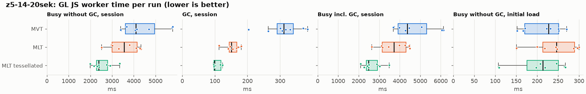
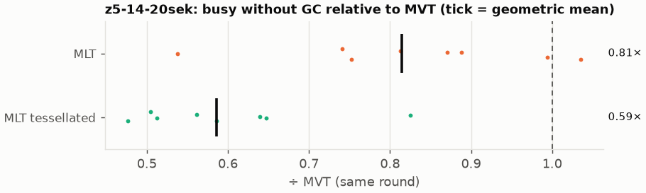
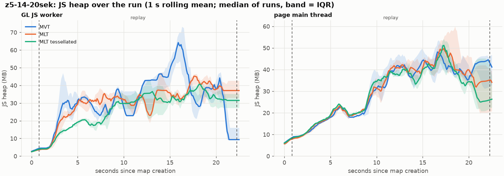
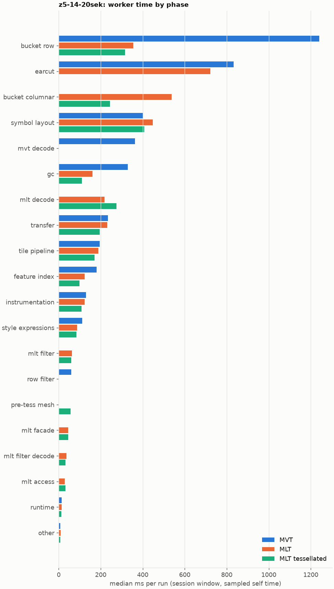
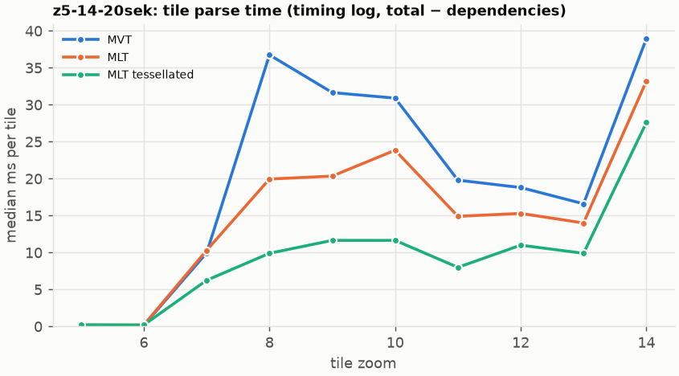
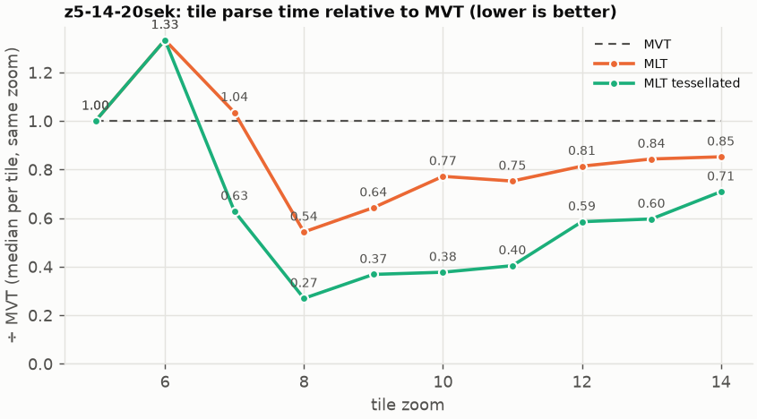

# Session trace benchmark — 20261023-100221

## Setup

- Created 2026-10-23T10:02:21+02:00; 8 repetitions + 1 warm-up round(s) (excluded); variants rotate per round (A B C, B C A, …); one cold browser context per run.
- Machine: 13th Gen Intel(R) Core(TM) i7-1365U, 12 logical cores, 31.3 GB RAM, Windows-11-10.0.26200-SP0; power: GUID des Energieschemas: 381b4222-f694-41f0-9685-ff5bb260df2e  (Ausbalanciert), AC True.
- GL JS gl7-performance-optimization @ f9bd50a8b5 (dirty); worker count 1; viewport {'width': 1280, 'height': 1024}.
- Python 3.12.2, packages {'playwright': '1.64.0', 'numpy': '2.5.3', 'matplotlib': '3.11.2'}.

| variant | bundle | format | bundle sha256 | branch build |
|---|---|---|---|---|
| MVT | `dist/maplibre-gl-dev.mjs` | mvt | `b2691453151d` | – |
| MLT | `dist/maplibre-gl-dev.mjs` | mlt | `b2691453151d` | – |
| MLT tessellated | `dist/maplibre-gl-dev.mjs` | mlt-pre-tess | `b2691453151d` | – |

| session | style | duration | frames | sha256 |
|---|---|---:|---:|---|
| z5-14-20sek | kernel-coverage (recorded: maptiler-basic) | 21.4 s | 829 | `5a376e5ede30` |

CPU sampling interval (median over runs): 596 µs.

## Definitions

- **busy** = wall time in which a GL JS worker thread runs a task (union of top-level task slices and GC slices on `DedicatedWorker thread`s), summed over workers. **GC** = union of `MinorGC`/`MajorGC`/`V8.GC*` slices on those threads. **busy without GC** = busy − GC (headline metric).
- **CPU** = thread time (`tdur`) of the same slices. Phase categories and functions come from the trace's CPU samples (self time), categorised by `config/categories.toml` (nearest matching frame, leaf to root).
- Windows: **load** = map creation → first idle; **session** = camera replay; **tail** = end of replay → idle; **total** = load + session + tail.
- Ratios are against **MVT**: ratio of medians with a bootstrap 95 % CI, the geometric mean of per-round ratios, and a two-sided Mann–Whitney U p-value (normal approximation, not corrected for multiple comparisons; rough below n = 8). Lower than 1× means less worker time.

## Session `z5-14-20sek`

### Worker busy without GC (session window)

| variant | n ok / failed | median ms | IQR | mean | ratio vs MVT | 95 % CI | geo-mean paired | MWU p |
|---|---:|---:|---:|---:|---:|---:|---:|---:|
| MVT | 8 / 0 | 4,100 | 3,609–4,956 | 4,365 | 1.00× | – | – | – |
| MLT | 8 / 0 | 3,554 | 3,001–4,155 | 3,543 | 0.87× | 0.60–1.12× | 0.81× | 0.128 |
| MLT tessellated | 8 / 0 | 2,391 | 2,282–2,795 | 2,536 | 0.58× | 0.44–0.75× | 0.59× | <0.001 |

### All worker metrics (median, ratio vs baseline)

| metric | MVT | MLT | MLT tessellated |
|---|---:|---:|---:|
| busy incl. GC | 4,368 | 3,717 (0.85×) | 2,489 (0.57×) |
| &nbsp;&nbsp;of which GC | 311.9 | 151.0 (0.48×) | 99.4 (0.32×) |
| &nbsp;&nbsp;of which busy without GC | 4,100 | 3,554 (0.87×) | 2,391 (0.58×) |
| &nbsp;&nbsp;&nbsp;&nbsp;of which filtering (sampled, incl. callees) | 60.5 | 63.8 (1.05×) | 59.6 (0.99×) |
| &nbsp;&nbsp;&nbsp;&nbsp;of which column decoding inside the MLT filter (sampled) | 0.0 | 36.8 | 32.6 |
| &nbsp;&nbsp;&nbsp;&nbsp;of which timing instrumentation (sampled) | 129.9 | 123.0 (0.95×) | 109.3 (0.84×) |
| busy without GC and instrumentation | 3,970 | 3,431 (0.86×) | 2,299 (0.58×) |
| CPU time without GC | 3,740 | 3,239 (0.87×) | 2,191 (0.59×) |
| tile: download end → sent to main thread, median per tile | 201.7 | 173.6 (0.86×) | 116.3 (0.58×) |
| tile: download end → sent to main thread, 90th percentile | 503.4 | 420.1 (0.83×) | 245.9 (0.49×) |
| tile: download end → sent to main thread, 95th percentile | 529.4 | 434.0 (0.82×) | 339.0 (0.64×) |
| tile: download end → sent to main thread, 99th percentile | 548.3 | 500.9 (0.91×) | 449.9 (0.82×) |
| &nbsp;&nbsp;parse part (timing log, incl. waiting for glyphs/icons), median per tile | 102.4 | 78.5 (0.77×) | 56.1 (0.55×) |
| &nbsp;&nbsp;queue + hand-off part, median per tile | 80.9 | 71.9 (0.89×) | 55.4 (0.68×) |
| minor GCs | 79.00 | 63.50 (0.80×) | 35.50 (0.45×) |
| major GCs | 8.00 | 3.00 (0.38×) | 3.00 (0.38×) |
| peak worker heap (MB) | 90.8 | 59.1 (0.65×) | 54.2 (0.60×) |
| load: busy without GC | 227.1 | 246.2 (1.08×) | 213.5 (0.94×) |
| load: GC | 8.1 | 6.6 (0.81×) | 6.5 (0.80×) |
| total: busy without GC | 4,312 | 3,798 (0.88×) | 2,604 (0.60×) |

Rows marked *of which* are parts of the row above, not additional time. Tile rows are per-tile latencies (medians over tiles, then over runs), not sums: tiles overlap in time, and the medians of the parse and queue parts do not add up exactly to the median latency.

### Filtering (session window)

Sampled worker time spent in feature filtering, including everything the filter calls (expression evaluation, property access): **row filter** = the style-spec feature filter that MVT runs per feature, **mlt filter** = the columnar MLT filter (incl. the geometry-type selection), without the columns it decodes (see the next table). Medians per run; rules in `config/categories.toml`.

| variant | mlt filter | row filter | filtering | ratio vs MVT | 95 % CI | MWU p | share of sampled busy |
|---|---:|---:|---:|---:|---:|---:|---:|
| MVT | 0.0 | 60.5 | 60.5 | 1.00× | – | – | 1.4% |
| MLT | 63.8 | 0.0 | 63.8 | 1.05× | 0.68–1.39× | 0.958 | 1.8% |
| MLT tessellated | 59.6 | 0.0 | 59.6 | 0.99× | 0.73–1.39× | 0.875 | 2.8% |

**Filtering together with tile decoding.** The MLT decoder leaves columns encoded until something reads them, and the filter is usually the first reader: the columns it decodes (properties, and the geometry for `$type`) are **of which inside the filter** (phase *mlt filter decode*), the rest is *mlt decode* (geometry and columns read later, e.g. by paint properties and symbols). MVT decodes every feature's properties and geometry while it reads the tile (*mvt decode*), whether the filter keeps the feature or not. So **filtering** above compares the filters, and **decoding + filtering** compares all that the formats spend on decoding the tile and selecting features. **tile decoding** = *mvt decode* or *mlt decode* + *mlt filter decode*: work inside a call into a decoder. Reading data that is already decoded is not counted, as for MVT's feature objects: *mlt access* (row views, value getters, looking a column up by name) and the MLT facade (*mlt facade*). MVT decodes geometry only for the features its filter keeps, MLT decodes a layer's whole geometry column.

| variant | tile decoding | of which inside the filter | filtering | decoding + filtering | ratio vs MVT | 95 % CI | MWU p |
|---|---:|---:|---:|---:|---:|---:|---:|
| MVT | 362.5 | 0.0 | 60.5 | 420.9 | 1.00× | – | – |
| MLT | 255.0 | 36.8 | 63.8 | 321.2 | 0.76× | 0.48–1.12× | 0.128 |
| MLT tessellated | 304.8 | 32.6 | 59.6 | 360.1 | 0.86× | 0.55–1.24× | 0.431 |

Top 12 functions inside filtering and its column decoding (self time, mean ms per run):

| phase | function | source | MVT | MLT | MLT tessellated |
|---|---|---|---:|---:|---:|
| row filter | `evaluate` | node_modules/@maplibre/maplibre-gl-style-spec/dist/expression/index.mjs | 22.9 | 0.0 | 0.0 |
| mlt filter decode | `decodeFsst` | maplibre-tile-spec/ts/dist/decoding/fsstDecoder.js | 0.0 | 12.6 | 12.8 |
| row filter | `evaluate` | node_modules/@maplibre/maplibre-gl-style-spec/dist/expression/definitions/comparison.mjs | 5.8 | 0.0 | 0.0 |
| row filter | `(anonymous)` | node_modules/@maplibre/maplibre-gl-style-spec/dist/expression/compound_expression.mjs | 5.8 | 0.0 | 0.0 |
| row filter | `evaluate` | node_modules/@maplibre/maplibre-gl-style-spec/dist/expression/compound_expression.mjs | 5.5 | 0.0 | 0.0 |
| row filter | `filter` | node_modules/@maplibre/maplibre-gl-style-spec/dist/feature_filter/index.mjs | 5.5 | 0.0 | 0.0 |
| mlt filter | `resolveDictionaryExecutor` | maplibre-tile-spec/ts/dist/processing/filter/execution/filterKernel.js | 0.0 | 4.5 | 3.9 |
| mlt filter | `filterByGeometryType` | maplibre-tile-spec/ts/dist/vector/geometry/geometryVector.js | 0.0 | 3.0 | 4.4 |
| mlt filter | `scanSelection` | maplibre-tile-spec/ts/dist/vector/filter/selectionVectorUtils.js | 0.0 | 3.9 | 4.0 |
| mlt filter | `scanDictionaryCodes` | maplibre-tile-spec/ts/dist/processing/filter/execution/filterKernel.js | 0.0 | 3.9 | 3.4 |
| mlt filter | `(anonymous)` | maplibre-tile-spec/ts/dist/processing/filter/execution/filterKernel.js | 0.0 | 3.7 | 3.4 |
| row filter | `get` | node_modules/@maplibre/maplibre-gl-style-spec/dist/expression/compound_expression.mjs | 3.6 | 0.0 | 0.0 |

### Where the variants differ from MVT (session window, mean ms per run)

Open **[flame.html](flame.html)** to explore the call tree interactively: pick a variant, compare it with MVT (red = more time at the same call path, blue = less), click a frame to zoom in, and read the phase and function breakdown under it. Without a comparison, frames are coloured by phase: filtering is green in both formats, and the columns the MLT filter decodes on first access (*mlt filter decode*) are MLT blue frames under the green filter. `flame/*.txt` open in https://www.speedscope.app.

#### MLT vs MVT

**By phase** (sampled self time; the Δ column sums to the difference in sampled busy time):

| phase | MVT | MLT | Δ |
|---|---:|---:|---:|
| bucket columnar | 0.0 | 545.3 | +545.3 |
| mlt decode | 0.0 | 228.9 | +228.9 |
| mlt filter | 0.1 | 60.3 | +60.1 |
| mlt facade | 0.4 | 47.4 | +46.9 |
| mlt filter decode | 0.0 | 36.3 | +36.3 |
| mlt access | 0.0 | 33.6 | +33.6 |
| other | 6.7 | 9.9 | +3.2 |
| symbol layout | 427.6 | 426.8 | -0.8 |
| runtime | 14.6 | 13.7 | -0.8 |
| tile pipeline | 202.9 | 189.5 | -13.5 |
| transfer | 250.3 | 224.6 | -25.7 |
| style expressions | 114.3 | 85.8 | -28.5 |
| instrumentation | 147.2 | 114.8 | -32.5 |
| row filter | 63.8 | 0.0 | -63.8 |
| feature index | 188.7 | 116.2 | -72.5 |
| earcut | 871.8 | 747.3 | -124.5 |
| gc | 324.4 | 161.9 | -162.4 |
| mvt decode | 393.2 | 0.0 | -393.2 |
| bucket row | 1,351 | 354.2 | -996.8 |

**By source layer** (timing log: createBucket + populate + addFeatures, summed over the style layers that use it; wall time, includes GC pauses; total Δ -826 ms):

| source layer | type | MVT | MLT | Δ |
|---|---|---:|---:|---:|
| transportation | line | 501.2 | 567.5 | +66.3 |
| transportation_name | line | 39.7 | 57.8 | +18.0 |
| boundary | line | 28.9 | 38.4 | +9.5 |
| housenumber | symbol | 226.0 | 235.0 | +8.9 |
| transportation_name | symbol | 212.9 | 221.1 | +8.2 |
| poi | symbol | 32.1 | 23.2 | -8.9 |
| housenumber | line | 21.6 | 6.3 | -15.3 |
| water | fill | 106.1 | 83.7 | -22.4 |
| poi | line | 92.5 | 34.2 | -58.3 |
| building | fill | 279.0 | 167.9 | -111.1 |
| landuse | fill | 815.6 | 493.1 | -322.4 |
| landcover | fill | 1,177 | 776.0 | -400.7 |

**Functions with the largest self-time difference** (by function name, summed over source files):

| function | MVT | MLT | Δ |
|---|---:|---:|---:|
| `readScaledRings` | 0.0 | 80.1 | +80.1 |
| `writeEarcutFill` | 0.0 | 60.4 | +60.4 |
| `buildEarcutMesh` | 0.0 | 45.0 | +45.0 |
| `decodeComponentwiseDeltaVec2` | 0.0 | 24.0 | +24.0 |
| `unpackNullable` | 0.0 | 20.7 | +20.7 |
| `scaleCheckedCoordinate` | 0.0 | 17.8 | +17.8 |
| `decodeFastPforInt32` | 0.0 | 14.3 | +14.3 |
| `decodeFsst` | 0.0 | 13.0 | +13.0 |
| `signedArea$1` | 0.0 | 12.6 | +12.6 |
| `decodeString$2` | 0.0 | 12.2 | +12.2 |
| `readVertices` | 0.0 | 10.4 | +10.4 |
| `appendSymbolFeature` | 0.0 | 10.3 | +10.3 |
| `_vertexToIndex` | 301.8 | 0.0 | -301.8 |
| `(garbage collector)` | 324.4 | 161.9 | -162.4 |
| `readSVarint` | 157.4 | 0.0 | -157.4 |
| `loadGeometry` | 125.8 | 21.4 | -104.4 |
| `isEar` | 283.2 | 194.5 | -88.6 |

#### MLT tessellated vs MVT

**By phase** (sampled self time; the Δ column sums to the difference in sampled busy time):

| phase | MVT | MLT tessellated | Δ |
|---|---:|---:|---:|
| mlt decode | 0.0 | 276.6 | +276.6 |
| bucket columnar | 0.0 | 261.5 | +261.5 |
| mlt filter | 0.1 | 62.5 | +62.3 |
| pre-tess mesh | 0.0 | 55.5 | +55.5 |
| mlt facade | 0.4 | 48.1 | +47.7 |
| mlt filter decode | 0.0 | 32.8 | +32.8 |
| mlt access | 0.0 | 31.7 | +31.7 |
| other | 6.7 | 7.7 | +1.0 |
| runtime | 14.6 | 12.3 | -2.3 |
| symbol layout | 427.6 | 418.1 | -9.6 |
| tile pipeline | 202.9 | 174.6 | -28.3 |
| style expressions | 114.3 | 84.1 | -30.2 |
| instrumentation | 147.2 | 112.5 | -34.8 |
| transfer | 250.3 | 202.7 | -47.6 |
| row filter | 63.8 | 0.0 | -63.8 |
| feature index | 188.7 | 100.5 | -88.2 |
| gc | 324.4 | 117.9 | -206.4 |
| mvt decode | 393.2 | 0.0 | -393.2 |
| earcut | 871.8 | 0.0 | -871.8 |
| bucket row | 1,351 | 339.0 | -1012.0 |

**By source layer** (timing log: createBucket + populate + addFeatures, summed over the style layers that use it; wall time, includes GC pauses; total Δ -1856 ms):

| source layer | type | MVT | MLT tessellated | Δ |
|---|---|---:|---:|---:|
| transportation | line | 501.2 | 567.2 | +65.9 |
| transportation_name | line | 39.7 | 59.4 | +19.6 |
| housenumber | symbol | 226.0 | 238.6 | +12.6 |
| boundary | line | 28.9 | 37.1 | +8.2 |
| transportation_name | symbol | 212.9 | 220.0 | +7.1 |
| poi | symbol | 32.1 | 22.5 | -9.6 |
| housenumber | line | 21.6 | 5.4 | -16.2 |
| poi | line | 92.5 | 31.6 | -60.9 |
| water | fill | 106.1 | 40.9 | -65.3 |
| building | fill | 279.0 | 60.3 | -218.8 |
| landuse | fill | 815.6 | 151.9 | -663.6 |
| landcover | fill | 1,177 | 243.4 | -933.4 |

**Functions with the largest self-time difference** (by function name, summed over source files):

| function | MVT | MLT tessellated | Δ |
|---|---:|---:|---:|
| `buildTessellatedBoundingBox` | 0.0 | 54.9 | +54.9 |
| `decodeUnsignedZigZagDeltaInt32` | 0.0 | 26.3 | +26.3 |
| `writeTessellatedFill` | 0.0 | 24.7 | +24.7 |
| `decodeComponentwiseDeltaVec2` | 0.0 | 20.0 | +20.0 |
| `appendScaledVertices` | 0.0 | 19.3 | +19.3 |
| `unpackNullable` | 0.0 | 16.6 | +16.6 |
| `decodeFastPforInt32` | 0.0 | 15.3 | +15.3 |
| `decodeFsst` | 0.0 | 13.0 | +13.0 |
| `decodeBigEndianInt32sInto` | 0.0 | 12.1 | +12.1 |
| `fastUnpack256_4` | 0.0 | 11.5 | +11.5 |
| `registerGlyphs` | 0.0 | 10.8 | +10.8 |
| `readGeometry` | 0.0 | 10.7 | +10.7 |
| `_vertexToIndex` | 301.8 | 0.0 | -301.8 |
| `isEar` | 283.2 | 0.0 | -283.2 |
| `(garbage collector)` | 324.4 | 117.9 | -206.4 |
| `isEarHashed` | 171.5 | 0.0 | -171.5 |
| `readSVarint` | 157.4 | 0.0 | -157.4 |

### Memory (session window)

**JS heap** = V8's used heap of the thread (`jsHeapSizeUsed` from the trace's `UpdateCounters`, about every 20 ms; the mean is time-weighted). It does not include ArrayBuffer contents, so the tile data itself (vertex, index and feature-index arrays) is not in it: **tile data sent to the main thread** is the size of the ArrayBuffers each tile result transfers (`web/worker_hook.js`), which then live on the main thread and are uploaded to the GPU. **garbage collected** = heap freed by the worker's GCs, a measure of how much it allocates. Medians per run; ratio of medians with a bootstrap 95 % CI.

| metric | MVT | MLT | MLT tessellated |
|---|---:|---:|---:|
| worker JS heap, mean (MB) | 27.1 | 25.5 (0.94×, 0.87–1.11×) | 23.6 (0.87×, 0.78–1.05×) |
| worker JS heap, peak (MB) | 90.8 | 59.1 (0.65×, 0.57–0.84×) | 54.2 (0.60×, 0.51–0.77×) |
| worker JS heap after the last GC (MB) | 8.7 | 27.6 (3.16×, 1.83–3.38×) | 24.0 (2.75×, 1.74–3.08×) |
| garbage collected in the worker (MB) | 1,899 | 1,182 (0.62×, 0.61–0.63×) | 501.4 (0.26×, 0.26–0.27×) |
| main thread JS heap, mean (MB) | 27.6 | 28.1 (1.02×, 0.83–1.09×) | 27.1 (0.98×, 0.82–1.08×) |
| main thread JS heap, peak (MB) | 60.7 | 63.0 (1.04×, 0.78–1.29×) | 60.7 (1.00×, 0.77–1.20×) |
| main thread JS heap at the end of the replay (MB) | 44.0 | 34.9 (0.79×, 0.44–1.37×) | 25.7 (0.58×, 0.46–1.31×) |
| tile data sent to the main thread, total (MB) | 115.9 | 110.8 (0.96×, 0.95–0.97×) | 110.4 (0.95×, 0.95–0.96×) |
| tile data sent to the main thread, median per tile (KB) | 726.7 | 694.4 (0.96×, 0.94–1.00×) | 692.0 (0.95×, 0.94–0.99×) |

### Worker time by phase (session window, median ms of sampled self time)

| phase | MVT | MLT | MLT tessellated |
|---|---:|---:|---:|
| bucket row | 1,240 | 354.2 | 315.0 |
| earcut | 832.9 | 722.0 | 0.0 |
| bucket columnar | 0.0 | 537.3 | 243.8 |
| symbol layout | 402.7 | 447.5 | 407.0 |
| mvt decode | 362.5 | 0.0 | 0.0 |
| gc | 328.6 | 161.0 | 110.8 |
| mlt decode | 0.0 | 218.1 | 275.6 |
| transfer | 234.7 | 230.9 | 194.7 |
| tile pipeline | 195.2 | 189.2 | 170.1 |
| feature index | 180.7 | 122.7 | 98.3 |
| instrumentation | 129.9 | 123.0 | 109.3 |
| style expressions | 112.6 | 88.3 | 84.4 |
| mlt filter | 0.0 | 63.8 | 59.6 |
| row filter | 60.5 | 0.0 | 0.0 |
| pre-tess mesh | 0.0 | 0.0 | 55.7 |
| mlt facade | 0.6 | 44.8 | 44.9 |
| mlt filter decode | 0.0 | 36.8 | 32.6 |
| mlt access | 0.0 | 28.7 | 31.8 |
| runtime | 14.2 | 13.7 | 12.0 |
| other | 6.8 | 9.2 | 7.0 |

### Top 20 worker functions by self time (session window, mean ms per run)

| function | source | phase | MVT | MLT | MLT tessellated |
|---|---|---|---:|---:|---:|
| `(garbage collector)` | (native) | gc | 324.4 | 161.9 | 117.9 |
| `_vertexToIndex` | src/render/subdivision.ts | bucket row | 301.8 | 0.0 | 0.0 |
| `isEar` | node_modules/earcut/src/earcut.js | earcut | 283.2 | 194.5 | 0.0 |
| `isEarHashed` | node_modules/earcut/src/earcut.js | earcut | 171.5 | 131.9 | 0.0 |
| `reserve` | src/util/struct_array.ts | feature index | 161.2 | 119.0 | 113.7 |
| `readSVarint` | node_modules/pbf/index.js | mvt decode | 157.4 | 0.0 | 0.0 |
| `emplace` | src/data/array_types.g.ts | bucket row | 121.8 | 127.0 | 110.5 |
| `populate` | src/data/bucket/line_bucket.ts | bucket row | 108.3 | 0.0 | 0.0 |
| `insert` | src/data/feature_index.ts | feature index | 89.3 | 30.8 | 25.1 |
| `addPhase` | src/source/worker_timing.ts | instrumentation | 87.6 | 57.7 | 57.5 |
| `readVarint` | node_modules/pbf/index.js | mvt decode | 81.4 | 0.0 | 0.0 |
| `readScaledRings` | src/data/bucket/columnar/columnar_mesh_arrays.ts | bucket columnar | 0.0 | 80.1 | 0.0 |
| `earcutLinked` | node_modules/earcut/src/earcut.js | earcut | 77.7 | 70.0 | 0.0 |
| `postMessage` | (native) | transfer | 74.7 | 76.8 | 75.2 |
| `_trim` | src/util/struct_array.ts | transfer | 75.2 | 51.6 | 38.3 |
| `fetch` | (native) | tile pipeline | 61.7 | 63.5 | 64.1 |
| `loadGeometry` | node_modules/@mapbox/vector-tile/index.js | mvt decode | 64.0 | 0.0 | 0.0 |
| `populate` | src/data/bucket/columnar/columnar_line_bucket.ts | bucket columnar | 0.0 | 61.8 | 59.7 |
| `loadGeometry` | src/data/load_geometry.ts | bucket row | 61.8 | 19.0 | 19.3 |
| `writeEarcutFill` | src/data/bucket/columnar/columnar_mesh_arrays.ts | bucket columnar | 0.0 | 60.4 | 0.0 |

### Top 20 worker functions by total time (incl. callees) (session window, mean ms per run)

| function | source | phase | MVT | MLT | MLT tessellated |
|---|---|---|---:|---:|---:|
| `parse` | src/source/worker_tile.ts | tile pipeline | 3,588 | 2,866 | 1,883 |
| `loadTile` | src/source/vector_tile_worker_source.ts | tile pipeline | 3,264 | 2,505 | 1,526 |
| `_parseWorkerTile` | src/source/vector_tile_worker_source.ts | tile pipeline | 3,155 | 2,437 | 1,458 |
| `populate` | src/data/bucket/fill_bucket.ts | bucket row | 2,126 | 0.0 | 0.0 |
| `addBucketFeatures` | src/data/bucket/fill_bucket.ts | bucket row | 1,806 | 1,222 | 156.0 |
| `addFeature` | src/data/bucket/fill_bucket.ts | bucket row | 1,696 | 0.0 | 0.0 |
| `subdividePolygon` | src/render/subdivision.ts | bucket row | 1,434 | 0.0 | 0.0 |
| `subdividePolygonInternal` | src/render/subdivision.ts | bucket row | 1,421 | 0.0 | 0.0 |
| `populate` | src/data/bucket/columnar/columnar_fill_bucket.ts | bucket columnar | 0.0 | 1,373 | 447.6 |
| `addFeature` | src/data/bucket/columnar/columnar_fill_bucket.ts | bucket columnar | 0.0 | 1,182 | 133.1 |
| `writeEarcutFill` | src/data/bucket/columnar/columnar_mesh_arrays.ts | bucket columnar | 0.0 | 1,167 | 0.0 |
| `earcut` | node_modules/earcut/src/earcut.js | earcut | 871.1 | 746.1 | 0.0 |
| `buildEarcutMesh` | src/data/bucket/columnar/columnar_mesh_arrays.ts | bucket columnar | 0.0 | 827.8 | 0.0 |
| `earcutLinked` | node_modules/earcut/src/earcut.js | earcut | 708.0 | 584.1 | 0.0 |
| `populate` | src/data/bucket/columnar/columnar_line_bucket.ts | bucket columnar | 0.0 | 668.6 | 654.2 |
| `populate` | src/data/bucket/line_bucket.ts | bucket row | 629.3 | 0.0 | 0.0 |
| `addFeatures` | src/data/bucket/symbol_bucket.ts | symbol layout | 379.8 | 380.8 | 373.7 |
| `performSymbolLayout` | src/symbol/symbol_layout.ts | symbol layout | 373.7 | 374.6 | 369.3 |
| `loadGeometry` | src/data/load_geometry.ts | bucket row | 372.6 | 56.2 | 56.0 |
| `processTask` | src/util/actor.ts | transfer | 332.7 | 296.4 | 273.8 |

### Tile parse time by zoom (timing log, median ms per tile, total − dependencies)

| zoom | MVT | MLT | MLT tessellated |
|---:|---:|---:|---:|
| 5 | 0.20 (n=72) | 0.20 (n=72) | 0.20 (n=72) |
| 6 | 0.15 (n=72) | 0.20 (n=72) | 0.20 (n=72) |
| 7 | 9.95 (n=48) | 10.30 (n=48) | 6.25 (n=48) |
| 8 | 36.75 (n=40) | 19.95 (n=50) | 9.90 (n=59) |
| 9 | 31.65 (n=128) | 20.35 (n=128) | 11.65 (n=128) |
| 10 | 30.90 (n=160) | 23.85 (n=160) | 11.65 (n=160) |
| 11 | 19.80 (n=121) | 14.90 (n=122) | 8.00 (n=120) |
| 12 | 18.80 (n=169) | 15.30 (n=169) | 11.00 (n=166) |
| 13 | 16.60 (n=171) | 14.00 (n=168) | 9.90 (n=168) |
| 14 | 38.95 (n=144) | 33.20 (n=144) | 27.60 (n=144) |

### Tile latency by zoom: download end → result sent to the main thread (session window, ms per tile: median / p95 / p99)

Includes waiting in the worker's queue, the parse and posting the result; see `tile_latency.csv` for the per-tile split (`parse_ms`, `wait_ms`). Percentiles over the tiles of all runs; with few tiles (n) p99 is close to the maximum.

| zoom | MVT | MLT | MLT tessellated |
|---:|---:|---:|---:|
| 6 | 72.8 / 143.3 / 151.7 (n=72) | 66.5 / 126.3 / 154.4 (n=72) | 52.6 / 94.4 / 97.4 (n=72) |
| 7 | 196.4 / 308.7 / 447.0 (n=48) | 137.1 / 222.0 / 344.4 (n=48) | 85.7 / 104.8 / 106.6 (n=48) |
| 8 | 298.5 / 394.6 / 408.4 (n=40) | 221.4 / 275.5 / 289.4 (n=50) | 126.1 / 152.5 / 163.6 (n=59) |
| 9 | 374.2 / 623.6 / 645.2 (n=128) | 258.6 / 443.6 / 453.4 (n=128) | 143.4 / 245.6 / 261.0 (n=128) |
| 10 | 391.6 / 734.1 / 750.7 (n=160) | 323.2 / 548.5 / 566.5 (n=160) | 188.5 / 279.5 / 284.8 (n=160) |
| 11 | 161.9 / 325.4 / 336.3 (n=121) | 128.7 / 235.4 / 239.3 (n=122) | 93.6 / 133.9 / 141.9 (n=120) |
| 12 | 124.8 / 368.6 / 450.2 (n=169) | 117.7 / 330.5 / 351.0 (n=169) | 66.8 / 268.5 / 329.8 (n=166) |
| 13 | 194.4 / 381.2 / 398.9 (n=171) | 143.1 / 304.9 / 342.5 (n=168) | 125.6 / 286.0 / 308.3 (n=168) |
| 14 | 389.5 / 710.3 / 810.8 (n=144) | 289.3 / 568.0 / 648.1 (n=144) | 268.3 / 510.7 / 582.0 (n=144) |

## Runs

27 ok, 0 failed/aborted, 0 not run, 24 used in statistics.

## Validity checks

- Counted once: all 27 analysed runs pass (windows load + session + tail add up to total; phases add up to the sampled busy time; GC and sampled time lie within busy time; no timing-log line twice).
- outlier runs left out of all statistics: busy without GC (session) more than 1.5 × IQR outside the quartiles of its session and variant (groups of at least 4 runs): none
- other programs used 3.22–9.24 logical processors during the replays (median 5.60)
- 24 run(s) with more than 0.5 cores of background load: z5-14-20sek/mlt/rep-01 (4.11), z5-14-20sek/mlt-pre-tess/rep-01 (6.46), z5-14-20sek/mvt/rep-01 (7.06), z5-14-20sek/mlt-pre-tess/rep-02 (7.19), z5-14-20sek/mvt/rep-02 (9.24), z5-14-20sek/mlt/rep-02 (8.11)
- 6 of 9 rounds parsed different tile sets across variants (e.g. z5-14-20sek round 1: mlt 134 tiles, mlt-pre-tess 128 tiles, mvt 123 tiles; z5-14-20sek round 3: mvt 123 tiles, mlt 125 tiles, mlt-pre-tess 130 tiles; z5-14-20sek round 4: mlt 125 tiles, mlt-pre-tess 129 tiles, mvt 126 tiles; z5-14-20sek round 5: mlt-pre-tess 128 tiles, mvt 126 tiles, mlt 129 tiles; z5-14-20sek round 6: mvt 129 tiles, mlt 129 tiles, mlt-pre-tess 134 tiles); no run went past z14, so this is timing: which tiles finish loading before the camera moves on, and which get cancelled; compare per-tile metrics (by zoom) rather than totals when the counts differ a lot

## Files

- `runs.csv`: one row per run (incl. failed and warm-up runs), every scalar metric as `<window>.<metric>`.
- `summary.csv`: session × variant × metric statistics.
- `functions.csv`, `categories.csv`: CPU-sample self/total time per function and phase per run and window.
- `category_functions.csv`: self time per phase × function (e.g. what the filters spend their time on).
- `tiles.csv`, `tile_layers.csv`, `tile_phases.csv`: the per-tile worker timing log, long format.
- `flame.html`: interactive call tree per variant with a diff view; `flame/*.txt`: collapsed stacks for speedscope.
- `analysis/stacks.csv` (per run): sampled self time per full call stack.
- `tile_latency.csv`: per tile request, worker clock: received, download start/end, result sent, latency = sent − download end, parse_ms, wait_ms = latency − parse.
- `runs/<session>/<variant>/rep-NN/trace.json.gz`: the raw trace (opens in the DevTools Performance tab).
