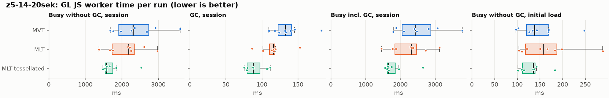
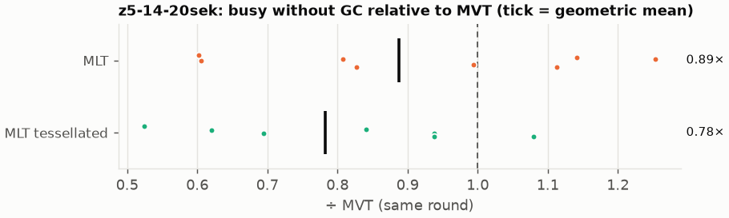
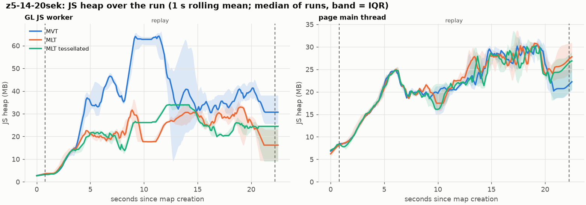
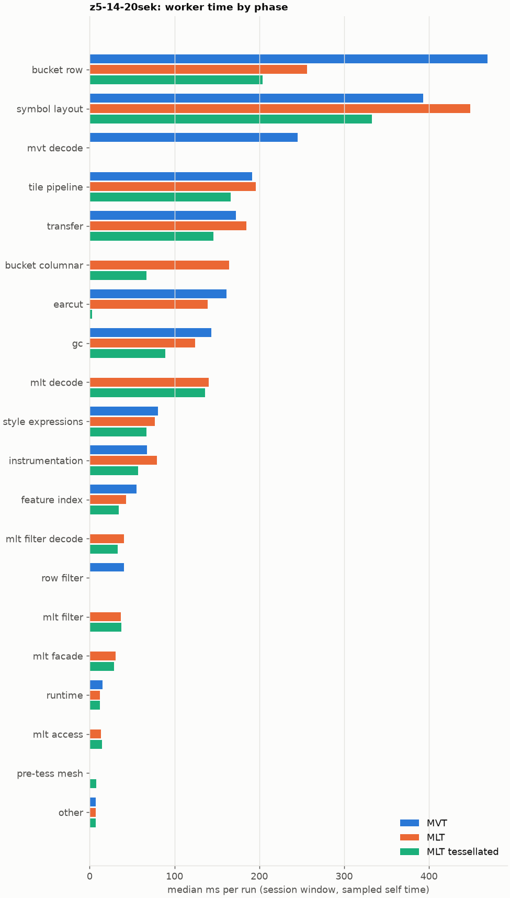
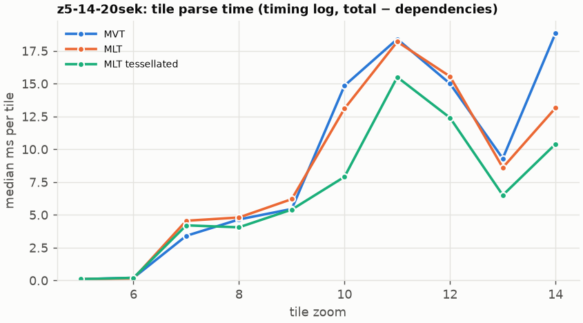
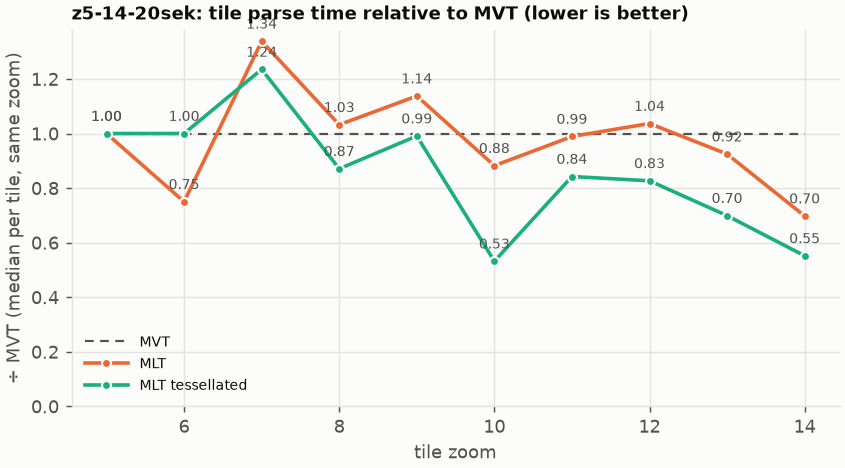

# Session trace benchmark — 20261023-104713

## Setup

- Created 2026-10-23T10:47:13+02:00; 8 repetitions + 1 warm-up round(s) (excluded); variants rotate per round (A B C, B C A, …); one cold browser context per run.
- Machine: 13th Gen Intel(R) Core(TM) i7-1365U, 12 logical cores, 31.3 GB RAM, Windows-11-10.0.26200-SP0; power: GUID des Energieschemas: 381b4222-f694-41f0-9685-ff5bb260df2e  (Ausbalanciert), AC True.
- GL JS gl7-performance-optimization @ f9bd50a8b5 (dirty); worker count 1; viewport {'width': 1280, 'height': 1024}.
- Python 3.12.2, packages {'playwright': '1.64.0', 'numpy': '2.5.3', 'matplotlib': '3.11.2'}.

| variant | bundle | format | bundle sha256 | branch build |
|---|---|---|---|---|
| MVT | `dist/maplibre-gl-dev.mjs` | mvt | `b2691453151d` | – |
| MLT | `dist/maplibre-gl-dev.mjs` | mlt | `b2691453151d` | – |
| MLT tessellated | `dist/maplibre-gl-dev.mjs` | mlt-pre-tess | `b2691453151d` | – |

| session | style | duration | frames | sha256 |
|---|---|---:|---:|---|
| z5-14-20sek | toner (recorded: maptiler-basic) | 21.4 s | 829 | `5a376e5ede30` |

CPU sampling interval (median over runs): 575 µs.

## Definitions

- **busy** = wall time in which a GL JS worker thread runs a task (union of top-level task slices and GC slices on `DedicatedWorker thread`s), summed over workers. **GC** = union of `MinorGC`/`MajorGC`/`V8.GC*` slices on those threads. **busy without GC** = busy − GC (headline metric).
- **CPU** = thread time (`tdur`) of the same slices. Phase categories and functions come from the trace's CPU samples (self time), categorised by `config/categories.toml` (nearest matching frame, leaf to root).
- Windows: **load** = map creation → first idle; **session** = camera replay; **tail** = end of replay → idle; **total** = load + session + tail.
- Ratios are against **MVT**: ratio of medians with a bootstrap 95 % CI, the geometric mean of per-round ratios, and a two-sided Mann–Whitney U p-value (normal approximation, not corrected for multiple comparisons; rough below n = 8). Lower than 1× means less worker time.

## Session `z5-14-20sek`

### Worker busy without GC (session window)

| variant | n ok / failed | median ms | IQR | mean | ratio vs MVT | 95 % CI | geo-mean paired | MWU p |
|---|---:|---:|---:|---:|---:|---:|---:|---:|
| MVT | 8 / 0 | 2,306 | 1,919–2,742 | 2,404 | 1.00× | – | – | – |
| MLT | 8 / 0 | 2,190 | 1,737–2,341 | 2,128 | 0.95× | 0.65–1.24× | 0.89× | 0.318 |
| MLT tessellated | 7 / 0 | 1,580 | 1,551–1,757 | 1,745 | 0.69× | 0.55–0.94× | 0.78× | 0.018 |

### All worker metrics (median, ratio vs baseline)

| metric | MVT | MLT | MLT tessellated |
|---|---:|---:|---:|
| busy incl. GC | 2,438 | 2,308 (0.95×) | 1,660 (0.68×) |
| &nbsp;&nbsp;of which GC | 132.5 | 116.4 (0.88×) | 87.6 (0.66×) |
| &nbsp;&nbsp;of which busy without GC | 2,306 | 2,190 (0.95×) | 1,580 (0.69×) |
| &nbsp;&nbsp;&nbsp;&nbsp;of which filtering (sampled, incl. callees) | 40.4 | 37.0 (0.92×) | 37.4 (0.93×) |
| &nbsp;&nbsp;&nbsp;&nbsp;of which column decoding inside the MLT filter (sampled) | 0.0 | 40.7 | 33.2 |
| &nbsp;&nbsp;&nbsp;&nbsp;of which timing instrumentation (sampled) | 67.7 | 79.3 (1.17×) | 57.3 (0.85×) |
| busy without GC and instrumentation | 2,237 | 2,111 (0.94×) | 1,525 (0.68×) |
| CPU time without GC | 2,102 | 2,015 (0.96×) | 1,464 (0.70×) |
| tile: download end → sent to main thread, median per tile | 106.2 | 93.5 (0.88×) | 81.7 (0.77×) |
| tile: download end → sent to main thread, 90th percentile | 213.3 | 213.4 (1.00×) | 149.5 (0.70×) |
| tile: download end → sent to main thread, 95th percentile | 242.2 | 233.1 (0.96×) | 156.6 (0.65×) |
| tile: download end → sent to main thread, 99th percentile | 280.0 | 261.0 (0.93×) | 171.3 (0.61×) |
| &nbsp;&nbsp;parse part (timing log, incl. waiting for glyphs/icons), median per tile | 61.9 | 54.9 (0.89×) | 44.4 (0.72×) |
| &nbsp;&nbsp;queue + hand-off part, median per tile | 36.2 | 32.6 (0.90×) | 30.7 (0.85×) |
| minor GCs | 42.50 | 37.00 (0.87×) | 32.00 (0.75×) |
| major GCs | 3.00 | 7.00 (2.33×) | 6.00 (2.00×) |
| peak worker heap (MB) | 79.8 | 48.1 (0.60×) | 40.8 (0.51×) |
| load: busy without GC | 138.3 | 158.3 (1.14×) | 135.1 (0.98×) |
| load: GC | 3.9 | 4.1 (1.06×) | 3.5 (0.89×) |
| total: busy without GC | 2,442 | 2,334 (0.96×) | 1,709 (0.70×) |

Rows marked *of which* are parts of the row above, not additional time. Tile rows are per-tile latencies (medians over tiles, then over runs), not sums: tiles overlap in time, and the medians of the parse and queue parts do not add up exactly to the median latency.

### Filtering (session window)

Sampled worker time spent in feature filtering, including everything the filter calls (expression evaluation, property access): **row filter** = the style-spec feature filter that MVT runs per feature, **mlt filter** = the columnar MLT filter (incl. the geometry-type selection), without the columns it decodes (see the next table). Medians per run; rules in `config/categories.toml`.

| variant | mlt filter | row filter | filtering | ratio vs MVT | 95 % CI | MWU p | share of sampled busy |
|---|---:|---:|---:|---:|---:|---:|---:|
| MVT | 0.0 | 40.4 | 40.4 | 1.00× | – | – | 2.0% |
| MLT | 37.0 | 0.0 | 37.0 | 0.92× | 0.54–1.42× | 0.564 | 1.9% |
| MLT tessellated | 37.4 | 0.0 | 37.4 | 0.93× | 0.56–1.27× | 0.685 | 2.6% |

**Filtering together with tile decoding.** The MLT decoder leaves columns encoded until something reads them, and the filter is usually the first reader: the columns it decodes (properties, and the geometry for `$type`) are **of which inside the filter** (phase *mlt filter decode*), the rest is *mlt decode* (geometry and columns read later, e.g. by paint properties and symbols). MVT decodes every feature's properties and geometry while it reads the tile (*mvt decode*), whether the filter keeps the feature or not. So **filtering** above compares the filters, and **decoding + filtering** compares all that the formats spend on decoding the tile and selecting features. **tile decoding** = *mvt decode* or *mlt decode* + *mlt filter decode*: work inside a call into a decoder. Reading data that is already decoded is not counted, as for MVT's feature objects: *mlt access* (row views, value getters, looking a column up by name) and the MLT facade (*mlt facade*). MVT decodes geometry only for the features its filter keeps, MLT decodes a layer's whole geometry column.

| variant | tile decoding | of which inside the filter | filtering | decoding + filtering | ratio vs MVT | 95 % CI | MWU p |
|---|---:|---:|---:|---:|---:|---:|---:|
| MVT | 244.9 | 0.0 | 40.4 | 313.7 | 1.00× | – | – |
| MLT | 181.7 | 40.7 | 37.0 | 218.6 | 0.70× | 0.34–1.21× | 0.189 |
| MLT tessellated | 169.5 | 33.2 | 37.4 | 206.9 | 0.66× | 0.36–1.16× | 0.385 |

Top 12 functions inside filtering and its column decoding (self time, mean ms per run):

| phase | function | source | MVT | MLT | MLT tessellated |
|---|---|---|---:|---:|---:|
| row filter | `evaluate` | node_modules/@maplibre/maplibre-gl-style-spec/dist/expression/index.mjs | 11.0 | 0.0 | 0.0 |
| mlt filter decode | `unpackNullable` | maplibre-tile-spec/ts/dist/decoding/unpackNullableUtils.js | 0.0 | 10.9 | 9.0 |
| row filter | `evaluate` | node_modules/@maplibre/maplibre-gl-style-spec/dist/expression/compound_expression.mjs | 10.3 | 0.0 | 0.0 |
| row filter | `CompoundExpression.register.filter-in-small` | node_modules/@maplibre/maplibre-gl-style-spec/dist/expression/compound_expression.mjs | 9.2 | 0.0 | 0.0 |
| mlt filter decode | `decodeFsst` | maplibre-tile-spec/ts/dist/decoding/fsstDecoder.js | 0.0 | 4.6 | 4.6 |
| row filter | `filter` | node_modules/@maplibre/maplibre-gl-style-spec/dist/feature_filter/index.mjs | 4.5 | 0.0 | 0.0 |
| mlt filter | `filterByGeometryType` | maplibre-tile-spec/ts/dist/vector/geometry/geometryVector.js | 0.0 | 3.8 | 4.2 |
| row filter | `CompoundExpression.register.filter-type-==` | node_modules/@maplibre/maplibre-gl-style-spec/dist/expression/compound_expression.mjs | 3.4 | 0.0 | 0.0 |
| mlt filter | `scanDictionaryCodes` | maplibre-tile-spec/ts/dist/processing/filter/execution/filterKernel.js | 0.0 | 3.4 | 2.6 |
| mlt filter | `dictionaryRowMatches` | maplibre-tile-spec/ts/dist/processing/filter/execution/filterKernel.js | 0.0 | 3.2 | 2.6 |
| row filter | `CompoundExpression.register.filter-==` | node_modules/@maplibre/maplibre-gl-style-spec/dist/expression/compound_expression.mjs | 2.9 | 0.0 | 0.0 |
| mlt filter decode | `decodeLazyColumn` | maplibre-tile-spec/ts/dist/vector/lazyPropertyVectors.js | 0.0 | 2.9 | 2.8 |

### Where the variants differ from MVT (session window, mean ms per run)

Open **[flame.html](flame.html)** to explore the call tree interactively: pick a variant, compare it with MVT (red = more time at the same call path, blue = less), click a frame to zoom in, and read the phase and function breakdown under it. Without a comparison, frames are coloured by phase: filtering is green in both formats, and the columns the MLT filter decodes on first access (*mlt filter decode*) are MLT blue frames under the green filter. `flame/*.txt` open in https://www.speedscope.app.

#### MLT vs MVT

**By phase** (sampled self time; the Δ column sums to the difference in sampled busy time):

| phase | MVT | MLT | Δ |
|---|---:|---:|---:|
| bucket columnar | 0.0 | 167.3 | +167.3 |
| mlt decode | 0.0 | 132.6 | +132.6 |
| mlt filter decode | 0.0 | 42.0 | +42.0 |
| mlt filter | 0.3 | 39.0 | +38.7 |
| mlt facade | 0.3 | 29.0 | +28.7 |
| symbol layout | 415.0 | 433.4 | +18.4 |
| mlt access | 0.0 | 16.2 | +16.2 |
| instrumentation | 71.5 | 77.8 | +6.3 |
| transfer | 181.1 | 181.7 | +0.6 |
| runtime | 17.1 | 12.8 | -4.3 |
| style expressions | 88.2 | 80.9 | -7.2 |
| feature index | 59.3 | 46.4 | -12.9 |
| tile pipeline | 205.0 | 190.8 | -14.2 |
| gc | 142.4 | 121.6 | -20.8 |
| earcut | 171.3 | 136.7 | -34.6 |
| row filter | 48.6 | 0.0 | -48.6 |
| bucket row | 516.1 | 257.6 | -258.5 |
| mvt decode | 324.8 | 0.0 | -324.8 |

**By source layer** (timing log: createBucket + populate + addFeatures, summed over the style layers that use it; wall time, includes GC pauses; total Δ -193 ms):

| source layer | type | MVT | MLT | Δ |
|---|---|---:|---:|---:|
| place | symbol | 186.5 | 231.8 | +45.3 |
| landuse | fill | 17.5 | 43.4 | +25.9 |
| park | symbol | 218.3 | 234.5 | +16.2 |
| transportation | fill | 18.7 | 33.7 | +15.0 |
| boundary | line | 27.3 | 29.9 | +2.7 |
| waterway | line | 11.7 | 13.7 | +1.9 |
| water_name | symbol | 27.3 | 28.4 | +1.1 |
| transportation_name | symbol | 66.9 | 63.6 | -3.3 |
| water | fill | 73.1 | 49.6 | -23.5 |
| building | fill | 155.6 | 72.8 | -82.8 |
| transportation | line | 465.2 | 381.5 | -83.7 |
| landcover | fill | 326.3 | 218.8 | -107.5 |

**Functions with the largest self-time difference** (by function name, summed over source files):

| function | MVT | MLT | Δ |
|---|---:|---:|---:|
| `decodeComponentwiseDeltaVec2` | 0.0 | 16.9 | +16.9 |
| `writeEarcutFill` | 0.0 | 14.0 | +14.0 |
| `readScaledRings` | 0.0 | 14.0 | +14.0 |
| `unpackNullable` | 0.0 | 13.2 | +13.2 |
| `buildRingBoundingBoxes` | 0.0 | 12.9 | +12.9 |
| `buildEarcutMesh` | 0.0 | 10.9 | +10.9 |
| `decodeFastPforInt32` | 0.0 | 9.5 | +9.5 |
| `decodeString$2` | 0.0 | 9.1 | +9.1 |
| `registerGlyphs` | 0.0 | 8.3 | +8.3 |
| `distToSegmentSquared` | 40.2 | 47.2 | +7.0 |
| `get` | 12.3 | 19.2 | +6.9 |
| `materializeSelectedFeatures` | 0.0 | 6.8 | +6.8 |
| `readSVarint` | 146.2 | 0.0 | -146.2 |
| `loadGeometry` | 101.8 | 8.1 | -93.7 |
| `_vertexToIndex` | 60.3 | 0.0 | -60.3 |
| `readVarint` | 35.2 | 1.9 | -33.3 |
| `readString` | 26.5 | 0.0 | -26.5 |

#### MLT tessellated vs MVT

**By phase** (sampled self time; the Δ column sums to the difference in sampled busy time):

| phase | MVT | MLT tessellated | Δ |
|---|---:|---:|---:|
| mlt decode | 0.0 | 147.8 | +147.8 |
| bucket columnar | 0.0 | 72.6 | +72.6 |
| mlt filter | 0.3 | 40.3 | +39.9 |
| mlt filter decode | 0.0 | 39.3 | +39.3 |
| mlt facade | 0.3 | 27.4 | +27.1 |
| mlt access | 0.0 | 17.7 | +17.7 |
| pre-tess mesh | 0.0 | 9.6 | +9.6 |
| other | 7.4 | 6.8 | -0.6 |
| runtime | 17.1 | 13.1 | -4.0 |
| instrumentation | 71.5 | 62.9 | -8.6 |
| style expressions | 88.2 | 70.4 | -17.8 |
| feature index | 59.3 | 37.8 | -21.4 |
| tile pipeline | 205.0 | 178.3 | -26.8 |
| transfer | 181.1 | 150.7 | -30.5 |
| symbol layout | 415.0 | 375.3 | -39.7 |
| row filter | 48.6 | 0.0 | -48.6 |
| gc | 142.4 | 91.6 | -50.8 |
| earcut | 171.3 | 2.9 | -168.3 |
| bucket row | 516.1 | 222.5 | -293.7 |
| mvt decode | 324.8 | 0.0 | -324.8 |

**By source layer** (timing log: createBucket + populate + addFeatures, summed over the style layers that use it; wall time, includes GC pauses; total Δ -523 ms):

| source layer | type | MVT | MLT tessellated | Δ |
|---|---|---:|---:|---:|
| landuse | fill | 17.5 | 51.4 | +33.9 |
| transportation | fill | 18.7 | 32.5 | +13.8 |
| place | symbol | 186.5 | 199.5 | +13.0 |
| boundary | line | 27.3 | 27.7 | +0.4 |
| waterway | symbol | 7.8 | 7.3 | -0.5 |
| water_name | symbol | 27.3 | 26.7 | -0.5 |
| transportation_name | symbol | 66.9 | 63.9 | -3.0 |
| park | symbol | 218.3 | 199.0 | -19.3 |
| water | fill | 73.1 | 24.5 | -48.6 |
| transportation | line | 465.2 | 337.3 | -127.9 |
| building | fill | 155.6 | 23.3 | -132.3 |
| landcover | fill | 326.3 | 74.8 | -251.4 |

**Functions with the largest self-time difference** (by function name, summed over source files):

| function | MVT | MLT tessellated | Δ |
|---|---:|---:|---:|
| `decodeUnsignedZigZagDeltaInt32` | 0.0 | 13.6 | +13.6 |
| `decodeComponentwiseDeltaVec2` | 0.0 | 13.1 | +13.1 |
| `unpackNullable` | 0.0 | 11.5 | +11.5 |
| `decodeFastPforInt32` | 0.0 | 10.8 | +10.8 |
| `buildTessellatedBoundingBox` | 0.0 | 9.6 | +9.6 |
| `decodeString$2` | 0.0 | 8.7 | +8.7 |
| `decodeBigEndianInt32sInto` | 0.0 | 7.0 | +7.0 |
| `registerGlyphs` | 0.0 | 6.9 | +6.9 |
| `readGeometry` | 0.0 | 6.5 | +6.5 |
| `materializeSelectedFeatures` | 0.0 | 6.1 | +6.1 |
| `fastUnpack256_4` | 0.0 | 6.0 | +6.0 |
| `readVertices` | 0.0 | 5.6 | +5.6 |
| `readSVarint` | 146.2 | 0.0 | -146.2 |
| `loadGeometry` | 101.8 | 8.5 | -93.2 |
| `_vertexToIndex` | 60.3 | 0.0 | -60.3 |
| `(garbage collector)` | 142.4 | 91.6 | -50.8 |
| `isEar` | 40.4 | 0.4 | -40.0 |

### Memory (session window)

**JS heap** = V8's used heap of the thread (`jsHeapSizeUsed` from the trace's `UpdateCounters`, about every 20 ms; the mean is time-weighted). It does not include ArrayBuffer contents, so the tile data itself (vertex, index and feature-index arrays) is not in it: **tile data sent to the main thread** is the size of the ArrayBuffers each tile result transfers (`web/worker_hook.js`), which then live on the main thread and are uploaded to the GPU. **garbage collected** = heap freed by the worker's GCs, a measure of how much it allocates. Medians per run; ratio of medians with a bootstrap 95 % CI.

| metric | MVT | MLT | MLT tessellated |
|---|---:|---:|---:|
| worker JS heap, mean (MB) | 32.5 | 16.7 (0.51×, 0.45–0.62×) | 18.8 (0.58×, 0.50–0.65×) |
| worker JS heap, peak (MB) | 79.8 | 48.1 (0.60×, 0.58–0.63×) | 40.8 (0.51×, 0.50–0.55×) |
| worker JS heap after the last GC (MB) | 23.4 | 8.7 (0.37×, 0.31–0.40×) | 8.1 (0.35×, 0.29–0.38×) |
| garbage collected in the worker (MB) | 714.8 | 555.0 (0.78×, 0.76–0.79×) | 378.6 (0.53×, 0.51–0.54×) |
| main thread JS heap, mean (MB) | 20.3 | 20.9 (1.03×, 0.99–1.06×) | 20.3 (1.00×, 0.97–1.04×) |
| main thread JS heap, peak (MB) | 40.7 | 40.6 (1.00×, 0.95–1.03×) | 40.3 (0.99×, 0.95–1.02×) |
| main thread JS heap at the end of the replay (MB) | 21.0 | 25.9 (1.23×, 0.94–1.61×) | 24.6 (1.17×, 0.76–1.50×) |
| tile data sent to the main thread, total (MB) | 68.3 | 63.9 (0.94×, 0.92–0.95×) | 66.0 (0.97×, 0.94–0.98×) |
| tile data sent to the main thread, median per tile (KB) | 542.7 | 522.2 (0.96×, 0.95–0.97×) | 525.9 (0.97×, 0.95–0.98×) |

### Worker time by phase (session window, median ms of sampled self time)

| phase | MVT | MLT | MLT tessellated |
|---|---:|---:|---:|
| bucket row | 468.8 | 256.3 | 203.6 |
| symbol layout | 393.1 | 448.6 | 332.7 |
| mvt decode | 244.9 | 0.0 | 0.0 |
| tile pipeline | 191.8 | 196.1 | 166.0 |
| transfer | 172.4 | 184.6 | 145.8 |
| bucket columnar | 0.0 | 164.3 | 66.9 |
| earcut | 161.3 | 139.4 | 2.9 |
| gc | 143.2 | 124.5 | 88.9 |
| mlt decode | 0.0 | 140.3 | 136.4 |
| style expressions | 80.7 | 77.1 | 67.0 |
| instrumentation | 67.7 | 79.3 | 57.3 |
| feature index | 55.0 | 43.2 | 34.5 |
| mlt filter decode | 0.0 | 40.7 | 33.2 |
| row filter | 40.4 | 0.0 | 0.0 |
| mlt filter | 0.0 | 37.0 | 37.4 |
| mlt facade | 0.2 | 30.7 | 28.8 |
| runtime | 15.1 | 12.0 | 12.3 |
| mlt access | 0.0 | 13.3 | 14.7 |
| pre-tess mesh | 0.0 | 0.0 | 7.9 |
| other | 7.0 | 7.3 | 7.0 |

### Top 20 worker functions by self time (session window, mean ms per run)

| function | source | phase | MVT | MLT | MLT tessellated |
|---|---|---|---:|---:|---:|
| `readSVarint` | node_modules/pbf/index.js | mvt decode | 146.2 | 0.0 | 0.0 |
| `(garbage collector)` | (native) | gc | 142.4 | 121.6 | 91.6 |
| `reserve` | src/util/struct_array.ts | bucket row | 83.3 | 83.2 | 65.0 |
| `postMessage` | (native) | transfer | 74.8 | 75.3 | 68.4 |
| `loadGeometry` | node_modules/@mapbox/vector-tile/index.js | mvt decode | 70.8 | 0.0 | 0.0 |
| `copyImage` | src/util/image.ts | tile pipeline | 61.3 | 60.3 | 52.6 |
| `_vertexToIndex` | src/render/subdivision.ts | bucket row | 60.3 | 0.0 | 0.0 |
| `fetch` | (native) | tile pipeline | 55.0 | 53.1 | 52.3 |
| `distToSegmentSquared` | src/util/intersection_tests.ts | symbol layout | 40.2 | 47.2 | 37.2 |
| `pointToPolygonDist` | src/util/find_pole_of_inaccessibility.ts | symbol layout | 43.0 | 44.3 | 40.2 |
| `isEar` | node_modules/earcut/src/earcut.js | earcut | 40.4 | 26.1 | 0.4 |
| `emplace` | src/data/array_types.g.ts | bucket row | 39.6 | 39.4 | 33.1 |
| `addHalfVertex` | src/data/bucket/line_bucket.ts | bucket row | 36.4 | 33.0 | 30.1 |
| `readVarint` | node_modules/pbf/index.js | mvt decode | 35.2 | 0.0 | 0.0 |
| `isEarHashed` | node_modules/earcut/src/earcut.js | earcut | 34.9 | 26.4 | 0.0 |
| `addLine` | src/data/bucket/line_bucket.ts | bucket row | 34.7 | 32.0 | 31.1 |
| `populate` | src/data/bucket/line_bucket.ts | bucket row | 31.9 | 0.0 | 0.0 |
| `_trim` | src/util/struct_array.ts | transfer | 29.2 | 31.4 | 19.2 |
| `loadGeometry` | src/data/load_geometry.ts | bucket row | 30.9 | 7.3 | 7.1 |
| `parse` | src/source/worker_tile.ts | tile pipeline | 29.6 | 26.0 | 24.7 |

### Top 20 worker functions by total time (incl. callees) (session window, mean ms per run)

| function | source | phase | MVT | MLT | MLT tessellated |
|---|---|---|---:|---:|---:|
| `parse` | src/source/worker_tile.ts | tile pipeline | 1,781 | 1,579 | 1,242 |
| `loadTile` | src/source/vector_tile_worker_source.ts |  | 1,076 | 919.0 | 830.8 |
| `_parseWorkerTile` | src/source/vector_tile_worker_source.ts | tile pipeline | 978.1 | 861.6 | 776.2 |
| `populate` | src/data/bucket/line_bucket.ts | bucket row | 451.0 | 0.0 | 0.0 |
| `addFeatures` | src/data/bucket/symbol_bucket.ts | symbol layout | 386.4 | 403.3 | 351.0 |
| `performSymbolLayout` | src/symbol/symbol_layout.ts | symbol layout | 381.1 | 398.9 | 345.8 |
| `populate` | src/data/bucket/columnar/columnar_line_bucket.ts | bucket columnar | 0.0 | 366.4 | 319.3 |
| `addFeature` | src/data/bucket/fill_bucket.ts | bucket row | 359.8 | 0.0 | 0.0 |
| `addFeatures` | src/data/bucket/fill_bucket.ts | bucket row | 310.4 | 210.0 | 22.3 |
| `subdividePolygon` | src/render/subdivision.ts | bucket row | 301.1 | 0.0 | 0.0 |
| `subdividePolygonInternal` | src/render/subdivision.ts | bucket row | 291.9 | 0.0 | 0.0 |
| `loadGeometry` | src/data/load_geometry.ts | bucket row | 280.5 | 26.9 | 26.8 |
| `loadGeometry` | node_modules/@mapbox/vector-tile/index.js | mvt decode | 245.4 | 0.0 | 0.0 |
| `addFeature` | src/data/bucket/columnar/columnar_fill_bucket.ts | bucket columnar | 0.0 | 242.0 | 31.4 |
| `writeEarcutFill` | src/data/bucket/columnar/columnar_mesh_arrays.ts | bucket columnar | 0.0 | 235.3 | 6.0 |
| `populate` | src/data/bucket/fill_bucket.ts | bucket row | 228.4 | 0.0 | 0.0 |
| `processTask` | src/util/actor.ts | transfer | 219.6 | 212.8 | 181.1 |
| `addFeature` | src/data/bucket/line_bucket.ts | bucket row | 217.6 | 200.4 | 176.0 |
| `addFeatures` | src/data/bucket/columnar/columnar_fill_bucket.ts |  | 0.0 | 210.4 | 22.6 |
| `addFeature` | src/symbol/symbol_layout.ts | symbol layout | 192.8 | 204.7 | 173.9 |

### Tile parse time by zoom (timing log, median ms per tile, total − dependencies)

| zoom | MVT | MLT | MLT tessellated |
|---:|---:|---:|---:|
| 5 | 0.10 (n=72) | 0.10 (n=72) | 0.10 (n=63) |
| 6 | 0.20 (n=72) | 0.15 (n=72) | 0.20 (n=63) |
| 7 | 3.40 (n=48) | 4.55 (n=48) | 4.20 (n=42) |
| 8 | 4.65 (n=64) | 4.80 (n=64) | 4.05 (n=60) |
| 9 | 5.45 (n=128) | 6.20 (n=128) | 5.40 (n=112) |
| 10 | 14.85 (n=160) | 13.10 (n=159) | 7.90 (n=138) |
| 11 | 18.40 (n=125) | 18.20 (n=120) | 15.50 (n=106) |
| 12 | 15.00 (n=166) | 15.55 (n=164) | 12.40 (n=140) |
| 13 | 9.30 (n=168) | 8.60 (n=168) | 6.50 (n=147) |
| 14 | 18.85 (n=144) | 13.15 (n=144) | 10.40 (n=126) |

### Tile latency by zoom: download end → result sent to the main thread (session window, ms per tile: median / p95 / p99)

Includes waiting in the worker's queue, the parse and posting the result; see `tile_latency.csv` for the per-tile split (`parse_ms`, `wait_ms`). Percentiles over the tiles of all runs; with few tiles (n) p99 is close to the maximum.

| zoom | MVT | MLT | MLT tessellated |
|---:|---:|---:|---:|
| 6 | 28.5 / 54.5 / 58.7 (n=72) | 33.9 / 58.8 / 65.4 (n=72) | 37.3 / 72.4 / 77.7 (n=63) |
| 7 | 43.8 / 91.3 / 93.8 (n=48) | 46.3 / 73.5 / 75.8 (n=48) | 47.4 / 72.1 / 74.0 (n=42) |
| 8 | 83.0 / 166.3 / 176.1 (n=64) | 69.5 / 109.2 / 114.5 (n=64) | 74.7 / 110.1 / 117.1 (n=60) |
| 9 | 70.3 / 169.5 / 185.3 (n=128) | 69.8 / 161.4 / 165.4 (n=128) | 66.0 / 138.7 / 148.9 (n=112) |
| 10 | 175.2 / 403.8 / 486.4 (n=160) | 137.7 / 338.5 / 390.5 (n=159) | 121.7 / 175.4 / 190.6 (n=138) |
| 11 | 124.8 / 278.2 / 321.0 (n=125) | 129.5 / 294.5 / 352.1 (n=120) | 116.7 / 207.9 / 251.4 (n=106) |
| 12 | 95.8 / 348.5 / 370.9 (n=166) | 89.9 / 272.7 / 305.1 (n=164) | 87.5 / 188.7 / 221.4 (n=140) |
| 13 | 104.0 / 212.0 / 260.3 (n=168) | 92.7 / 192.0 / 215.7 (n=168) | 87.0 / 172.4 / 177.3 (n=147) |
| 14 | 197.1 / 313.2 / 419.1 (n=144) | 127.7 / 214.3 / 231.0 (n=144) | 114.4 / 173.2 / 209.9 (n=126) |

## Runs

27 ok, 0 failed/aborted, 0 not run, 23 used in statistics.

## Validity checks

- Counted once: all 27 analysed runs pass (windows load + session + tail add up to total; phases add up to the sampled busy time; GC and sampled time lie within busy time; no timing-log line twice).
- outlier runs left out of all statistics: busy without GC (session) more than 1.5 × IQR outside the quartiles of its session and variant (groups of at least 4 runs): 1 run(s): z5-14-20sek/mlt-pre-tess/rep-02 (3,202 ms, background 5.28 cores)
- other programs used 2.42–6.86 logical processors during the replays (median 3.48)
- 23 run(s) with more than 0.5 cores of background load: z5-14-20sek/mlt/rep-01 (2.46), z5-14-20sek/mlt-pre-tess/rep-01 (4.27), z5-14-20sek/mvt/rep-01 (3.74), z5-14-20sek/mvt/rep-02 (6.86), z5-14-20sek/mlt/rep-02 (4.49), z5-14-20sek/mvt/rep-03 (4.15)
- 5 of 9 rounds parsed different tile sets across variants (e.g. z5-14-20sek round 0: mvt 126 tiles, mlt 130 tiles, mlt-pre-tess 130 tiles; z5-14-20sek round 2: mlt-pre-tess 123 tiles, mvt 130 tiles, mlt 130 tiles; z5-14-20sek round 4: mlt 127 tiles, mlt-pre-tess 130 tiles, mvt 130 tiles; z5-14-20sek round 5: mlt-pre-tess 134 tiles, mvt 130 tiles, mlt 130 tiles; z5-14-20sek round 6: mvt 130 tiles, mlt 129 tiles, mlt-pre-tess 130 tiles); no run went past z14, so this is timing: which tiles finish loading before the camera moves on, and which get cancelled; compare per-tile metrics (by zoom) rather than totals when the counts differ a lot

## Files

- `runs.csv`: one row per run (incl. failed and warm-up runs), every scalar metric as `<window>.<metric>`.
- `summary.csv`: session × variant × metric statistics.
- `functions.csv`, `categories.csv`: CPU-sample self/total time per function and phase per run and window.
- `category_functions.csv`: self time per phase × function (e.g. what the filters spend their time on).
- `tiles.csv`, `tile_layers.csv`, `tile_phases.csv`: the per-tile worker timing log, long format.
- `flame.html`: interactive call tree per variant with a diff view; `flame/*.txt`: collapsed stacks for speedscope.
- `analysis/stacks.csv` (per run): sampled self time per full call stack.
- `tile_latency.csv`: per tile request, worker clock: received, download start/end, result sent, latency = sent − download end, parse_ms, wait_ms = latency − parse.
- `runs/<session>/<variant>/rep-NN/trace.json.gz`: the raw trace (opens in the DevTools Performance tab).
