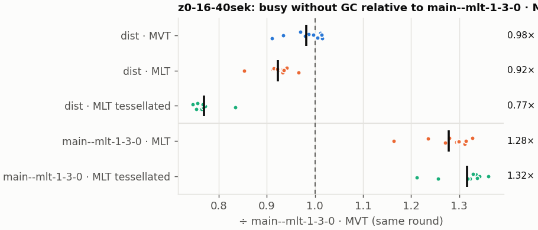
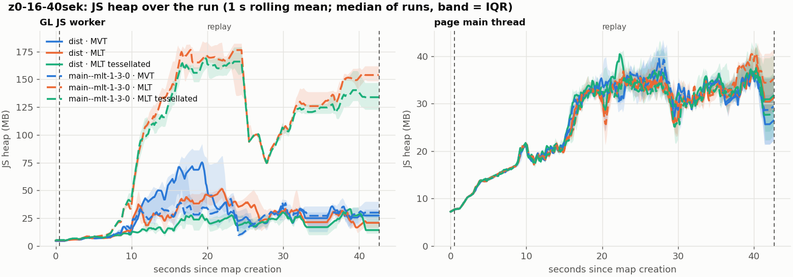
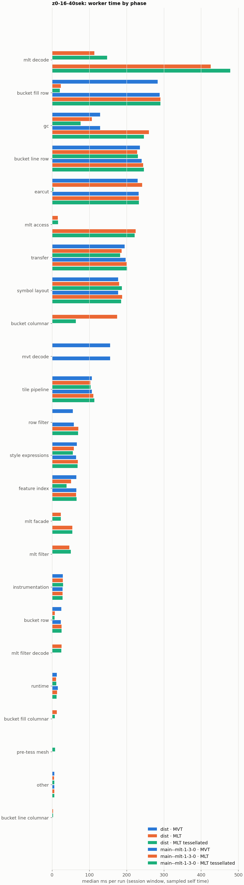
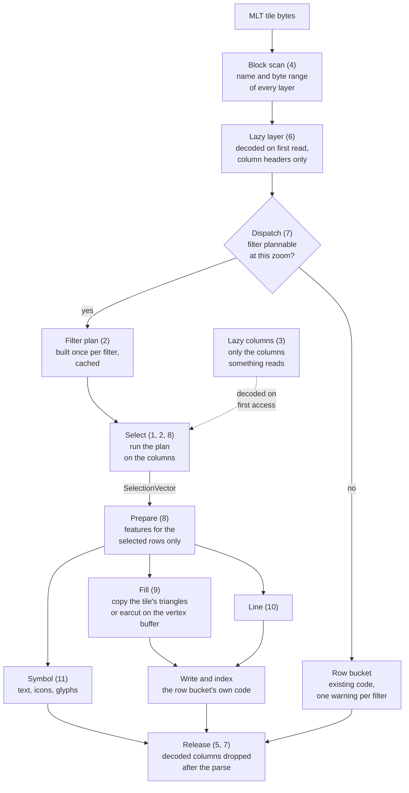

# Columnar MLT in MapLibre GL JS

These pages explain what the thesis changes, and why. A MapLibre Tile (MLT) stores each layer column by
column: one column for the ids, one for the geometry, one per property. MapLibre GL JS on `main` throws that
layout away. Its worker decodes every column of every layer, builds a JavaScript object for every feature,
runs the style filter on each object, and triangulates every polygon with earcut, even when the tile already
carries the triangles. An MLT tile is turned back into rows before anything is drawn, and ends up slower than
the Mapbox Vector Tile (MVT) it is meant to replace.

The changes let the worker filter and build buckets directly on the columns. They sit in two codebases:

- **`@maplibre/mlt`** (maplibre-tile-spec, TypeScript decoder): selection vectors, a columnar filter engine,
  lazy column decoding, the primitives an adapter needs, and decoder performance (pages 1 to 5).
- **MapLibre GL JS**: an MLT facade, per-layer dispatch, and columnar fill, line and symbol buckets that reuse
  the row buckets' code (pages 6 to 12).

The tile format, the renderer and the shaders do not change. MVT tiles, and every layer that cannot use the
columnar path, run the existing code unchanged.

## Gains against `main`

Worker busy time without garbage collection in a recorded 42 s map session (z0 to z16), replayed in Chromium,
10 runs per variant. Lower is better, 95 % confidence interval in parentheses. `main` is GL JS `bb3895408` with
`@maplibre/mlt` 1.3.0.

| Style | MLT ÷ MVT on `main` | MLT ÷ MVT with the changes | pre-tessellated MLT ÷ MVT with the changes | MLT: speedup against `main` | pre-tessellated MLT: speedup against `main` |
|---|---|---|---|---|---|
| maptiler-basic | 1.30× (1.25-1.32) | 0.93× (0.92-0.94) | 0.77× (0.76-0.79) | 1.41× (1.39-1.44) | 1.75× (1.70-1.78) |
| osm-bright | 1.22× (1.21-1.23) | 0.89× (0.85-0.96) | 0.80× (0.75-0.85) | 1.35× (1.32-1.36) | 1.55× (1.51-1.66) |
| positron | – | 0.92× (0.90-0.94) | 0.81× (0.79-0.82) | – | – |

Positron was only run without `main`, so it has no speedup. MVT costs the same with and without the changes
(0.99×, CI 0.95-1.01, on maptiler-basic).



*maptiler-basic, every run of the batch as a dot, the median as a bar. `dist` is GL JS with the changes,
`main--mlt-1-3-0` is `main` with `@maplibre/mlt` 1.3.0; all ratios are against MVT on `main` in the same round.
Full report: [run 20261107-171557](benchmarks/session-trace/20261107-171557/report.md).*

Where the time and memory go, per maptiler-basic session (medians):

| | MVT | MLT, `main` | MLT, changes | pre-tessellated MLT, `main` | pre-tessellated MLT, changes |
|---|---|---|---|---|---|
| worker busy time without GC | 1,897 ms | 2,470 ms | 1,748 ms | 2,526 ms | **1,440 ms** |
| tile decoding | 156 ms | 426 ms | 113 ms | 478 ms | 148 ms |
| building fill and line buckets, incl. earcut | 765 ms | 764 ms | 505 ms | 770 ms | **272 ms** |
| memory freed by the worker's GCs | 1,439 MB | 1,627 MB | 1,059 MB | 1,652 MB | 555 MB |
| peak worker heap | 67 MB | 201 MB | 61 MB | 188 MB | **45 MB** |



*Worker heap over the 42 s session (left): on `main` (dashed) MLT climbs to about 175 MB while MVT stays
below 75 MB; with the changes (solid) every format stays at or below MVT.*

<details markdown>
<summary>Worker time by phase, all six variants</summary>



*Median sampled self time per phase. The `main` bars for `mlt decode`, `mlt access` and `earcut` are where
the changes save most.*

</details>

Four things stand out:

- On `main`, MLT costs 1.22-1.30× the worker time of MVT, and pre-tessellated tiles bring nothing, because
  their triangles are thrown away and recomputed with earcut. With the changes, MLT is the cheaper format, and
  pre-tessellated MLT the cheapest.
- Tile decoding drops from 426 to 113 ms. A layer, and inside it a column, is only decoded when something
  reads it ([lazy decoding](03-lazy-decoding.md)), and the decoder's largest costs, found by profiling, were
  removed ([decode performance](05-decode-performance.md)).
- The largest single gain is in building fill buckets: pre-tessellated triangles are copied into the vertex
  arrays as they are, and plain tiles run earcut straight on the vertex buffer
  ([fill bucket](09-fill-bucket.md)). Building fill and line buckets takes 272 ms for pre-tessellated MLT, against 765 ms for MVT.
- On `main` a loaded MLT tile keeps every decoded column, three times the peak worker heap of MVT. The worker
  now drops the decoded columns after each parse, and the peak heap falls below MVT's.

The batches ran with the worker timing log switched on, which costs about 1.5-3 % of worker time in every
format. A batch with the log off has not been run yet. How each number was measured is on
[how it was measured](13-measuring.md).

The tile-spec changes alone, timed in Node from the unzipped tile bytes to the point where GL JS would start
writing vertices (decoding, every style-layer filter once, and the columns the bucket reads), on 82 tiles
around Cologne per style:

| Style | Filter jobs | MLT `main` ÷ MVT | MLT ÷ MVT | MLT ÷ MLT `main` |
|---|---|---|---|---|
| maptiler-basic | 2,522 | 1.62× | 0.30× | 0.19× |
| osm-bright | 5,894 | 1.41× | 0.25× | 0.17× |
| positron | 2,013 | 1.64× | 0.32× | 0.20× |

Every filter job keeps the same features in all three formats, compared by feature id.

## How the changes build on each other

Each style layer of a tile goes through the same steps. The numbers in brackets are the pages below.



- Nothing is decoded before it is needed. A tile is split into layers without decoding them, a layer is
  decoded to its column headers on first read, and a column's data on first access.
- A filter is planned once and then evaluated per tile as a scan over typed columns. Its result, a
  [selection vector](01-selection-vectors.md), says which rows survive, and nothing else is built for the rows
  that do not.
- Writing vertices, sorting and the spatial index stay in the row buckets. The columnar buckets inherit from
  them and call the same methods, so both paths draw the same features.

## One layer, end to end

A line layer of a zoom-14 MLT tile with eight features and the columns `id`, geometry, `class`, `lanes`,
`surface` and `name`, all of its features LineStrings. The style layer filters it with

```json
["all", ["==", "class", "primary"],
        ["any", [">", "lanes", 2], ["==", "surface", "paved"]]]
```

```
1 wrap      scanLayerBlocks()            names and byte ranges, nothing decoded
2 decode    first read of the layer      column headers walked, offsets kept
3 dispatch  isColumnarBucketSupported()  filter plannable at z14
                                         → ColumnarLineBucket, plan cached
4 select    class == 'primary'           dictionary, once per value  {0,2,3,5,7}
            any: lanes > 2               Int32, its copy of the 5    {2,5,7}
                 surface == 'paved'      dictionary, its copy        {0,2,7}
                 union, within the 5                                 {0,2,5,7}
            geometry type                only LineStrings → all rows, no scan
5 prepare   features 0, 2, 5 and 7       properties are row views, not copies
6 write     addBucketFeatures()          LineBucket's code: sort, dashes, index
7 release   after the last addFeatures() decoded columns dropped

decoded      class, lanes, surface, geometry, id
not decoded  name, and every layer that no style layer reads
```

The filter engine page walks through step 4 in detail ([filter engine](02-filter-engine.md)).

## Rules every change follows

- **Same result as MVT.** The style spec's filter test suite runs against the columnar engine, the benchmarks
  compare the selected features by id, and the fill bucket's triangles, outline edges and index boxes equal
  `FillBucket`'s on 53 tiles of North Rhine-Westphalia (166 polygon layers, 442,779 triangles). The one
  difference in the written data: the earcut fill path does not deduplicate vertices and writes about 5 %
  more of them, for the same triangles and outlines.
- **A whole filter or none.** A filter is planned completely or rejected before any tile is touched. A
  rejected layer takes the existing row path, with one warning per filter naming the part that failed. The
  other layers of the tile are not affected.
- **Inherit, do not copy.** Every columnar bucket extends its row bucket and overrides only the selection. The
  row buckets' `populate()` is split into protected methods so both paths call the same writing code.
- **Pay only for what is read.** Layers, columns and rows are decoded or built on first use.
- **No format, renderer or shader change.** The current `main` decoder reads the same tiles, and
  `getFeatures()` returns the same result as before.

## The pages

**`@maplibre/mlt`**

1. [Selection vectors](01-selection-vectors.md): "which rows" without an index array where possible.
2. [Filter engine](02-filter-engine.md): style filters planned once, evaluated on columns.
3. [Lazy decoding](03-lazy-decoding.md): a column is decoded when it is first read.
4. [Adapter primitives](04-adapter-primitives.md): block scan, row view and 64-bit values in the package.
5. [Decode performance](05-decode-performance.md): what the decoder spent its time on, and releasing columns.

**MapLibre GL JS**

6. [MLT facade](06-mlt-facade.md): an MLT tile that looks like any other vector tile.
7. [Dispatch and hand-off](07-dispatch.md): columnar or row bucket, per style layer.
8. [Shared populate pipeline](08-populate-pipeline.md): select and prepare once for every bucket.
9. [Fill bucket](09-fill-bucket.md): pre-tessellated triangles copied, earcut on the vertex buffer.
10. [Line bucket](10-line-bucket.md): columnar selection, `LineBucket`'s writing.
11. [Symbol bucket](11-symbol-bucket.md): columnar selection, `SymbolBucket`'s code.
12. [Worker performance](12-worker-performance.md): what the session traces found, and what was fixed.

**Method**

13. [How it was measured](13-measuring.md): the benchmarks, the machine and the limits.

## Where the code is

Every change is a branch in a fork. The branches form one stack per repository, each on the one before it,
so each link below shows only that change.

| Page | Repository | Branch |
|---|---|---|
| 1 | maplibre-tile-spec | [`feat1-vector-infrastructure`](https://github.com/Salkin975/maplibre-tile-spec/compare/main...feat1-vector-infrastructure) |
| 2 | maplibre-tile-spec | [`feat2-filter-engine`](https://github.com/Salkin975/maplibre-tile-spec/compare/feat1-vector-infrastructure...feat2-filter-engine) |
| 3 | maplibre-tile-spec | [`feat3-lazy-decoding`](https://github.com/Salkin975/maplibre-tile-spec/compare/feat2-filter-engine...feat3-lazy-decoding) |
| 4 | maplibre-tile-spec | [`feat4-adapter-primitives`](https://github.com/Salkin975/maplibre-tile-spec/compare/feat3-lazy-decoding...feat4-adapter-primitives) |
| 5 | maplibre-tile-spec | [`feat5-decode-performance`](https://github.com/Salkin975/maplibre-tile-spec/compare/feat4-adapter-primitives...feat5-decode-performance) |
| 6 | maplibre-gl-js | [`gl1-mlt-facade`](https://github.com/Salkin975/maplibre-gl-js/compare/main...gl1-mlt-facade) |
| 7 | maplibre-gl-js | [`gl2-dispatch`](https://github.com/Salkin975/maplibre-gl-js/compare/gl1-mlt-facade...gl2-dispatch) |
| 8 | maplibre-gl-js | [`gl3-populate-pipeline`](https://github.com/Salkin975/maplibre-gl-js/compare/gl2-dispatch...gl3-populate-pipeline) |
| 9 | maplibre-gl-js | [`gl4-fill-bucket`](https://github.com/Salkin975/maplibre-gl-js/compare/gl3-populate-pipeline...gl4-fill-bucket) |
| 10 | maplibre-gl-js | [`gl5-line-bucket`](https://github.com/Salkin975/maplibre-gl-js/compare/gl4-fill-bucket...gl5-line-bucket) |
| 11 | maplibre-gl-js | [`gl6-symbol-bucket`](https://github.com/Salkin975/maplibre-gl-js/compare/gl5-line-bucket...gl6-symbol-bucket) |
| 12 | maplibre-gl-js | [`gl7-performance-optimization`](https://github.com/Salkin975/maplibre-gl-js/compare/gl6-symbol-bucket...gl7-performance-optimization) |

The full proposals are the two RFCs, [`@maplibre/mlt`](https://github.com/maplibre/maplibre-tile-spec/issues/2010) and
[GL JS](https://github.com/maplibre/maplibre-gl-js/issues/8985).
