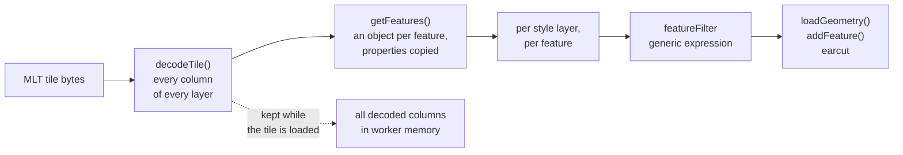
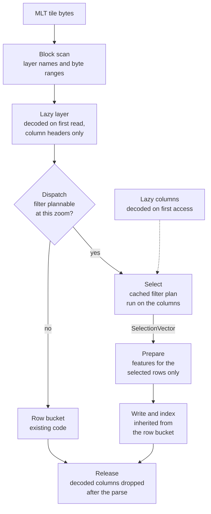

# How a tile is parsed

## Before: rows first

On `main`, an MLT tile is converted to rows when it is loaded, and everything after that is the MVT path.

Every feature is built, including the ones the filter drops. A pre-tessellated tile pays for its triangles
twice: once to decode them, once to recompute them with earcut.

## After: columns until the write

Each style layer of an MLT tile now goes through these steps. The row bucket's own code still writes the
vertices, sorts and indexes, so both paths draw the same features.

| Step | Where | What it does |
|---|---|---|
| Block scan | `@maplibre/mlt` `scanLayerBlocks()` | finds each layer's name and bytes without decoding a column |
| Lazy layer | GL JS `MLTVectorTile` | a getter per layer that calls `decodeTile()` on first read and then turns into a plain property |
| Dispatch | GL JS `createBucket()` → `isColumnarBucketSupported()` | columnar bucket if the tile is MLT and the filter can be planned at this zoom, row bucket otherwise |
| Select | `@maplibre/mlt` `filterFeatureTable()` | plans the filter once per filter (and zoom, if it reads `["zoom"]`), runs it on the columns, returns a selection vector |
| Lazy columns | `@maplibre/mlt` `FeatureTable` | a column's data is decoded the first time the filter or the bucket reads it |
| Prepare | GL JS `columnar_populate.ts` | a `BucketFeature` per selected row: properties as a row view, id through `promoteId`, sort key only if data-driven |
| Write and index | GL JS row buckets, `addBucketFeatures()` | sorting, pattern and dash deferral, vertex writing, `FeatureIndex` insert, unchanged code |
| Release | GL JS `WorkerTile.parse()` | `releaseDecodedColumns()` after the last `addFeatures()` |

The fill bucket replaces only the geometry part of the write: it copies pre-tessellated triangles, or runs
earcut on the vertex buffer, and gives the spatial index bounding boxes. Everything else it inherits.

## Who owns what

The split follows one rule: what is MLT format knowledge lives in `@maplibre/mlt`, what is GL JS knowledge
lives in GL JS.

*System context. GL JS loads the tiles and draws them; the tile spec decodes lazily and runs the filters on
the columns; the style spec still defines what a filter means.*

| `@maplibre/mlt` owns | GL JS owns |
|---|---|
| finding layers in the bytes, lazy decoding, releasing columns | the `VectorTileLike` facade, the lazy layer getter, the geometry-type mapping |
| the filter engine: planning, the plan cache, execution, the "can this filter be planned" gate | the choice of bucket per style layer, and handing it the right input |
| selection vectors and their algebra | turning selected rows into bucket features |
| the row view over a feature's properties, with MVT-compatible 64-bit values | writing vertices, sorting, indexing, transfer to the main thread |

The package's new pieces are useful to any consumer that reads MLT: a tile inspector, a diff tool or another
renderer can filter and read rows the same way.

## The contract between the two

GL JS calls the package through a small surface. Everything else it reads is the existing `FeatureTable`.

| Call | Used by GL JS for |
|---|---|
| `scanLayerBlocks(tile)` | the facade's lazy layers |
| `decodeTile(block.bytes)` | decoding one layer on first read, headers only |
| `isColumnarBucketSupported(encoding, filter, zoom, layerId)` | `createBucket()` of fill, line and symbol style layers |
| `filterFeatureTable(table, filter, zoom)` | the select step |
| `unionSelectionVectors()`, `intersectSelectionVectors()`, `geometryVector.filter(type)` | narrowing the selection by geometry type (line bucket) |
| `createRowView(table, row)` | `feature.properties`, with 64-bit values rounded as MVT rounds them |
| `FeatureTable.releaseDecodedColumns()` | the release at the end of `parse()` |

`isColumnarBucketSupported()` and `filterFeatureTable()` answer from the same cached plan, so dispatch and
select cannot disagree. If they do, `select` throws rather than silently falling back.

## The tile's memory over its life

| Moment | Holds |
|---|---|
| loaded | the tile bytes, layer names and byte ranges |
| a layer read | that layer's column headers and offsets |
| during the parse | the columns the filters and buckets read |
| after the parse | headers and offsets again, about 29 KB per tile instead of about 500 KB |
| reload | the columns decoded again from the bytes, about 2.6 ms per tile for all of them |

On the main thread, `queryRenderedFeatures` reads the raw tile through its own `MLTVectorTile` with copied
properties, so returned features are plain objects that do not keep columns alive.

Detail: [MLT facade](../changes/06-mlt-facade.md), [dispatch](../changes/07-dispatch.md),
[populate pipeline](../changes/08-populate-pipeline.md), and the walk-through of one layer end to end on the
[explainer overview](../changes/index.md#one-layer-end-to-end).
