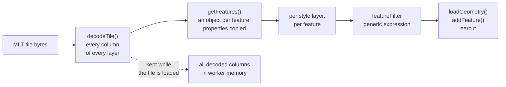
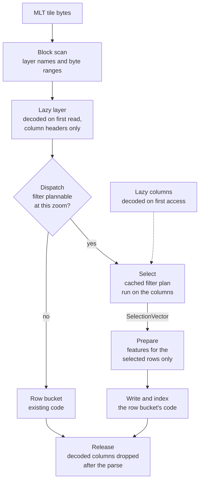

# How a tile is parsed

## Before: rows first

- every feature is built, also the ones the filter drops
- pre-tessellated tiles pay twice: triangles decoded, then recomputed by earcut

## After: columns until the write

| Step | Where | What |
|---|---|---|
| Block scan | `@maplibre/mlt` `scanLayerBlocks()` | each layer's name and bytes, no column decoded |
| Lazy layer | GL JS `MLTVectorTile` | getter per layer: `decodeTile()` on first read, then a plain property |
| Dispatch | GL JS `createBucket()` → `isColumnarBucketSupported()` | columnar bucket if MLT and the filter plans at this zoom, else row bucket |
| Select | `@maplibre/mlt` `filterFeatureTable()` | filter planned once, run on the columns, returns a selection vector |
| Lazy columns | `@maplibre/mlt` `FeatureTable` | a column's data decoded on first read |
| Prepare | GL JS `columnar_populate.ts` | a `BucketFeature` per selected row; properties as a row view |
| Write and index | GL JS row buckets, `addBucketFeatures()` | sorting, deferral, vertices, `FeatureIndex`: unchanged code |
| Release | GL JS `WorkerTile.parse()` | `releaseDecodedColumns()` after the last `addFeatures()` |

- both paths write through the same row-bucket code → same features drawn
- fill bucket only: own geometry write (triangles copied, or earcut on the vertex buffer), bounding boxes for
  the index

## Who owns what

*GL JS loads and draws; the tile spec decodes lazily and filters on the columns; the style spec defines what a
filter means.*

| `@maplibre/mlt`: format knowledge | GL JS: renderer knowledge |
|---|---|
| finding layers, lazy decoding, releasing columns | `VectorTileLike` facade, lazy layer getter, geometry-type mapping |
| filter engine: planning, plan cache, execution, the "plannable?" gate | bucket choice per style layer, the right input for it |
| selection vectors and their algebra | selected rows → bucket features |
| row view over a feature's properties, MVT-compatible 64-bit values | vertices, sorting, indexing, transfer to the main thread |

- the package's new pieces work for any MLT consumer: inspector, diff tool, other renderer

## The contract between the two

| Call | Used by GL JS for |
|---|---|
| `scanLayerBlocks(tile)` | the facade's lazy layers |
| `decodeTile(block.bytes)` | one layer on first read, headers only |
| `isColumnarBucketSupported(encoding, filter, zoom, layerId)` | `createBucket()` of fill, line, symbol |
| `filterFeatureTable(table, filter, zoom)` | the select step |
| `unionSelectionVectors()`, `intersectSelectionVectors()`, `geometryVector.filter(type)` | narrowing by geometry type (line bucket) |
| `createRowView(table, row)` | `feature.properties`, 64-bit values rounded as MVT does |
| `FeatureTable.releaseDecodedColumns()` | the release at the end of `parse()` |

- dispatch and select read the same cached plan → cannot disagree; if they do, select throws

## The tile's memory over its life

| Moment | Holds |
|---|---|
| loaded | tile bytes, layer names and byte ranges |
| a layer read | that layer's column headers and offsets |
| during the parse | the columns filters and buckets read |
| after the parse | headers and offsets: about 29 KB per tile instead of about 500 KB |
| reload | columns decoded again from the bytes: about 2.6 ms per tile for all of them |

- `queryRenderedFeatures` (main thread): its own `MLTVectorTile` with copied properties → returned features
  keep no columns alive

Detail: [MLT facade](../changes/06-mlt-facade.md), [dispatch](../changes/07-dispatch.md),
[populate pipeline](../changes/08-populate-pipeline.md),
[one layer end to end](../changes/index.md#one-layer-end-to-end).
