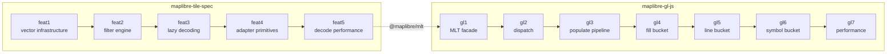

# Decisions and open questions

## Rules

| Rule | Why | Checked by |
|---|---|---|
| **Same result as MVT** | different features drawn = a bug | style-spec filter tests; benchmarks compare features by id; fill output compared triangle by triangle |
| **A whole filter or none** | a partly applied filter draws wrong features | planned completely or rejected before any tile; rejected → row path, one warning |
| **Reuse the row buckets' code** | writing, sorting, deferral, indexing exist once; `main` changes reach both paths | today by inheritance; the review asks for composition ([feedback](feedback.md#3-composition-over-inheritance)) |
| **Pay only for what is read** | most columns and rows are never drawn | layers, columns, rows built on first use, released after the parse |
| **No format, renderer or shader change** | keeps the change in the worker and the decoder | the `main` decoder reads the same tiles |

## Trade-offs taken

| Trade-off | Accepted because |
|---|---|
| a decoded table keeps the tile buffer alive | GL JS keeps the tile bytes for reloads anyway |
| a corrupt column surfaces on first read | the header walk still fails on a bad offset |
| earcut fill path: about 5 % more vertices | skipping deduplication is its largest saving; same triangles and outlines |
| globe and pole tiles use `FillBucket` | the direct paths do not subdivide |
| fill layer without ring topology: no outline | triangles carry no ring; one warning |
| filter alone slower on layers below about 50 features | fixed cost per filter; decode + filter stays below MVT |
| a reload decodes the columns again | about 2.6 ms per tile vs. about 470 KB less memory per tile |
| `decodeTile()` loses `idWithinMaxSafeInteger` | ids are numbers whenever all values are safe |

## Built, measured, not kept

| Idea | Why not |
|---|---|
| point-free copy of `LineBucket`'s extrusion | run time within noise; about 200 copied lines to keep in step with `main` |
| cache of decoded layer schemas | metadata is about 1-3 % of the decode |
| skipping streams unread, one-pass stream metadata, ASCII string fast path | the measurement did not justify them |
| per-tile cache of filter leaf selections | lookups and copies cancelled the savings |

## Open questions for maintainers

1. **Layers without ring topology:** warning enough, or should the encoder keep ring topology for drawn
   layers?
2. **Splitting the row buckets:** `populate()` split into protected methods: acceptable seam in shared code?
3. **Lazy decoding:** buffer kept alive, corrupt columns surface late: acceptable for other consumers of
   `@maplibre/mlt`?
4. **PR shape:** stacked PRs following the changes, fill bucket first?

Still open:

- symbol `populate` on osm-bright (evidence predates a deopt fix)
- resolving symbol text on the columns
- main-thread heap: 2-5 MB more with MLT, cause unknown

## Branch stacks

- each branch stacked on the one before; each compare link shows one change:
  [compare links](../changes/index.md#where-the-code-is)
- RFCs: [`@maplibre/mlt`](https://github.com/maplibre/maplibre-tile-spec/issues/2010),
  [GL JS](https://github.com/maplibre/maplibre-gl-js/issues/8985)
