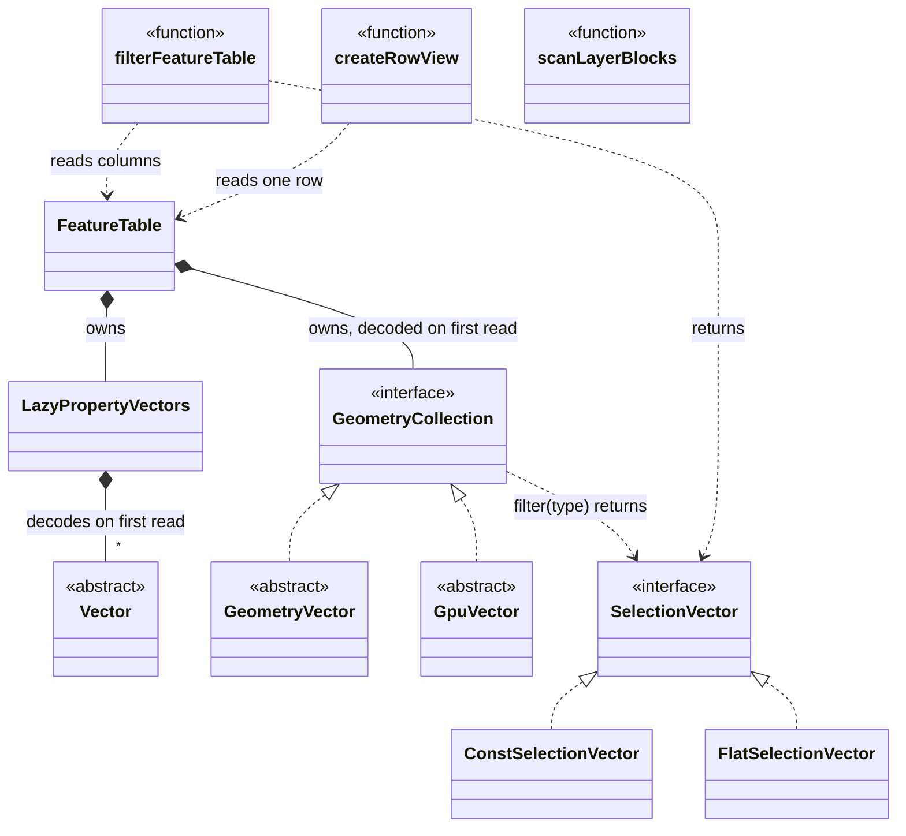
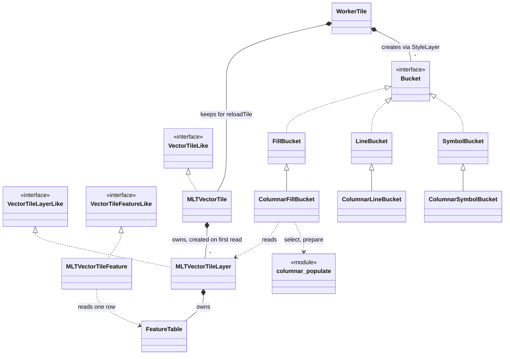
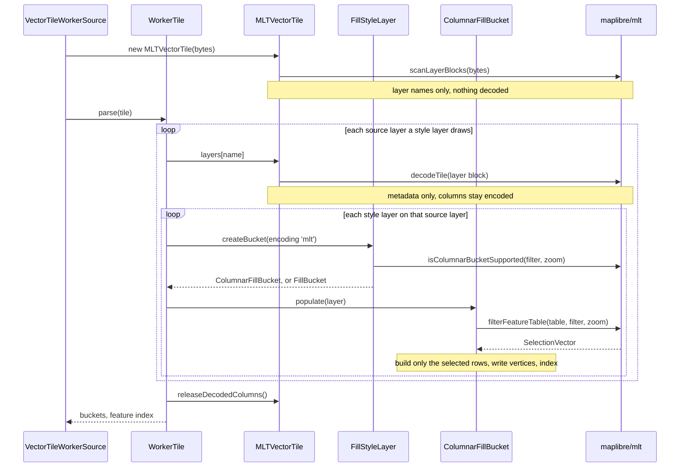

# Review feedback

Answers to the first review of the GL JS proposal
([maplibre/maplibre-gl-js#8985](https://github.com/maplibre/maplibre-gl-js/issues/8985)). No code changed yet.

| # | Feedback | Answer |
|---|---|---|
| 1 | avoid the explicit release after the parse | it keeps MLT's worker memory comparable to MVT's; an automatic option exists, the symbol bucket is the risk |
| 2 | class diagrams instead of text | added below |
| 3 | composition over inheritance, at most one level | should be doable |
| 4 | MLT encoder for overzoom and GeoJSON | feasible, not looked into, out of scope for the thesis |
| 5 | is the reading of the numbers right? | yes |

## 1. The explicit release after the parse

```ts
// WorkerTile.parse(), after the last bucket.addFeatures()
if (data instanceof MLTVectorTile) data.releaseDecodedColumns();
```

**Why it is there**

- the worker keeps the parsed tile for `reloadTile()`; for MVT that is cheap (an index into the bytes)
- a feature table keeps every column it decoded, because several style layers read the same columns (up to 54
  style layers on `transportation` in OpenMapTiles styles)
- after the parse nobody reads them, but the table still holds them
- the release turns them back into their encoded form → worker memory comparable to MVT

| Per tile, Node benchmark, all columns decoded | plain | pre-tessellated |
|---|---|---|
| after a full decode | 500 KB | 680 KB |
| after the release | 29 KB | 33 KB |
| cost of the release | 0.05 ms | 0.06 ms |
| decoding everything again | 2.66 ms | 2.62 ms |

**Making it automatic**

| Option | How | Trade-off |
|---|---|---|
| **fresh facade per parse** | the worker keeps the tile bytes, builds a new `MLTVectorTile` per parse; its columns die with it | a reload repeats the block scan and metadata walk; must be checked against the symbol bucket |
| release inside the facade | the table frees its columns when the last reader is done | the facade cannot know when: buckets would have to report back, again an explicit call |
| `WeakRef` to decoded columns | GC may drop columns | a column may vanish mid-parse and be decoded again; parse time unpredictable |
| no caching | every read decodes again | a column read by many style layers decoded once per style layer |

- risk for every automatic option: the **columnar symbol bucket** keeps its features (and through them the
  columns) until `addFeatures()`, after glyphs and images arrived, longer than fill and line
- main thread: `FeatureIndex` keeps its own `MLTVectorTile` for `queryRenderedFeatures`, never released today

**Removing it without a replacement**

- drawn output: unchanged
- worker memory: up to 0.5-0.7 MB per loaded tile instead of about 30 KB → up to 50-70 MB more for 100 tiles
- reloads: save about 2.6 ms per tile
- GL JS heap without the release: not measured; the figures are from the Node benchmark

## 2. The design as diagrams

### `@maplibre/mlt`



- new: `SelectionVector` and its two forms, `GeometryCollection`, `LazyPropertyVectors`, the three functions
- on `main` already: `FeatureTable` and the vectors; now decoded on first read
- `scanLayerBlocks()`: layers by name, nothing decoded

### GL JS



- on `main` already: `MLTVectorTile` and its layer and feature classes; now lazy, properties through a row view
- new: the three `Columnar*Bucket` classes, `columnar_populate`
- line and symbol read the layer and use `columnar_populate` like fill; arrows left out

### One MLT tile through the worker



- filter not plannable → `FillBucket`, gets the row list as on `main`
- the last call is point 1

## 3. Composition over inheritance

Today each columnar bucket is two levels below `Bucket`:

| Class | Overrides | Uses |
|---|---|---|
| `ColumnarFillBucket` | `populate()`, `addFeature()`, `addFeatures()` | `columnar_populate` (select, prepare), `columnar_mesh_arrays` (pre-tessellated and earcut writing) |
| `ColumnarLineBucket` | `populate()`, `lineFeatureClips()` | `columnar_populate` |
| `ColumnarSymbolBucket` | `populate()` | `columnar_populate` (select) |

- should be doable: selection, preparation and vertex writing are standalone functions already
- the subclasses mostly wire them to the row bucket's steps
- to be done against the recent changes to the bucket hierarchy

## 4. Overzoom and an MLT encoder in GL JS

| | Today | With the MLT encoder |
|---|---|---|
| overzoomed tile | re-encoded as MVT → row path | re-encoded as MLT → columnar path |
| GeoJSON | row path | columnar path, nested properties kept |

- today the changes only make sure `createBucket()` sees the encoding actually parsed (`'mvt'` after
  overzoom)
- the encoder ships with `@maplibre/mlt` already
- feasible, not looked into: the focus was the buckets and their speed; out of scope for the thesis
- open: the encoder's size in the worker bundle, its cost per tile

## 5. Reading the numbers

| Worker time ÷ MVT | maptiler-basic | osm-bright | positron |
|---|---|---|---|
| MLT today | 1.30× | 1.22× | not run |
| MVT with the changes | 1.00× | 1.01× | 0.99× |
| MLT with the changes | 0.91× | 0.91× | 0.92× |
| pre-tessellated MLT with the changes | 0.74× | 0.74× | 0.78× |

| Session tiles | MVT | plain MLT | pre-tessellated MLT |
|---|---|---|---|
| download size | 10.5 MB | 8.7 MB (0.83×) | 11.4 MB (1.09×) |
| mean tile | 55.8 kB | 46.4 kB | 60.6 kB |
| download + worker time, 1.6 Mbit/s | 53.9 s | **44.9 s** | 58.0 s |
| download + worker time, 10 Mbit/s | 9.94 s | **8.38 s** | 10.24 s |
| download + worker time, 100 Mbit/s | 2.39 s | 2.11 s | **2.05 s** |

- today: MLT up to 30 % more worker time than MVT
- with the changes: MLT about 9 % less, pre-tessellated MLT about 25 % less
- plain MLT: ahead at every bandwidth
- pre-tessellated MLT: beats MVT from about 17 Mbit/s, plain MLT from about 77 Mbit/s (simple download + worker
  time model)
- details: [results](results.md#tile-size-and-bandwidth)
