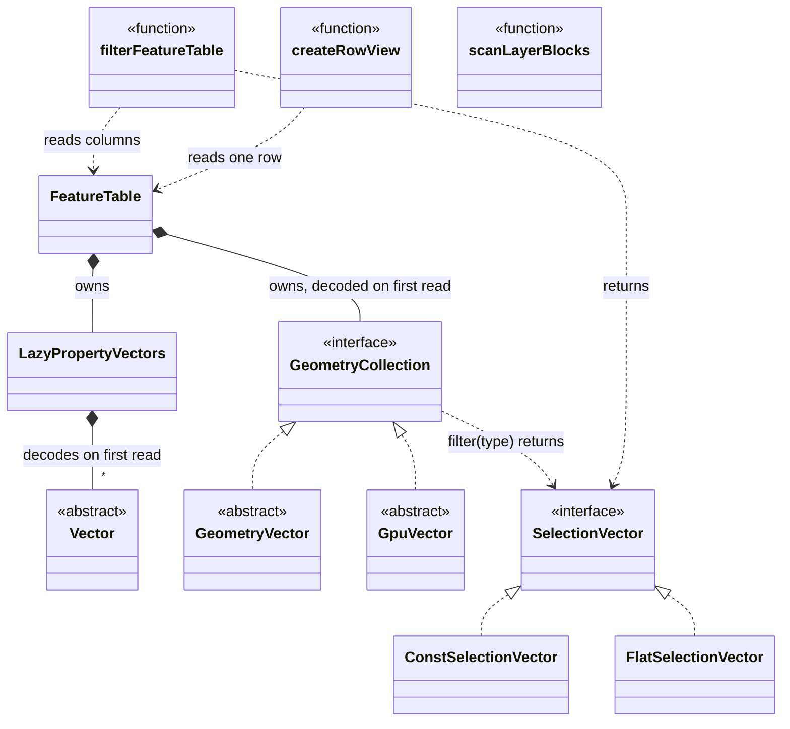
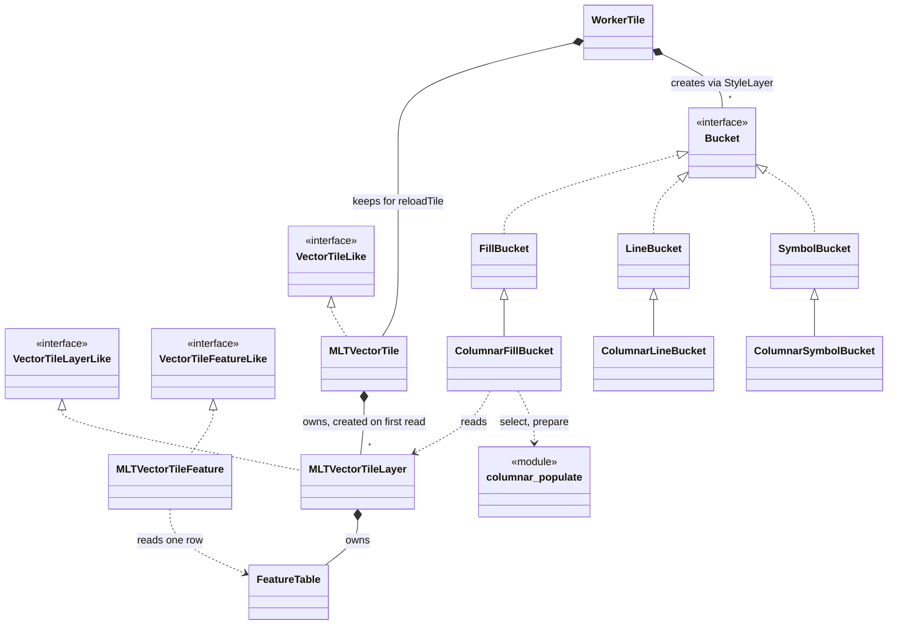
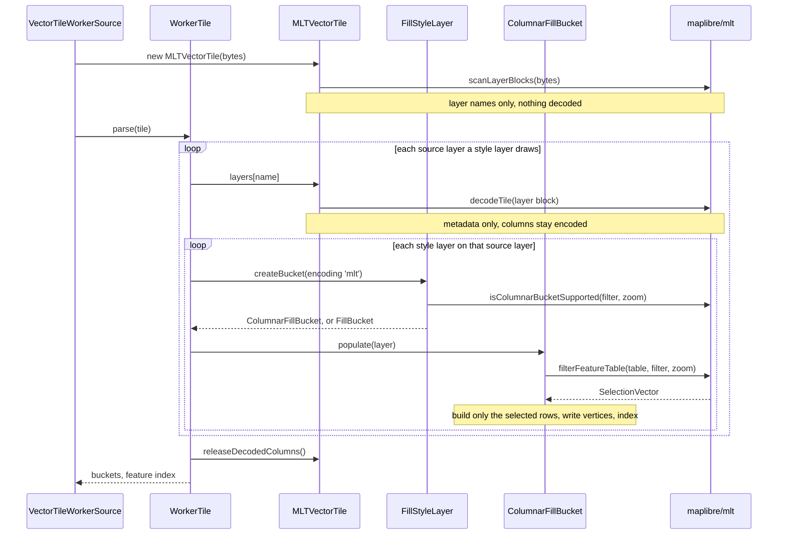

# Review feedback

Answers to the first review of the GL JS proposal
([maplibre/maplibre-gl-js#8985](https://github.com/maplibre/maplibre-gl-js/issues/8985)), point by point. No code has
changed in response yet.

## 1. The explicit release after the parse

### Why it is there

```ts
// WorkerTile.parse(), after the last bucket.addFeatures()
if (data instanceof MLTVectorTile) data.releaseDecodedColumns();
```

Two things meet here:

- **The worker keeps the parsed tile.** `VectorTileWorkerSource` stores the tile object on the `WorkerTile`, so
  `reloadTile()` can parse it again after a style change without downloading it. For MVT that object is cheap
  to keep: a `VectorTile` holds only an index into the bytes.
- **A feature table keeps what it has decoded.** Within one parse several style layers read the same columns
  (OpenMapTiles styles put up to 54 style layers on `transportation`), so a column is decoded on its first read
  and kept. After the parse nobody reads them any more, but the table still holds them.

Without the release, a loaded MLT tile keeps every column its parse decoded: in the Node decode benchmark about
500 KB per tile (680 KB pre-tessellated) when all columns are decoded, against about 30 KB once released
([page 5](../changes/05-decode-performance.md)). The release costs about 0.05 ms per tile.

### Can it happen automatically?

| Option | How | Trade-off |
|---|---|---|
| **A fresh facade per parse** | For MLT the worker keeps the tile bytes instead of the `MLTVectorTile` and builds a new one at the start of each parse. Its decoded columns become garbage with it; nothing is released by hand | Each reload repeats the block scan and the metadata walk of the layers it reads (no column decoding). Retained memory per loaded tile drops to the bytes alone. Touches where `VectorTileWorkerSource` stores the tile |
| Release inside the facade, without a call from the worker | The facade or the table frees its columns on its own once the last reader is done | The facade cannot know when that is: symbol buckets keep features until `addFeatures()`, after glyphs and images arrived. The buckets would have to report back, which is again an explicit call |
| Weak references to decoded columns | The table holds its columns through `WeakRef` | Any garbage collection may drop a column in the middle of a parse, to be decoded again for the next style layer; parse time becomes unpredictable |
| No caching at all | Every read decodes the column again | A column read by many style layers is decoded once per style layer: much slower |

The first option removes the call without a new cost in the common path (the first parse) and is the one worth
trying. It is not built yet. The main thread has the same pattern: `FeatureIndex` keeps its own `MLTVectorTile`
for `queryRenderedFeatures`, and no one releases it today; the same change would apply there.

### What removing it would cost

Removing the call alone does not change what is drawn. The worker would keep every column its parses decoded for
as long as the tile is loaded: up to about 0.5-0.7 MB per tile instead of about 30 KB, so with 100 loaded tiles
up to 50-70 MB more worker heap. A reload would save the re-decoding, about 2.6 ms per tile for all columns. The
GL JS heap has not been measured without the release on its own; these per-tile figures come from the Node
benchmark.

## 2. The design as diagrams

### `@maplibre/mlt`



*New: `SelectionVector` with its two implementations, `GeometryCollection`, `LazyPropertyVectors` and the three
functions. `FeatureTable` and the vectors exist on `main`; they now decode on first read. `scanLayerBlocks()`
finds a tile's layers by name without decoding any of them.*

### GL JS



*`MLTVectorTile` and its layer and feature classes exist on `main`; they now create layers on first read and
read properties through a row view. The three `Columnar*Bucket` classes and `columnar_populate` are new.
`ColumnarLineBucket` and `ColumnarSymbolBucket` use `columnar_populate` and read the layer like the fill
bucket; their arrows are left out.*

### One MLT tile through the worker



*A bucket whose filter cannot be planned is a `FillBucket` and gets the row list as on `main`. The last call is
the one point 1 is about.*

## 3. Composition over inheritance

Today each columnar bucket extends its row bucket, two levels below the `Bucket` interface (diagram above):

| Class | Overrides | Uses |
|---|---|---|
| `ColumnarFillBucket` | `populate()`, `addFeature()` and `addFeatures()` for writing polygons straight from the tile's geometry | `columnar_populate` (select, prepare), `columnar_mesh_arrays` (pre-tessellated and earcut writing) |
| `ColumnarLineBucket` | `populate()`, `lineFeatureClips()` | `columnar_populate` |
| `ColumnarSymbolBucket` | `populate()` | `columnar_populate` (select) |

The selection, the preparation of the selected rows and the vertex writing are standalone functions already;
the subclasses mostly wire them to the row bucket's own steps. Whether the columnar path can move into the row
buckets by composition, with these functions or a helper class, and at most one level below `Bucket`, is being
looked into, also against the recent changes to the bucket hierarchy.

## 4. Overzoom and an MLT encoder in GL JS

Today an overzoomed tile is re-encoded by the existing overzoom code as MVT, so its layers take the row path.
The changes only make sure that `createBucket()` is told the encoding of the tile it actually parses (`'mvt'`
after overzoom), so no columnar bucket is handed a row list.

Re-encoding with the MLT encoder that `@maplibre/mlt` already ships, and using it for GeoJSON as well, is a
viable option: overzoomed and GeoJSON tiles would take the columnar path, and nested properties would survive.
It was not looked into and is out of scope for the thesis. Open questions would be the encoder's size in the
worker bundle and its cost per overzoomed or GeoJSON tile.

## 5. Reading the numbers

Yes, that reading is right:

| Worker time, as a multiple of MVT's | maptiler-basic | osm-bright | positron |
|---|---|---|---|
| MLT today | 1.30× | 1.22× | not run |
| MVT with the changes | 1.00× | 1.01× | 0.99× |
| MLT with the changes | 0.91× | 0.91× | 0.92× |
| pre-tessellated MLT with the changes | 0.74× | 0.74× | 0.78× |

Tile size and bandwidth, for the tiles of the 42 s session:

| | MVT | plain MLT | pre-tessellated MLT |
|---|---|---|---|
| download size | 10.5 MB | 8.7 MB (0.83×) | 11.4 MB (1.09×) |
| mean tile | 55.8 kB | 46.4 kB | 60.6 kB |
| download + worker time at 1.6 Mbit/s | 53.9 s | **44.9 s** | 58.0 s |
| download + worker time at 10 Mbit/s | 9.94 s | **8.38 s** | 10.24 s |
| download + worker time at 100 Mbit/s | 2.39 s | 2.11 s | **2.05 s** |

Plain MLT is ahead at every bandwidth. Pre-tessellated MLT trades about 9 % more bytes for about 25 % less
worker time, which pays off above about 17 Mbit/s against MVT, and above about 4 Mbit/s on a CPU four times
slower. The whole-tileset sizes, the per-zoom differences and how the model is built are on
[results](results.md#tile-size-and-bandwidth).
