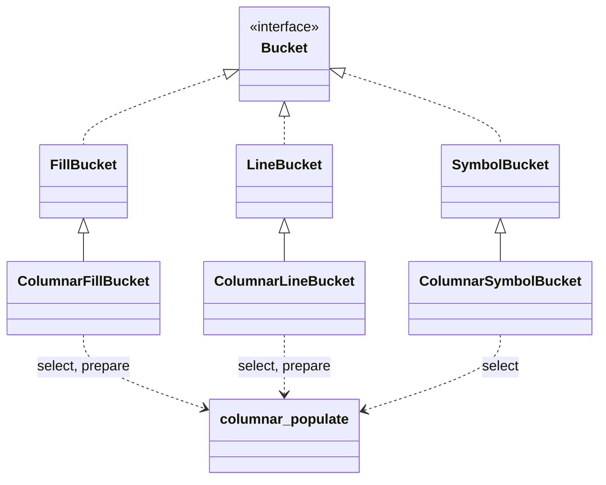
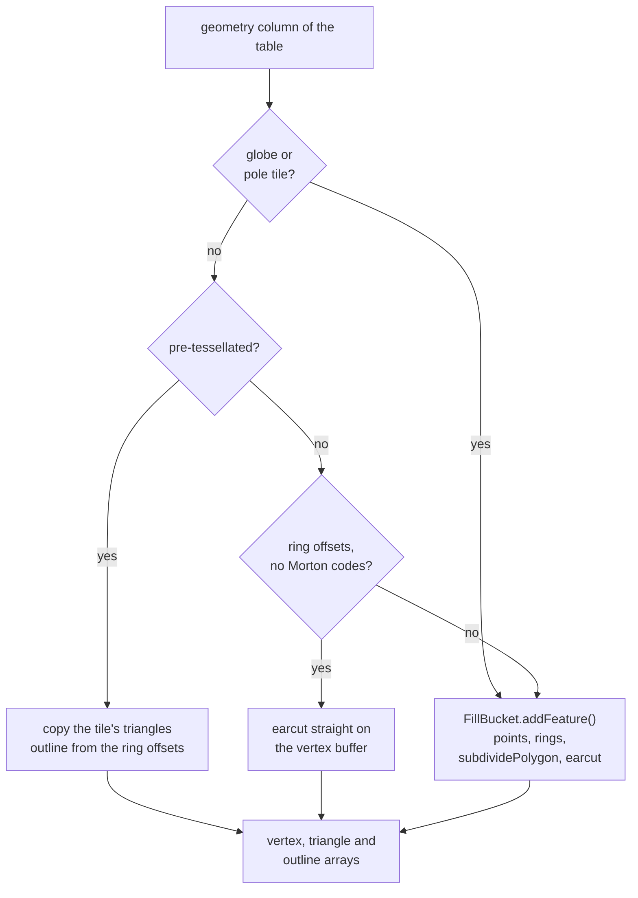

# MapLibre GL JS

- all changes in the worker
- renderer, shaders, main thread: unchanged, except one line so `queryRenderedFeatures` copies MLT properties

| # | Change | In one line |
|---|---|---|
| 6 | [MLT facade](../changes/06-mlt-facade.md) | `MLTVectorTile` meets `VectorTileLike`, decodes nothing up front |
| 7 | [Dispatch and hand-off](../changes/07-dispatch.md) | columnar or row bucket per style layer; release after the parse |
| 8 | [Shared populate pipeline](../changes/08-populate-pipeline.md) | select and prepare once, for every columnar bucket |
| 9 | [Fill bucket](../changes/09-fill-bucket.md) | pre-tessellated triangles copied, earcut on the vertex buffer |
| 10 | [Line bucket](../changes/10-line-bucket.md) | columnar selection, `LineBucket`'s writing |
| 11 | [Symbol bucket](../changes/11-symbol-bucket.md) | columnar selection, `SymbolBucket`'s code |
| 12 | [Worker performance](../changes/12-worker-performance.md) | what browser traces found, and the fixes |

## The facade

| Part | Behaviour |
|---|---|
| `tile.layers` | one getter per layer; first read decodes the headers, then a data property |
| `feature.properties` | a row view: reading 2 of 30 properties decodes 2 columns |
| `loadGeometry()` | reads the vertex buffer and offsets, new `Point`s per call |
| `releaseDecodedColumns()` | releases every read layer; unread layers untouched |

- `tile.layers` is `Object.create(null)`: as a plain `{}`, the getter → property switch caused thousands of V8
  deopts per session elsewhere

## Dispatch

```ts
createBucket(parameters: BucketParameters<any>): FillBucket {
    return isColumnarBucketSupported(parameters.encoding, this.filter, parameters.zoom, this.id)
        ? new ColumnarFillBucket(parameters)
        : new FillBucket(parameters);
}
```

- columnar bucket ← `MLTVectorTileLayer`; row bucket ← `IndexedFeature[]`
- row list for an MLT layer: only if a row bucket needs it, once per source layer
- `BucketParameters.encoding` = the parsed layer's encoding → overzoomed tiles (re-encoded as MVT) get a row
  bucket
- release after the last `addFeatures()`, not after `populate()`: symbol features read columns until glyphs
  and images arrive

## The buckets



*Today: inheritance. The review asks for composition.*

| Bucket | Select | Write |
|---|---|---|
| `ColumnarFillBucket` | the filter (not narrowed to polygons: `FillBucket` fills lines too) | pre-tessellated: triangles copied, outline from ring offsets; plain: earcut on the vertex buffer; else `FillBucket.addFeature()` |
| `ColumnarLineBucket` | the filter, narrowed to LineStrings and Polygons | `LineBucket.addBucketFeatures()` |
| `ColumnarSymbolBucket` | the filter | `addSymbolFeature()` per feature, then `finishSymbolFeatures()` |

How `ColumnarFillBucket` picks its write path, per table:



- fill: where the format's advantage lands; no triangulation, no deduplication, no `Point` per vertex
- line: gains from selection only; vertices depend on joins, caps, dashes

## Existing code that changes

| File | Change |
|---|---|
| `data/bucket/fill_bucket.ts`, `line_bucket.ts` | `populate()` split: filter loop + protected `addBucketFeatures()`; moved, not rewritten |
| `data/bucket/symbol_bucket.ts` | `populate()` split into `layoutHasText()`, `layoutHasIcon()`, `addSymbolFeature()`, `finishSymbolFeatures()` |
| `data/bucket.ts` | `BucketParameters.encoding`, `Bucket.isColumnar`, `populate()` takes an `MLTVectorTileLayer` |
| `source/worker_tile.ts` | input per bucket, `encoding` from the parsed layer, release after the parse |
| `style/style_layer/{fill,line,symbol}_style_layer.ts` | `createBucket()` asks the filter engine |
| `data/feature_index.ts` | one line: queries read MLT with copied properties |
| `source/vector_tile_mlt.ts` | the facade, rewritten |

- new: `data/bucket/columnar/` with `columnar_populate.ts`, `columnar_fill_bucket.ts`,
  `columnar_mesh_arrays.ts`, `columnar_line_bucket.ts`, `columnar_symbol_bucket.ts`
- untouched: circle, heatmap, fill-extrusion

## Output compared with the row path

| Bucket | Same as the row path? |
|---|---|
| fill | same triangles, outlines, index boxes on 53 NRW tiles (166 polygon layers, 442,779 triangles); earcut path: about 5 % more vertices (no deduplication); globe and pole: byte for byte |
| line | `LineBucket`'s own writing code |
| symbol | same features, glyphs, icons; tested with and without filter, sort key, merged lines |
| any | fill layer without ring topology: triangles drawn, no outline, one warning |
