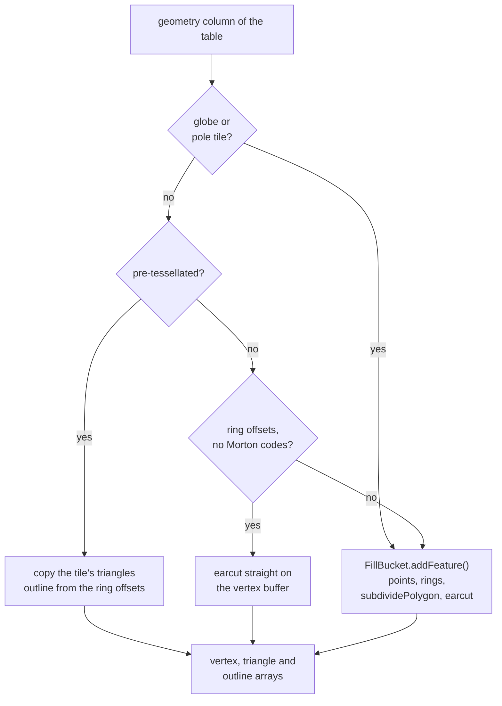

# MapLibre GL JS

All changes are in the worker. The renderer, the shaders and the main thread are unchanged, apart from one
line that makes `queryRenderedFeatures` copy MLT properties.

Seven changes, stacked in this order:

| # | Change | In one sentence |
|---|---|---|
| 6 | [MLT facade](../changes/06-mlt-facade.md) | `MLTVectorTile` meets `VectorTileLike` while decoding nothing up front |
| 7 | [Dispatch and hand-off](../changes/07-dispatch.md) | columnar or row bucket per style layer, each given the input it accepts, and the release after the parse |
| 8 | [Shared populate pipeline](../changes/08-populate-pipeline.md) | select and prepare once, in one module, for every columnar bucket |
| 9 | [Fill bucket](../changes/09-fill-bucket.md) | pre-tessellated triangles copied, earcut on the vertex buffer otherwise |
| 10 | [Line bucket](../changes/10-line-bucket.md) | columnar selection in front of `LineBucket`'s writing |
| 11 | [Symbol bucket](../changes/11-symbol-bucket.md) | columnar selection in front of `SymbolBucket`'s code |
| 12 | [Worker performance](../changes/12-worker-performance.md) | what browser traces found in the MLT path, and the fixes |

## The facade

`MLTVectorTile` keeps its role: an MLT tile looks like any other vector tile to buckets, expressions and
queries. What changes is when the work happens.

- `tile.layers` holds one getter per layer from `scanLayerBlocks()`. The first read decodes that layer's
  headers and replaces the getter with a data property. `tile.layers` is `Object.create(null)`: as a plain
  `{}`, the getter-to-property reconfiguration disturbed hidden classes V8 shares with other `{}` objects and
  caused thousands of deopts per session in an unrelated `for...in` loop.
- A feature's properties are a row view, so reading two of thirty properties decodes two columns.
- `loadGeometry()` reads straight from the vertex buffer and offsets into GL JS `Point`s, returning new points
  per call as bucket code expects.
- `releaseDecodedColumns()` on the tile releases every layer that has been read, and leaves unread layers alone
  without triggering their getters.

## Dispatch

Each style layer chooses its bucket in `createBucket()`:

```ts
createBucket(parameters: BucketParameters<any>): FillBucket {
    return isColumnarBucketSupported(parameters.encoding, this.filter, parameters.zoom, this.id)
        ? new ColumnarFillBucket(parameters)
        : new FillBucket(parameters);
}
```

`WorkerTile.parse()` then hands a columnar bucket the `MLTVectorTileLayer` and a row bucket the usual
`IndexedFeature[]`. For an MLT layer the row list is built only if some row bucket asks for it, and once per
source layer. `BucketParameters.encoding` now describes the parsed layer, not the request, which fixes
overzoomed MLT tiles (re-encoded as MVT) getting a columnar bucket fed with rows.

`parse()` ends with `releaseDecodedColumns()` after the last `addFeatures()`, not after `populate()`, because
symbol features read columns until their glyphs and images have arrived.

## The buckets

Every columnar bucket extends its row bucket and overrides `populate()`. Steps 1 and 2 are shared in
`columnar_populate.ts`; writing and indexing are the row bucket's own `addBucketFeatures()`.

| Bucket | Select | Write |
|---|---|---|
| `ColumnarFillBucket` | the filter only; `FillBucket` fills lines too, so the selection is not narrowed to polygons | pre-tessellated: triangles copied, outline from ring offsets; plain: earcut on the flat vertex buffer; globe, pole tiles, Morton-coded vertices and non-polygons: `FillBucket.addFeature()` |
| `ColumnarLineBucket` | the filter, narrowed to LineStrings and Polygons, the type selection cached per geometry vector | `LineBucket.addBucketFeatures()`; clip columns looked up once per table |
| `ColumnarSymbolBucket` | the filter | `SymbolBucket.addSymbolFeature()` per selected feature, then `finishSymbolFeatures()` |

How `ColumnarFillBucket` picks its write path, per table:



The fill bucket is where the format's advantage lands. A pre-tessellated table is written without
triangulation, deduplication or a `Point` per vertex, and the spatial index gets bounding boxes instead of
rings. Lines have no such shortcut, since their vertices depend on joins, caps and dashes, so the line bucket
gains only from selection.

## Existing code that changes

| File | Change | Why it matters |
|---|---|---|
| `data/bucket/fill_bucket.ts`, `line_bucket.ts` | `populate()` split: the filter loop, then a protected `addBucketFeatures()` with the rest | MVT path moved, not rewritten; both paths share sorting, deferral, writing and indexing |
| `data/bucket/symbol_bucket.ts` | `populate()` split into `layoutHasText()`, `layoutHasIcon()`, `addSymbolFeature()`, `finishSymbolFeatures()` | the same; three later `main` changes to the per-feature steps reached both paths on rebase |
| `data/bucket.ts` | `BucketParameters.encoding`, `Bucket.isColumnar`, `populate()` accepts an `MLTVectorTileLayer` | worker-only fields, kept out of the transfer |
| `source/worker_tile.ts` | per-bucket input, `encoding` from the parsed layer, release after the parse | |
| `style/style_layer/{fill,line,symbol}_style_layer.ts` | `createBucket()` asks the filter engine | circle, heatmap and fill-extrusion are untouched |
| `data/feature_index.ts` | one line: queries read MLT with copied properties | |
| `source/vector_tile_mlt.ts` | the facade, rewritten | |

New files are under `data/bucket/columnar/`: `columnar_populate.ts`, `columnar_fill_bucket.ts`,
`columnar_mesh_arrays.ts`, `columnar_line_bucket.ts`, `columnar_symbol_bucket.ts`. The worker timing log
(`source/worker_timing.ts`) is off by default.

## Output compared with the row path

| Bucket | Same as the row path? |
|---|---|
| fill | the same triangles, outline edges and index boxes on 53 NRW tiles (166 polygon layers, 442,779 triangles); the earcut path writes about 5 % more vertices, because it does not deduplicate; globe and pole tiles byte for byte |
| line | `LineBucket`'s own writing code |
| symbol | the same features, glyphs and icons, tested with and without a filter, a sort key and merged lines |
| any | a fill layer without ring topology (some pre-tessellated tiles) draws its triangles but no outline, with one warning |
