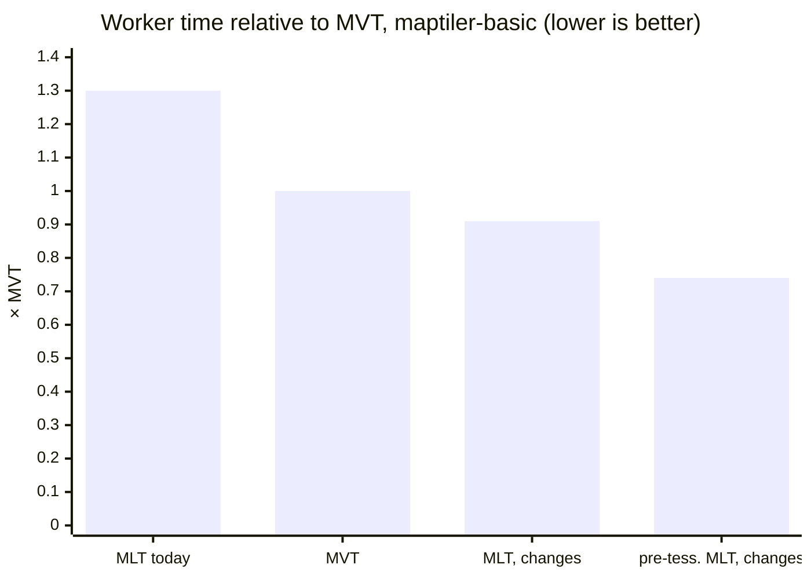

# Columnar MLT in MapLibre: overview

## The problem

GL JS `main` turns an MLT tile back into rows before it draws anything:

- every column of every layer is decoded
- every feature becomes a JavaScript object with copied properties
- the style filter runs per feature, as a generic expression
- every polygon goes through earcut, pre-tessellated ones too
- the decoded columns stay in memory while the tile is loaded

With `@maplibre/mlt` 1.3.0:

- worker time: **1.22-1.30× MVT**
- peak worker heap: **about 3× MVT**
- pre-tessellated tiles: **no gain**, their triangles are recomputed

## The idea

| Step | On `main` | With the changes |
|---|---|---|
| decode | every column of every layer | only the layers and columns that are read |
| filter | per feature, generic expression | planned once, a scan over typed columns |
| features | an object for every row | only the selected rows, properties as row views |
| polygons | earcut, pre-tessellated tiles too | triangles copied; earcut on the vertex buffer |
| after the parse | all decoded columns kept | decoded columns released |

## The result

| Worker time ÷ MVT | maptiler-basic | osm-bright | positron |
|---|---|---|---|
| MLT today (`main`, `@maplibre/mlt` 1.3.0) | 1.30× | 1.22× | not run |
| MLT with the changes | 0.91× | 0.91× | 0.92× |
| pre-tessellated MLT with the changes | 0.74× | 0.74× | 0.78× |
| MVT with the changes | 1.00× | 1.01× | 0.99× |

- MLT: **about 9 % less** worker time than MVT, pre-tessellated MLT **about 25 % less**
- MVT: unchanged
- peak worker heap, maptiler-basic: **173 → 61 MB** (MVT 80 MB)
- cost: worker bundle **+10.5 KB gzip (+7.1 %)**, main bundle +10.4 KB (+3.5 %), about 60 % of it `@maplibre/mlt`
- "MLT today": 7 November, Linux laptop; the other rows: 10 November, Windows workstation; every ratio
  formed inside one batch

Details, tile sizes and bandwidth: [results](results.md).

## What changes, what does not

| Changes | Does not change |
|---|---|
| `@maplibre/mlt`: selection vectors, filter engine, lazy decoding, adapter primitives, decoder speedups | the MLT format; the tiles the `main` decoder reads |
| GL JS worker: lazy MLT facade, per-layer dispatch, columnar fill, line and symbol buckets | renderer, shaders, main thread |
| `FillBucket`, `LineBucket`, `SymbolBucket`: `populate()` split into protected methods | MVT tiles: the existing code, unchanged |
| | circle, heatmap, fill-extrusion: row path |

- filter the engine cannot plan → that style layer falls back to its row bucket, one warning
- the other layers of the tile stay columnar

## The pages

| Page | Shows |
|---|---|
| [How a tile is parsed](architecture.md) | the worker's path before and after, who owns what |
| [@maplibre/mlt](mlt-package.md) | the five package changes, new API, behaviour changes |
| [MapLibre GL JS](gl-js.md) | facade, dispatch, buckets, touched files |
| [Results](results.md) | time, memory, tile size, bandwidth, bundle size, limits |
| [Decisions and open questions](decisions.md) | rules, trade-offs, rejected ideas, open questions, branches |

- one explainer page per change: [all explainer pages](../changes/index.md)
- RFCs: [`@maplibre/mlt`](https://github.com/maplibre/maplibre-tile-spec/issues/2010),
  [GL JS](https://github.com/maplibre/maplibre-gl-js/issues/8985)
