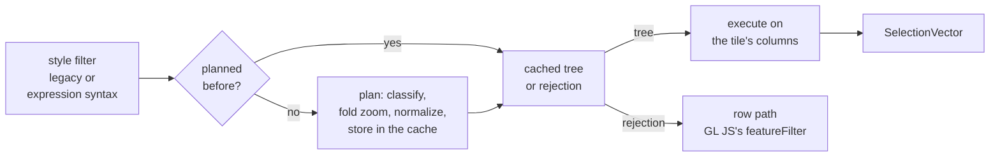
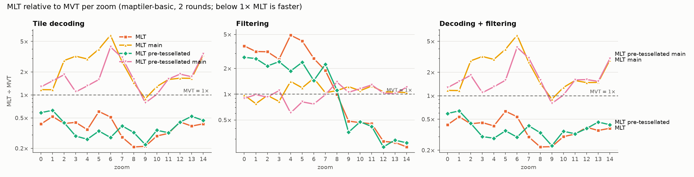
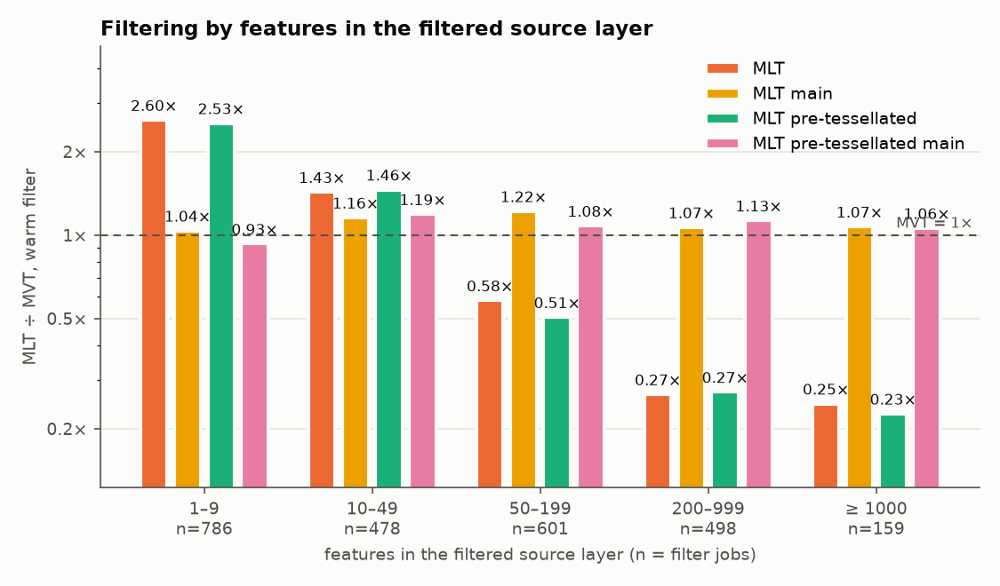

# @maplibre/mlt

- new: filter a decoded tile on its columns, read only the rows and columns that are drawn
- built on what `decodeTile()` already returns
- `getFeatures()`: same result as before

| # | Change | In one line |
|---|---|---|
| 1 | [Selection vectors](../changes/01-selection-vectors.md) | "which rows": a constant (all / none) or an ascending `Uint32Array`, with union, intersection, inversion |
| 2 | [Filter engine](../changes/02-filter-engine.md) | style filters planned once, cached, evaluated on the columns |
| 3 | [Lazy decoding](../changes/03-lazy-decoding.md) | column headers walked, a column's data decoded on first read |
| 4 | [Adapter primitives](../changes/04-adapter-primitives.md) | block scan, row view, MVT-compatible values: moved from GL JS into the package |
| 5 | [Decode performance](../changes/05-decode-performance.md) | the decoder's largest measured costs removed; `releaseDecodedColumns()` |

## Selection vectors

| Form | Holds | Allocates |
|---|---|---|
| `ConstSelectionVector` | all rows or no rows | nothing |
| `FlatSelectionVector` | ascending, duplicate-free `Uint32Array` | one index array |

- a filter's result is a set of rows; every later step narrows it
- results covering all or no rows collapse back to a constant → no filter, or one geometry type: no allocation
- `["all", a, b, c]` narrows one buffer in place
- `GeometryCollection` (`GeometryVector`, pre-tessellated `GpuVector`): `filter(type)` without a scan when the
  layer has one geometry type
- geometry and dictionary strings readable per row

## Filter engine

| Tier | When | Does |
|---|---|---|
| planning | once per filter object (and zoom, if it reads `["zoom"]`) | classify syntax, fold zoom tests, normalize into four node kinds, cache in a `WeakMap` |
| execution | once per tile and style layer | `all` narrows child by child, `any` unions; a kernel per column encoding |

| Column | Kernel |
|---|---|
| dictionary | each distinct value tested once |
| plain string | UTF-8 bytes compared, no decoding |
| numeric | raw typed array scanned |

- planned completely or rejected whole, never run in part
- style-spec type rules, not JavaScript's; the style spec's filter test suites run against it
- every filter in maptiler-basic, osm-bright and positron is supported
- GL JS calls only `isColumnarBucketSupported()` and `filterFeatureTable()`

## Lazy decoding

- `decodeTile()` walks every column header once and records offsets
- id and geometry: decoded on first access
- properties: per name, through `getPropertyVector(name)`
- `numFeatures`: from the header walk, no geometry decode
- `releaseDecodedColumns()`: decoded vectors dropped, offsets kept, a later read decodes again

## Adapter primitives

| Function | Does |
|---|---|
| `scanLayerBlocks(tile)` | each layer's name and bytes; cost grows only with the number of layers |
| `createRowView(table, row)` | a `Proxy` over one row; each property read decodes one column |
| `toMvtValue(value)` (internal) | a value as `@mapbox/vector-tile` reports it: 64-bit rounding, `null` as absent |

## Decode performance

| Round | Found | Fix |
|---|---|---|
| 1, Node profile | FastPFOR allocated a 64 KiB workspace per stream: 56.6 % of the decode's self time | one shared workspace |
| 2, browser traces | dictionary filters, bit reads, string operands, 64-bit ids, short names, `#private` | dedicated loop; shifts; operands encoded once; safe ids as numbers; no `TextDecoder` for short names; TS `private` |

## API changes

| New export | For |
|---|---|
| `filterFeatureTable` | planning and running a style filter on a `FeatureTable` |
| `isColumnarBucketSupported` | can this filter be planned? one warning per rejected filter |
| `SelectionVector`, `unionSelectionVectors`, `intersectSelectionVectors` | selections |
| `scanLayerBlocks`, `LayerBlock` | layers without decoding |
| `createRowView` | properties over one row |
| `SINGLE_PART_GEOMETRY_TYPE` | the type `geometryVector.filter()` takes |

| Behaviour change | Consequence |
|---|---|
| `decodeTile()` loses `idWithinMaxSafeInteger` | **breaking** for callers passing it; ids are numbers if all safe, `bigint` otherwise |
| a decoded table keeps the tile buffer alive | do not reuse or transfer the buffer while the table is in use |
| a corrupt column surfaces on first read | the header walk still checks each column stays inside its block |
| MAP columns are not lazy | no length in their layout: decoded and discarded by the walk |
| `getFeatures()` forces a full decode | GL JS `main` unchanged; the gain needs the columnar API |

- no general expression evaluator: paint and layout expressions stay in the style spec

## What it is worth on its own

Node, unzipped bytes → the point where GL JS writes vertices, 82 tiles around Cologne per style:

| Style | MLT `main` ÷ MVT | MLT ÷ MVT | MLT ÷ MLT `main` |
|---|---|---|---|
| maptiler-basic | 1.62× | 0.30× | 0.19× |
| osm-bright | 1.41× | 0.25× | 0.17× |
| positron | 1.64× | 0.32× | 0.20× |

- same features kept in all three formats, compared by id

*maptiler-basic per zoom, MLT ÷ MVT, log scale; below the dashed line MLT is faster. 2 rounds: read trends.*

- layers below about 50 features: the filter alone is slower than MVT's (fixed cost per filter)
- decoding + filtering: below MVT at every zoom

*The filter alone on decoded data, maptiler-basic, by size of the source layer.*
