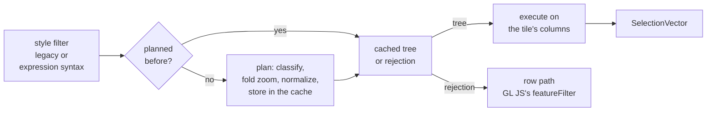

# @maplibre/mlt

The package gains the ability to be read column by column: a consumer can filter a decoded tile on its
columns and read only the rows and columns it draws. Everything works on what `decodeTile()` already
produces, and `getFeatures()` returns the same result as before.

Five changes, stacked in this order:

| # | Change | In one sentence |
|---|---|---|
| 1 | [Selection vectors](../changes/01-selection-vectors.md) | "which rows" as a constant (all or none, no allocation) or an ascending `Uint32Array`, with union, intersection and inversion |
| 2 | [Filter engine](../changes/02-filter-engine.md) | style filters planned once into a small typed tree, cached, and evaluated on the columns |
| 3 | [Lazy decoding](../changes/03-lazy-decoding.md) | `decodeTile()` walks the column headers and decodes a column's data on first read |
| 4 | [Adapter primitives](../changes/04-adapter-primitives.md) | block scan, row view and MVT-compatible values moved from GL JS into the package |
| 5 | [Decode performance](../changes/05-decode-performance.md) | the decoder's largest measured costs removed, and `releaseDecodedColumns()` |

## Selection vectors

A columnar filter does not produce features, it produces a set of rows, and every later step narrows it. Two
forms make that cheap: `ConstSelectionVector` for "all rows" or "no rows", and `FlatSelectionVector`, an
ascending, duplicate-free `Uint32Array`. Every operation collapses its result back to a constant when it covers
all or no rows, so a layer without a filter, or a source layer of a single geometry type, never allocates an
index array. `["all", a, b, c]` narrows one buffer in place.

The geometry vectors (`GeometryVector` and the pre-tessellated `GpuVector`) share a `GeometryCollection`
interface whose `filter(type)` answers without a scan when the layer holds one geometry type. Geometry and
dictionary strings can now be read for a single row.

*The vector layer of the package: the two selection forms and their algebra, the shared geometry interface,
and the per-row readers for geometry and dictionary strings.*

## Filter engine

Most of a filter's cost depends on the filter, not on the tile, so the engine works in two tiers:

- **Planning**, once per filter object (and zoom, if it reads `["zoom"]`): classify legacy or expression
  syntax, fold zoom tests, normalize both syntaxes into one tree of four node kinds (`constant`, `leaf`,
  `compound`, `type-check`). Plans and rejections are cached in a `WeakMap` keyed by the filter object.
- **Execution**, once per tile and style layer: `all` narrows from child to child, `any` unions the children's
  results. Each leaf picks a kernel by column encoding: dictionary columns test each distinct value once,
  plain strings compare UTF-8 bytes without decoding, numeric columns scan the raw typed array.

*The filter engine's modules. GL JS calls only `isColumnarBucketSupported()` and `filterFeatureTable()`.*

A filter is planned completely or rejected whole, never run in part. The engine follows the style spec's type
rules, not JavaScript's, and the style spec's filter test suites are ported and run against it. Every filter
in maptiler-basic, osm-bright and positron is supported.

## Lazy decoding

A column's position is only known by walking past the columns before it, so `decodeTile()` walks every header
once and records each column's offset. Id and geometry are decoded on first access, property columns by name
through `getPropertyVector(name)`. `numFeatures` comes from the header walk, so it never forces a geometry
decode.

`FeatureTable.releaseDecodedColumns()` reverses it: the decoded vectors are dropped, the offsets kept, and a
later read decodes again from the bytes.

*`FeatureTable`: each column field holds either a lazy record (bytes and offset) or the decoded vector.*

## Adapter primitives

Three functions that are format knowledge, not GL JS knowledge:

- `scanLayerBlocks(tile)`: each layer's name and bytes, without decoding a column. Its cost grows with the
  number of layers only.
- `createRowView(table, row)`: a `Proxy` over one row whose property reads decode one column each.
  Enumerating it (`Object.keys`, spread) works and decodes the rest.
- `toMvtValue(value)`, internal, used by the row view: a decoded value as `@mapbox/vector-tile` would report
  it, so a 64-bit integer outside the safe range is rounded as MVT rounds it and `null` counts as absent.

## Decode performance

Two rounds of profile-driven changes, each measured on its own. The largest single find: the FastPFOR decoder
allocated a 64 KiB workspace per stream, 56.6 % of the decode's self time; it now shares one. The second round
took its targets from browser traces: a dedicated loop for dictionary filters, bit reads with shifts, string
operands encoded once per session, safe 64-bit ids decoded as numbers, short names decoded without
`TextDecoder`, and TS `private` instead of `#private` (which compiled to `WeakMap` lookups for ES2020).

## API changes

New exports:

| Export | For |
|---|---|
| `filterFeatureTable` | planning and running a style filter on a `FeatureTable` |
| `isColumnarBucketSupported` | asking whether a filter can be planned, with one warning per rejected filter |
| `SelectionVector`, `unionSelectionVectors`, `intersectSelectionVectors` | working with selections |
| `scanLayerBlocks`, `LayerBlock` | finding layers without decoding |
| `createRowView` | a properties object over one row |
| `SINGLE_PART_GEOMETRY_TYPE` | the type `geometryVector.filter()` takes; a multi-part feature matches its single-part type |

Behaviour a maintainer should know about:

| Change | Consequence |
|---|---|
| `decodeTile()`'s `idWithinMaxSafeInteger` parameter is removed | **breaking** for callers that pass it; ids are numbers when every value is a safe integer, `bigint` otherwise |
| a decoded table keeps the tile buffer alive | the caller must not reuse or transfer the buffer while the table is in use |
| a corrupt column is reported on first read, not in `decodeTile()` | the header walk still checks that each column stays inside its block |
| MAP columns are not lazy | their layout has no length, so the walk decodes and discards them |
| `getFeatures()` forces a full decode | linked into current GL JS `main`, nothing changes; the gain needs the columnar API |

A general expression evaluator is not part of this. Paint and layout expressions stay in the style spec.

## What it is worth on its own

In Node, from the unzipped tile bytes to the point where GL JS would write vertices (decoding, every
style-layer filter once, the columns the bucket reads), 82 tiles around Cologne per style:

| Style | MLT `main` ÷ MVT | MLT ÷ MVT | MLT ÷ MLT `main` |
|---|---|---|---|
| maptiler-basic | 1.62× | 0.30× | 0.19× |
| osm-bright | 1.41× | 0.25× | 0.17× |
| positron | 1.64× | 0.32× | 0.20× |

Every filter job keeps the same features in all three formats, compared by feature id.

*maptiler-basic per zoom level, MLT ÷ MVT on a log scale; below the dashed line MLT is faster. "MLT main" is
the tile spec's `main` read through GL JS `main`. Only 2 measured rounds: read the trends, not single
points.*

The columnar filter has a fixed cost per filter, so on source layers with fewer than about 50 features the
filter alone is slower than MVT's row filter; decoding and filtering together stay below MVT at every zoom
level.

*The filter alone on already decoded data, maptiler-basic, by size of the filtered source layer.*
