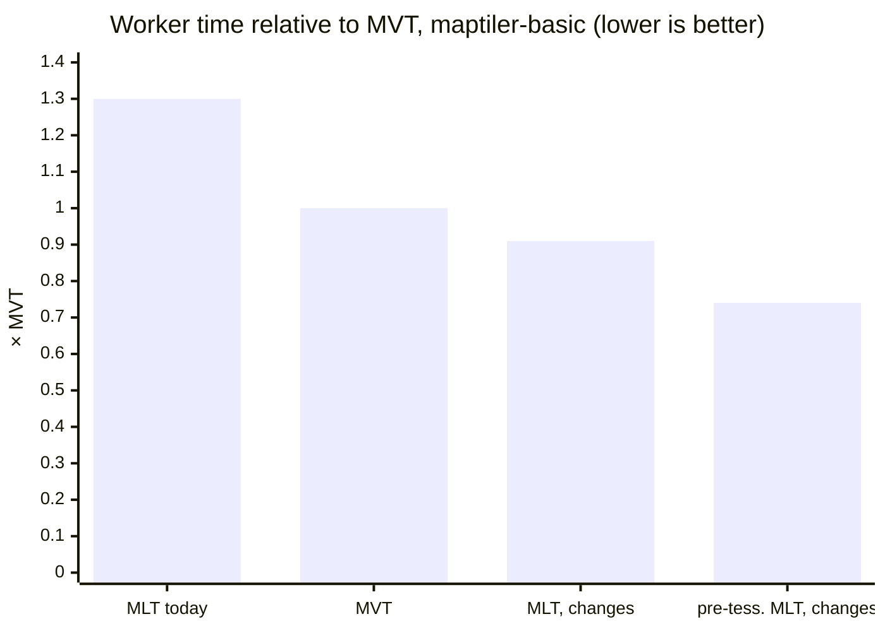
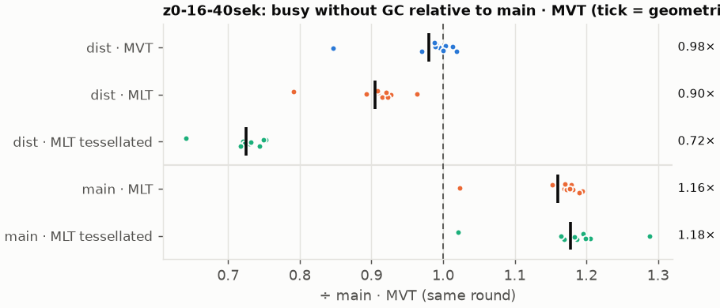
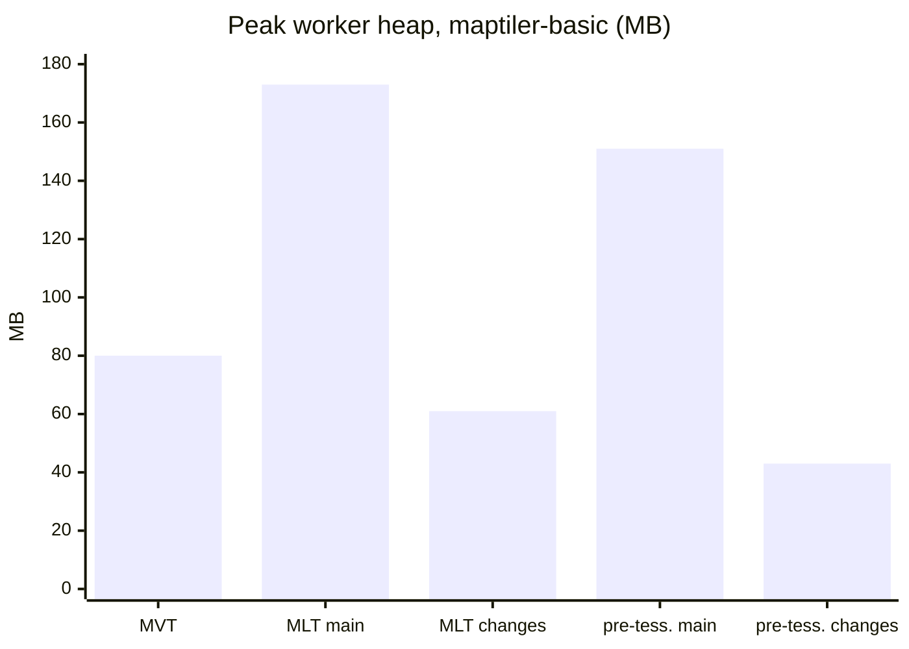
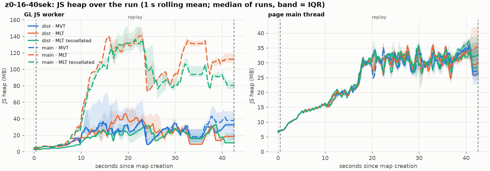

# Results

## In short

| Worker time ÷ MVT | maptiler-basic | osm-bright | positron |
|---|---|---|---|
| MVT, with or without the changes | 1.00× | 1.00× | 1.00× |
| MLT today (GL JS `main`, `@maplibre/mlt` 1.3.0) | 1.30× | 1.22× | not run |
| MLT with the changes | 0.91× | 0.91× | 0.92× |
| pre-tessellated MLT with the changes | 0.74× | 0.74× | 0.78× |

- today: MLT needs **22-30 % more** worker time than MVT
- with the changes: MLT **about 9 % less**, pre-tessellated MLT **about 25 % less**
- MVT: unchanged (0.99-1.01×)
- measure: worker busy time without GC, recorded 42 s session z0-z16, replayed in Chromium, median of 10 runs
- "MLT today": 7 November, Linux laptop; other rows: 10 November, Windows workstation; each ratio inside one
  batch
- download size differs per format: [tile size and bandwidth](#tile-size-and-bandwidth)

## In detail

| Style | MLT ÷ MVT, `main` with 1.3.0 | MLT ÷ MVT, `main` with the tile-spec changes | MLT ÷ MVT, all changes | pre-tess. MLT ÷ MVT, all changes | MLT speedup from the GL JS changes | pre-tess. MLT speedup from the GL JS changes |
|---|---|---|---|---|---|---|
| maptiler-basic | 1.30× (1.25-1.32) | 1.17× (1.15-1.19) | 0.91× (0.90-0.93) | 0.74× (0.72-0.75) | 1.29× | 1.61× |
| osm-bright | 1.22× (1.21-1.23) | 1.12× (1.10-1.15) | 0.91× (0.89-0.93) | 0.74× (0.72-0.75) | 1.23× | 1.55× |
| positron | not run | 1.19× (1.17-1.21) | 0.92× (0.90-0.93) | 0.78× (0.77-0.80) | 1.30× | 1.55× |

- ratios of medians against MVT on `main` in the same batch; 95 % bootstrap confidence interval in brackets
- `main` = GL JS `bb3895408`; "tile-spec changes" = `@maplibre/mlt` `85738fbf` (all five changes, earlier
  commit)
- tile-spec changes alone: MLT still 1.12-1.19× MVT, since `main` still builds a feature object per row
- pre-tessellated MLT on `main`: 1.15-1.22× MVT, its triangles are recomputed
- MVT with the changes: 1.00×, 1.01×, 0.99×, every interval inside 0.98-1.02 → the row buckets' split costs
  nothing

*maptiler-basic, 10 November. A dot per run, the bar is the geometric mean. `dist` = GL JS with the changes,
`main` = GL JS `main` with the tile-spec changes; all against MVT on `main` in the same round.*

## Where it comes from

maptiler-basic, 10 November, medians; `main` already has the tile-spec changes:

| | MVT, `main` | MLT, `main` | MLT, changes | pre-tess. MLT, `main` | pre-tess. MLT, changes |
|---|---|---|---|---|---|
| worker busy time without GC | 1,461 ms | 1,711 ms | 1,330 ms | 1,731 ms | **1,074 ms** |
| tile decoding | 127 ms | 196 ms | 110 ms | 218 ms | 138 ms |
| reading decoded data (feature objects, row views, facade) | – | 187 ms | 31 ms | 184 ms | 30 ms |
| fill and line buckets, incl. earcut | 602 ms | 602 ms | 505 ms | 595 ms | **235 ms** |
| memory freed by the worker's GCs | 1,421 MB | 1,544 MB | 1,051 MB | 1,554 MB | 570 MB |
| peak worker heap | 80 MB | 173 MB | 61 MB | 151 MB | **43 MB** |

*Worker heap over the session (left), 1 s rolling mean. `main` (dashed): MLT climbs to about 140 MB, MVT below
45 MB. With the changes (solid): every format within MVT's range.*

| Gain | From |
|---|---|
| decoding 196 → 110 ms | lazy layers and columns; `main` with 1.3.0: 426 ms (7 November) |
| reading decoded data 187 → 31 ms | no feature object per row; only selected rows, through row views |
| fill and line buckets 602 → 505 ms, pre-tessellated 235 ms | triangles copied, earcut on the vertex buffer, only selected rows |
| peak heap 173 → 61 MB | the release after each parse; no per-feature objects |
| filtering about equal to MVT | the gain is what is not built after the filter |

- filtering: 32 ms MLT vs. 37 ms MVT, plus 21 ms decoding the filtered columns
- symbol layout and transfer: about equal in every format
- feature index: 50 → 33 ms

## Tile size and bandwidth

NRW, OpenMapTiles schema, each tile gzipped as a server sends it; MLT at the encoder's maximum compression:

| | MVT | plain MLT | pre-tessellated MLT |
|---|---|---|---|
| tiles of one session replay (191, z0-16) | 10.5 MB | 8.7 MB (0.83×) | 11.4 MB (1.09×) |
| mean tile, session | 55.8 kB | 46.4 kB | 60.6 kB |
| whole tileset, z0-16 (352,409 tiles) | 1.62 GB | 1.47 GB (0.91×) | 1.76 GB (1.09×) |
| mean tile, tileset | 4.6 kB | 4.2 kB | 5.0 kB |

| Zoom | plain MLT vs. MVT | pre-tessellated MLT vs. MVT |
|---|---|---|
| z0-z4 | up to 7 % larger | 2-2.6× at z0-z3 |
| z6-z13 | 4-14 % smaller | 23-40 % larger |
| z14-z16 | 4-14 % smaller | 1-12 % larger |

**Download + worker time** for the session's tiles (worker busy time including GC: MVT 1.56 s, MLT 1.42 s,
pre-tessellated 1.14 s):

| Bandwidth | MVT | plain MLT | pre-tessellated MLT |
|---|---|---|---|
| low, 1.6 Mbit/s (Chrome "Slow 4G") | 53.9 s | **44.9 s** | 58.0 s |
| average, 10 Mbit/s | 9.94 s | **8.38 s** | 10.24 s |
| high, 100 Mbit/s | 2.39 s | 2.11 s | **2.05 s** |

| Break-even of pre-tessellated MLT | against MVT | against plain MLT |
|---|---|---|
| this workstation | about 17 Mbit/s | about 77 Mbit/s |
| CPU 4× slower | about 4 Mbit/s | about 19 Mbit/s |

- plain MLT: **ahead at every bandwidth**, fewer bytes and less worker time
- pre-tessellated MLT: less worker time, more bytes
- break-even: `8 · Δsize / B = Δworker time`, e.g. 7.2 Mbit / 0.419 s ≈ 17 Mbit/s
- the model is a sum: no parallel downloads, no overlap with parsing, no cache → shows the trade-off, not a
  user's wait

## What it costs in size

- `@maplibre/mlt` `71f20ee8` → `feat5-decode-performance`; GL JS `bb3895408` with 1.3.0 →
  `gl7-performance-optimization` with the tile-spec head
- GL JS head built without the benchmark timing log (not part of the proposal)
- bytes; gzip at default level, as GL JS's `build/check-bundle-size.ts`

**GL JS production bundles** (`npm run build-prod`):

| Bundle | | `main` | changes | difference |
|---|---|---|---|---|
| `maplibre-gl-worker.mjs` | minified | 519,352 | 553,404 | +34,052 (+6.6 %) |
| | gzip | 148,324 | 158,855 | **+10,531 (+7.1 %)** |
| | brotli | 121,465 | 129,745 | +8,280 (+6.8 %) |
| `maplibre-gl.mjs` | minified | 1,107,256 | 1,141,124 | +33,868 (+3.1 %) |
| | gzip | 296,233 | 306,613 | **+10,380 (+3.5 %)** |
| | brotli | 241,216 | 249,282 | +8,066 (+3.3 %) |

- main bundle grows too: bucket classes (deserialization) and `MLTVectorTile` for `queryRenderedFeatures`

**Worker bundle growth by source** (minified bytes, via the source map):

| Source | `main` | changes | difference |
|---|---|---|---|
| `@maplibre/mlt` | 65,852 | 87,086 | +21,234 |
| GL JS `src/data/bucket/columnar/` | 0 | 9,372 | +9,372 |
| GL JS `src/source/vector_tile_mlt.ts` | 886 | 3,356 | +2,470 |
| GL JS, rest of `src/` (bucket splits, dispatch) | 240,731 | 241,671 | +940 |
| other dependencies | 210,797 | 210,802 | +5 |

- about 60 % tile spec, about 40 % GL JS

**`@maplibre/mlt` on its own:**

| | `71f20ee8` | `feat5-decode-performance` | difference |
|---|---|---|---|
| public API, minified | 80,970 | 102,447 | +21,477 (+26.5 %) |
| public API, gzip | 21,336 | 27,299 | **+5,963 (+27.9 %)** |
| `dist/` JavaScript, unminified | 374,372 | 440,054 | +65,682 (+17.5 %) |
| `dist/` type declarations | 73,065 | 86,803 | +13,738 (+18.8 %) |

- public API includes the encoder, which GL JS does not import → GL JS carries 66-87 KB, not 81-102 KB

**Source lines**, without tests:

| Package | before | after | difference | per change |
|---|---|---|---|---|
| `@maplibre/mlt` `ts/src/` | 11,462 | 13,420 | +1,958 (+17.1 %) | selection vectors +354, filter engine +1,022, lazy decoding +363, adapter primitives +94, decode performance +125 |
| GL JS `src/` | 72,780 | 74,025 | +1,245 (+1.7 %) | facade +92, dispatch +42, populate pipeline +120, fill bucket +693, line bucket +74, symbol bucket +98, worker performance +126 |

- filter engine: half of the tile-spec growth; fill bucket: more than half of the GL JS growth
  (`columnar_mesh_arrays.ts`: 476 lines)
- GL JS counted without the timing log (148 lines)
- tests and benchmarks: +1,949 lines tile spec, +1,833 GL JS
- baselines not byte-identical: GL JS uses 1.3.0 from npm, the tile spec `71f20ee8`

## How it was measured

| Benchmark | Runs in | Measures | Used for |
|---|---|---|---|
| filter benchmark | Node | one tile, unzipped bytes → where GL JS writes vertices | `@maplibre/mlt` changes |
| session traces | Chromium, headed | recorded camera path replayed with tracing: busy time by category and function, heap, GC | GL JS changes, the numbers above |
| NRW parse benchmark | Node (vitest) | twelve z12 Cologne tiles through `WorkerTile.parse()` | before/after a single GL JS change |

- three formats on the same NRW tiles: MVT, plain MLT, pre-tessellated MLT
- ratios only inside one batch, at least 10 runs: absolute times of identical code moved by a third between
  days
- details: [how it was measured](../changes/13-measuring.md)

## Limits

- **Two machines:** changes on a Windows 11 workstation (Core Ultra 9 285K); 1.3.0 baseline only on a
  Ryzen 7 5800H Linux laptop; no ratio across the two
- **Timing log:** off in the 10 November batches; on in the 7 November batches (about 1.5-3 % of worker time,
  every format)
- **One region, one schema:** NRW, OpenMapTiles
- **One browser:** Chromium via Playwright; no Firefox, Safari, mobile
- **Small layers:** below about 50 features the columnar filter alone is slower than the row filter
- **Main-thread heap:** 2-5 MB more with MLT at the end of the replay, wide intervals, cause unknown
